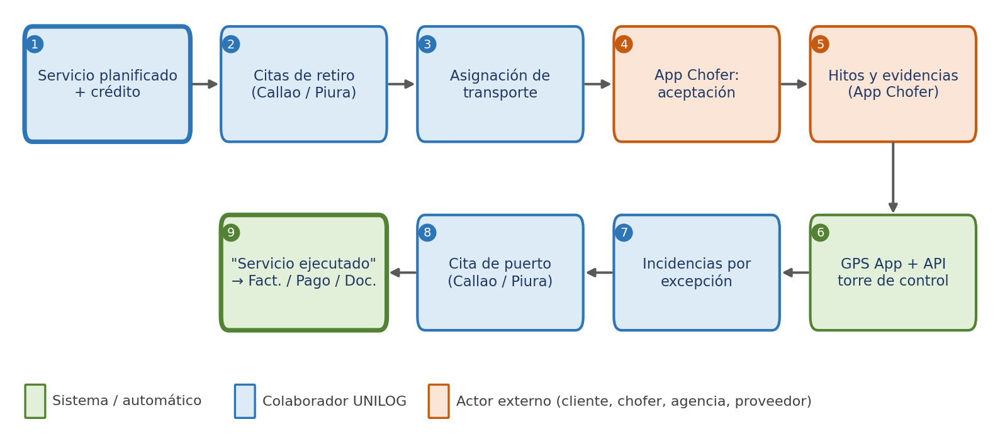

# Fuente — PRD del Módulo de Transportes (TO BE)

> **Tipo:** documento fuente de la Fase 1 (insumo, no artefacto de la cadena SDLC)
> **Original:** `PRD_MODULO_TRANSPORTES.docx` · clasificación: documento confidencial — UNILOG
> **Conversión:** pandoc 2026-09-24, sin edición del contenido funcional salvo quitar la tabla de contenidos de Word. **Actualización 2026-09-28:** versión del propietario modificada el 2026-09-26 (revisión 188 del .docx); solo cambia la fila RF-PLA-000 de la §13.1 —ahora HU-PLA-000.1 a 000.3 con CA-PLA-000.1 a 000.9 y seis criterios que la fuente numera todos «CA-PLA-001.1»—, transcrita desde el .docx sin corregir su texto. El resto del documento no cambia de contenido; análisis del impacto en [PRD-SIL-001 v0.5.0](../prd-sil-001.es.md#13-historial-de-cambios)
> **Uso en este repositorio:** línea base del fit-gap con LOGAWARE ([ADR-SIL-001](../../../reference/architecture/adrs/SIL-001-integracion-sil-tms-logaware.es.md)) y fuente de los requisitos RF-EJE que construye SIL en el [PRD-SIL-001](../prd-sil-001.es.md)
> **Estado:** tal como lo entregó el propietario; las correcciones se piden al dueño del documento ([G-020](../../../GAPS.md))

---

## PROCESO DE EJECUCIÓN

Ejecución y trazabilidad del servicio de transporte y embarque: asignación, App Transporte, hitos, GPS, incidencias, evidencias y cierre

| **Documento padre** | **PRD Sistema UNILOG — Modelo TO BE v1.0** |
|----|----|
| **Módulo** | Módulo de Transportes |
| **Sedes** | Callao y Piura |
| **Audiencia** | Proveedor externo de desarrollo; equipos de TI, producto y dueños de proceso de UNILOG |
| **Clasificación** | Documento confidencial — UNILOG |

## 1. Introducción y convenciones

### 1.1 Propósito del documento

Este documento describe el **Módulo de Transportes** del Sistema UNILOG en su modelo futuro (TO BE): qué hará el sistema, quién lo usará, qué automatizará, qué validará, qué alertas generará, con qué sistemas se integrará y cómo se aceptará cada requerimiento.

### 1.2 Convenciones

<table style="width:99%;">
<colgroup>
<col style="width: 25%" />
<col style="width: 73%" />
</colgroup>
<thead>
<tr>
<th><strong>Elemento</strong></th>
<th><strong>Convención</strong></th>
</tr>
</thead>
<tbody>
<tr>
<td>Identificadores</td>
<td>RF-EJE-001 (requerimiento) · HU-EJE-001 (historia de usuario) · CA-EJE-001.1 (criterio de aceptación, formato "Dado… cuando… entonces…").</td>
</tr>
<tr>
<td><strong>Estado de validación</strong></td>
<td><ul>
<li>
<strong>Confirmado:</strong> sustentado en las definiciones validadas del proceso TO BE.
</li>
<li>
<strong>Por validar:</strong> necesidad implícita indispensable o alcance aún no confirmado por UNILOG.
</li>
</ul></td>
</tr>
<tr>
<td><strong>Tipo de automatización</strong></td>
<td><ul>
<li>
<strong>Automática:</strong> la ejecuta el sistema.
</li>
<li>
<strong>Semiautomática:</strong> el sistema prepara y un usuario confirma o completa.
</li>
<li>
<strong>Asistida por usuario:</strong> el usuario registra con apoyo del sistema.
</li>
<li>
<strong>Actor externo:</strong> la registra cliente, chofer, agencia o proveedor.
</li>
<li>
<strong>Excepción:</strong> interviene un usuario solo cuando hay una desviación.
</li>
</ul></td>
</tr>
<tr>
<td><strong>Estado técnico de integración</strong></td>
<td><ul>
<li>
<strong>Componente de la solución:</strong> parte del Sistema, portales o App.
</li>
<li>
<strong>Integración requerida / por definir técnicamente:</strong> necesaria, sin definición técnica confirmada.
</li>
<li>
<strong>Registro o carga asistida:</strong> el usuario registra la información de un sistema externo con evidencia.
</li>
</ul></td>
</tr>
<tr>
<td><strong>Tipo de alerta</strong></td>
<td><ul>
<li>
<strong>Crítica (Rojo):</strong> requiere acción inmediata.
</li>
<li>
<strong>Advertencia (Amarillo):</strong> requiere acción dentro de un plazo.
</li>
<li>
<strong>Informativa (Verde):</strong> comunica un evento; no requiere acción.
</li>
</ul></td>
</tr>
<tr>
<td><strong>Parámetros</strong></td>
<td>Los plazos, umbrales y metas sin valor en las fuentes se indican "por definir durante implementación".</td>
</tr>
</tbody>
</table>

## 2. Objetivo del módulo

El Módulo de Transportes gestiona y traza de extremo a extremo el servicio de transporte y embarque, desde que el servicio queda planificado hasta que el sistema lo marca como **"Servicio ejecutado"**. Resuelve la capacidad de negocio de gestionar citas, asignar el transporte, entregar instrucciones digitales al transportista, registrar en tiempo real los hitos operativos desde la App Transporte, centralizar la ubicación GPS dentro del Sistema UNILOG, gestionar incidencias por excepción y dar visibilidad directa al cliente.

Este módulo cumple la función de **TMS** del Sistema UNILOG.

### 2.1 Resultados que entrega el módulo

- Servicio asignado y aceptado por el chofer.

- Citas de retiro y de puerto integradas al servicio.

- Hitos, evidencias, ubicación e incidencias en tiempo real.

- Monitoreo por excepción con alertas y temporizadores.

- Trazabilidad visible y descargable en el Portal Cliente.

- Extraordinarios valorizados con sustento.

- Cierre operativo automático e información enviada a Cliente, Facturación, Pago y Documentario.

## 3. Alcance funcional

### 3.1 Funcionalidades incluidas

| **Funcionalidad** | **Descripción** | **Requerimientos** |
|----|----|----|
| **Bandeja y habilitación del servicio** | Servicios planificados, condición de crédito y pago previo. | RF-EJE-001, 002 |
| **Gestión de citas** | Cita de retiro y puerto serán subidas por el Asistente/Coordinador de Transporte respectivamente. | RF-EJE-003 |
| **Asignación de transporte** | Propuesta y confirmación, asignación automática, costo de transporte en PV. | RF-EJE-004, 005 |
| **App Transporte e instrucciones** | Sincronización y aceptación, documentos digitales, Portal Proveedor, acceso y consentimiento. | RF-EJE-006 a 008 |
| **Gestión de hitos** | Checks con metadatos, control de secuencia y geocercas, operación sin conexión, llenado, aforo y precintos. | RF-EJE-009 a 012 |
| **Gestión de suministros en ejecución** | Entrega física de los suministros del servicio según la sede, registro en la App Transporte de los suministros utilizados (código, cantidad y fotografías) y trazabilidad del consumo en el expediente. | RF-EJE-013 |
| **Cierre de contenedor y trazabilidad documentaria** | Registro del cierre del contenedor en la App Transporte, migración automática del evento al Módulo Documentario y carga de los certificados del servicio (SENASA / fumigación) por el Customer Service en VUCE. | RF-EJE-014 |
| **Evidencias digitales** | Fotografías vinculadas por hito, ticket de balanza y peso, y guía de remisión (por validar). | RF-EJE-015 a 017 |
| **Trazabilidad GPS** | GPS de la App, APIs GPS de transportistas, normalización. | RF-EJE-018 a 020 |
| **Arquitectura de integración y seguridad** | Capa de integración / API Gateway, credenciales y monitoreo, trazabilidad end-to-end, roles y permisos. | RF-EJE-021 a 024 |
| **Torre de control** | Mapa, temporizadores de hitos, desviaciones y pérdida de señal. | RF-EJE-025 a 027 |
| **Gestión de incidencias** | Reporte desde la App y gestión hasta el cierre. | RF-EJE-028, 029 |
| **Trazabilidad para el cliente** | Portal Cliente en tiempo real, descargas, consulta por hito, informes automáticos. | RF-EJE-030, 031 |
| **Servicios extraordinarios** | Registro con sustento y envío a Facturación y Pago. | RF-EJE-032 |
| **Cierre de ejecución** | "Servicio ejecutado" y traslado a Facturación, Pago y Documentario. | RF-EJE-033, 034 |

### 3.2 Fuera del alcance de este módulo

| **Tema** | **Dónde se atiende** |
|----|----|
| Planificación del servicio, servicios adicionales, carta de temperatura y reserva de suministros | Módulo de Planificación |
| Homologación y habilitación de proveedores, unidades y conductores | Módulo Proveedores. Ejecución consume proveedores habilitados. |
| Aprobación y pago de anticipos; liquidación y pago a proveedores | Módulo Pago. |
| Documentos post embarque (draft BL, DAM, envío documental) | Módulo Documentario. |
| Facturación de sobrecostos al cliente | Módulo de Facturación. |
| Devolución de contenedores vacíos | Web depot |
| Transmisiones SUNAT (IMPO / EXPO, levante, guías de salida), precitas portuarias, IoT y control de accesos | Web Externa |

## 4. Roles y usuarios

### 4.1 Roles que interactúan con el módulo

| **Rol** | **Tipo / canal** | **Responsabilidades en el módulo** | **Permisos** |
|----|----|----|----|
| **Coordinador de Transporte (Callao / Piura)** | Interno · Sistema Unilog | Revisa servicios planificados; asigna transporte; registra cita de puerto (Callao); monitorea por excepción; gestiona incidencias operativas y extraordinarios; aprueba excepciones de cierre. | Crear, editar, aprobar |
| **Asistente de Transporte (Callao / Piura)** | Interno · Sistema | Valida crédito y activo pago previo; registra cita de retiro (Callao) o da seguimiento (Piura); apoya asignación y monitoreo; carga certificados; supervisa evidencias e informes. | Crear, editar |
| **Chofer** | Externo · App Transporte | Acepta la cita; sube al sistema información de los suministros y precintos usados en el servicio, confirma lectura de documentos; registra hitos, evidencias, ticket de peso, guía de remisión e incidencias. | Registrar en servicios asignados |
| **Proveedor de transporte** | Externo · Portal Proveedor | Consulta servicios asignados, citas, documentos, hitos e incidencias de sus unidades. | Consulta de lo propio |
| **Cliente** | Externo · Portal Cliente | Consulta trazabilidad, ubicación, hitos, incidencias y evidencias; descarga reportes; recibe informes. | Consulta de lo propio |
| **Customer Service** | Interno · Sistema Unilog | Gestiona incidencias administrativas, documentarias, SENASA y cambio de contenedor; recibe notificación de "Servicio ejecutado" con ticket de peso. | Crear, editar incidencias asignadas |
| **Coordinador Administrativo Cliente / Proveedor** | Interno · Sistema Unilog | Reciben el servicio ejecutado, extraordinarios y costos. | Consulta |
| **Jefatura** | Interno · Sistema Unilog | Recibe escalamientos de incidencias fuera de SLA. | Consulta |
| **Administrador del sistema** | Interno · Sistema Unilog | Configura catálogos (hitos, incidencias, evidencias), parámetros, reglas de asignación, integraciones y permisos. | Configuración |
| **Sistema / APIs externas** | Automático | Sincroniza App, normaliza GPS, calcula temporizadores, genera alertas, cambia estados y publica eventos. | — |

### 4.2 Origen de la información durante la ejecución

La siguiente tabla diferencia qué información registra el chofer, qué genera el sistema, qué se obtiene por APIs externas y qué requiere la intervención de un colaborador.

| **Origen** | **Información** |
|----|----|
| **Generada por el chofer (App Transporte)** | Aceptación o rechazo de la cita; confirmación de lectura; checks points de hitos; N° de contenedor; N° y foto de precintos; fotos de llenado, confirmación de código de suministros (filtros – termorregistros), entrega; ticket de balanza y peso; guía de remisión; reporte de incidencias con comentario y fotos.; registro de los suministros utilizados (código, cantidad y fotografías) y registro del cierre del contenedor. |
| **Generada automáticamente por el sistema** | Fecha, hora, usuario, unidad, conductor y coordenadas de cada check; hora objetivo de hitos y semáforo; alertas de demora, desviación y pérdida de señal; costo de transporte en PV; cambios de estado ("En ejecución", "Con incidente", "Servicio ejecutado"); cierre operativo; informes; publicación a Facturación, Pago y Documentario; bitácora.; vinculación del consumo de suministros al servicio y migración automática del evento de cierre de contenedor al Módulo Documentario. |
| **Obtenida mediante APIs externas** | Posiciones y eventos de las plataformas GPS de las empresas de transporte (por placa); en el futuro integraciones con Webs externas (datos de depósitos, terminales o navieras cuando existan APIs (por definir técnicamente). |
| **Registrada por actores externos en portales** | Citas de retiro y de puerto en Piura (Agencia de Aduanas en coordinación con el Coordinador/Asistente de Transporte); programación de aforo (cuando aplique). En Piura, la Agencia de Aduanas recibe y distribuye los suministros a las empresas de transporte. Por ende, el chofer se encargará de subir la información de los suministros a la App. |
| **Validaciones y registros que requieren intervención del colaborador** | Confirmación de asignación; registro de citas en Callao; carga de certificados; aprobación de anulación de hitos; gestión y cierre de incidencias; registro y clasificación de extraordinarios; aprobación de excepciones de cierre; solicitud de nueva evidencia. |

## 5. Flujo TO BE del módulo

### 5.1 Vista general

*Figura 1. Flujo TO BE resumido del Módulo de Transportes. Color de cada paso según quién lo ejecuta.*

### 5.2 Secuencia de actividades

| **\#** | **Actividad** | **Ejecutor** | **Tipo** | **Resultado** | **RF** |
|:--:|----|----|----|----|----|
| **1** | Recibir servicio planificado en la bandeja y validar condición de crédito; activar pago previo si corresponde | Coordinador / Asistente de Transporte + Sistema | Semiautomática | Servicio listo para citas y asignación | RF-EJE-001, 002 |
| **2** | Registrar código de cita de retiro del vacío | Asistente de Transporte | Semiautomática | Cita en expediente y App Transporte | RF-EJE-003 |
| **3** | Proponer y confirmar asignación de proveedor, unidad y conductor | Sistema + Coordinador de Transporte | Semiautomática | Asignación enviada | RF-EJE-004 |
| **4** | Sincronizar con App Transporte; el chofer acepta; costo de transporte al PV; estado "En ejecución" | Sistema + Chofer | Automática / Actor externo | Asignación aceptada | RF-EJE-005, 006 |
| **5** | Publicar documentos e instrucciones; confirmar lectura | Sistema + Chofer | Automática | Documentos confirmados | RF-EJE-007, 008 |
| **6** | Registrar hitos: ingreso a depósito, N° de contenedor, salida, llegada a planta | Chofer | Actor externo | Hitos con metadatos | RF-EJE-009 a 011 |
| **6.1** | Registrar en la App Transporte los suministros utilizados: código, cantidad y fotografías (inmediatamente después del hito "Llegada a planta del cliente") | Chofer (empresa de transporte) | Actor externo | Consumo de suministros trazado en el expediente | RF-EJE-013 |
| **7** | Llenado / aforo y precintos; certificados | Chofer / Asistente de Transporte | Actor externo / Asistida por usuario | Precintos y certificados en expediente | RF-EJE-012 |
| **7.1** | Registrar el cierre del contenedor en la App Transporte; el sistema publica el evento en el Módulo Documentario | Chofer + Sistema | Actor externo / Automática | Evento de cierre disponible para el Customer Service (VUCE / certificados SENASA) | RF-EJE-014 |
| **8** | Registrar cita de puerto | Coordinador de Transporte | Semiautomática | Cita de puerto confirmada | RF-EJE-003 |
| **9** | Evidencias de salida de planta y guía de remisión; inicio de traslado a IP; ingreso a balanza; ticket de peso | Chofer | Actor externo | Evidencias y peso | RF-EJE-015 a 017 |
| **P** | En paralelo: ubicación App + API GPS, normalización, mapa, temporizadores, desviaciones, informes al cliente | Sistema | Automática | Trazabilidad en tiempo real | RF-EJE-018 a 022, 025 a 027, 030, 031 |
| **I** | En paralelo: reporte y gestión de incidencias; extraordinarios y recobros | Chofer / Coordinador de Transporte / Customer Service | Excepción | Incidencias cerradas; extraordinarios valorizados | RF-EJE-028, 029, 032 |
| **10** | Validar checklist de cierre; "Servicio ejecutado"; enviar a Facturación, Pago y Documentario; notificar | Sistema | Automática | Servicio ejecutado | RF-EJE-033, 034 |

### 5.3 Catálogos operativos

#### 5.3.1 Catálogo de hitos

| **Código** | **Hito** | **Dato / evidencia asociada** | **Aplica a** |
|----|----|----|----|
| H-01 | Unidad asignada / cita aceptada | Aceptación | Todos |
| H-02 | Llegada al punto de recojo (ingreso a depósito de vacíos) | Ubicación (geocerca) | Todos |
| H-03 | Retiro de contenedor / confirmación de N° de contenedor | N° de contenedor y foto | Todos |
| H-04 | Salida del depósito / inicio de traslado a planta | Ubicación | Todos |
| H-05 | Llegada a planta del cliente | Ubicación (geocerca) | Todos |
| H-17 | Asignación / registro de suministros utilizados (flujograma TO BE: "Asignar suministro") | Código del suministro, cantidad (POR VALIDAR su obligatoriedad) y fotografías | Todos · se registra entre H-05 y H-06 |
| H-06 | Inicio de llenado | — | Todos |
| H-07 | Fin de llenado / aforo culminado | — | Todos |
| H-08 | Colocación de precintos | N° y foto de precintos | Todos |
| H-18 | Cierre de contenedor | Fecha y hora del cierre; evidencia fotográfica. | Todos · se registra después del llenado / aforo (H-07) y del precintado (H-08) |
| H-09 | Salida de planta | Fotos de filtros, termorregistros, precintos; guía de remisión | Según tipo de carga |
| H-10 | Ingreso a depósito o terminal intermedio | Ubicación | Si la ruta lo incluye |
| H-11 | Salida de depósito o terminal intermedio | Ubicación | Si la ruta lo incluye |
| H-12 | Inicio de traslado a instalación portuaria | Ubicación | Todos |
| H-13 | Ingreso a puerto / balanza IP | Ubicación (geocerca) | Todos |
| H-14 | Ticket de peso | Foto del ticket y peso | Todos |
| H-15 | Entrega | Confirmación | Todos |
| H-16 | Fin de servicio | Confirmación | Todos |

#### 5.3.2 Catálogo de incidencias

| **Código** | **Incidencia** | **Responsable de gestión** | **Evidencia** |
|----|----|----|----|
| INC-01 | Ruta accidentada | Coordinador de Transporte | Opcional |
| INC-02 | Accidente | Coordinador de Transporte (notifica a Jefatura) | Fotos obligatorias |
| INC-03 | Problema con empresa de transporte | Coordinador de Transporte | Comentario obligatorio |
| INC-04 | Llanta pinchada | Coordinador de Transporte | Foto |
| INC-05 | Falla mecánica | Coordinador de Transporte | Foto |
| INC-06 | Marchas | Coordinador de Transporte | Opcional |
| INC-07 | Paros | Coordinador de Transporte | Opcional |
| INC-08 | Bloqueo de vías | Coordinador de Transporte | Foto |
| INC-09 | Demora en terminal | Coordinador de Transporte | Opcional |
| INC-10 | Demora en depósito | Coordinador de Transporte | Opcional |
| INC-11 | Demora en planta | Coordinador de Transporte (informa a Customer Service) | Opcional |
| INC-12 | Cambio de contenedor | Coordinador de Transporte | Foto del nuevo contenedor |
| INC-13 | Problemas documentarios | Customer Service | Foto del documento |
| INC-14 | Observaciones SENASA | Customer Service | Foto / acta |
| INC-15 | Otras incidencias | Coordinador de Transporte | Comentario obligatorio |

#### 5.3.3 Catálogo de evidencias

| **Código** | **Evidencia** | **Hito asociado** | **Obligatoria** |
|----|----|----|----|
| EVD-01 | Contenedor (N° y estado) | H-03 | Sí |
| EVD-02 | Precintos (aduana / línea) | H-08 | Sí |
| EVD-03 | Llenado | H-06 / H-07 | Sí |
| EVD-04 | Filtros de etileno | H-09 | Sí |
| EVD-05 | Termorregistros / termómetros | H-09 | Sí |
| EVD-06 | Ticket de balanza (con peso) | H-14 | Sí |
| EVD-07 | Aforo | H-07 | Sí |
| EVD-08 | Documentos (guía de remisión y otros) | H-09 | Según tipo |
| EVD-09 | Entrega | H-15 | Sí |
| EVD-10 | Incidencias | Cualquier momento | Sí (sin comentarios internos) |
| EVD-11 | Suministros utilizados (código y cantidad) | H-17 | Sí |
| EVD-12 | Cierre de contenedor | H-18 | Sí |

## 6. Estados

### 6.1 Estados del servicio que intervienen en el módulo

| **Estado** | **Condición de ingreso** | **Quién lo cambia** | **Estado siguiente** |
|----|----|----|----|
| **Servicio planificado** | Recibido desde Planificación | Sistema | Pendiente de pago previo / Listo para asignación |
| **Pendiente de pago previo** | Condición de crédito en Rojo | Sistema / Asistente de Transporte (activa pago) | Listo para asignación (anticipo aprobado) |
| **Listo para asignación** | Crédito conforme o anticipo aprobado | Sistema | En ejecución (asignación aceptada) |
| **En ejecución** | El chofer acepta la asignación en la App | Sistema | Con incidente / Servicio ejecutado |
| **Con incidente** | Incidencia abierta de severidad que afecta el servicio | Sistema | En ejecución (al cerrar la última incidencia) |
| **Pendiente de evidencia (sub-estado de cierre)** | Último hito registrado con evidencia obligatoria faltante | Sistema | Servicio ejecutado (al completar evidencia o excepción aprobada) |
| **Servicio ejecutado** | Checklist de cierre conforme | Sistema (automático) | Servicio concluido (Módulo Documentario) |

### 6.2 Estados de los objetos del módulo

| **Objeto** | **Ciclo de estados** |
|----|----|
| **Cita (retiro / puerto)** | Pendiente de registro → Registrada → Modificada → Cumplida · Perdida |
| **Asignación de transporte** | Propuesta → Enviada → Aceptada · Rechazada · No aceptada en plazo → Reasignada |
| **Hito** | Pendiente → Registrado → Sincronizado · Registrado fuera de tiempo · Fuera de geocerca · Anulado |
| **Incidencia** | Abierta → En gestión → Resuelta → Cerrada · Escalada |
| **Evidencia** | Registrada → Sincronizada · Reemplazada |
| **Extraordinario** | Sugerido → Registrado → Validado → Pendiente de aprobación del cliente (Facturación) · Clasificado como costo |
| **Integración GPS** | Activa · Con errores · Sin datos · Inactiva |
| **Suministro del servicio** | Reservado (Planificación) → Entregado a la empresa de transporte (Callao) · Entregado a la Agencia de Aduanas → Entregado a la empresa de transporte (Piura) → Registrado como utilizado (App Transporte) · Con diferencia · Devolución de sobrantes: POR VALIDAR |
| **Cierre de contenedor** | Pendiente → Registrado (App Transporte) → Migrado al Módulo Documentario · Pendiente de reintento |

## 7. Automatizaciones

| **ID** | **Automatización** | **Disparador** | **Resultado** | **RF** |
|----|----|----|----|----|
| **A-01** | Publicación del servicio planificado en la bandeja | Estado "Servicio planificado" | Servicio en bandeja con datos clave | RF-EJE-001 |
| **A-02** | Validación de crédito y bloqueo de asignación | Ingreso a bandeja | Verde / Rojo; "Pendiente de pago previo" | RF-EJE-002 |
| **A-03** | Integración de citas registradas por la Coordinador/Asistente de Transporte | Registro en el sistema | Cita en servicio, torre y App | RF-EJE-003 |
| **A-04** | Propuesta de asignación filtrada y ordenada | Servicio listo para asignación | Opciones habilitadas y disponibles | RF-EJE-004 |
| **A-05** | Asignación automática por regla | Regla activa para ruta | Asignación enviada | RF-EJE-005 |
| **A-06** | Envío de asignación, instrucciones y documentos a la App | Confirmación de asignación | Servicio en App | RF-EJE-006 |
| **A-07** | Cambio a "En ejecución" y costo de transporte en PV | Aceptación del chofer | Estado y costo actualizados | RF-EJE-005, 006 |
| **A-08** | Captura de metadatos del hito | Check del chofer | Hito con fecha, hora, usuario, unidad, conductor, coordenadas | RF-EJE-009 |
| **A-09** | Control de secuencia, geocercas y evidencias obligatorias | Check del chofer | Bloqueo o marca de excepción | RF-EJE-010 |
| **A-10** | Sincronización offline | Recuperación de señal | Registros sincronizados con doble hora | RF-EJE-011 |
| **A-11** | Validación de precintos contra entregados | Registro de precintos | Alerta de diferencia | RF-EJE-012 |
| **A-12** | Captura de ubicación App y consulta de API GPS | Servicio activo | Posiciones por fuente | RF-EJE-018, 019 |
| **A-13** | Normalización y cálculo de ubicación actual, ruta y tiempos | Nuevas posiciones | Modelo canónico por servicio | RF-EJE-020 |
| **A-14** | Temporizadores de hitos, desviación y pérdida de señal | Hora objetivo / umbrales | Alertas AL-206, 207, 208 | RF-EJE-026, 027 |
| **A-15** | Creación de incidencia con responsable por tipo y cambio a "Con incidente" | Reporte del chofer | Incidencia asignada y alerta | RF-EJE-028, 029 |
| **A-16** | Actualización en tiempo real del Portal Cliente e informes | Hitos, posiciones, incidencias | Trazabilidad visible; informes enviados | RF-EJE-030, 031 |
| **A-17** | Sugerencia y valorización de extraordinarios | Demoras / incidencias | Sobrecosto y costo | RF-EJE-032 |
| **A-18** | Checklist de cierre y "Servicio ejecutado" | Último hito obligatorio | Cierre operativo | RF-EJE-033 |
| **A-19** | Publicación a Facturación, Pago y Documentario y notificaciones | Servicio ejecutado | "Listo para facturar" / "Listo para liquidar" / inicio post embarque | RF-EJE-034 |
| **A-20** | Vinculación y trazabilidad del registro de suministros utilizados | Registro del chofer en la App Transporte después del hito H-05 | Consumo vinculado a Servicio → ET → Chofer → Suministro → Código → Cantidad → Fecha / hora → Evidencia; acta de suministros en el Portal Proveedor | RF-EJE-013 |
| **A-21** | Migración automática del evento de cierre de contenedor al Módulo Documentario | Registro del cierre en la App Transporte (H-18) | Evento disponible para el Customer Service; alerta AL-221 | RF-EJE-014 |

## 8. Validaciones

### 8.1 Validaciones automáticas del sistema

| **Validación** | **Regla** | **Resultado si no se cumple** | **RF** |
|----|----|----|----|
| **Condición de crédito** | Sin crédito no se asigna transporte | Bloqueo "Pendiente de pago previo" | RF-EJE-002 |
| **Cita de retiro registrada** | No se registra "Llegada al depósito" sin cita (salvo excepción) | Bloqueo del hito | RF-EJE-003 |
| **Habilitación y vigencia documental de proveedor, unidad y conductor** | Solo habilitados y vigentes en la propuesta | Excluidos de la propuesta | RF-EJE-004 |
| **Superposición horaria** | Una unidad / conductor no tiene dos servicios superpuestos | Excluido de la propuesta | RF-EJE-004 |
| **Secuencia de hitos** | Hitos obligatorios en orden | Bloqueo del check | RF-EJE-010 |
| **Geocerca** | Ubicación del check vs geocerca del punto | Marca "Fuera de geocerca" | RF-EJE-010 |
| **Evidencia obligatoria por hito** | Foto / dato requerido | Bloqueo del check; "Pendiente de evidencia" | RF-EJE-010, 015, 033 |
| **Origen de la foto** | Precintos, contenedor y ticket solo con cámara de la App | Rechazo de imágenes de galería | RF-EJE-015 |
| **Suministros asignados al servicio** | Solo se registran códigos de suministros asignados al servicio en Planificación | Marca de diferencia y alerta AL-222 | RF-EJE-013 |
| **Evidencia fotográfica de suministros** | Fotografía obligatoria en el registro de suministros utilizados | Bloqueo del registro | RF-EJE-013 |
| **Cantidad de suministros** | Obligatoriedad de la cantidad por tipo de suministro |  | RF-EJE-013 |
| **Secuencia del registro de suministros** | El registro se habilita después del hito "Llegada a planta del cliente" (H-05) | La App Transporte no habilita el registro | RF-EJE-013 |
| **N° de contenedor confirmado para el cierre** | El cierre de contenedor requiere el hito H-03 registrado | Bloqueo del registro de cierre | RF-EJE-014 |
| **Precintos entregados** | N° registrado vs entregados al proveedor | Alerta de diferencia | RF-EJE-012 |
| **Discrepancia App–API** | Diferencia de posición mayor al umbral | Prevalece API; alerta de verificación | RF-EJE-020 |
| **Evidencia en incidencias** | Tipos con evidencia obligatoria | Bloqueo del envío | RF-EJE-028 |
| **Cierre de incidencia** | Solución y causa obligatorias | No permite cerrar | RF-EJE-029 |
| **Extraordinario** | Sustento y "asumido por" obligatorios; concepto en catálogo tarifado | No permite guardar | RF-EJE-032 |
| **Checklist de cierre** | Hitos, evidencias, incidencias críticas, cita cumplida | No cambia a "Servicio ejecutado" | RF-EJE-033 |
| **Pertenencia** | Chofer, proveedor, agencia y cliente solo acceden a lo propio | Acceso denegado | RF-EJE-024 |

### 8.2 Validaciones que requieren intervención humana

| **Validación** | **Responsable** | **Resultado** | **RF** |
|----|----|----|----|
| **Confirmación de la asignación de transporte** | Coordinador de Transporte | Asignación enviada | RF-EJE-004 |
| **Registro de citas en Callao** | Asistente de Transporte (retiro) / Coordinador de Transporte (puerto) | Cita registrada | RF-EJE-003 |
| **Excepción para hito sin cita** | Coordinador de Transporte | Excepción aprobada con motivo | RF-EJE-003 |
| **Anulación de hito solicitada por el chofer** | Coordinador de Transporte | Hito anulado | RF-EJE-010 |
| **Gestión, solución y causa de incidencias** | Coordinador de Transporte / Customer Service | Incidencia cerrada | RF-EJE-029 |
| **Registro y clasificación de extraordinarios** | Coordinador de Transporte | Extraordinario registrado | RF-EJE-032 |
| **Excepción de cierre sin evidencia** | Coordinador de Transporte | Cierre aprobado con motivo | RF-EJE-033 |
| **Solicitud de nueva evidencia (foto ilegible)** | Asistente de Transporte | Solicitud enviada a la App | RF-EJE-015 |
| **Entrega física de suministros a la empresa de transporte (Callao)** | Asistente de Transporte | Entrega registrada con acta de suministros | RF-EJE-013 |
| **Entrega de suministros a la Agencia de Aduanas y distribución a las empresas de transporte (Piura)** | Asistente de Transporte (entrega) · Agencia de Aduanas (distribución) | Entrega registrada | RF-EJE-013 |
| **Gestión en VUCE y carga de certificados SENASA a partir del cierre de contenedor** | Customer Service | Certificado cargado en el expediente (actividad operativa en plataforma externa) | RF-EJE-014 |

## 9. Alertas y notificaciones

Entre paréntesis se indica quién origina el evento: sistema, colaborador, cliente, chofer, integración o API. Las filas sin código son notificaciones informativas asociadas a un cambio de estado.

| **ID** | **Evento (origen)** | **Tipo** | **Destinatario** | **Canal** | **Acción esperada** | **Cambio de estado** |
|----|----|----|----|----|----|----|
| **AL-201** | Servicio sin asignación a X horas de la cita (sistema) | Crítica (Rojo) | Coordinador de Transporte; Asistente de Transporte | Bandeja | Asignar transporte | — |
| **AL-202** | Servicio requiere pago previo (sistema) | Crítica (Rojo) | Asistente de Transporte; Coordinador Administrativo Proveedor | Bandeja | Activar anticipo | "Pendiente de pago previo" |
| **AL-203** | Cita de retiro pendiente de registro (sistema) | Advertencia (Amarillo) | Asistente de Transporte (Callao) / Agencia de Aduanas (Piura) | Bandeja; Portal Cliente | Registrar la cita | — |
| **—** | Chofer acepta la asignación (chofer) | Informativa (Verde) | Coordinador de Transporte; cliente (unidad y conductor) | Bandeja; Portal Cliente | Ninguna | "En ejecución" |
| **AL-204** | Asignación no aceptada en plazo o rechazada (chofer / sistema) | Crítica (Rojo) | Coordinador de Transporte; proveedor | Bandeja; Portal Proveedor | Reasignar | Asignación "No aceptada en plazo" / "Rechazada" |
| **AL-205** | Documentos del servicio sin confirmación de lectura (sistema) | Advertencia (Amarillo) | Coordinador de Transporte; chofer | Bandeja; App Transporte | Contactar al chofer | — |
| **—** | Chofer registra un hito (chofer) | Informativa (Verde) | Cliente (según suscripción); torre de control | Portal Cliente; torre | Ninguna | Hito "Registrado" |
| **AL-206** | Hito esperado no registrado a la hora objetivo (sistema) | Crítica (Rojo) | Coordinador de Transporte; Asistente; Customer Service y cliente si afecta cita o zarpe | Bandeja; torre; portal | Contactar y registrar acción | Semáforo Rojo |
| **AL-207** | Desviación de ruta (sistema / API) | Crítica (Rojo) | Coordinador de Transporte; Asistente de Transporte | Bandeja; torre | Verificar con proveedor | — |
| **AL-208** | Sin ubicación por más del umbral (sistema / API) | Advertencia (Amarillo) | Asistente de Transporte; Coordinador de Transporte | Bandeja; torre | Verificar conectividad | — |
| **AL-209** | Llenado o aforo excede el tiempo previsto (sistema) | Advertencia (Amarillo) | Coordinador de Transporte; Customer Service | Bandeja | Evaluar extraordinario | Sugerencia de extraordinario |
| **AL-210** | Certificado pendiente de carga (sistema) | Advertencia (Amarillo) | Asistente de Transporte | Bandeja | Cargar certificado | — |
| **AL-211** | Cita registrada o modificada (colaborador / Agencia de Aduanas) | Advertencia (Amarillo) | Chofer; Coordinador y Asistente de Transporte; Customer Service; cliente | App Transporte; bandeja; portal | Revisar nueva cita | Cita "Registrada" / "Modificada" |
| **AL-212** | Evidencia obligatoria faltante (chofer / sistema) | Crítica (Rojo) | Chofer; Asistente de Transporte | App Transporte; bandeja | Cargar evidencia | "Pendiente de evidencia" |
| **AL-213** | Incidencia reportada (chofer) | Crítica (Rojo) | Coordinador de Transporte (operativa) / Customer Service (administrativa, documentaria, SENASA, cambio de contenedor); cliente (estado) | Bandeja; portal | Gestionar solución | "Con incidente" (según severidad) |
| **AL-214** | Incidencia sin atención dentro del SLA (sistema) | Crítica (Rojo) | Jefatura; responsable de la incidencia | Bandeja; correo | Escalar y resolver | Incidencia "Escalada" |
| **AL-215** | Extraordinario pendiente de sustento o clasificación (sistema) | Advertencia (Amarillo) | Coordinador de Transporte; Coordinador Administrativo Proveedor | Bandeja | Completar registro | — |
| **AL-216** | Servicio ejecutado (sistema, tras último hito del chofer) | Informativa (Verde) | Cliente; Customer Service / Coordinador logístico (ticket de peso); Coordinador Administrativo Cliente; Coordinador Administrativo Proveedor; Asistente Logístico | Bandeja; portal | Continuar Documentario, Facturación y Pago | "Servicio ejecutado" |
| **AL-217** | Integración GPS del proveedor sin datos (API) | Advertencia (Amarillo) | Administrador del sistema; Coordinador de Transporte | Bandeja | Revisar integración | Integración "Con errores" / "Sin datos" |
| **AL-218** | Cita de puerto pendiente a la fecha límite (sistema) | Crítica (Rojo) | Coordinador de Transporte (Callao) / Agencia de Aduanas (Piura) con seguimiento del Coordinador | Bandeja; Portal Cliente | Registrar cita | — |
| **AL-219** | Error en generación de informe de trazabilidad (sistema) | Advertencia (Amarillo) | Asistente de Transporte; Administrador | Bandeja | Revisar y reintentar | — |
| AL-220 | Suministros del servicio sin registro después del hito "Llegada a planta del cliente" (sistema) | Advertencia (Amarillo) | Chofer; Asistente de Transporte | App Transporte; bandeja | Registrar los suministros utilizados | — (plazo: POR VALIDAR) |
| AL-221 | Cierre de contenedor registrado (chofer) | Informativa (Verde) | Customer Service; Coordinador de Transporte; cliente (según suscripción) | Bandeja; Módulo Documentario; Portal Cliente | Iniciar la gestión en VUCE y la carga de certificados SENASA | Hito "Cierre de contenedor" registrado y migrado |
| AL-222 | Diferencia entre suministros asignados y registrados como utilizados (sistema) | Advertencia (Amarillo) | Asistente de Transporte; Coordinador de Transporte | Bandeja | Verificar con la empresa de transporte | --- |

> Plazos de atención y escalamiento de cada alerta: por definir durante implementación. Toda alerta tiene responsable, plazo y escalamiento.

## 10. Integraciones

| **Sistema / componente** | **Propósito** | **Dirección** | **Datos** | **Estado técnico** | **RF** |
|----|----|----|----|----|----|
| **App Transporte (Android / iOS)** | Asignación, documentos, hitos, suministros, cierre de contenedor, evidencias, incidencias y ubicación | Bidireccional | Servicio, documentos, checks, fotos, coordenadas | Componente de la solución (desarrollo requerido) | RF-EJE-006 a 020, 028 |
| **Portal Cliente** | Trazabilidad, descargas, informes; citas de la Agencia de Aduanas (Piura) | Bidireccional | Hitos, ubicaciones, incidencias, evidencias, citas | Componente de la solución | RF-EJE-030, 031 |
| **Portal Proveedor** | Servicios asignados, documentos, estados | Salida | Asignaciones, citas, documentos | Componente de la solución | RF-EJE-007 |
| **Módulos internos (Planificación, Proveedores, Pago, Facturación, Documentario)** | Recepción del servicio; habilitación; anticipos y costos; sobrecostos; post embarque | Bidireccional | Ver sección 11 | Componente de la solución | RF-EJE-001, 002, 004, 005, 032, 034 |
| **APIs GPS de empresas de transporte** | Posiciones y eventos por placa | Entrada | Placa, coordenadas, fecha / hora, velocidad, eventos | Integración requerida / por definir técnicamente (homologación por proveedor) | RF-EJE-019 |
| **Capa de integración / API Gateway** | Centralizar, asegurar, versionar y monitorear APIs | Bidireccional | Mensajes, logs, reintentos | Integración requerida / por definir técnicamente | RF-EJE-021, 022 |
| **Servicio de tracking interno** | Modelo canónico de eventos y última posición | Interno | Eventos normalizados | Componente de la solución | RF-EJE-020 |
| **Servicio de mapas y geocodificación** | Mapa, rutas, geocercas | Salida / consulta | Coordenadas, direcciones | Integración requerida / por definir técnicamente | RF-EJE-010, 025, 027 |
| **Webs de depósitos y terminales** | Citas de retiro y de puerto | Registro asistido | Citas y confirmaciones | Registro asistido confirmado · API por definir técnicamente | RF-EJE-003 |
| **VUCE** | Certificados | Registro asistido | Certificados | Integración requerida / por definir técnicamente | RF-EJE-014 |
| **ERP / SAP** | Costo de transporte en PV | Salida | Ítem de costo | Integración requerida / por definir técnicamente | RF-EJE-005 |
| **Correo saliente y notificaciones push** | Alertas, informes, notificaciones al chofer | Salida | Alertas, informes | Integración requerida / por definir técnicamente | RF-EJE-031 |
| **SUNAT (guía de remisión electrónica)** | Emisión de guía desde la App, si se requiere | Salida | Guía de remisión | Por validar | RF-EJE-017 |
| **SUNAT (transmisiones, levante, guías de salida), precitas portuarias, IoT, control de accesos, sistema externo de incidencias** | Planteadas en el Excel | — | — | Por validar (sin sustento en el TO BE de UNILOG) | — |
| Módulo Documentario (evento de cierre de contenedor) | Disparar la gestión documentaria y la emisión de certificados a partir del cierre registrado por el chofer | Salida | ID de operación, booking, N° de contenedor, fecha y hora de cierre, unidad y chofer | Componente de la solución | RF-EJE-014 |
| Módulo de Planificación (suministros del servicio) | Recibir los suministros reservados y asignados al servicio y devolver el consumo registrado | Bidireccional | Código, descripción y cantidad de suministros asignados; suministros utilizados y evidencias | Componente de la solución | RF-EJE-013 |

> Ninguna integración externa se considera técnicamente disponible mientras no se confirme su método (API, middleware, archivo o registro asistido), autenticación, formato y frecuencia.

## 11. Entrada → procesamiento → salida

### 11.1 Por funcionalidad

| **Funcionalidad** | **Entrada** | **Procesamiento** | **Salida** |
|----|----|----|----|
| **Bandeja y crédito** | Servicio planificado; condición de crédito | Publicación; validación de crédito | Servicio priorizado; "Pendiente de pago previo" o "Listo para asignación" |
| **Citas** | Datos de cita (colaborador o agencia) | Registro versionado; publicación; control de cumplimiento | Cita en expediente, torre, App y portal |
| **Asignación** | Servicio; proveedores, unidades y conductores habilitados; tarifas; reglas | Filtro, orden, confirmación, envío a App | Asignación aceptada; costo en PV; "En ejecución" |
| **Hitos** | Check del chofer; ubicación del dispositivo | Captura de metadatos; control de secuencia y geocerca | Hito registrado; línea de tiempo; notificación |
| **Suministros** | Suministros asignados en Planificación; registro del chofer en la App Transporte (código, cantidad, fotografías) | Validación contra los suministros asignados; captura de metadatos; vinculación jerárquica | Consumo trazado en el expediente; acta de suministros en el Portal Proveedor; diferencias alertadas |
| **Cierre de contenedor** | Registro del chofer en la App Transporte tras el llenado / aforo | Captura de fecha y hora; generación de la alerta; publicación del evento | Evento disponible en el Módulo Documentario para el Customer Service (VUCE / certificados SENASA) |
| **Evidencias** | Foto y dato asociado | Marca de tiempo y ubicación; vínculo jerárquico | Evidencia inalterable en expediente |
| **Trazabilidad GPS** | Posiciones App; posiciones API | Normalización; cálculo de ubicación, ruta y tiempos | Mapa; última posición; alertas |
| **Incidencias** | Tipo, comentario, fotos, ubicación | Asignación de responsable; SLA; gestión | Incidencia cerrada con causa |
| **Portal Cliente** | Hitos, posiciones, incidencias, evidencias | Filtro por pertenencia; generación de descargas | Consulta y reportes del cliente |
| **Extraordinarios** | Hitos, incidencias, evidencias; catálogo tarifado | Sugerencia; valorización; clasificación | Sobrecosto (Facturación); costo (Pago) |
| **Cierre** | Hitos, evidencias, incidencias, cita | Checklist de cierre | "Servicio ejecutado"; eventos a Facturación, Pago y Documentario |

## 12. Reglas de negocio

### 12.1 Reglas del módulo

| **ID** | **Regla** | **RF** |
|----|----|----|
| **RN-EJE-01** | No se asigna transporte a un servicio "Pendiente de pago previo"; la condición de crédito de proveedor o terminal se configura por proveedor y sede. | RF-EJE-002 |
| **RN-EJE-02** | Responsable de cita de retiro: El Asistente de Transporte sube la cita al sistema. | RF-EJE-003 |
| **RN-EJE-03** | Responsable de cita de ingreso a puerto: El Coordinador de Transporte sube la cita al sistema | RF-EJE-003 |
| **RN-EJE-04** | No se registra el hito "Llegada al depósito" sin cita registrada, salvo excepción aprobada por el Coordinador de Transporte. | RF-EJE-003 |
| **RN-EJE-05** | Solo proveedores, unidades y conductores habilitados con documentos vigentes pueden asignarse; una unidad o conductor no tiene servicios con horarios superpuestos. | RF-EJE-004 |
| **RN-EJE-06** | El costo de transporte se toma de la tarifa vigente del proveedor para la ruta a la fecha del servicio. | RF-EJE-005 |
| **RN-EJE-07** | Los criterios y pesos de asignación automática se parametrizan (valores por definir). | RF-EJE-007 |
| **RN-EJE-08** | El chofer solo accede a los documentos y datos de sus servicios asignados. | RF-EJE-008 |
| **RN-EJE-09** | Hitos obligatorios y orden por tipo de servicio y sede; no se registran fuera de secuencia salvo opcionales; fuera de geocerca se registra con marca de excepción. | RF-EJE-010 |
| **RN-EJE-10** | Toda información del chofer se vincula automáticamente a Servicio → Booking → Contenedor → Unidad → Chofer → Fecha / hora. | RF-EJE-009, 015 |
| **RN-EJE-11** | La App Transporte es la fuente principal de hitos; la API GPS es fuente complementaria de ubicación; ante discrepancia mayor al umbral prevalece la API para la posición. | RF-EJE-018 a 020 |
| **RN-EJE-12** | La App captura ubicación solo durante servicios activos; frecuencia, umbral de pérdida de señal y de desviación se parametrizan. | RF-EJE-018, 027 |
| **RN-EJE-13** | Tiempos por tramo y márgenes Amarillo / Rojo se parametrizan por ruta y sede. | RF-EJE-026 |
| **RN-EJE-14** | Todo precinto y termorregistro usado queda vinculado a un contenedor y expediente. | RF-EJE-012 |
| **RN-EJE-15** | Las evidencias no se eliminan; precintos, contenedor y ticket de peso solo con cámara de la App. | RF-EJE-015 |
| **RN-EJE-16** | Todo incidente tiene tipo, responsable, SLA y cierre con solución; la causa atribuible es obligatoria para cerrar. | RF-EJE-029 |
| **RN-EJE-17** | El cliente ve ubicaciones solo durante el servicio y no ve comentarios internos de incidencias. | RF-EJE-030 |
| **RN-EJE-18** | Todo extraordinario requiere sustento vinculado y concepto del catálogo tarifado; si no existe, requiere aprobación de tarifa. | RF-EJE-032 |
| **RN-EJE-19** | "Servicio ejecutado" solo lo cambia el sistema; el checklist de cierre es configurable por tipo de servicio; las integraciones posteriores no detienen el cierre (se encolan). | RF-EJE-033, 034 |
| **RN-EJE-20** | Toda alerta tiene responsable, plazo y escalamiento. | Sección H |
| **RN-EJE-21** | La planificación valida previamente el stock y la disponibilidad de los suministros del servicio. En ejecución los suministros ya están disponibles y su destinatario final es la empresa de transporte (ET): en Callao el Asistente de Transporte los entrega directamente a la ET; en Piura los entrega a la Agencia de Aduanas, que los distribuye a las ET según cada servicio. | RF-EJE-013 |
| **RN-EJE-22** | El registro de los suministros utilizados se realiza en la App Transporte después del hito "Llegada a planta del cliente" (H-05) y antes del llenado, conforme al flujograma TO BE, y queda vinculado a Servicio → ET → Chofer → Suministro → Código → Cantidad → Fecha / hora → Evidencia. | RF-EJE-013 |
| **RN-EJE-23** | El evento "Cierre de contenedor" registrado por el chofer migra automáticamente al Módulo Documentario. La gestión en VUCE y la carga de los certificados SENASA son actividades operativas del Customer Service en una plataforma externa y no se automatizan. | RF-EJE-014 |

## 13. Requerimientos funcionales

### 13.1 Épica: Bandeja y habilitación del servicio

<table>
<colgroup>
<col style="width: 8%" />
<col style="width: 10%" />
<col style="width: 21%" />
<col style="width: 28%" />
<col style="width: 30%" />
</colgroup>
<thead>
<tr>
<th><strong>ID RF</strong></th>
<th><strong>ÉPICA</strong></th>
<th><strong>HISTORIA DE USUARIO</strong></th>
<th><strong>DESCRIPCIÓN / OBJETIVO</strong></th>
<th><strong>CRITERIO DE ACEPTACIÓN</strong></th>
</tr>
</thead>
<tbody>
<tr>
<td><strong>RF-PLA-000</strong></td>
<td>Gestión de solicitudes</td>
<td><strong>HU-PLA-000.1</strong> Como Customer Service, necesito registrar y validar en el Sistema Operaciones SIL una solicitud de servicio a partir de la información recibida del cliente por correo, permitiendo ingresar los datos operativos, adjuntar el Booking de manera obligatoria y la Carta de T°C cuando sea carga reefer.</td>
<td>
El cliente adjunta el booking más datos importante del servicio, a través de correo. Luego, el customer service, registrará la siguiente información:

Fecha de Solicitud, ETD, Cliente, Booking, Nave, Viaje, Agencia de aduanas, Línea naviera, Datos de la carga: Tipo de carga, Producto, Adjuntar Carta T°C (actualmente algunos depots lo solicitan o sino solo se adjunta el booking), Datos del contenedor: Tamaño de CTR, Cantidad de CTR, Retiro y llenado: Depot de vacíos, Lugar de llenado (planta del cliente), Almacén de Retiro, Fecha/hora de llenado, Embarque: Puerto de embarque, Suministros: Tipo de suministro, Cantidad de suministro, observaciones.

Verificar fecha ETD para aceptar servicio

Verificar si exise reprogramación
</td>
<td><ul>
<li>
<strong>CA-PLA-000.1</strong> El sistema debe permitir registrar la solicitud mediante un formulario organizado por categorías de información.
</li>
<li>
<strong>CA-PLA-000.2</strong> El sistema debe validar que los campos obligatorios estén completos antes de permitir guardar o validar la solicitud.
</li>
<li>
<strong>CA-PLA-000.3</strong> El sistema debe validar que la información ingresada cumpla las reglas de consistencia definidas para la operación.
</li>
<li>
<strong>CA-PLA-000.4</strong> El sistema debe validar que el Booking no se encuentre asociado a otra operación activa y, en caso de duplicidad, debe impedir el registro y mostrar una alerta al usuario.
</li>
<li>
<strong>CA-PLA-000.5</strong> El sistema debe permitir adjuntar los documentos (Booking + Carta de T°C (en caso reefer y lo solicite el depot) para la solicitud y asociarlos automáticamente al expediente de la operación.
</li>
</ul></td>
</tr>
<tr>
<td></td>
<td></td>
<td><strong>HU-PLA-000.2.</strong> Como Customer Service, necesito guardar la solicitud registrada, para que el sistema genere un ID único de registro, cree el expediente de la operación y emita automáticamente la alerta de servicio creado, dejando la información disponible para las siguientes etapas y migrándola al TMS Transportes cuando la operación requiera transporte, así como notificando por correo a la agencia de aduanas correspondiente al proceso.</td>
<td>Permitir que el Customer Service registre y guarde la solicitud de servicio de forma controlada, generando automáticamente un expediente e ID único que permitan identificar y dar trazabilidad a la operación. Una vez validada la solicitud, el sistema debe habilitar la continuidad del proceso y, cuando la operación requiera transporte, transmitir automáticamente la información necesaria al TMS Transportes, evitando el registro duplicado de la información y asegurando su disponibilidad para las siguientes etapas. Asimismo, debe generar la alerta de servicio creado y comunicar automáticamente a la agencia de aduanas correspondiente al proceso.</td>
<td><ul>
<li>
<strong>CA-PLA-000.6</strong> Al registrar correctamente la solicitud, el sistema debe generar automáticamente un registro único de la operación, asignarle un ID único y asociarlo a la información registrada para permitir su trazabilidad durante las siguientes etapas del proceso.
</li>
<li>
<strong>CA-PLA-000.7</strong> Una vez guardada correctamente la solicitud y generado el ID, el sistema debe emitir automáticamente una alerta de <strong>“Servicio creado”</strong>, registrando la fecha y hora de creación y permitiendo su visualización a los usuarios involucrados en las siguientes etapas del proceso.
</li>
<li>
<strong>CA-PLA-000.8</strong> Cuando la operación requiera gestión de transporte, el sistema debe identificar dicha condición y transmitir automáticamente al TMS Transportes la información definida para iniciar la gestión del servicio, manteniendo la relación entre el ID de la operación en SIL y el registro generado en el TMS, sin requerir la redigitación de la información proveniente de Planificación.
</li>
<li>
<strong>CA-PLA-000.9</strong> Cuando la operación corresponda y la agencia de aduanas se encuentre registrada en la solicitud, el sistema debe generar y enviar automáticamente un correo de notificación de servicio creado a la agencia registrada, manteniendo la evidencia del envío asociada al registro de la operación.
</li>
</ul></td>
</tr>
<tr>
<td></td>
<td></td>
<td><strong>HU-PLA-000.3.</strong> Como Customer Service, necesito modificar la información de una solicitud registrada cuando se presente una incidencia o un cambio solicitado por el cliente, como una reprogramación o cambio de aforo, para mantener actualizada la información de la operación y asegurar que los cambios sean considerados en las etapas posteriores del proceso.</td>
<td>Permitir la actualización controlada de una solicitud de servicio previamente registrada ante incidencias o cambios solicitados por el cliente, manteniendo la información vigente de la operación y asegurando que los cambios que impacten en la ejecución sean comunicados y/o trasladados a los módulos correspondientes.</td>
<td><ul>
<li>
<strong>CA-PLA-001.1</strong> El sistema debe permitir modificar una solicitud previamente registrada cuando exista una incidencia o un cambio solicitado por el cliente.
</li>
<li>
<strong>CA-PLA-001.1</strong> Debe permitir actualizar, según corresponda, información como fecha de servicio/reprogramación, aforo, cantidad de contenedores u otros datos operativos definidos en la solicitud.
</li>
<li>
<strong>CA-PLA-001.1</strong> El sistema debe conservar el mismo ID de la operación, sin generar un nuevo registro por cada modificación.
</li>
<li>
<strong>CA-PLA-001.1</strong> Cada modificación debe registrar fecha, hora y usuario que realizó el cambio, manteniendo trazabilidad de la actualización.
</li>
<li>
<strong>CA-PLA-001.1</strong> Cuando el cambio impacte una operación que ya fue enviada al TMS Transportes, el sistema debe actualizar o comunicar la información modificada al TMS, evitando diferencias entre Planificación y Ejecución.
</li>
<li>
<strong>CA-PLA-001.1</strong> Cuando corresponda, el sistema debe generar una alerta de modificación a los usuarios involucrados.
</li>
</ul></td>
</tr>
<tr>
<td>
<strong>RF-EJE-001</strong>

<strong>Alta</strong>
</td>
<td>Bandeja y habilitación del servicio</td>
<td><strong>HU-EJE-001.</strong> Como Coordinador y asistente de Transportes, necesito visualizar los servicios planificados de mi sede con sus datos clave, para priorizar su ejecución y asignar el transporte oportunamente.</td>
<td>La bandeja "Servicios planificados" mostrará los expedientes recibidos del Módulo de Planificación: 
Datos de la operación: Fecha de Solicitud, Cliente, Booking, Nave, Viaje, Línea naviera, Tipo de carga, Producto, T°C del CTR (solo reefer), Carta T°C (solo reefer), Tamaño de CTR, Cantidad de CTR, N° de Contenedor, Puerto de embarque, Destino. 
<strong>Lo que manejaría transportes en el TMS:</strong> 
<strong>Gestión del transporte:</strong> Transportista, Chofer, Brevete, Celular, Tracto, Carreta, <strong>Retiro y posicionamiento:</strong> Depot de vacíos, Almacén de Retiro, Fecha posicionada, Hora posicionada, Llegada al TAL vacío, Salida del TAL vacío, <strong>Operación en planta:</strong> Lugar de llenado, Fecha/hora de llenado, Llegada a planta, Salida de planta, <strong>Control del contenedor:</strong> Precinto, Termorregistro, Tara KG, Payload KG, Encendido del Genset, <strong>Retorno y embarque:</strong> Almacén de retorno, Llegada al TAL/IP lleno, Salida al TAL/IP puerto, <strong>Suministros:</strong> Tipo de suministro, Cantidad de suministro, <strong>Trazabilidad:</strong> Última ubicación, Término de servicio, Observaciones.</td>
<td><ul>
<li>
<strong>CA-EJE-001.1</strong> Dado un servicio que cambia a "Servicio planificado", cuando el Coordinador y Asistente de Transporte de esa sede abra la bandeja, entonces el servicio aparecerá con todos sus datos clave.
</li>
<li>
<strong>CA-EJE-001.2</strong> Dado un usuario de Callao, cuando consulte la bandeja, entonces no verá servicios de Piura salvo permiso multisede.
</li>
<li>
<strong>CA-EJE-001.3</strong> Dado un cambio de fecha de llenado en Planificación, cuando se guarde, entonces el servicio mostrará la marca "Actualizado" y la versión nueva de la orden de servicio.
</li>
<li>
CA-EJE-001.4 Dado que se va realizando la operación, los datos se van completando de manera automatica y manueal en ciertos casos.
</li>
</ul></td>
</tr>
<tr>
<td>
<strong>RF-EJE-002</strong>

<strong>Alta</strong>
</td>
<td>Bandeja y habilitación del servicio</td>
<td><strong>HU-EJE-002.</strong> Como Asistente de Transporte, necesito que el sistema valide la condición de crédito del servicio y active el pago previo cuando no exista disponibilidad, para no ejecutar servicios sin respaldo de pago.</td>
<td>El sistema mostrará la condición de crédito del servicio: Verde (con crédito) o Rojo (requiere pago previo del cliente o del proveedor / terminal sin crédito). En Rojo, el Asistente de Transporte activará desde el expediente el flujo de anticipo del Módulo Pago; el servicio quedará "Pendiente de pago previo" y no permitirá asignar transporte hasta la aprobación.</td>
<td><ul>
<li>
<strong>CA-EJE-002.1</strong> Dado un servicio en Rojo, cuando el Coordinador intente asignar transporte, entonces el sistema bloqueará la asignación e indicará "Pendiente de pago previo".
</li>
<li>
<strong>CA-EJE-002.2</strong> Dado un anticipo aprobado en el Módulo Pago, cuando se registre la aprobación, entonces el servicio quedará "Listo para asignación" y el Asistente recibirá la notificación.
</li>
<li>
<strong>CA-EJE-002.3</strong> Dado un anticipo rechazado, cuando se registre el rechazo, entonces el Coordinador de Transporte y el Customer Service recibirán alerta con el motivo.
</li>
</ul></td>
</tr>
</tbody>
</table>

### 13.2 Épica: Gestión de citas

<table>
<colgroup>
<col style="width: 8%" />
<col style="width: 10%" />
<col style="width: 21%" />
<col style="width: 28%" />
<col style="width: 30%" />
</colgroup>
<thead>
<tr>
<th><strong>ID RF</strong></th>
<th><strong>ÉPICA</strong></th>
<th><strong>HISTORIA DE USUARIO</strong></th>
<th><strong>DESCRIPCIÓN / OBJETIVO</strong></th>
<th><strong>CRITERIO DE ACEPTACIÓN</strong></th>
</tr>
</thead>
<tbody>
<tr>
<td>
<strong>RF-EJE-003</strong>

<strong>Alta</strong>
</td>
<td>Gestión de citas</td>
<td><strong>HU-EJE-003.</strong> Como Coordinador/Asistente de Transportes, necesito gestionar y registrar las citas asociadas al servicio, incluyendo la cita de retiro de contenedor vacío y la cita de ingreso/embarque en puerto, respectivamente, para que la información esté disponible para el chofer, torre de control, UNILOG y los usuarios que correspondan, y se pueda controlar su cumplimiento.</td>
<td>El sistema permitirá gestionar las citas asociadas a los servicios de transporte. Para <strong>retiro de contenedor vacío</strong>, el Asistente de Transporte registrará la información en el sistema, gestionada en la plataforma del depósito, incluyendo depósito, N.° de cita/reserva, fecha, hora, contenedor asignado cuando corresponda y adjunto. Para la <strong>cita de ingreso/embarque en puerto</strong>, el Coordinador de Transporte registrará la información en el sistema, gestionada en la plataforma del terminal, incluyendo terminal/instalación portuaria, N.° de cita, fecha, hora y adjunto. El sistema integrará ambas citas al expediente y las publicará en la <strong>torre de control y App Transporte</strong>, y en el Portal Cliente cuando corresponda. Asimismo, realizará seguimiento de cumplimiento y generará las alertas configuradas ante citas pendientes, vencimiento de plazos o modificaciones. La gestión de las citas en las plataformas externas continuará siendo responsabilidad del usuario operativo correspondiente.</td>
<td><ul>
<li>
<strong>CA-EJE-003.1</strong> El sistema deberá permitir registrar las citas de retiro de contenedor vacío y de ingreso/embarque a puerto, asociarlas al expediente y ponerlas a disposición de la Torre de Control y App Transporte, según corresponda.
</li>
<li>
<strong>CA-EJE-003.2</strong> El sistema deberá controlar el cumplimiento de las citas, registrar las desviaciones y generar las alertas AL-203 y AL-218 cuando se alcance el plazo definido para cada tipo de cita. (definir)
</li>
<li>
<strong>CA-EJE-003.3</strong> El sistema deberá registrar las modificaciones de las citas, conservar el historial del cambio y generar la alerta AL-211 a los usuarios involucrados, según corresponda.
</li>
<li>
<strong>CA-EJE-003.4</strong> El sistema deberá restringir el registro y modificación de citas según los permisos definidos y mostrar la información en los módulos, Torre de Control, App Transporte y Portal Cliente que correspondan.
</li>
</ul></td>
</tr>
</tbody>
</table>

### 13.3 Épica: Asignación de transporte

<table>
<colgroup>
<col style="width: 8%" />
<col style="width: 10%" />
<col style="width: 21%" />
<col style="width: 28%" />
<col style="width: 30%" />
</colgroup>
<thead>
<tr>
<th><strong>ID RF</strong></th>
<th><strong>ÉPICA</strong></th>
<th><strong>HISTORIA DE USUARIO</strong></th>
<th><strong>DESCRIPCIÓN / OBJETIVO</strong></th>
<th><strong>CRITERIO DE ACEPTACIÓN</strong></th>
</tr>
</thead>
<tbody>
<tr>
<td>
<strong>RF-EJE-004</strong>

<strong>Alta</strong>
</td>
<td>Asignación de transporte</td>
<td><strong>HU-EJE-004.</strong> Como Coordinador de Transportes, necesito gestionar la disponibilidad de las Empresas de Transporte para un servicio, para confirmar qué proveedor atenderá la operación y continuar con la ejecución del transporte.</td>
<td>
El sistema permitirá identificar los servicios pendientes de asignación y registrar la Empresa de Transporte seleccionada. El Coordinador de Transportes gestionará la disponibilidad directamente con las ET. Una vez que una ET confirme su disponibilidad vía WhatsApp o correo, el coordinador registrará el servicio. La selección de la unidad y del conductor será responsabilidad de la Empresa de Transporte, considerando su propia disponibilidad operativa.

Nota: Todas las placas de tracto y carreta, choferes, deben estar registradas en el sistema.
</td>
<td><ul>
<li>
<strong>CA-EJE-004.1</strong> Dado un servicio pendiente de asignación, cuando el Coordinador de Transportes gestione la disponibilidad con una Empresa de Transporte, entonces podrá registrar la ET seleccionada y el estado correspondiente de la asignación.
</li>
<li>
<strong>CA-EJE-004.2</strong> Dada una Empresa de Transporte que acepta el servicio vía correo y WhatsApp (FASE INICIAL), cuando corresponda definir la unidad y el conductor, entonces la ET será responsable de determinar internamente qué unidad y conductor ejecutarán el servicio. Además, el coordinador de transportes subirá dicha información al sistema.
</li>
</ul>
<ul>
<li>
<strong>CA-EJE-004.3</strong> Dada una asignación no aceptada por el transportista en máximo 30 minutos, entonces se generará la alerta AL-204 al Coordinador para solicitar un nuevo chofer y unidad de transporte a la misma ET u otra.
</li>
<li>
<strong>CA-EJE-004.4</strong> Dada una reasignación a otro proveedor, cuando se confirme, entonces el sistema actualizará el costo y conservará el historial.
</li>
</ul></td>
</tr>
<tr>
<td>
<strong>RF-EJE-005</strong>

<strong>Alta</strong>
</td>
<td>Asignación de transporte</td>
<td><strong>HU-EJE-005.</strong> Como Coordinador Administrativo Proveedor, necesito que el costo del transporte se registre automáticamente en el pedido de venta al aceptarse la asignación, para disponer del costo pendiente de factura del proveedor con datos precargados.</td>
<td>Al aceptar el chofer la asignación, el sistema registrará en la hoja de costos / PV del expediente el costo del transporte con la tarifa vigente del proveedor para la ruta, en estado "Pendiente de factura del proveedor".</td>
<td><ul>
<li>
<strong>CA-EJE-005.1</strong> Dada una asignación aceptada, cuando se registre la aceptación, entonces el costo de transporte aparecerá en la hoja de costos con la tarifa vigente y estado "Pendiente de factura del proveedor".
</li>
<li>
<strong>CA-EJE-005.2</strong>. Culminado el servicio, el sistema permitirá identificar y registrar los sobrecostos o servicios extraordinarios de transporte asociados a la operación, de acuerdo con las reglas definidas.
</li>
</ul></td>
</tr>
</tbody>
</table>

### 13.4 Épica: App Transporte e instrucciones al transportista

<table>
<colgroup>
<col style="width: 8%" />
<col style="width: 10%" />
<col style="width: 21%" />
<col style="width: 28%" />
<col style="width: 30%" />
</colgroup>
<thead>
<tr>
<th><strong>ID RF</strong></th>
<th><strong>ÉPICA</strong></th>
<th><strong>HISTORIA DE USUARIO</strong></th>
<th><strong>DESCRIPCIÓN / OBJETIVO</strong></th>
<th><strong>CRITERIO DE ACEPTACIÓN</strong></th>
</tr>
</thead>
<tbody>
<tr>
<td>
<strong>RF-EJE-006</strong>

<strong>Alta</strong>
</td>
<td>App Transporte e instrucciones al transportista</td>
<td><strong>HU-EJE-006.</strong> Como Chofer, necesito visualizar en la App Transporte el servicio que me ha asignado el coordinador de Transporte, junto con la cita, ruta, instrucciones y documentación necesaria, para contar con la información requerida para ejecutar el servicio.</td>
<td>Una vez que la Empresa de Transporte haya confirmado la disponibilidad del servicio y definido la unidad y el conductor que lo ejecutará, el coordinador registra en el sistema UNILOG y quedará disponible en la App Transporte del conductor. El chofer podrá visualizar la información operativa del servicio, incluyendo unidad, ruta, citas, instrucciones y documentación asociada, y realizar la acción requerida para confirmar que ha recibido la información del servicio. La información deberá mantenerse vinculada a la ID del servicio, el expediente y permitir la trazabilidad del transporte.</td>
<td><ul>
<li>
<strong>CA-EJE-006.1</strong> Dada una asignación enviada, cuando el chofer la acepte en la App, entonces el expediente cambiará a "En ejecución" y el cliente verá la unidad y el conductor en su portal.
</li>
<li>
<strong>CA-EJE-006.2</strong> Dado un servicio asignado al conductor, cuando este ingrese a la App Transporte, entonces podrá visualizar la información correspondiente al servicio, incluyendo como mínimo la ruta, cita, instrucciones, unidad y documentación disponible, de acuerdo con la información registrada en el sistema por parte del coordinador de Transporte.
</li>
<li>
<strong>CA-EJE-006.3</strong> Dado un servicio disponible en la App Transporte, cuando el chofer confirme la recepción/aceptación de la información del servicio, entonces el sistema deberá registrar dicha acción con fecha y hora, manteniendo la trazabilidad en el sistema.
</li>
<li>
<strong>CA-EJE-006.4</strong> Dado un servicio sin confirmación de lectura antes de la cita, cuando se alcance el umbral, entonces se generará la alerta AL-205 al Coordinador.
</li>
</ul></td>
</tr>
<tr>
<td>
<strong>RF-EJE-007</strong>

<strong>Media</strong>
</td>
<td>App Transporte e instrucciones al transportista</td>
<td><strong>HU-EJE-007.</strong> Como Proveedor de transporte, necesito consultar en el Portal Proveedor o App Transporte los servicios asignados a mis unidades, sus citas, documentos y estados, para coordinar mi operación.</td>
<td>El Portal Proveedor/App Transporte mostrará los servicios asignados a la empresa con unidad, conductor, citas, documentos, estado de hitos e incidencias de sus unidades, y las actas de suministros.</td>
<td><ul>
<li>
<strong>CA-EJE-007.1</strong> Dado un proveedor con servicios asignados, cuando ingrese al portal, entonces verá solo los servicios de sus unidades con citas, documentos y estado.
</li>
<li>
<strong>CA-EJE-007.2</strong> Dado un proveedor, cuando intente consultar un servicio de otra empresa, entonces el sistema no lo permitirá.
</li>
</ul></td>
</tr>
<tr>
<td>
<strong>RF-EJE-008</strong>

<strong>Alta</strong>
</td>
<td>App Transporte e instrucciones al transportista</td>
<td><strong>HU-EJE-008.</strong> Como Chofer, necesito ingresar a la App con un acceso seguro vinculado a mi empresa y unidad y ver mis servicios del día, para ejecutar solo los servicios que me corresponden.</td>
<td>La App Transporte (Android e iOS) autenticará al conductor habilitado vinculado a un proveedor; mostrará los servicios del día con hora de cita, origen, destino y contenedor; mantendrá sesión persistente segura con token revocable; registrará el consentimiento de uso de ubicación y fotografías antes del primer servicio.</td>
<td><ul>
<li>
<strong>CA-EJE-008.1</strong> Dado un conductor habilitado, cuando inicie sesión, entonces verá únicamente sus servicios asignados.
</li>
<li>
<strong>CA-EJE-008.2</strong> Dado un conductor bloqueado por documento vencido, cuando intente iniciar sesión, entonces la App no mostrará servicios nuevos y le indicará el motivo.
</li>
<li>
<strong>CA-EJE-008.3</strong> Dado un dispositivo revocado por el administrador, cuando la App intente sincronizar, entonces el acceso será rechazado.
</li>
<li>
<strong>CA-EJE-008.4</strong> Dado un conductor nuevo, cuando ingrese por primera vez, entonces la App solicitará y registrará el consentimiento de ubicación y fotografías.
</li>
</ul></td>
</tr>
</tbody>
</table>

### 13.5 Épica: Gestión de hitos

<table>
<colgroup>
<col style="width: 8%" />
<col style="width: 10%" />
<col style="width: 21%" />
<col style="width: 28%" />
<col style="width: 30%" />
</colgroup>
<thead>
<tr>
<th><strong>ID RF</strong></th>
<th><strong>ÉPICA</strong></th>
<th><strong>HISTORIA DE USUARIO</strong></th>
<th><strong>DESCRIPCIÓN / OBJETIVO</strong></th>
<th><strong>CRITERIO DE ACEPTACIÓN</strong></th>
</tr>
</thead>
<tbody>
<tr>
<td>
<strong>RF-EJE-009</strong>

<strong>Alta</strong>
</td>
<td>Gestión de hitos</td>
<td><strong>HU-EJE-009.</strong> Como Chofer, necesito registrar cada hito del servicio con un check en la App, para que UNILOG y el cliente conozcan el avance en tiempo real de forma automática.</td>
<td>La App mostrará la secuencia de hitos del tipo de servicio (catálogo base de la sección L). En cada check, la App capturará automáticamente fecha, hora, usuario, unidad, conductor, coordenadas y precisión; el sistema vinculará el hito al expediente y contenedor, actualizará la línea de tiempo, la torre de control y el Portal Cliente, y notificará al cliente según su suscripción.</td>
<td><ul>
<li>
<strong>CA-EJE-009.1</strong> Dado un servicio aceptado, cuando el chofer marque "Llegada a planta", entonces el sistema registrará fecha, hora, usuario, unidad, conductor, coordenadas y estado con datos precargados.
</li>
<li>
<strong>CA-EJE-009.2</strong> Dado un hito registrado con conectividad, cuando se sincronice, entonces aparecerá en la torre de control y en el Portal Cliente en menos de 60 segundos (valor objetivo a validar con TI).
</li>
<li>
<strong>CA-EJE-009.3</strong> Dado un cliente suscrito al hito "Ingreso a puerto", cuando el chofer lo registre, entonces el cliente recibirá la notificación.
</li>
</ul></td>
</tr>
<tr>
<td>
<strong>RF-EJE-010</strong>

<strong>Alta</strong>
</td>
<td>Gestión de hitos</td>
<td><strong>HU-EJE-010.</strong> Como Coordinador de Transportes, necesito que el sistema controle la secuencia, obligatoriedad y ubicación de los hitos, para asegurar registros confiables.</td>
<td>El sistema aplicará: hitos obligatorios y orden por tipo de servicio y sede; bloqueo de hitos fuera de secuencia (salvo opcionales); comparación de la ubicación del check con la geocerca del punto (depósito, planta, terminal) marcando excepción si está fuera; bloqueo del check sin la evidencia o dato requerido; anulación de un hito solo con solicitud del chofer y confirmación del Coordinador.</td>
<td><ul>
<li>
<strong>CA-EJE-010.1</strong> Dado un hito obligatorio anterior no registrado, cuando el chofer intente registrar el siguiente, entonces la App no lo permitirá e indicará el hito pendiente.
</li>
<li>
<strong>CA-EJE-010.2</strong> Dado un check fuera de la geocerca configurada, cuando se registre, entonces el sistema lo guardará con la marca "Fuera de geocerca".
</li>
<li>
<strong>CA-EJE-010.3</strong> Dada una solicitud de anulación de hito, cuando el Coordinador la confirme, entonces el hito quedará "Anulado" con motivo en la bitácora.
</li>
<li>
<strong>CA-EJE-010.4</strong> Dada una perdida de señal en el monitoreo, el sistema debe permitir guardar automáticamente la fecha hora y lugar del hito.
</li>
</ul></td>
</tr>
<tr>
<td>
<strong>RF-EJE-011</strong>

<strong>Alta</strong>
</td>
<td>Gestión de hitos</td>
<td><strong>HU-EJE-011.</strong> Como Chofer, necesito registrar hitos, evidencias e incidencias, aunque no tenga señal, para no perder información en rutas sin cobertura.</td>
<td>Sin conectividad, la App guardará localmente (cifrado) los checks, evidencias e incidencias con hora del dispositivo y ubicación captada, y los sincronizará automáticamente al recuperar señal. El sistema mostrará hora de registro y hora de sincronización y un indicador de pendientes en la App.</td>
<td><ul>
<li>
<strong>CA-EJE-011.1</strong> Dado un chofer sin señal, cuando registre tres hitos y dos fotos, entonces la App los guardará y mostrará 5 pendientes de sincronización.
</li>
<li>
<strong>CA-EJE-011.2</strong> Dados registros pendientes, cuando se recupere la señal, entonces el sistema sincronizará el 100% y mostrará hora de dispositivo y hora de servidor.
</li>
</ul></td>
</tr>
<tr>
<td>
<strong>RF-EJE-012</strong>

<strong>Alta</strong>
</td>
<td>Gestión de hitos</td>
<td><strong>HU-EJE-012.</strong> Como Coordinador de Transportes, necesito que el chofer informe por la App el inicio y fin del llenado, el aforo y la colocación de precintos, para dar seguimiento solo ante demoras o diferencias.</td>
<td>El chofer registrará "Inicio de llenado", "Fin de llenado / aforo culminado" y "Colocación de precintos" con N° y foto de precintos (aduana y línea). La Agencia de Aduanas o el Customer Service podrá registrar la programación del aforo. El sistema validará que los precintos correspondan a los entregados al proveedor y alertará si el llenado excede el tiempo previsto.</td>
<td><ul>
<li>
<strong>CA-EJE-012.1</strong> Dado un chofer en planta, cuando registre "Colocación de precintos" sin foto o sin N°, entonces la App no completará el check.
</li>
<li>
<strong>CA-EJE-012.2</strong> Dado un N° de precinto no entregado al proveedor, cuando se registre, entonces el sistema generará alerta de diferencia al Asistente de Transporte.
</li>
<li>
<strong>CA-EJE-012.3</strong> Dado un llenado que supera el tiempo previsto, cuando venza el umbral, entonces se generará la alerta AL-209 al Coordinador de Transporte.
</li>
</ul></td>
</tr>
</tbody>
</table>

### 13.6 Épica: Gestión de suministros en ejecución

<table>
<colgroup>
<col style="width: 8%" />
<col style="width: 10%" />
<col style="width: 21%" />
<col style="width: 28%" />
<col style="width: 30%" />
</colgroup>
<thead>
<tr>
<th><strong>ID RF</strong></th>
<th><strong>ÉPICA</strong></th>
<th><strong>HISTORIA DE USUARIO</strong></th>
<th><strong>DESCRIPCIÓN / OBJETIVO</strong></th>
<th><strong>CRITERIO DE ACEPTACIÓN</strong></th>
</tr>
</thead>
<tbody>
<tr>
<td>
RF-EJE-013

Alta
</td>
<td>Gestión de suministros en ejecución</td>
<td><strong>HU-EJE-013.</strong> Como Chofer de la empresa de transporte, necesito registrar en la App Transporte los suministros utilizados en el servicio con su codificación, cantidad y fotografías, para que el Sistema mantenga la trazabilidad del consumo desde la reserva hasta su uso.</td>
<td>
El Módulo de Planificación reserva y valida previamente el stock de los suministros del servicio. En la ejecución los suministros ya se encuentran disponibles y se entregan físicamente: en <strong>Callao</strong>, el Asistente de Transporte los entrega directamente a la empresa de transporte (ET); en <strong>Piura</strong>, el Asistente de Transporte los entrega a la Agencia de Aduanas, que los distribuye a las empresas de transporte según cada servicio. En ambas sedes la <strong>ET es el destinatario final</strong>.

La App Transporte mostrará al chofer los suministros asignados a su servicio y permitirá registrar, después del hito "Llegada a planta del cliente" (H-05) y antes del llenado, los suministros utilizados: identificación del servicio, de la ET, de la unidad y del chofer, código del suministro, cantidad cuando corresponda y fotografías como evidencia. El sistema capturará automáticamente fecha, hora y usuario, enviará la información a UNILOG y mantendrá la trazabilidad <strong>Servicio → ET → Chofer → Suministro → Código → Cantidad → Fecha / hora → Evidencia</strong>, visible en el expediente, la torre de control y el acta de suministros del Portal Proveedor.

Considerar: Es caso del uso de suministros, es importante colocar el N°serie del: precinto de línea, precinto de aduana, cortinas, bolsas, termorregistros, filtros, etc.
</td>
<td><ul>
<li>
<strong>CA-EJE-013.1</strong> Dado un servicio con suministros asignados en Planificación, cuando el chofer abra el servicio en la App Transporte, entonces verá la lista de suministros asignados y cantidad.
</li>
<li>
<strong>CA-EJE-013.2</strong> Dado que la empresa de transporte es el destinatario final de los suministros, cuando el chofer registre en la App Transporte los suministros utilizados con su codificación y las fotografías de evidencia, entonces la información quedará asociada al servicio y migrará Al sistema UNILOG manteniendo la trazabilidad Servicio → ET → Chofer → Suministro → Código → Cantidad → Fecha / hora → Evidencia.
</li>
<li>
<strong>CA-EJE-013.3</strong> Dado un registro de suministros utilizados, cuando se guarde, entonces el sistema registrará automáticamente fecha, hora, usuario / chofer, unidad y servicio, sin que el usuario los digite.
</li>
<li>
<strong>CA-EJE-013.4</strong> Dado un registro de suministros sin fotografía de evidencia, cuando el chofer intente guardarlo, entonces el sistema no lo permitirá.
</li>
<li>
<strong>CA-EJE-013.5</strong> Dado el hito "Llegada a planta del cliente" registrado, cuando el chofer continúe el servicio, entonces la App habilitará el registro de suministros antes del hito de inicio de llenado
</li>
<li>
<strong>CA-EJE-013.6</strong> Dado un código de suministro que no corresponde a los asignados al servicio, cuando el chofer lo registre, entonces el sistema lo marcará como diferencia y generará la alerta AL-222.
</li>
<li>
<strong>CA-EJE-013.7</strong> Dado un servicio de Piura, cuando se consulte la trazabilidad de los suministros, entonces el expediente mostrará la entrega a la Agencia de Aduanas y el uso registrado por el chofer de la empresa de transporte.
</li>
<li>
<strong>CA-EJE-013.8</strong> Dado un registro de suministros sincronizado, cuando el Asistente de Transporte consulte el expediente o el Portal Proveedor, entonces verá el acta con los suministros utilizados, sus códigos, cantidades y evidencias.
</li>
</ul></td>
</tr>
</tbody>
</table>

### 13.7 Épica: Cierre de contenedor y trazabilidad documentaria

<table>
<colgroup>
<col style="width: 8%" />
<col style="width: 10%" />
<col style="width: 21%" />
<col style="width: 28%" />
<col style="width: 30%" />
</colgroup>
<thead>
<tr>
<th><strong>ID RF</strong></th>
<th><strong>ÉPICA</strong></th>
<th><strong>HISTORIA DE USUARIO</strong></th>
<th><strong>DESCRIPCIÓN / OBJETIVO</strong></th>
<th><strong>CRITERIO DE ACEPTACIÓN</strong></th>
</tr>
</thead>
<tbody>
<tr>
<td>
RF-EJE-014

Alta
</td>
<td>Cierre de contenedor y trazabilidad documentaria</td>
<td><strong>HU-EJE-014.</strong> Como Customer Service, necesito que el cierre del contenedor registrado por el chofer en la App Transporte migre automáticamente al Módulo Documentario, para iniciar la gestión en VUCE y la carga de los certificados SENASA con información confiable y trazable.</td>
<td>
Culminado el seguimiento de llenado y/o aforo, el chofer registrará en la App Transporte el evento <strong>"Cierre de contenedor"</strong> (hito H-18). El sistema capturará la fecha y hora del cierre, el ID de operación, el booking, el N° de contenedor y la identificación de la unidad y del chofer; generará la alerta AL-221 y <strong>migrará automáticamente el evento a UNILOG y al Módulo Documentario</strong>, donde quedará disponible para el Customer Service como disparador de la gestión documentaria.

Con esa información el Customer Service realiza la gestión en <strong>VUCE</strong> y la <strong>carga de los certificados SENASA y/o de fumigación</strong>: el sistema mostrará los certificados pendientes del servicio y el Customer Service registrará tipo, número, fecha y archivo; el sistema vinculará el certificado al expediente, cerrará la tarea y lo publicará en el Módulo Documentario y el Portal Cliente. Esa carga se mantiene como actividad operativa del Customer Service en una plataforma externa: este requerimiento <strong>no la automatiza</strong>.

La exigencia de evidencia fotográfica del cierre y su relación con el hito H-08 "Colocación de precintos" quedan <strong>POR VALIDAR</strong> (PV-EJE-13).
</td>
<td><ul>
<li>
<strong>CA-EJE-014.1</strong> Dado un servicio en ejecución con el llenado o aforo culminado, cuando el chofer registre el cierre del contenedor en la App Transporte, entonces el evento quedará registrado con fecha, hora, ID de operación, booking, N° de contenedor, unidad y chofer.
</li>
<li>
<strong>CA-EJE-014.2</strong> Dado el evento de cierre registrado, cuando el sistema lo procese, entonces migrará automáticamente al Sistema UNILOG, quedará disponible en el Módulo Documentario y el Customer Service recibirá la alerta AL-221.
</li>
<li>
<strong>CA-EJE-014.3</strong> Dado el evento disponible en el Módulo Documentario, cuando el Customer Service lo consulte, entonces verá el servicio, el contenedor, la fecha y hora de cierre y el sustento registrado para continuar con la gestión en VUCE y la carga de certificados SENASA.
</li>
<li>
<strong>CA-EJE-014.4</strong> Dada la carga de certificados SENASA, cuando el Customer Service la realice en VUCE, entonces el certificado quedará vinculado al expediente, sin transmisión automática desde UNILOG hacia VUCE.
</li>
<li>
<strong>CA-EJE-014.5</strong> Dada la indisponibilidad temporal del Módulo Documentario, cuando se registre el cierre, entonces el evento quedará encolado y se reintentará sin detener la ejecución del servicio.
</li>
<li>
<strong>CA-EJE-014.7</strong> Dado un certificado pendiente del servicio, cuando el Customer Service lo cargue con tipo, número, fecha y archivo, entonces la tarea se cerrará y el certificado aparecerá en el expediente, en el Módulo Documentario y en el Portal Cliente.
</li>
<li>
<strong>CA-EJE-014.8</strong> Dado un certificado no cargado dentro del plazo previsto, cuando venza, entonces se generará la alerta AL-210 al Asistente de Transporte. Definir plazos estimados
</li>
</ul></td>
</tr>
</tbody>
</table>

### 13.8 Épica: Evidencias digitales

<table>
<colgroup>
<col style="width: 8%" />
<col style="width: 10%" />
<col style="width: 21%" />
<col style="width: 28%" />
<col style="width: 30%" />
</colgroup>
<thead>
<tr>
<th><strong>ID RF</strong></th>
<th><strong>ÉPICA</strong></th>
<th><strong>HISTORIA DE USUARIO</strong></th>
<th><strong>DESCRIPCIÓN / OBJETIVO</strong></th>
<th><strong>CRITERIO DE ACEPTACIÓN</strong></th>
</tr>
</thead>
<tbody>
<tr>
<td>
<strong>RF-EJE-015</strong>

<strong>Alta</strong>
</td>
<td>Evidencias digitales</td>
<td><strong>HU-EJE-015.</strong> Como Chofer, necesito tomar y cargar fotografías y evidencias desde la App en cada hito, para dejar sustento del servicio vinculado a la operación.</td>
<td>La App permitirá cargar evidencias por tipo (contenedor, precintos, llenado, filtros, termorregistros / termómetros, ticket de balanza, aforo, documentos, entrega, incidencias) usando la cámara integrada; agregará fecha, hora y coordenadas; comprimirá la imagen y la vinculará a Servicio → Booking → Contenedor → Unidad → Chofer → Fecha / hora. Las evidencias no se eliminan; solo se marcan como reemplazadas. El Asistente de Transporte podrá solicitar una nueva evidencia desde la torre de control.</td>
<td><ul>
<li>
<strong>CA-EJE-015.1</strong> Dada una foto de precintos y suministros, cuando se cargue, entonces el expediente la mostrará vinculada a servicio, booking, contenedor, unidad, chofer, fecha, hora y ubicación.
</li>
<li>
<strong>CA-EJE-015.2</strong> Dado un tipo de evidencia de precintos y suministros, contenedor o ticket de peso, el chofer tendrá acceso a subir fotos de galería y foto instantánea.
</li>
<li>
<strong>CA-EJE-015.3</strong> Dada cualquier evidencia registrada, el sistema la registrará, pero tendrá opción de subir otra imagen en dicha evidencia.
</li>
</ul></td>
</tr>
<tr>
<td>
<strong>RF-EJE-016</strong>

<strong>Alta</strong>
</td>
<td>Evidencias digitales</td>
<td><strong>HU-EJE-016.</strong> Como Customer Service, necesito que el chofer registre la foto del ticket de balanza y el peso en la App, para utilizar esta información en la gestión post-embarque.</td>
<td>En el hito "Ticket de peso", la App exigirá la foto del ticket y el peso; el sistema guardará el dato estructurado y lo publicará para el Módulo Documentario (draft BL) y el Portal Cliente, y lo incluirá en la notificación de "Servicio ejecutado" al Customer Service.</td>
<td><ul>
<li>
<strong>CA-EJE-016.1</strong> Dado el hito "Ticket de peso", cuando el chofer registre foto y peso, entonces el peso quedará disponible como dato en el expediente y en el Módulo Documentario.
</li>
<li>
<strong>CA-EJE-016.2</strong> Dado el hito "Ticket de peso" sin foto, cuando el chofer intente completarlo, entonces la App no lo permitirá.
</li>
</ul></td>
</tr>
<tr>
<td>
<strong>RF-EJE-017</strong>

<strong>Alta</strong>
</td>
<td>Evidencias digitales</td>
<td><strong>HU-EJE-017.</strong> Como Chofer, necesito registrar en la App la guía de remisión del transportista y del cliente del servicio, para que el documento quede asociado a la operación.</td>
<td>En el hito de salida de planta, la App solicitará registrar la guía de remisión del transportista y del cliente (N° y foto / archivo) y el sistema la vinculará al expediente y la publicará al Módulo Documentario.</td>
<td><ul>
<li>
<strong>CA-EJE-017.1</strong> Dado el hito "Salida de planta/DT", cuando el chofer registre N° y foto de la guía de remisión del transportista/remitente, entonces el documento quedará en el expediente y visible en el Módulo Documentario.
</li>
</ul></td>
</tr>
</tbody>
</table>

### 13.9 Épica: Trazabilidad GPS

<table>
<colgroup>
<col style="width: 8%" />
<col style="width: 10%" />
<col style="width: 21%" />
<col style="width: 28%" />
<col style="width: 30%" />
</colgroup>
<thead>
<tr>
<th><strong>ID RF</strong></th>
<th><strong>ÉPICA</strong></th>
<th><strong>HISTORIA DE USUARIO</strong></th>
<th><strong>DESCRIPCIÓN / OBJETIVO</strong></th>
<th><strong>CRITERIO DE ACEPTACIÓN</strong></th>
</tr>
</thead>
<tbody>
<tr>
<td>
<strong>RF-EJE-018</strong>

<strong>Alta</strong>
</td>
<td>Trazabilidad GPS</td>
<td><strong>HU-EJE-018.</strong> Como Coordinador/Asistente de Transportes, necesito que la App Transporte envíe la ubicación del dispositivo durante el servicio, para conocer la posición de la unidad.</td>
<td>Mientras el servicio esté activo (desde la aceptación hasta el fin del servicio), la App capturará la ubicación con frecuencia configurable y la enviará al sistema con fecha, hora y precisión. La captura se detendrá al finalizar el servicio.</td>
<td><ul>
<li>
<strong>CA-EJE-018.1</strong> Dado un servicio en ejecución, cuando la App esté activa, entonces el sistema recibirá posiciones con la frecuencia configurada y marcará la fuente "App".
</li>
<li>
<strong>CA-EJE-018.2</strong> Dado un servicio finalizado, cuando se registre "Fin de servicio", entonces la App dejará de capturar ubicación.
</li>
</ul></td>
</tr>
<tr>
<td>
<strong>RF-EJE-019</strong>

<strong>Alta</strong>
</td>
<td>Trazabilidad GPS</td>
<td><strong>HU-EJE-019.</strong> Como Coordinador/Asistente de Transportes, necesito que el sistema integre las APIs GPS de cada empresa de transporte, para centralizar la ubicación de las unidades dentro del Sistema.</td>
<td>La capa de integración consultará o recibirá posiciones y eventos de las plataformas GPS de cada proveedor por placa, con configuración por proveedor (endpoint, autenticación, frecuencia). Registrará request / response técnico, estado, timestamp y código de error, con reintentos controlados.</td>
<td><ul>
<li>
<strong>CA-EJE-019.1</strong> Dado un proveedor con API GPS configurada, cuando la unidad esté en servicio, entonces el sistema registrará sus posiciones con fuente "API" y la hora de la última posición.
</li>
<li>
<strong>CA-EJE-019.2</strong> Dada una falla de la API, cuando ocurra, entonces el sistema registrará el error, reintentará según política y generará la alerta AL-217 si no hay datos por más del umbral.
</li>
</ul></td>
</tr>
<tr>
<td>
<strong>RF-EJE-020</strong>

<strong>Alta</strong>
</td>
<td>Trazabilidad GPS</td>
<td><strong>HU-EJE-020.</strong> Como Coordinador/Asistente de Transportes, necesito que las posiciones de la App y de las distintas APIs GPS se normalicen en un modelo común, para visualizarlas de forma homogénea por servicio.</td>
<td>El servicio de tracking interno estandarizará posiciones, estados, timestamps, unidad, conductor, servicio y eventos provenientes de la App y de múltiples proveedores GPS en un modelo canónico, y calculará por servicio: ubicación actual, última ubicación y hora, ruta recorrida y tiempo transcurrido desde el último hito. Si App y API discrepan más del umbral, prevalecerá la API para la posición y se registrará una alerta de verificación.</td>
<td><ul>
<li>
<strong>CA-EJE-020.1</strong> Dadas posiciones de dos proveedores con formatos distintos, cuando se procesen, entonces el sistema las almacenará en el mismo modelo con fuente, unidad, servicio y timestamp.
</li>
<li>
<strong>CA-EJE-020.2</strong> Dada una discrepancia App–API mayor al umbral, cuando se detecte, entonces el sistema usará la posición de la API y registrará la alerta de verificación.
</li>
</ul></td>
</tr>
</tbody>
</table>

### 13.10 Épica: Arquitectura de integración y seguridad

<table>
<colgroup>
<col style="width: 8%" />
<col style="width: 10%" />
<col style="width: 21%" />
<col style="width: 28%" />
<col style="width: 30%" />
</colgroup>
<thead>
<tr>
<th><strong>ID RF</strong></th>
<th><strong>ÉPICA</strong></th>
<th><strong>HISTORIA DE USUARIO</strong></th>
<th><strong>DESCRIPCIÓN / OBJETIVO</strong></th>
<th><strong>CRITERIO DE ACEPTACIÓN</strong></th>
</tr>
</thead>
<tbody>
<tr>
<td>
<strong>RF-EJE-021</strong>

<strong>Alta</strong>
</td>
<td>Arquitectura de integración y seguridad</td>
<td><strong>HU-EJE-021.</strong> Como Administrador del sistema, necesito administrar de forma segura las credenciales, endpoints y salud de las integraciones de transporte, para asegurar su disponibilidad y trazabilidad.</td>
<td>Panel de administración de integraciones con: alta de credenciales cifradas por proveedor, endpoints, frecuencia, estado de salud, errores, reintentos y mensajes fallidos; alertas técnicas al Administrador.</td>
<td><ul>
<li>
<strong>CA-EJE-021.1</strong> Dada una credencial registrada, cuando se consulte, entonces el sistema no mostrará el secreto en texto claro.
</li>
<li>
<strong>CA-EJE-021.2</strong> Dada una integración con errores consecutivos, cuando supere el umbral, entonces el panel la mostrará en rojo y se generará alerta técnica al Administrador.
</li>
</ul></td>
</tr>
<tr>
<td>
<strong>RF-EJE-022</strong>

<strong>Alta</strong>
</td>
<td>Arquitectura de integración y seguridad</td>
<td><strong>HU-EJE-022.</strong> Como Administrador del sistema, necesito una capa de integración centralizada para las integraciones de Ejecución, para gestionar APIs de forma segura, monitoreada y versionada.</td>
<td>Componente de integración (API Gateway / middleware) que centralice las APIs de Ejecución: GPS de proveedores, App Transporte, Portal Cliente, Portal Proveedor, plataformas de depósitos y terminales cuando existan APIs; con autenticación, versionamiento, colas, reintentos idempotentes, registro de mensajes y monitoreo.</td>
<td><ul>
<li>
<strong>CA-EJE-022.1</strong> Dado un mensaje entrante de una API externa, cuando la capa lo reciba, entonces registrará ID de mensaje, timestamp, origen, resultado y lo encolará para su procesamiento.
</li>
<li>
<strong>CA-EJE-022.2</strong> Dado un reintento de un mensaje ya procesado, cuando llegue, entonces el sistema no generará duplicados.
</li>
</ul></td>
</tr>
<tr>
<td>
<strong>RF-EJE-023</strong>

<strong>Alta</strong>
</td>
<td>Arquitectura de integración y seguridad</td>
<td><strong>HU-EJE-023.</strong> Como Jefatura, necesito que cada servicio, mensaje, evento y documento de Ejecución tenga identificador único y quede en bitácora, para auditar la operación de punta a punta.</td>
<td>El sistema asignará identificadores únicos a eventos (hitos, posiciones, incidencias, evidencias, mensajes de integración) relacionados con el ID de operación y los registrará en bitácora inalterable con usuario / sistema, fecha, hora de dispositivo y servidor, canal y origen.</td>
<td><ul>
<li>
<strong>CA-EJE-023.1</strong> Dado un expediente ejecutado, cuando se consulte la bitácora, entonces se reconstruirán todos los hitos, posiciones, incidencias y cambios de estado con su origen.
</li>
<li>
<strong>CA-EJE-023.2</strong> Dado cualquier rol, cuando intente editar un evento de la bitácora, entonces el sistema no lo permitirá.
</li>
</ul></td>
</tr>
<tr>
<td>
<strong>RF-EJE-024</strong>

<strong>Alta</strong>
</td>
<td>Arquitectura de integración y seguridad</td>
<td><strong>HU-EJE-024.</strong> Como Administrador del sistema, necesito controlar el acceso a Ejecución por rol, sede y pertenencia, para que cada actor vea y actúe solo sobre lo que le corresponde.</td>
<td>Control de acceso basado en roles, sede y pertenencia para Intranet (Coordinador y Asistente de Transporte, Customer Service, Jefatura), Portal Cliente (cliente, agencia), Portal Proveedor y App Transporte, con segregación de funciones y auditoría.</td>
<td><ul>
<li>
<strong>CA-EJE-024.1</strong> Dado un chofer, cuando consulte la App, entonces solo verá servicios asignados a él.
</li>
<li>
<strong>CA-EJE-024.2</strong> Dada una Agencia de Aduanas de Piura, cuando ingrese al portal, entonces podrá registrar citas solo de los servicios en que está vinculada.
</li>
</ul></td>
</tr>
</tbody>
</table>

### 13.11 Épica: Torre de control y monitoreo por excepción

<table>
<colgroup>
<col style="width: 8%" />
<col style="width: 10%" />
<col style="width: 21%" />
<col style="width: 28%" />
<col style="width: 30%" />
</colgroup>
<thead>
<tr>
<th><strong>ID RF</strong></th>
<th><strong>ÉPICA</strong></th>
<th><strong>HISTORIA DE USUARIO</strong></th>
<th><strong>DESCRIPCIÓN / OBJETIVO</strong></th>
<th><strong>CRITERIO DE ACEPTACIÓN</strong></th>
</tr>
</thead>
<tbody>
<tr>
<td>
<strong>RF-EJE-025</strong>

<strong>Alta</strong>
</td>
<td>Torre de control y monitoreo por excepción</td>
<td><strong>HU-EJE-025.</strong> Coordinador/Asistente de Transportes, necesito visualizar en un mapa la ubicación y ruta de los servicios en ejecución, para conocer el estado de la operación sin consultar plataformas externas.</td>
<td>La torre de control mostrará en un mapa los servicios en ejecución de la sede con última ubicación, hora y fuente (App / API), ruta recorrida, último hito y semáforo; desde el mapa se accederá al expediente y a los contactos del chofer y proveedor.</td>
<td><ul>
<li>
<strong>CA-EJE-025.1</strong> Dados servicios en ejecución, cuando el Coordinador abra la torre de control, entonces verá en un solo mapa todos los servicios de su sede con última ubicación, hora, fuente y semáforo.
</li>
<li>
<strong>CA-EJE-025.2</strong> Dado un servicio sin ubicación reciente, cuando se muestre, entonces aparecerá la última ubicación con la marca "Sin actualización desde…".
</li>
</ul></td>
</tr>
<tr>
<td>
<strong>RF-EJE-026</strong>

<strong>Alta</strong>
</td>
<td>Torre de control y monitoreo por excepción</td>
<td><strong>HU-EJE-026.</strong> Como Coordinador de Transportes, necesito que el sistema calcule la hora objetivo de cada hito y me alerte cuando no se registre a tiempo, para intervenir solo ante demoras.</td>
<td>El sistema calculará la hora objetivo de cada hito según citas y tiempos por tramo parametrizados; mostrará semáforo Verde (a tiempo), Amarillo (próximo a vencer) y Rojo (vencido); al vencer, generará la alerta con última ubicación, último hito y tiempo transcurrido. Si el retraso afecta la cita de puerto o el zarpe, notificará además al Customer Service y al cliente.</td>
<td><ul>
<li>
<strong>CA-EJE-026.1</strong> Dado un hito "Llegada a planta" con hora objetivo, cuando no se registre dentro del margen, entonces se generará la alerta AL-206 al Coordinador de Transporte y el servicio pasará a Rojo.
</li>
<li>
<strong>CA-EJE-026.2</strong> Dado un retraso que afecta la cita de puerto, cuando se detecte, entonces el Customer Service y el cliente recibirán notificación.
</li>
<li>
<strong>CA-EJE-026.3</strong> Dada una alerta de demora, cuando se registre el hito, entonces la alerta se cerrará automáticamente.
</li>
</ul></td>
</tr>
<tr>
<td>
<strong>RF-EJE-027</strong>

<strong>Media</strong>
</td>
<td>Torre de control y monitoreo por excepción</td>
<td><strong>HU-EJE-027.</strong> Como Coordinador de Transportes, necesito alertas de desviación de ruta y de pérdida de ubicación, para actuar ante riesgos durante el traslado.</td>
<td>El sistema comparará la ruta recorrida con la ruta esperada y generará alerta si supera el umbral de desviación; también alertará cuando no reciba ubicación de ninguna fuente por más del umbral configurado.</td>
<td><ul>
<li>
<strong>CA-EJE-027.1</strong> Dada una unidad fuera de la ruta esperada más allá del umbral, cuando se detecte, entonces se generará la alerta AL-207 al Coordinador de Transporte.
</li>
<li>
<strong>CA-EJE-027.2</strong> Dada una unidad sin posiciones de App ni API por más del umbral, cuando venza, entonces se generará la alerta AL-208 al Asistente de Transporte.
</li>
</ul></td>
</tr>
</tbody>
</table>

### 13.12 Épica: Gestión de incidencias

<table>
<colgroup>
<col style="width: 8%" />
<col style="width: 10%" />
<col style="width: 21%" />
<col style="width: 28%" />
<col style="width: 30%" />
</colgroup>
<thead>
<tr>
<th><strong>ID RF</strong></th>
<th><strong>ÉPICA</strong></th>
<th><strong>HISTORIA DE USUARIO</strong></th>
<th><strong>DESCRIPCIÓN / OBJETIVO</strong></th>
<th><strong>CRITERIO DE ACEPTACIÓN</strong></th>
</tr>
</thead>
<tbody>
<tr>
<td>
<strong>RF-EJE-028</strong>

<strong>Alta</strong>
</td>
<td>Gestión de incidencias</td>
<td><strong>HU-EJE-028.</strong> Como Chofer, necesito reportar incidencias desde la App seleccionando opciones parametrizadas, con comentario y fotos, para que el responsable las atienda de inmediato.</td>
<td>La App tendrá un botón permanente "Reportar incidencia" con el catálogo (ruta accidentada, accidente, problema con empresa de transporte, llanta pinchada, falla mecánica, marchas, paros, bloqueo de vías, demora en terminal, demora en depósito, demora en planta, cambio de contenedor, problemas documentarios, observaciones SENASA, otras). El chofer registrará comentario y fotos; la App agregará ubicación, fecha, hora, unidad y conductor. El sistema creará la incidencia con severidad y responsable por defecto y enviará la alerta.</td>
<td><ul>
<li>
<strong>CA-EJE-028.1</strong> Dado un servicio en ejecución, cuando el chofer reporte "Llanta pinchada" con foto, entonces el sistema creará la incidencia con ubicación automática y enviará la alerta AL-213 al Coordinador de Transporte.
</li>
<li>
<strong>CA-EJE-028.2</strong> Dado un tipo de incidencia con evidencia obligatoria (p. ej. accidente), cuando el chofer intente enviarla sin fotos, entonces la App no lo permitirá.
</li>
<li>
<strong>CA-EJE-028.3</strong> Dada una incidencia sin señal, cuando se recupere la conexión, entonces se sincronizará con la hora original de registro.
</li>
</ul></td>
</tr>
<tr>
<td>
<strong>RF-EJE-029</strong>

<strong>Alta</strong>
</td>
<td>Gestión de incidencias</td>
<td><strong>HU-EJE-029.</strong> Como Coordinador de Transportes, necesito gestionar cada incidencia desde la alerta hasta su cierre con responsable y SLA, para resolverla y dejar trazada la causa.</td>
<td>Flujo: incidencia detectada → alerta → asignación de responsable → gestión de solución → cierre. Responsable por tipo: operativas de transporte = Coordinador de Transporte (apoyo del Asistente); administrativas, documentarias, SENASA y cambio de contenedor = Customer Service. Según severidad, el expediente pasará a "Con incidente". El responsable registrará acciones, solución, causa atribuible (proveedor, cliente, terminal / depósito, entidad, fuerza mayor, UNILOG) y si genera extraordinario. El cliente verá tipo, estado y solución sin comentarios internos.</td>
<td><ul>
<li>
<strong>CA-EJE-029.1</strong> Dada una incidencia crítica reportada, cuando se cree, entonces el expediente cambiará a "Con incidente" y el responsable según tipo recibirá la alerta.
</li>
<li>
<strong>CA-EJE-029.2</strong> Dada una incidencia sin atención dentro del SLA, cuando venza, entonces se generará la alerta AL-214 a la Jefatura.
</li>
<li>
<strong>CA-EJE-029.3</strong> Dada una incidencia, cuando se intente cerrar sin solución y causa, entonces el sistema no lo permitirá.
</li>
<li>
<strong>CA-EJE-029.4</strong> Dada la última incidencia abierta cerrada, cuando se registre el cierre, entonces el expediente volverá a "En ejecución".
</li>
</ul></td>
</tr>
</tbody>
</table>

### 13.13 Épica: Trazabilidad para el cliente

<table>
<colgroup>
<col style="width: 8%" />
<col style="width: 10%" />
<col style="width: 21%" />
<col style="width: 28%" />
<col style="width: 30%" />
</colgroup>
<thead>
<tr>
<th><strong>ID RF</strong></th>
<th><strong>ÉPICA</strong></th>
<th><strong>HISTORIA DE USUARIO</strong></th>
<th><strong>DESCRIPCIÓN / OBJETIVO</strong></th>
<th><strong>CRITERIO DE ACEPTACIÓN</strong></th>
</tr>
</thead>
<tbody>
<tr>
<td>
<strong>RF-EJE-030</strong>

<strong>Alta</strong>
</td>
<td>Trazabilidad para el cliente</td>
<td>HU-EJE-030. Como Cliente, necesito recibir alertas automatizadas del cambio de estado y trazabilidad básica de mis operaciones vía WhatsApp y/o correo.</td>
<td>El mensaje automático vía WhatsApp y/o correo, permitirá visualizar de manera básica las operaciones en curso, mostrando estado, último hito, fecha/hora, ubicación disponible e incidencias relevantes. La información se actualizará con los datos registrados en UNILOG y, cuando esté disponible, mediante GPS. La visualización de ubicación estará limitada al periodo activo del servicio.</td>
<td><ul>
<li>
CA-EJE-030.1: El cliente recibirá WhatsApp y/o correo de las operaciones activas con estado, último hito, fecha/hora y ubicación disponible.
</li>
<li>
CA-EJE-030.2: El cliente podrá revisar o visualizar los hitos e incidencias relevantes de cada operación.
</li>
<li>
CA-EJE-030.3: La información será visible únicamente para las operaciones asociadas al cliente o agencia autorizada.
</li>
<li>
CA-EJE-030.4: Los comentarios o información de uso interno no serán visibles para el cliente.
</li>
</ul></td>
</tr>
<tr>
<td>
<strong>RF-EJE-031</strong>

<strong>Media</strong>
</td>
<td>Trazabilidad para el cliente</td>
<td>HU-EJE-031. Como Cliente, necesito recibir el informe periódico sobre el tracking de mis operaciones, para mantenerme informado sin requerir seguimiento manual a UNILOG.</td>
<td>
El sistema generará informes periódicos de <strong>seguimiento o tracking de las unidades de transporte asociadas a dicho servicio</strong>, con una frecuencia referencial de <strong>cada 2 o 3 horas</strong>, según el acuerdo establecido con cada cliente. Las alertas podrán enviarse por <strong>correo electrónico o WhatsApp</strong>, de acuerdo con el canal contratado/configurado. El contenido deberá incluir, como mínimo, el estado o último hito relevante de la operación.

Nota: El informe será un formato estándar/personalizado por cada cliente, enviándose en PDF/Excel según definición del cliente.
</td>
<td><ul>
<li>
<strong>CA-EJE-031.1</strong> El sistema enviará informes periódicamente según la frecuencia acordada con el cliente.
</li>
</ul>
<ul>
<li>
<strong>CA-EJE-031.2</strong> Los informes podrán enviarse por correo electrónico o WhatsApp, según configuración.
</li>
<li>
<strong>CA-EJE-031.3</strong> Los informes incluirán el estado o último hito relevante de la operación en formato PDF/EXCEL, personalizado o estándar según definición del cliente.
</li>
<li>
<strong>CA-EJE-031.4</strong> Ante un error de generación o envío, se generará la alerta AL-219 al responsable definido y se registrará el evento.
</li>
</ul></td>
</tr>
</tbody>
</table>

### 13.14 Épica: Servicios extraordinarios

<table>
<colgroup>
<col style="width: 8%" />
<col style="width: 10%" />
<col style="width: 21%" />
<col style="width: 28%" />
<col style="width: 30%" />
</colgroup>
<thead>
<tr>
<th><strong>ID RF</strong></th>
<th><strong>ÉPICA</strong></th>
<th><strong>HISTORIA DE USUARIO</strong></th>
<th><strong>DESCRIPCIÓN / OBJETIVO</strong></th>
<th><strong>CRITERIO DE ACEPTACIÓN</strong></th>
</tr>
</thead>
<tbody>
<tr>
<td>
<strong>RF-EJE-032</strong>

<strong>Alta</strong>
</td>
<td>Servicios extraordinarios</td>
<td><strong>HU-EJE-032.</strong> Como Coordinador de Transportes, necesito registrar los servicios extraordinarios, adicionales o recobros con sustento automático, para que se valoricen y lleguen a Facturación y Pago con su sustento completo.</td>
<td>El sistema sugerirá extraordinarios cuando detecte condiciones (p. ej. permanencia en planta mayor al tiempo previsto, incidencia de demora). El Coordinador registrará concepto (catálogo tarifado), cantidad, sustento vinculado (hitos, evidencias, incidencias), proveedor que lo cobra y "asumido por" (cliente, UNILOG, agencia, proveedor). El sistema valorizará con tarifarios; si lo asume el cliente creará el sobrecosto para Facturación y registrará el costo para Pago.</td>
<td><ul>
<li>
<strong>CA-EJE-032.1</strong> Dada una permanencia en planta mayor al tiempo previsto, cuando se registre la salida, entonces el sistema sugerirá un extraordinario con las horas calculadas desde los hitos.
</li>
<li>
<strong>CA-EJE-032.2</strong> Dado un extraordinario asumido por el cliente, cuando se registre, entonces se creará el sobrecosto "Pendiente de aprobación" en el Módulo de Facturación con su sustento.
</li>
<li>
<strong>CA-EJE-032.3</strong> Dado un extraordinario sin sustento o sin "asumido por", cuando se intente guardar, entonces el sistema no lo permitirá.
</li>
</ul></td>
</tr>
</tbody>
</table>

### 13.15 Épica: Cierre de ejecución

<table>
<colgroup>
<col style="width: 8%" />
<col style="width: 10%" />
<col style="width: 21%" />
<col style="width: 28%" />
<col style="width: 30%" />
</colgroup>
<thead>
<tr>
<th><strong>ID RF</strong></th>
<th><strong>ÉPICA</strong></th>
<th><strong>HISTORIA DE USUARIO</strong></th>
<th><strong>DESCRIPCIÓN / OBJETIVO</strong></th>
<th><strong>CRITERIO DE ACEPTACIÓN</strong></th>
</tr>
</thead>
<tbody>
<tr>
<td>
<strong>RF-EJE-033</strong>

<strong>Alta</strong>
</td>
<td>Cierre de ejecución</td>
<td><strong>HU-EJE-033.</strong> Como Coordinador de Transportes, necesito que el sistema valide el cumplimiento de hitos y evidencias y cambie automáticamente el servicio a "Servicio ejecutado", para cerrar la ejecución sin registros adicionales.</td>
<td>Al registrarse el último hito obligatorio, el sistema ejecutará el checklist de cierre: hitos obligatorios, evidencias obligatorias (precintos, ticket de peso, guía de remisión), incidencias críticas cerradas y cita de puerto cumplida. Si está conforme, generará el cierre operativo (tiempos por tramo, incidencias, extraordinarios), cambiará a "Servicio ejecutado" y marcará "Listo para facturar" y "Listo para liquidar". En servicios con varios contenedores, el cambio ocurrirá cuando todos cierren.</td>
<td><ul>
<li>
<strong>CA-EJE-033.1</strong> Dado el último hito obligatorio registrado con todas las evidencias, cuando el sistema evalúe el checklist, entonces el expediente cambiará a "Servicio ejecutado" automáticamente.
</li>
<li>
<strong>CA-EJE-033.2</strong> Dada una evidencia obligatoria faltante, cuando se evalúe el cierre, entonces el cierre quedará "Pendiente de evidencia" y se generará la alerta AL-212 al chofer y al Asistente de Transporte.
</li>
<li>
<strong>CA-EJE-033.3</strong> Dada una excepción justificada, cuando el Coordinador la apruebe con motivo, entonces el sistema permitirá el cierre y lo registrará en bitácora.
</li>
</ul></td>
</tr>
<tr>
<td>
<strong>RF-EJE-034</strong>

<strong>Alta</strong>
</td>
<td>Cierre de ejecución</td>
<td><strong>HU-EJE-034.</strong> Como Coordinador Administrativo Cliente, necesito que al ejecutarse el servicio el sistema envíe automáticamente la información a Facturación, Pago y Documentario, para continuar el ciclo con la información del expediente único.</td>
<td>Al cambiar a "Servicio ejecutado", el sistema publicará: a Facturación, servicios prestados, adicionales y extraordinarios con sustento ("Listo para facturar"); a Pago, costo de transporte y extraordinarios del proveedor ("Listo para liquidar"); a Documentario, el inicio del post embarque con ticket de peso, precintos, guía de remisión y datos del contenedor. Notificará al cliente, al Customer Service / Coordinador logístico (con ticket de peso), al Coordinador Administrativo Cliente, al Coordinador Administrativo Proveedor y al Asistente Logístico. Si un módulo destino no está disponible, los eventos se encolarán sin detener el cierre.</td>
<td><ul>
<li>
<strong>CA-EJE-034.1</strong> Dado un servicio ejecutado, cuando se publique el evento, entonces aparecerá en Facturación como "Listo para facturar" y en Pago como "Listo para liquidar".
</li>
<li>
<strong>CA-EJE-034.2</strong> Dado un servicio ejecutado, cuando se publique el evento, entonces el Módulo Documentario recibirá peso, precintos y guía de remisión y el cliente recibirá la solicitud de documentos de cierre.
</li>
<li>
<strong>CA-EJE-034.3</strong> Dada la indisponibilidad temporal de un módulo destino, cuando ocurra el cierre, entonces el evento quedará encolado y se entregará al restablecerse.
</li>
</ul></td>
</tr>
</tbody>
</table>

Matriz principal de requerimientos del Módulo de Transportes, agrupada por épica. Cada requerimiento incluye historia de usuario, descripción y criterios de aceptación verificables

## 14. Anexo. Glosario

| **Término** | **Significado** |
|----|----|
| **BL / DAM** | Conocimiento de embarque / Declaración Aduanera de Mercancías. |
| **Expediente único / ID de operación** | Registro único del servicio que concentra datos, documentos, estados y trazabilidad. |
| **Hito** | Evento operativo registrado con fecha, hora, usuario y ubicación. |
| **IP** | Instalación portuaria. |
| **Portal Cliente / Portal Proveedor** | Canales web externos de clientes (incluye agencias de aduanas y agentes de carga) y de proveedores. |
| **PV** | Pedido de venta. |
| **SLA** | Plazo de atención acordado. |
| **TMS** | Sistema de gestión de transporte (función del Módulo de Transportes). |
| **Torre de control** | Vista de monitoreo por excepción de servicios, alertas y ubicación. |
| **ET (Empresa de Transporte)** | Proveedor de transporte asignado al servicio; destinatario final de los suministros. En este documento se usa indistintamente "empresa de transporte" o "proveedor de transporte". |
| **SENASA** | Servicio Nacional de Sanidad Agraria; entidad que emite los certificados fitosanitarios que el Customer Service gestiona y carga. |
| **Suministros** | Materiales asignados al servicio (por ejemplo filtros de etileno, termorregistros y precintos) reservados en Planificación y utilizados durante la ejecución. |
| **VUCE** | Ventanilla Única de Comercio Exterior; plataforma externa donde el Customer Service gestiona y carga los certificados. |
| **App Transporte** | Aplicación móvil del conductor para aceptar servicios y registrar hitos, suministros, evidencias, cierre de contenedor e incidencias. En el Product Backlog figura como "App Chofer". |
