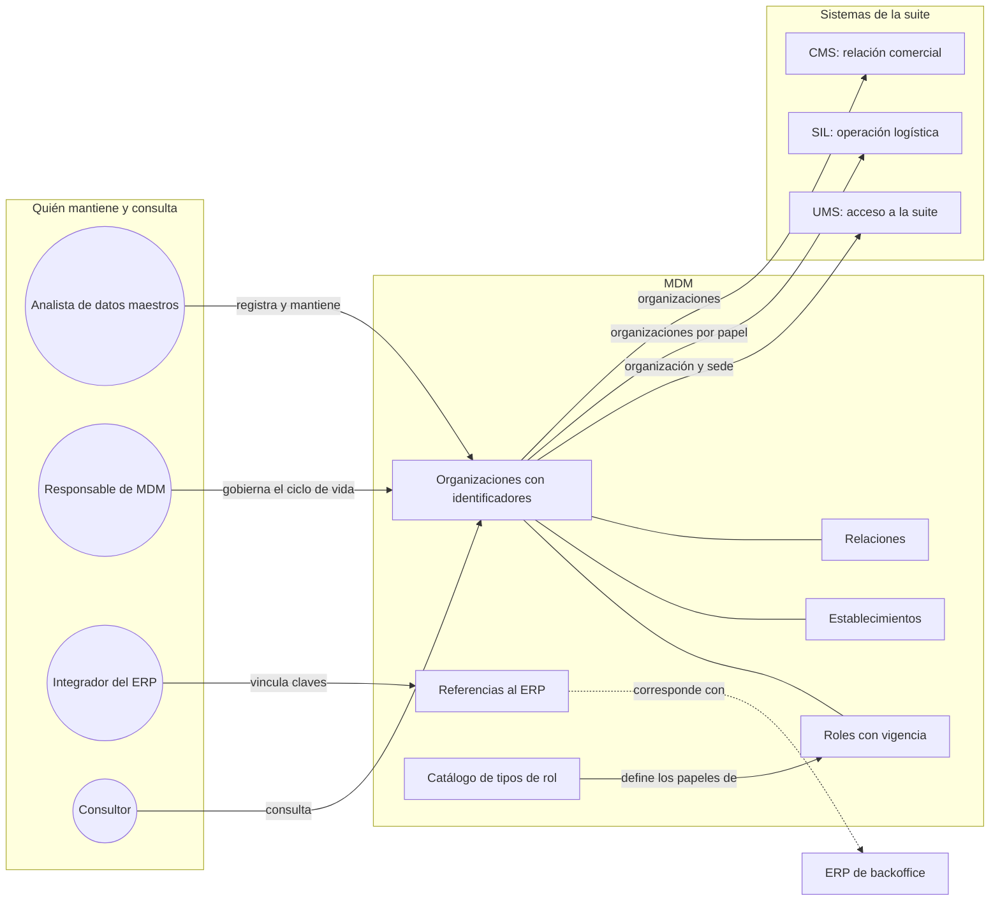

# PRD-MDM-001 — Maestro de organizaciones y partes de la suite (MDM)

  
  
  
  

> **Artefacto:** PRD
> **Identificador:** `PRD-MDM-001`
> **Fase:** 1 — Concepción y Descubrimiento
> **Alcance:** local
> **Estado:** Borrador
> **Plantilla canónica:** `plantilla-prd` (Hub de Plantillas del estándar, S-01) · vista publicada 0.2.0, fuente `plantilla-prd-fuente.es.md`, plugin `organizacion-core` 1.107.0
> **Elaborado a posteriori:** sí. Ordena una cadena que empezó por el diseño y la construcción; no cambia ninguna decisión (ver [§2](#2-resumen-ejecutivo))
> **Decisiones que lo fundamentan:** [D-031](../../DECISIONS.md#decisiones-locales) · [D-043](../../DECISIONS.md#decisiones-locales) · [D-044](../../DECISIONS.md#decisiones-locales) · [D-046](../../DECISIONS.md#decisiones-locales) · [ADR-0264](https://github.com/organizacion-peru/organizacion-arch/blob/main/reference/architecture/adrs/core/0264-el-maestro-de-partes-es-party-con-roles-y-sigue-los-dos-ejes-del-erp.es.md) · [ADR-0265](https://github.com/organizacion-peru/organizacion-arch/blob/main/reference/architecture/adrs/core/0265-mdm-es-dueno-de-la-organizacion-y-ums-del-tenant.es.md)
> **Hub del área:** [MDM — Datos Maestros](../02-diseno/hub-mdm.es.md)

---

MDM es el registro único de **quién es quién** en la suite —organizaciones y, más adelante, personas— y de **dónde opera** cada una. Este PRD dice, en lenguaje de negocio, qué problema resuelve, para quién y cómo se sabrá que lo resuelve. **No diseña la solución:** el modelo, la interfaz y el contrato viven en los artefactos de diseño que se enlazan en la [§11](#11-trazabilidad).

## Tabla de Navegación

| Sección | Contenido |
| :--- | :--- |
| [1. Metadatos](#1-metadatos) | Identidad, versión, aprobadores y convenciones |
| [2. Resumen Ejecutivo](#2-resumen-ejecutivo) | Problema, valor, criterio de éxito y por qué se redacta a posteriori |
| [3. Contexto y Problema](#3-contexto-y-problema) | Duplicados, identidad partida y sedes con doble nacimiento |
| [4. Objetivos y Métricas de Éxito](#4-objetivos-y-métricas-de-éxito) | Metas verificables, sin fechas |
| [5. Alcance](#5-alcance) | Dentro, fuera, mapa conceptual, requisitos funcionales y no funcionales |
| [6. Actores y Casos de Uso de Alto Nivel](#6-actores-y-casos-de-uso-de-alto-nivel) | Personas de uso y sistemas consumidores |
| [7. Reglas de Negocio Explícitas](#7-reglas-de-negocio-explícitas) | Lo que el maestro impone |
| [8. Restricciones, Supuestos y Dependencias](#8-restricciones-supuestos-y-dependencias) | Límites, supuestos y de quién depende |
| [9. Riesgos de Negocio](#9-riesgos-de-negocio) | Riesgos y mitigación |
| [10. Criterios de Aceptación del PRD](#10-criterios-de-aceptación-del-prd) | Condiciones de aprobación |
| [11. Trazabilidad](#11-trazabilidad) | Requisito → historia → regla → decisión → diseño |
| [12. Glosario](#12-glosario) | Términos |
| [13. Historial de Cambios](#13-historial-de-cambios) | Versiones |

## 1. Metadatos

- **Identificador:** `PRD-MDM-001`
- **Producto:** MDM — Datos Maestros de la suite (maestro de organizaciones y partes)
- **Suite:** Suite ORG. MDM sirve a toda la suite; el catálogo lo sitúa en `organizacion-scm` y aquí vive provisionalmente ([D-027](../../DECISIONS.md#decisiones-locales), [G-257](../../GAPS.md))
- **Sistema:** MDM
- **Versión:** 0.1.0
- **Estado:** Borrador
- **Autor(es):** Producto MDM — aarroyo; redacción con el agente `organizacion-pm`
- **Aprobador de Negocio:** por designar — dueño del dato maestro de organizaciones de Organización
- **Aprobador de Arquitectura:** por designar — Arquitectura MDM, con el Architecture Board
- **Fecha de Aprobación:** — (pendiente de la puerta «Aprobación de Negocio»)
- **Iniciativa en el tablero SDLC:** `PRD-MDM-001` en el [índice de iniciativas del satélite](../../reporting/data/initiatives-index.json) (S-25); fechas y avance real viven en el tablero

**Convenciones de este PRD.**

- `RF-MDM-NNN` son requisitos funcionales; `RNF-MDM-NN`, no funcionales; `RN-MDM-NN`, reglas de negocio; `RR-MDM-NN`, riesgos.
- Las historias `US-MDM-001` a `US-MDM-014` **no se duplican aquí**: viven en la [§3 de UX-MDM-001](../02-diseno/especificacion-ux-mdm-001.es.md#3-historias-de-usuario), con sus criterios Dado/Cuando/Entonces. Cada requisito las cita.
- Las reglas `INV-PTY-NN` son las del [modelo de dominio DOM-MDM-002 §4.3](../02-diseno/modelo-dominio-organizacion-erp-mdm-002.es.md#43-invariantes); aquí se enuncian en lenguaje de negocio.
- **SUPUESTO** marca lo que no tiene evidencia (SD-05); cada supuesto tiene su gap en [GAPS.md](../../GAPS.md) o se propone uno.

## 2. Resumen Ejecutivo

Hoy la misma empresa puede existir varias veces en la suite: una vez como cliente, otra como proveedor, otra en el ERP y otra como inquilino de UMS, y la sede nace por separado en cada sistema. MDM resuelve eso con **un único registro por organización**, identificado por su documento oficial (por ejemplo, el RUC), que acumula sus **roles** con vigencia (cliente, proveedor, transportista, agente de aduanas, empresa propia…), sus **establecimientos** y sus **relaciones**, y que guarda aparte la correspondencia con el ERP. El valor es dejar de conciliar duplicados entre sistemas y que UMS, SIL, CMS y el ERP hablen de la misma organización. El criterio de éxito es que ningún documento oficial identifique a dos organizaciones y que toda organización y sede de la suite tenga un solo origen.

**Este PRD se elabora a posteriori.** El mantenimiento de organización y sede de [D-031](../../DECISIONS.md#decisiones-locales) y la interfaz web de [D-044](../../DECISIONS.md#decisiones-locales) se construyeron antes que este documento, con la especificación UX como base funcional provisional ([G-543](../../GAPS.md)). Este PRD ordena la cadena PRD → diseño → construcción que exige el estándar y pasa a ser la **referencia de negocio** de MDM. **No cambia ninguna decisión:** recoge lo decidido en D-031, D-043, D-044 y D-046 y en ADR-0264 y ADR-0265, y lo que no tiene respaldo lo marca como SUPUESTO.

> **Sin compromisos de calendario (S-24).** Este PRD declara el **qué** y el **por qué**. El calendario, los hitos y el avance los posee el **tablero SDLC**, no este documento.

## 3. Contexto y Problema

- **Situación actual.** La organización y su sede nacen en UMS (como inquilino y sucursal, para dar acceso) y en `mdm-api` (el mantenimiento de D-031), y conviven dos altas mientras no haya sincronización ([D-031](../../DECISIONS.md#decisiones-locales) consecuencia 2, [G-313](../../GAPS.md)). El modelo anterior separaba «organización de tipo cliente» y «cliente», lo que ya producía solape ([G-531](../../GAPS.md)). El ERP de backoffice tiene su propio registro de terceros y su estructura de sociedades y centros, sin correspondencia confirmada con la suite ([G-532](../../GAPS.md), [G-545](../../GAPS.md)).
- **Problema.**
  1. **Duplicados cliente/proveedor.** Una empresa que es a la vez cliente, proveedor y agente se registra una vez por papel; cada copia envejece por su lado ([DOM-MDM-002 §2](../02-diseno/modelo-dominio-organizacion-erp-mdm-002.es.md#2-por-qué-party-d-043)).
  2. **Identidad partida entre UMS y ERP.** Quién accede a la suite (UMS), quién es la organización (MDM) y quién es el tercero contable (ERP) se mezclan; D-031 chocaba con [ADR-0071](https://github.com/organizacion-peru/organizacion_arch/blob/main/reference/architecture/adrs/core/0071-identidad-tenant-raiz-admin-root-tenant-owner.es.md) porque ponía en MDM lo que es identidad ([G-311](../../GAPS.md)).
  3. **Sedes con doble nacimiento.** La misma sede nace como sucursal en UMS y como sede en MDM, con identificadores distintos ([DOM-MDM-002 §6](../02-diseno/modelo-dominio-organizacion-erp-mdm-002.es.md#6-relación-con-ums-tenant-y-sucursal)).
  - **Métrica base:** **no medida.** No hay cifras de duplicados, de volumen ni de picos de alta ([G-543](../../GAPS.md)). Se propone medirla en la carga inicial (ver §4).
- **Oportunidad.** MDM está empezando: nada consume `mdm-api` ([G-312](../../GAPS.md)) y no hay datos productivos, así que fijar ahora un registro único es el momento barato ([D-043](../../DECISIONS.md#decisiones-locales)).
- **Audiencia afectada.** Quienes mantienen el dato maestro (analista y responsable de MDM), TI del ERP, quienes consultan organizaciones desde operaciones y comercial, y los sistemas que las consumen: UMS, SIL, CMS y el ERP. Volumen de usuarios y de organizaciones: **SUPUESTO**, sin medir.

## 4. Objetivos y Métricas de Éxito

Cada métrica se puede comprobar con una consulta sobre el maestro o sobre el sistema consumidor (SD-04). La ventana es **relativa a la carga inicial o al despliegue**, nunca una fecha; la fecha la fija el tablero.

| Objetivo | Métrica | Valor Inicial | Meta | Ventana de medición |
| --- | --- | --- | --- | --- |
| O1. Una organización existe una sola vez | Número de documentos oficiales (país, tipo, número) que identifican a más de una organización, incluidas archivadas | No medido ([G-543](../../GAPS.md)) | 0 | Desde la carga inicial, en todo momento |
| O2. Varios papeles sin duplicar | Porcentaje de organizaciones con más de un papel (por ejemplo, cliente y proveedor) representadas como un único registro con varios roles | No medido | 100 % | Tras la carga inicial |
| O3. Un solo origen de la organización | Inquilinos de UMS que no corresponden a una organización de MDM con el mismo identificador | No medido; hoy conviven dos altas ([G-313](../../GAPS.md)) | 0 | Tras activar la sincronización con UMS ([G-312](../../GAPS.md)) |
| O4. Un solo origen de la sede | Sucursales de UMS que no corresponden a un establecimiento de MDM con el mismo identificador | No medido | 0 | Tras activar la sincronización con UMS |
| O5. Correspondencia con el ERP visible | Porcentaje de sociedades y centros del ERP dentro del alcance con su referencia vinculada en MDM | 0 % (ERP sin confirmar, [G-545](../../GAPS.md)) | 100 % del alcance acordado con TI | Tras la carga inicial desde el ERP |
| O6. El catálogo de roles se adapta sin esperar a TI | Cambios de aplicación necesarios para dar de alta un tipo de rol nuevo | Antes de D-046: un cambio por tipo | 0 | Desde el despliegue de la pantalla de tipos de rol |

## 5. Alcance

### 5.1 Dentro del Alcance

Según [D-043](../../DECISIONS.md#decisiones-locales), [D-044](../../DECISIONS.md#decisiones-locales) y [D-046](../../DECISIONS.md#decisiones-locales):

- **Organizaciones:** buscar, consultar, registrar, corregir nombres, suspender, reactivar y archivar.
- **Identificadores** oficiales (país, tipo, número) con vigencia y uno principal.
- **Roles con vigencia** (cliente, proveedor, transportista, agente de aduanas, consignatario, empresa propia…): asignar, suspender, reactivar y terminar.
- **Establecimientos** sede, sucursal y planta: abrir, editar, desactivar, reactivar y cerrar.
- **Relaciones** entre organizaciones con vigencia: matriz-filial, grupo económico, agente de.
- **Referencias al ERP:** vincular, consultar y desvincular la clave del ERP de una organización o de un establecimiento.
- **Catálogo de tipos de rol:** alta, edición, desactivación y reactivación, con la carga inicial de los papeles del sector logístico ([D-046](../../DECISIONS.md#decisiones-locales)).
- **Poner el maestro a disposición** de UMS, SIL, CMS y el ERP, como dueño de la organización ([ADR-0265](https://github.com/organizacion-peru/organizacion-arch/blob/main/reference/architecture/adrs/core/0265-mdm-es-dueno-de-la-organizacion-y-ums-del-tenant.es.md)). Sin historia todavía (RF-MDM-015).

### 5.2 Fuera del Alcance

- **Personas naturales**, hasta resolver el tratamiento de datos personales de la Ley 29733 ([G-534](../../GAPS.md)).
- **Fusión de duplicados**: el estado «fusionada» se muestra, no se produce ([G-537](../../GAPS.md)).
- **Almacenes** como establecimiento ([G-547](../../GAPS.md)).
- **Centros de costo y de beneficio**, organización de ventas y de compras: se quedan en el ERP ([G-548](../../GAPS.md)).
- **Inquilino y sucursal como acceso y permisos**: son de UMS ([ADR-0265](https://github.com/organizacion-peru/organizacion-arch/blob/main/reference/architecture/adrs/core/0265-mdm-es-dueno-de-la-organizacion-y-ums-del-tenant.es.md)).
- **Datos comerciales y contables** del rol (crédito, tarifario, cuentas): son de CMS o del ERP ([DOM-MDM-002 §4.2](../02-diseno/modelo-dominio-organizacion-erp-mdm-002.es.md#42-datos-del-rol-lo-mínimo)).
- **Administración de los demás catálogos** (tipos de identificador, de establecimiento y de relación): solo lectura ([G-555](../../GAPS.md)).

### 5.3 Mapa Conceptual

### 5.4 Requisitos funcionales

Prioridad: **Must** para todo lo que D-044 y D-046 incluyen en la primera entrega. El detalle verificable de cada requisito está en los criterios Dado/Cuando/Entonces de la historia citada.

| ID | Requisito | Criterio de aceptación de negocio (resumen verificable) | Historia | Reglas | Prioridad |
| :--- | :--- | :--- | :--- | :--- | :--- |
| RF-MDM-001 | Buscar organizaciones por texto o por documento oficial exacto | La búsqueda por documento encuentra la organización aunque esté archivada o el documento vencido; la de texto excluye archivadas y fusionadas | US-MDM-001 | INV-PTY-02 | Must |
| RF-MDM-002 | Consultar en una sola ficha documentos, roles, establecimientos, relaciones y referencias al ERP | Un rol vencido se ve como no vigente aunque no se haya terminado; una organización archivada o fusionada se ve sin acciones de cambio | US-MDM-002 | INV-PTY-11 | Must |
| RF-MDM-003 | Registrar una organización con su documento principal, sin duplicarla | Un documento que ya pertenece a otra organización, vigente o no, impide el alta y ofrece abrir la existente; un RUC con dígito verificador incorrecto se rechaza | US-MDM-003 | INV-PTY-02, 03, 04, 07 | Must |
| RF-MDM-004 | Corregir razón social y nombre comercial | Código, tipo y documentos no se editan desde la corrección de nombres | US-MDM-004 | INV-PTY-01, 07 | Must |
| RF-MDM-005 | Suspender, reactivar y archivar una organización | Archivar pide confirmación y es definitivo; una suspendida no admite roles ni establecimientos nuevos | US-MDM-005 | INV-PTY-11 | Must |
| RF-MDM-006 | Añadir documentos, reemplazar el principal y vencer documentos, sin borrar | Siempre hay exactamente un documento principal vigente; la empresa propia no se queda sin documento fiscal vigente | US-MDM-006 | INV-PTY-03, 04, 06 | Must |
| RF-MDM-007 | Asignar un rol con vigencia | Dos roles del mismo tipo de una organización no se cruzan en fechas; «empresa propia» exige documento fiscal vigente | US-MDM-007 | INV-PTY-05, 06 | Must |
| RF-MDM-008 | Suspender, reactivar y terminar un rol | Terminar cierra la vigencia del rol y es definitivo; el historial del rol se conserva | US-MDM-008 | — ([DOM-MDM-002 §4.4](../02-diseno/modelo-dominio-organizacion-erp-mdm-002.es.md#44-ciclo-de-vida)) | Must |
| RF-MDM-009 | Abrir y editar sedes, sucursales y plantas, con código de anexo SUNAT y dirección | Como mucho un establecimiento principal activo; el código no se repite dentro de la organización, ni de uno cerrado; no se ofrece almacén | US-MDM-009 | INV-PTY-08, 09 | Must |
| RF-MDM-010 | Desactivar, reactivar y cerrar un establecimiento | Desactivar es reversible; cerrar es definitivo y reserva su código | US-MDM-010 | INV-PTY-10 | Must |
| RF-MDM-011 | Relacionar dos organizaciones con vigencia (matriz-filial, grupo, agente de) | Una organización no se relaciona consigo misma; no hay dos relaciones iguales con fechas cruzadas | US-MDM-011 | INV-PTY-12 | Must |
| RF-MDM-012 | Vincular y desvincular la clave del ERP de una organización o establecimiento | Una clave del ERP apunta a un solo registro de MDM, aunque se haya desvinculado; no se vincula a archivadas ni a cerrados | US-MDM-012 | INV-PTY-13 | Must |
| RF-MDM-013 | No sobrescribir el trabajo de otra persona | Si otra persona cambió la organización mientras se editaba, el cambio no se aplica, lo escrito no se pierde y se puede recargar y reaplicar | US-MDM-013 | — (regla de D-031) | Must |
| RF-MDM-014 | Mantener el catálogo de tipos de rol | Código inmutable y no reutilizable; un tipo desactivado no se asigna a roles nuevos y los existentes se conservan; el alta de un tipo no requiere cambio de aplicación | US-MDM-014 | [D-046](../../DECISIONS.md#decisiones-locales) | Must |
| RF-MDM-015 | Poner a disposición de UMS, SIL, CMS y el ERP las altas y cambios de organizaciones, establecimientos y relaciones | UMS reconoce cada organización y establecimiento con el mismo identificador que MDM (metas O3 y O4) | **Sin historia** (propuesta de gap) | [ADR-0265](https://github.com/organizacion-peru/organizacion-arch/blob/main/reference/architecture/adrs/core/0265-mdm-es-dueno-de-la-organizacion-y-ums-del-tenant.es.md); [G-312](../../GAPS.md), [G-553](../../GAPS.md) | Must (por decisión D-043; pendiente de historia) |

### 5.5 Requisitos no funcionales de negocio

| ID | Requisito | Respaldo |
| :--- | :--- | :--- |
| RNF-MDM-01 | **Trazabilidad:** todo cambio del maestro deja constancia de quién y cuándo, y nada se borra físicamente: se archiva, se cierra, se termina o se vence | [D-031](../../DECISIONS.md#decisiones-locales) regla 2 |
| RNF-MDM-02 | **Control de acceso:** solo las personas autorizadas cambian el maestro, y las acciones definitivas (archivar, cerrar, terminar, vencer) quedan reservadas al responsable | **SUPUESTO** ([UX-MDM-001 §2.2](../02-diseno/especificacion-ux-mdm-001.es.md#22-matriz-rol--acción), [G-314](../../GAPS.md), [G-536](../../GAPS.md), [G-560](../../GAPS.md)) |
| RNF-MDM-03 | **Protección de datos personales:** no se registran personas naturales hasta resolver la Ley 29733 | [G-534](../../GAPS.md) |
| RNF-MDM-04 | **Accesibilidad:** la interfaz es usable con teclado y lector de pantalla, con WCAG 2.2 AA como piso | [UX-MDM-001 §7](../02-diseno/especificacion-ux-mdm-001.es.md#7-accesibilidad) |
| RNF-MDM-05 | **Volumen y concurrencia:** el maestro soporta el número de organizaciones y de altas en pico de Organización | **SUPUESTO**: sin cifras ([G-543](../../GAPS.md)) |
| RNF-MDM-06 | **Coherencia con los consumidores:** un cambio en MDM llega a UMS, SIL y CMS sin que nadie lo vuelva a digitar | [ADR-0265](https://github.com/organizacion-peru/organizacion-arch/blob/main/reference/architecture/adrs/core/0265-mdm-es-dueno-de-la-organizacion-y-ums-del-tenant.es.md); antigüedad máxima tolerada sin definir ([G-030](../../GAPS.md)) |

## 6. Actores y Casos de Uso de Alto Nivel

Las cuatro personas de uso son **SUPUESTO**: se infieren del diseño, sin entrevistas ni PRD previo ([SU-MDM-01](../02-diseno/especificacion-ux-mdm-001.es.md#81-supuestos), [G-560](../../GAPS.md)).

| Actor | Necesidad | Caso de uso de alto nivel | Prioridad |
| --- | --- | --- | --- |
| Analista de datos maestros (SUPUESTO) | Que cada organización exista una sola vez, bien identificada, con sus roles y sedes al día | Buscar antes de registrar, registrar, corregir, asignar roles, abrir establecimientos, relacionar, mantener tipos de rol | Must |
| Responsable de MDM (SUPUESTO) | Gobernar el ciclo de vida y corregir con trazabilidad | Lo del analista, más suspender, archivar, terminar roles, cerrar establecimientos y vencer documentos | Must |
| Integrador del ERP, TI (SUPUESTO) | Que cada organización y establecimiento tenga su clave del ERP | Vincular y desvincular referencias; revisar su estado | Must |
| Consultor de operaciones o comercial (SUPUESTO) | Confirmar los datos de una organización antes de usarla en otro sistema | Buscar y consultar la ficha | Must |
| UMS (sistema) | Dar acceso a la suite a organizaciones y sedes reales | Recibir organizaciones y establecimientos; decidir cuáles son inquilino y sucursal | Must |
| SIL (sistema) | Usar clientes, transportistas y agentes en la operación | Consumir organizaciones por papel | Must |
| CMS (sistema) | Gestionar la relación comercial sobre la organización correcta | Consumir organizaciones | Should (SUPUESTO: sin requisito de CMS documentado) |
| ERP de backoffice (sistema) | Mantener su registro de terceros y su estructura alineados con la suite | Origina sociedades y centros; se vincula a las organizaciones que origina MDM ([DOM-MDM-002 §9](../02-diseno/modelo-dominio-organizacion-erp-mdm-002.es.md#9-correspondencia-con-el-erp), propuesta) | Must |

## 7. Reglas de Negocio Explícitas

| ID | Regla | Respaldo |
| :--- | :--- | :--- |
| RN-MDM-01 | Un documento oficial (país, tipo, número) identifica a una sola organización en toda la suite, también si está archivada o fusionada | INV-PTY-02 |
| RN-MDM-02 | Un papel no es una organización: la misma organización es cliente, proveedor y agente con un solo registro y varios roles | [D-043](../../DECISIONS.md#decisiones-locales), [ADR-0264](https://github.com/organizacion-peru/organizacion-arch/blob/main/reference/architecture/adrs/core/0264-el-maestro-de-partes-es-party-con-roles-y-sigue-los-dos-ejes-del-erp.es.md) |
| RN-MDM-03 | El código de una organización y el de un establecimiento no cambian ni se reutilizan nunca | D-031 regla 1; INV-PTY-07, 08 |
| RN-MDM-04 | Nada se borra: la organización se archiva, el establecimiento se cierra, el rol se termina y el documento se vence; archivar y cerrar son definitivos | D-031 regla 2; INV-PTY-10, 11 |
| RN-MDM-05 | Una organización tiene exactamente un documento principal vigente | INV-PTY-03 |
| RN-MDM-06 | Dos roles del mismo tipo de una organización no se cruzan en fechas; un rol vencido no es vigente | INV-PTY-05; DOM-MDM-002 §4.4 |
| RN-MDM-07 | Solo una organización con documento fiscal vigente puede tener el rol de empresa propia de Organización | INV-PTY-06 |
| RN-MDM-08 | Como mucho un establecimiento principal activo por organización | INV-PTY-09 |
| RN-MDM-09 | Una relación une dos organizaciones distintas y no se repite con fechas cruzadas | INV-PTY-12 |
| RN-MDM-10 | La correspondencia con el ERP vive fuera del registro de la organización, y cada clave del ERP apunta a un solo registro | D-043; INV-PTY-13 |
| RN-MDM-11 | MDM es dueño de la organización y del establecimiento; UMS es dueño del inquilino y de la sucursal como acceso, y ambos usan el mismo identificador | [ADR-0265](https://github.com/organizacion-peru/organizacion-arch/blob/main/reference/architecture/adrs/core/0265-mdm-es-dueno-de-la-organizacion-y-ums-del-tenant.es.md); DOM-MDM-002 §6 |
| RN-MDM-12 | Un tipo de rol desactivado no se asigna a roles nuevos; los roles que ya lo usan se conservan | [D-046](../../DECISIONS.md#decisiones-locales) |
| RN-MDM-13 | Lo que varía por papel es dato del catálogo, no un cambio de aplicación | ADR-0264 (citado en D-046) |

## 8. Restricciones, Supuestos y Dependencias

- **Restricciones regulatorias:** Ley 29733 de protección de datos personales, que bloquea las personas naturales ([G-534](../../GAPS.md)); los documentos peruanos siguen las reglas de SUNAT (RUC con dígito verificador, código de establecimiento anexo).
- **Restricciones de gobierno:** la forma del maestro la fija [ADR-0264](https://github.com/organizacion-peru/organizacion-arch/blob/main/reference/architecture/adrs/core/0264-el-maestro-de-partes-es-party-con-roles-y-sigue-los-dos-ejes-del-erp.es.md) y el reparto de dueños con UMS [ADR-0265](https://github.com/organizacion-peru/organizacion-arch/blob/main/reference/architecture/adrs/core/0265-mdm-es-dueno-de-la-organizacion-y-ums-del-tenant.es.md), aceptados y pendientes de publicarse en el plugin que vincula este satélite ([G-554](../../GAPS.md)); el registro con el nuevo modelo no se construye hasta entonces ([G-552](../../GAPS.md)). El domicilio de MDM en este repositorio es provisional ([G-257](../../GAPS.md)).

### 8.1 Supuestos

| ID | Supuesto | Gap |
| :--- | :--- | :--- |
| SP-MDM-01 | Las cuatro personas de uso y su frecuencia | [G-560](../../GAPS.md) |
| SP-MDM-02 | Quién puede hacer qué (matriz de permisos); hoy no hay autorización por acción | [G-560](../../GAPS.md), [G-314](../../GAPS.md), [G-536](../../GAPS.md) |
| SP-MDM-03 | Qué ERP es, su estructura y la relación sede ↔ centro | [G-532](../../GAPS.md), [G-545](../../GAPS.md) |
| SP-MDM-04 | Quién origina cada nivel: ERP las sociedades y centros, MDM los terceros (propuesta) | [G-546](../../GAPS.md) |
| SP-MDM-05 | Quién es dueño de cada dato entre MDM y ERP | [G-533](../../GAPS.md) |
| SP-MDM-06 | Quién administra los catálogos (para tipos de rol, analista y responsable) | [G-555](../../GAPS.md), [G-560](../../GAPS.md) |
| SP-MDM-07 | Volumen de organizaciones y picos de alta | [G-543](../../GAPS.md) |
| SP-MDM-08 | Que CMS consuma organizaciones de MDM | Sin gap: se propone abrirlo |

### 8.2 Dependencias

| Dependencia | Qué necesita MDM | Estado |
| :--- | :--- | :--- |
| UMS | Acordar cómo recibe organizaciones y establecimientos y conservar sus identificadores en la carga inicial | En consulta ([G-553](../../GAPS.md), [G-313](../../GAPS.md)) |
| ERP de backoffice, vía XMS | Saber qué ERP es y cómo está organizado; traducir en los dos sentidos | [Cuestionario a TI](../02-diseno/cuestionario-erp-estructura-organizativa-mdm.es.md) sin enviar ([G-545](../../GAPS.md)) |
| ADR-0264 y ADR-0265 | Publicación en el plugin del estándar | Aceptados; pendientes de llegar al plugin ([G-554](../../GAPS.md)) |
| Publicación de cambios | Que los consumidores reciban el maestro | Pendiente ([G-312](../../GAPS.md)) |

## 9. Riesgos de Negocio

| ID | Riesgo | Probabilidad | Impacto | Mitigación |
| --- | --- | --- | --- | --- |
| RR-MDM-01 | Mientras no haya sincronización, la organización y la sede siguen naciendo en UMS y en MDM | Alta | Alto | Carga inicial que conserve los identificadores de UMS y una sola alta tras la sincronización ([G-313](../../GAPS.md)) |
| RR-MDM-02 | El ERP real no encaja con la correspondencia supuesta | Media | Alto | Enviar y responder el cuestionario a TI antes de la carga inicial ([G-545](../../GAPS.md)) |
| RR-MDM-03 | Personas y permisos supuestos no coinciden con cómo trabaja Organización | Media | Medio | Validarlos con el negocio como condición de aprobación de este PRD ([G-560](../../GAPS.md)) |
| RR-MDM-04 | Sin fusión, los duplicados heredados con documentos distintos no se pueden unir | Media | Medio | Búsqueda previa al alta; fusión en una fase posterior ([G-537](../../GAPS.md), [G-561](../../GAPS.md)) |
| RR-MDM-05 | Este PRD, escrito a posteriori, diverge de lo ya construido o diseñado | Media | Medio | Criterio de aceptación de §10: reconciliar cada requisito con su historia y su diseño antes de aprobar |
| RR-MDM-06 | El registro nuevo espera a la publicación de los ADR en el plugin y la interfaz sigue contra datos simulados | Alta | Medio | Seguir en el tablero la vinculación del plugin ([G-552](../../GAPS.md), [G-554](../../GAPS.md)) |
| RR-MDM-07 | Traslado de MDM a otro repositorio | Media | Bajo | Los artefactos de MDM no dependen de los de SIL ([G-257](../../GAPS.md)) |

## 10. Criterios de Aceptación del PRD

El PRD se considera aprobado cuando:

- [ ] El Aprobador de Negocio y el de Arquitectura están designados y validan el resumen ejecutivo.
- [ ] Las cuatro personas de uso y la matriz de permisos están confirmadas con el negocio, o sustituidas, y SP-MDM-01 y SP-MDM-02 dejan de ser supuestos.
- [ ] Cada métrica de §4 tiene su valor inicial medido o su forma de medirlo acordada, y su meta firmada.
- [ ] Cada requisito RF-MDM-001 a RF-MDM-014 está reconciliado con su historia de UX-MDM-001 sin contradicciones, y RF-MDM-015 tiene historia o gap con dueño.
- [ ] El alcance (§5.1 y §5.2) está firmado por Producto y Arquitectura y es coherente con D-043, D-044 y D-046.
- [ ] Las reglas de §7 no se contradicen entre sí ni con DOM-MDM-002.
- [ ] Cada riesgo de §9 tiene mitigación con responsable.

## 11. Trazabilidad

### 11.1 Requisito → historia → regla → diseño

| Requisito | Historia ([UX-MDM-001 §3](../02-diseno/especificacion-ux-mdm-001.es.md#3-historias-de-usuario)) | Regla de DOM-MDM-002 | Decisión |
| :--- | :--- | :--- | :--- |
| RF-MDM-001 | US-MDM-001 | INV-PTY-02 | D-043, D-044 |
| RF-MDM-002 | US-MDM-002 | INV-PTY-11 | D-044 |
| RF-MDM-003 | US-MDM-003 | INV-PTY-02, 03, 04, 07 | D-031, D-043, D-044 |
| RF-MDM-004 | US-MDM-004 | INV-PTY-01, 07 | D-031, D-044 |
| RF-MDM-005 | US-MDM-005 | INV-PTY-11 | D-031, D-044 |
| RF-MDM-006 | US-MDM-006 | INV-PTY-03, 04, 06 | D-043, D-044 |
| RF-MDM-007 | US-MDM-007 | INV-PTY-05, 06 | D-043, D-044 |
| RF-MDM-008 | US-MDM-008 | Ciclo de vida del rol (§4.4) | D-043, D-044 |
| RF-MDM-009 | US-MDM-009 | INV-PTY-08, 09 | D-031, D-043, D-044 |
| RF-MDM-010 | US-MDM-010 | INV-PTY-10 | D-031, D-044 |
| RF-MDM-011 | US-MDM-011 | INV-PTY-12 | D-043, D-044 |
| RF-MDM-012 | US-MDM-012 | INV-PTY-13 | D-043, D-044 |
| RF-MDM-013 | US-MDM-013 | — | D-031 regla 3 |
| RF-MDM-014 | US-MDM-014 | Catálogo de tipos de rol (§3.2) | D-046 |
| RF-MDM-015 | — | Relación con UMS (§6) | D-043, ADR-0265 |

### 11.2 Hacia el resto de la cadena

| Artefacto | Relación con este PRD |
| :--- | :--- |
| [DOM-MDM-002 — modelo de dominio](../02-diseno/modelo-dominio-organizacion-erp-mdm-002.es.md) | Diseño del maestro: reglas, ciclo de vida, correspondencia con el ERP y relación con UMS |
| [UX-MDM-001 — especificación UX](../02-diseno/especificacion-ux-mdm-001.es.md) | Personas, historias US-MDM-001 a 014 y flujos |
| [UI-MDM-001 — especificación UI](../02-diseno/especificacion-ui-mdm-001.es.md) | Componentes y estados de la interfaz |
| [API-MDM-002 — contrato de la API de Party](../03-construccion/contrato-api-party-mdm-002.es.md) | Contrato que realiza los requisitos |
| [Especificación técnica de organización y sede](../03-construccion/especificacion-tecnica-organizacion-sede-mdm-001.es.md) | Lo construido bajo D-031, en revisión por D-043; pasará a historia técnica cuando haya historia funcional ([G-323](../../GAPS.md)) |
| [Cuestionario para TI sobre el ERP](../02-diseno/cuestionario-erp-estructura-organizativa-mdm.es.md) | Confirma SP-MDM-03 y SP-MDM-04 |
| [DECISIONS.md — D-031, D-043, D-044 y D-046](../../DECISIONS.md#decisiones-locales) | Decisiones del propietario que este PRD recoge sin cambiar |
| [ADR-0264](https://github.com/organizacion-peru/organizacion-arch/blob/main/reference/architecture/adrs/core/0264-el-maestro-de-partes-es-party-con-roles-y-sigue-los-dos-ejes-del-erp.es.md) y [ADR-0265](https://github.com/organizacion-peru/organizacion-arch/blob/main/reference/architecture/adrs/core/0265-mdm-es-dueno-de-la-organizacion-y-ums-del-tenant.es.md) | Norma del núcleo que respalda el alcance y las reglas |
| [GAPS.md](../../GAPS.md) | [G-323](../../GAPS.md) y [G-543](../../GAPS.md) (concepción), [G-560](../../GAPS.md) (personas y permisos) y los demás citados |

Las historias funcionales, el reporte de pruebas y las notas de lanzamiento de MDM que se redacten citarán `PRD-MDM-001`.

## 12. Glosario

- **Organización (Party):** empresa o entidad con identidad propia ante la ley o el comercio; existe una sola vez en la suite.
- **Documento oficial (identificador):** país, tipo y número que identifican a la organización (RUC, RUT, EORI…), con vigencia; uno es el principal.
- **Rol:** papel que una organización cumple durante un periodo: cliente, proveedor, transportista, agente de aduanas, consignatario, empresa propia…
- **Tipo de rol:** entrada del catálogo que define un papel; se desactiva, no se borra.
- **Empresa propia:** rol de una entidad legal de Organización; en el ERP, una sociedad.
- **Vigencia:** periodo, con inicio y fin opcional, en que un documento, un rol o una relación vale.
- **Establecimiento:** lugar donde opera la organización (sede, sucursal, planta), con su código de anexo SUNAT si es peruano.
- **Relación:** vínculo con vigencia entre dos organizaciones distintas: matriz-filial, grupo económico, agente de.
- **Referencia al ERP:** correspondencia entre un registro de MDM y su clave en el ERP.
- **Inquilino (Tenant):** organización a la que UMS da acceso a la suite. Es de UMS, no de MDM.
- **Sucursal (UMS):** ámbito de permisos que UMS asocia a un establecimiento. Es de UMS.
- **Archivar / cerrar / terminar / vencer:** dar por finalizado sin borrar, a la organización, al establecimiento, al rol y al documento.
- **Duplicado:** dos registros de la misma organización; la regla RN-MDM-01 los impide por documento oficial.
- **XMS:** capa de la suite que conecta con sistemas externos como el ERP.

## 13. Historial de Cambios

| Versión | Fecha | Autor | Cambios |
| --- | --- | --- | --- |
| 0.1.0 | 2026-10-24 | aarroyo, con el agente `organizacion-pm` | Versión inicial, **elaborada a posteriori** a pedido del propietario: ordena la cadena PRD → diseño → construcción de MDM y pasa a ser su referencia de negocio. Recoge D-031, D-043, D-044 y D-046 y ADR-0264 y ADR-0265 sin cambiar ninguna decisión. 15 requisitos funcionales trazados a US-MDM-001 a 014 y a las reglas INV-PTY de DOM-MDM-002; RF-MDM-015 sin historia. Personas, permisos, volumen y ERP quedan como supuestos |

---

  
  

  <strong>© Organización S.A.</strong> · RUC 20100412447 · Operador Logístico Aduanero desde 1978

