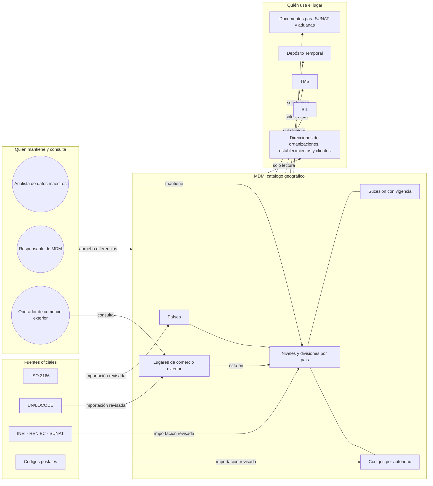

# PRD-MDM-002 — Geografía de la suite: países, divisiones administrativas, ubigeo y lugares de comercio exterior

  
  
  
  

> **Artefacto:** PRD
> **Identificador:** `PRD-MDM-002`
> **Fase:** 1 — Concepción y Descubrimiento
> **Alcance:** local
> **Estado:** Borrador
> **Plantilla canónica:** `plantilla-prd` (Hub de Plantillas del estándar, S-01) · vista publicada 0.2.0, fuente `plantilla-prd-fuente.es.md`, plugin `organizacion-core` 1.107.0
> **Deriva de:** [PRD-MDM-001](./prd-mdm-001.es.md) (MDM). Amplía el maestro de la suite con el «dónde»: las direcciones de organizaciones, establecimientos y clientes que PRD-MDM-001 registra pasan a referenciar un lugar de este catálogo
> **Base de evidencia:** [análisis de fuentes y requisitos de geografía](./fuentes/analisis-geografia-mdm.es.md) (agente `organizacion-analyst`, «Diana»), con los requisitos candidatos R-GEO-01 a R-GEO-15 y las preguntas P-GEO-01 a P-GEO-13
> **Decisiones que lo fundamentan:** [D-047](../../DECISIONS.md#decisiones-locales) · [ADR-MDM-002](../../reference/architecture/adrs/MDM-002-modelo-geografico-de-la-suite.es.md) (ambas en redacción por Arquitectura) · [D-027](../../DECISIONS.md#decisiones-locales) · [D-043](../../DECISIONS.md#decisiones-locales)
> **Hub del área:** [MDM — Datos Maestros](../02-diseno/hub-mdm.es.md)

---

La suite necesita un **lenguaje común para decir «dónde»**: dónde está la dirección fiscal de un cliente, dónde opera un establecimiento, desde qué puerto sale un contenedor y a qué país va. Este PRD dice, en lenguaje de negocio, qué problema resuelve el catálogo geográfico de MDM, para quién y cómo se sabrá que lo resuelve. **No diseña la solución:** el modelo y la elección de fuentes viven en [ADR-MDM-002](../../reference/architecture/adrs/MDM-002-modelo-geografico-de-la-suite.es.md) y en los artefactos de diseño que se enlazan en la [§11](#11-trazabilidad).

## Tabla de Navegación

| Sección | Contenido |
| :--- | :--- |
| [1. Metadatos](#1-metadatos) | Identidad, versión, aprobadores y convenciones |
| [2. Resumen Ejecutivo](#2-resumen-ejecutivo) | Problema, valor, criterio de éxito y etapas |
| [3. Contexto y Problema](#3-contexto-y-problema) | Direcciones en texto libre, esquemas de ubigeo sin decidir, puertos sin código |
| [4. Objetivos y Métricas de Éxito](#4-objetivos-y-métricas-de-éxito) | Metas verificables, sin fechas |
| [5. Alcance](#5-alcance) | Dentro, fuera, mapa conceptual, requisitos funcionales y no funcionales |
| [6. Actores y Casos de Uso de Alto Nivel](#6-actores-y-casos-de-uso-de-alto-nivel) | Personas de uso y sistemas consumidores |
| [7. Reglas de Negocio Explícitas](#7-reglas-de-negocio-explícitas) | Lo que el catálogo impone |
| [8. Restricciones, Supuestos y Dependencias](#8-restricciones-supuestos-y-dependencias) | Límites, supuestos y de quién depende |
| [9. Riesgos de Negocio](#9-riesgos-de-negocio) | Riesgos y mitigación |
| [10. Criterios de Aceptación del PRD](#10-criterios-de-aceptación-del-prd) | Condiciones de aprobación |
| [11. Trazabilidad](#11-trazabilidad) | Requisito → requisito candidato → regla → decisión → diseño, y preguntas abiertas |
| [12. Glosario](#12-glosario) | Términos |
| [13. Historial de Cambios](#13-historial-de-cambios) | Versiones |

## 1. Metadatos

- **Identificador:** `PRD-MDM-002`
- **Producto:** MDM — Datos Maestros de la suite (catálogo geográfico)
- **Suite:** Suite ORG. MDM sirve a toda la suite; el catálogo lo sitúa en `organizacion-scm` y aquí vive provisionalmente ([D-027](../../DECISIONS.md#decisiones-locales), [G-257](../../GAPS.md))
- **Sistema:** MDM
- **Versión:** 0.1.0
- **Estado:** Borrador
- **Autor(es):** Producto MDM — aarroyo; redacción con el agente `organizacion-pm`
- **Aprobador de Negocio:** por designar — dueño funcional del catálogo geográfico de Organización (pregunta abierta [P-GEO-02](./fuentes/analisis-geografia-mdm.es.md#8-preguntas-para-negocio))
- **Aprobador de Arquitectura:** por designar — Arquitectura MDM, con el Architecture Board
- **Fecha de Aprobación:** — (pendiente de la puerta «Aprobación de Negocio»)
- **Iniciativa en el tablero SDLC:** `PRD-MDM-002` en el [índice de iniciativas del satélite](../../reporting/data/initiatives-index.json) (S-25); fechas y avance real viven en el tablero

**Convenciones de este PRD.**

- `RF-GEO-NNN` son requisitos funcionales; `RNF-GEO-NN`, no funcionales; `RN-GEO-NN`, reglas de negocio; `RR-GEO-NN`, riesgos; `SP-GEO-NN`, supuestos.
- `R-GEO-NN` son los requisitos candidatos y `P-GEO-NN` las preguntas para negocio del [análisis de fuentes](./fuentes/analisis-geografia-mdm.es.md); cada requisito de este PRD cita el candidato del que nace.
- **Lugar** es cualquier entrada del catálogo: un país, una división administrativa (departamento, provincia, distrito, estado, comuna…) o un lugar de comercio exterior (puerto, aeropuerto, depósito interior…).
- **Etapas, no fechas.** Coordenadas y geocodificación se escalonan en **primera etapa** y **etapa posterior**: la etapa expresa precedencia (qué debe existir antes), no calendario.
- **SUPUESTO** marca lo que no tiene evidencia (SD-05); cada supuesto tiene su gap en [GAPS.md](../../GAPS.md) o se propone uno.

## 2. Resumen Ejecutivo

Hoy la suite no tiene catálogo geográfico. El contrato de organizaciones admite un ubigeo de seis dígitos solo para Perú y guarda departamento, provincia y distrito como **texto libre**; el modelo de Cliente declara ese texto «informativo mientras no haya catálogo de ubigeo»; y ningún documento fija qué ubigeo (INEI, RENIEC o SUNAT) se usa ni qué código de puerto manejan SIL y los documentos de comercio exterior ([análisis §3](./fuentes/analisis-geografia-mdm.es.md#3-consumidores-y-código-que-necesita-cada-uno)). MDM resuelve eso con **un catálogo único de lugares**: países con su código internacional, la **escalera de niveles propia de cada país** (en Perú, departamento, provincia y distrito con su ubigeo), los **lugares de comercio exterior** con su código UN/LOCODE y los **códigos postales**. Cada lugar admite varios códigos, cada uno con su autoridad; ningún código se reutiliza, nada se borra y los cambios territoriales se registran como sucesión con vigencia.

El valor es que una dirección, un puerto o un país signifiquen lo mismo en MDM, SIL, el TMS, el Depósito Temporal y los documentos que van a SUNAT, sin que cada sistema mantenga su propia lista. El criterio de éxito es que toda dirección peruana de la suite apunte a un ubigeo vigente del catálogo, que ningún documento de comercio exterior use un lugar no aprobado y que ningún consumidor mantenga una lista geográfica propia.

**Etapas.** La **primera etapa** cubre países, niveles, ubigeo, subdivisiones ISO 3166-2, lugares UN/LOCODE, códigos postales y el punto de referencia que traen los catálogos oficiales. Las coordenadas de cada dirección y la geocodificación automática quedan para una **etapa posterior**, condicionada a que un consumidor concreto las pida ([P-GEO-11](./fuentes/analisis-geografia-mdm.es.md#8-preguntas-para-negocio)).

> **Sin compromisos de calendario (S-24).** Este PRD declara el **qué** y el **por qué**. El calendario, los hitos y el avance los posee el **tablero SDLC**, no este documento.

## 3. Contexto y Problema

- **Situación actual.** La dirección de un establecimiento o de un cliente guarda país, ubigeo opcional y departamento, provincia y distrito escritos a mano ([análisis §1](./fuentes/analisis-geografia-mdm.es.md#1-propósito)). SIL espera de MDM «puertos, depósitos y ubicaciones» como dato maestro transversal, sin código definido ([análisis §3](./fuentes/analisis-geografia-mdm.es.md#3-consumidores-y-código-que-necesita-cada-uno)). [DOM-MDM-002 §10](../02-diseno/modelo-dominio-organizacion-erp-mdm-002.es.md#10-qué-se-adopta-del-mdm-original) dejó la geografía del MDM original «para más adelante» y [G-538](../../GAPS.md) pide decidir dónde vive y quién mantiene el ubigeo.
- **Problema.**
  1. **Direcciones que no se pueden validar.** Con el distrito en texto libre, la misma ubicación se escribe de varias formas y un homónimo (Aco de Concepción frente a Aco de Corongo) no se distingue ([análisis §4](./fuentes/analisis-geografia-mdm.es.md#4-casos-difíciles-del-perú)).
  2. **Tres ubigeos y ninguna decisión.** INEI, RENIEC y SUNAT usan «ubigeo» con codificaciones que pueden diferir; un comprobante con el código equivocado puede ser rechazado (riesgo RG-GEO-02 del análisis).
  3. **Cambios territoriales sin historia.** Un distrito nuevo nace de otro por ley; sin vigencia ni sucesión, los documentos antiguos pierden su ubicación y las direcciones afectadas no se revisan.
  4. **Puertos y países sin lenguaje común.** BL, manifiesto y DAM necesitan puerto de embarque y de descarga y país de origen y destino; no está fijado qué código se usa ni qué lugares son válidos.
  - **Métrica base:** **no medida.** No hay cifras de direcciones en texto libre, de direcciones que no casan con un catálogo ni de países y puertos que opera Organización ([P-GEO-03](./fuentes/analisis-geografia-mdm.es.md#8-preguntas-para-negocio)). Se propone medirla antes de la transición (ver §4).
- **Oportunidad.** MDM está empezando y no hay datos productivos de direcciones: fijar ahora el catálogo evita migrar texto libre acumulado más adelante.
- **Audiencia afectada.** Quienes mantienen el dato maestro (analista y responsable de MDM), quienes registran operaciones de comercio exterior, y los sistemas que usan direcciones y lugares: el maestro de organizaciones de MDM, SIL, el TMS, el Depósito Temporal y los sistemas que emiten documentos para SUNAT. Volumen de usuarios: **SUPUESTO**, sin medir.

## 4. Objetivos y Métricas de Éxito

Cada métrica se puede comprobar con una consulta sobre el catálogo, sobre el maestro de organizaciones o sobre el sistema consumidor (SD-04). La ventana es **relativa a la carga inicial, a la transición de direcciones o a la etapa**, nunca una fecha; la fecha la fija el tablero.

| Objetivo | Métrica | Valor Inicial | Meta | Ventana de medición |
| --- | --- | --- | --- | --- |
| O1. Toda dirección peruana está ubicada | Porcentaje de direcciones de establecimientos y clientes con país `PE` que apuntan a un distrito vigente del catálogo | No medido; hoy el ubigeo es opcional | 100 % | Al cerrar la transición de direcciones en texto libre |
| O2. No queda texto libre sin conciliar | Direcciones con departamento, provincia o distrito en texto que no casan con ningún lugar del catálogo | No medido | 0 | Al cerrar la transición |
| O3. Un código identifica siempre al mismo lugar | Códigos del catálogo (de cualquier esquema) asignados a más de un lugar a lo largo de su historia | No aplica: no hay catálogo | 0 | Desde la carga inicial, en todo momento |
| O4. Ningún documento usa un lugar no válido | Documentos de comercio exterior registrados en la suite con un lugar de comercio en estado no aprobado o por eliminar | No medido | 0 | Desde la carga de lugares de comercio |
| O5. Ningún cambio oficial entra sin revisión | Porcentaje de importaciones de catálogos oficiales aplicadas con sus diferencias aprobadas por un responsable | No aplica | 100 % | Desde la primera importación |
| O6. Una sola geografía en la suite | Sistemas consumidores que mantienen su propia lista de países, ubigeo o puertos | No medido (SIL espera la de MDM) | 0 | Tras poner el catálogo a disposición de la suite |
| O7. Licencias respetadas | Porcentaje de fuentes cargadas con su licencia y su atribución registradas | No aplica | 100 % | Desde la carga inicial |

## 5. Alcance

### 5.1 Dentro del Alcance

Según la decisión del propietario que recoge [D-047](../../DECISIONS.md#decisiones-locales):

- **Países** con su código ISO 3166-1 (alfa-2, alfa-3 y numérico), incluidos los retirados para que los documentos históricos sigan resolviendo su país.
- **Escalera de niveles por país:** cada país declara sus niveles (número y nombre variables) y sus divisiones administrativas; en Perú, departamento, provincia y distrito con su **ubigeo**.
- **Subdivisiones ISO 3166-2** y su correspondencia con las divisiones nacionales, incluidas las que no son uno a uno.
- **Varios códigos por lugar**, cada uno con su autoridad (INEI, RENIEC, SUNAT, ISO, UNECE…), y la correspondencia entre esquemas.
- **Sucesión territorial con vigencia:** altas, divisiones y fusiones de circunscripciones sin perder la historia.
- **Lugares de comercio exterior UN/LOCODE** con su función, su estado y su subdivisión.
- **Códigos postales** por país, cuando el país los use.
- **Coordenadas y geocodificación por etapas:** en la primera etapa, el punto de referencia que traen los catálogos; en una etapa posterior, las coordenadas de cada dirección y la geocodificación automática.
- **Importación de catálogos oficiales** con revisión de diferencias, y registro de licencia y atribución por fuente.
- **Validación de direcciones** de organizaciones, establecimientos y clientes contra el catálogo, con transición para el texto libre existente.
- **Poner el catálogo a disposición** de la suite en solo lectura.

### 5.2 Fuera del Alcance

- **Puntos de interés generales** (comercios, hitos, accidentes geográficos sin función administrativa ni comercial).
- **Rutas y distancias** entre lugares, tiempos de viaje y cálculo de recorridos: son del TMS.
- **Centros poblados** por debajo del distrito, hasta que un consumidor concreto los pida ([P-GEO-06](./fuentes/analisis-geografia-mdm.es.md#8-preguntas-para-negocio)).
- **Nomenclátor mundial completo** (todos los lugares con nombre del mundo): solo se cargan los lugares que la suite usa (supuesto SP-GEO-06).
- **La dirección como dato de la organización** (calle, número, referencia): sigue en el maestro de organizaciones de [PRD-MDM-001](./prd-mdm-001.es.md); este PRD aporta el lugar al que la dirección apunta.
- **Códigos propios de aduanas** (aduana, depósito temporal de SUNAT) mientras no se confirme si se basan en UN/LOCODE ([P-GEO-05](./fuentes/analisis-geografia-mdm.es.md#8-preguntas-para-negocio)).

### 5.3 Mapa Conceptual

### 5.4 Requisitos funcionales

Prioridad: **Must** para la primera etapa; **Should** para lo que depende de una pregunta abierta; **Could** para la etapa posterior. **Sin historias todavía:** las historias de geografía se derivarán de este PRD y lo citarán; cada requisito traza al requisito candidato del [análisis §7](./fuentes/analisis-geografia-mdm.es.md#7-requisitos-candidatos-para-el-prd).

| ID | Requisito | Criterio de aceptación de negocio (resumen verificable) | Candidato | Reglas | Prioridad |
| :--- | :--- | :--- | :--- | :--- | :--- |
| RF-GEO-001 | Buscar países, divisiones y lugares de comercio por código o por nombre | Buscar «Ancash» encuentra «Áncash» y buscar «aco» devuelve los dos distritos Aco, cada uno con su provincia y su departamento a la vista; buscar un código exacto devuelve un solo lugar, aunque esté desactivado o sucedido | R-GEO-01 | RN-GEO-06 | Must |
| RF-GEO-002 | Mantener los países con sus tres códigos ISO 3166-1 | Cada país tiene alfa-2, alfa-3 y numérico; un país retirado sigue resolviéndose desde los documentos que lo usan y su código no se asigna a otro | R-GEO-03, R-GEO-04 | RN-GEO-01, 02 | Must |
| RF-GEO-003 | Declarar la escalera de niveles de cada país | Un país puede tener cualquier número de niveles con su propio nombre; Perú se registra con departamento, provincia y distrito, y el Callao con un departamento de una sola provincia, sin regla especial | R-GEO-02 | RN-GEO-07 | Must |
| RF-GEO-004 | Mantener las divisiones peruanas con su ubigeo | Cada distrito vigente tiene ubigeo de seis dígitos coherente con su provincia y su departamento; un ubigeo solo se acepta en lugares del Perú | R-GEO-02, R-GEO-05 | RN-GEO-04, 10 | Must |
| RF-GEO-005 | Registrar las subdivisiones ISO 3166-2 y su correspondencia con las divisiones nacionales | La provincia de Lima corresponde a `PE-LMA` y el resto del departamento de Lima a `PE-LIM`; ninguna correspondencia se deduce del código, todas se registran | R-GEO-05 | RN-GEO-04 | Must |
| RF-GEO-006 | Guardar varios códigos por lugar, cada uno con su autoridad | Un distrito puede tener a la vez código INEI, RENIEC y SUNAT; al consultar un código se ve qué autoridad lo emite; dos autoridades con códigos distintos para el mismo distrito no generan dos distritos | R-GEO-05 | RN-GEO-04 | Must |
| RF-GEO-007 | Dar de alta, corregir, desactivar y reactivar lugares | El código no se edita; un lugar desactivado no se ofrece para direcciones nuevas y las existentes se conservan; ninguna acción borra un lugar | R-GEO-03 | RN-GEO-01, 02 | Must |
| RF-GEO-008 | Importar un catálogo oficial revisando antes sus diferencias | Antes de aplicar, se muestran altas, cambios y bajas frente al catálogo vigente; nada cambia hasta que un responsable aprueba; queda registrada la fuente, su versión y su fecha de corte del dato | R-GEO-04 | RN-GEO-11 | Must |
| RF-GEO-009 | Registrar la sucesión territorial con vigencia | Cuando un distrito se divide, el original y el nuevo conservan sus códigos, el nuevo declara a su predecesor y ambos tienen vigencia; consultar el catálogo «tal como era» en un día pasado devuelve las divisiones vigentes ese día | R-GEO-06 | RN-GEO-03 | Must |
| RF-GEO-010 | Listar las direcciones afectadas por un cambio territorial | Al aprobar una sucesión se obtiene la lista de direcciones que apuntan al lugar de origen para su revisión; ninguna se reasigna sin que quede constancia de quién lo decidió | R-GEO-06 | RN-GEO-03 | Should (quién revisa: [P-GEO-08](./fuentes/analisis-geografia-mdm.es.md#8-preguntas-para-negocio)) |
| RF-GEO-011 | Mantener los lugares de comercio exterior UN/LOCODE con función, estado y subdivisión | Cada lugar muestra si es puerto marítimo, aeropuerto, ferroviario, carretera, postal, multimodal o depósito interior, o zona económica especial; un lugar en estudio o por eliminar no se ofrece para documentos de comercio exterior | R-GEO-07 | RN-GEO-08 | Must |
| RF-GEO-012 | Registrar lugares propios sin UN/LOCODE (terminales, depósitos) dentro del lugar UN/LOCODE que los contiene | Un terminal del Callao se registra vinculado al lugar UN/LOCODE del Callao; el catálogo no le asigna un código de cinco caracteres inventado | R-GEO-08 | RN-GEO-09 | Should (lugar o establecimiento: [P-GEO-10](./fuentes/analisis-geografia-mdm.es.md#8-preguntas-para-negocio)) |
| RF-GEO-013 | Registrar códigos postales por país | Un país que no usa código postal no lo exige; uno que lo usa valida su formato; el código postal es opcional mientras ningún consumidor lo exija | R-GEO-09 | — | Should ([P-GEO-07](./fuentes/analisis-geografia-mdm.es.md#8-preguntas-para-negocio)) |
| RF-GEO-014 | Primera etapa: mostrar el punto de referencia que traen los catálogos oficiales | Un lugar UN/LOCODE con coordenadas publicadas las muestra; uno sin ellas se ve «sin punto de referencia» y sigue siendo válido | R-GEO-10 | RN-GEO-05 | Must |
| RF-GEO-015 | Etapa posterior: registrar las coordenadas de cada dirección | Una dirección puede llevar latitud y longitud con su origen (manual o catálogo); la coordenada no reemplaza al lugar administrativo | R-GEO-10 | — | Could (consumidor y precisión: [P-GEO-11](./fuentes/analisis-geografia-mdm.es.md#8-preguntas-para-negocio)) |
| RF-GEO-016 | Etapa posterior: proponer coordenadas a partir del texto de la dirección | La propuesta queda marcada como automática y una persona puede corregirla; se exige que RF-GEO-015 exista antes | R-GEO-10 | — | Could |
| RF-GEO-017 | Validar las direcciones de organizaciones, establecimientos y clientes contra el catálogo | Una dirección nueva exige país vigente y, si el país es `PE`, distrito vigente coherente con ese país; las direcciones en texto libre existentes se listan como «sin conciliar» con una propuesta de lugar hasta que una persona las confirme | R-GEO-11 | RN-GEO-10 | Must (esquema de ubigeo: [P-GEO-01](./fuentes/analisis-geografia-mdm.es.md#8-preguntas-para-negocio)) |
| RF-GEO-018 | Guardar nombres oficiales, alternativos y transliterados por idioma | El nombre oficial se conserva tal cual, con tildes; un lugar puede tener nombre de comercio internacional y nombre local; «Cusco» y «Cuzco» encuentran el mismo lugar | R-GEO-12 | RN-GEO-06 | Should (idioma de cada uso: [P-GEO-12](./fuentes/analisis-geografia-mdm.es.md#8-preguntas-para-negocio)) |
| RF-GEO-019 | Poner a disposición de la suite el catálogo y sus cambios, en solo lectura | SIL, el TMS, el Depósito Temporal y los sistemas que emiten documentos reconocen cada lugar con el mismo código que MDM y no lo modifican (meta O6) | R-GEO-13 | RN-GEO-05 | Must |
| RF-GEO-020 | Registrar la licencia y la atribución de cada fuente y respetarlas al compartir | Cada lugar indica de qué fuente viene; una fuente sin licencia confirmada para uso comercial no se comparte fuera de MDM | R-GEO-15 | RN-GEO-05 | Must |

### 5.5 Requisitos no funcionales de negocio

| ID | Requisito | Respaldo |
| :--- | :--- | :--- |
| RNF-GEO-01 | **Trazabilidad:** todo cambio del catálogo deja constancia de quién, cuándo, desde qué fuente y versión, y qué diferencia se aprobó; nada se borra físicamente | R-GEO-14; patrón de [PRD-MDM-001](./prd-mdm-001.es.md) RNF-MDM-01 |
| RNF-GEO-02 | **Control de acceso:** solo personas autorizadas mantienen el catálogo, y aprobar diferencias de importación y sucesiones queda reservado al responsable | **SUPUESTO** (dueño funcional sin designar: [P-GEO-02](./fuentes/analisis-geografia-mdm.es.md#8-preguntas-para-negocio), [G-555](../../GAPS.md)) |
| RNF-GEO-03 | **Fidelidad a la fuente:** el nombre y el código oficiales se conservan tal como los publica la autoridad; las búsquedas toleran tildes y mayúsculas sin alterar el dato | [Análisis §4](./fuentes/analisis-geografia-mdm.es.md#4-casos-difíciles-del-perú) (nombres con y sin tildes) |
| RNF-GEO-04 | **Actualidad:** el retraso máximo tolerado entre una publicación oficial y su uso en la suite está definido por fuente | **SUPUESTO**: sin valor ([P-GEO-13](./fuentes/analisis-geografia-mdm.es.md#8-preguntas-para-negocio)) |
| RNF-GEO-05 | **Volumen:** el catálogo soporta el núcleo que la suite usa (de miles a decenas de miles de lugares) y, si se carga UN/LOCODE completo, más de cien mil lugares, sin degradar la búsqueda para quien registra una dirección | **SUPUESTO**: estimaciones del [análisis §6](./fuentes/analisis-geografia-mdm.es.md#6-volúmenes-orientativos) |
| RNF-GEO-06 | **Coherencia con los consumidores:** un cambio del catálogo llega a los sistemas de la suite sin que nadie lo vuelva a digitar | R-GEO-13; antigüedad máxima tolerada sin definir |
| RNF-GEO-07 | **Accesibilidad:** las pantallas del catálogo son usables con teclado y lector de pantalla, con WCAG 2.2 AA como piso | **SUPUESTO**: se extiende el piso de [UX-MDM-001 §7](../02-diseno/especificacion-ux-mdm-001.es.md#7-accesibilidad) |

## 6. Actores y Casos de Uso de Alto Nivel

Las personas de uso son **SUPUESTO**: se infieren del análisis y del patrón de PRD-MDM-001, sin entrevistas (SP-GEO-01).

| Actor | Necesidad | Caso de uso de alto nivel | Prioridad |
| --- | --- | --- | --- |
| Analista de datos maestros (SUPUESTO) | Que cada lugar exista una sola vez, bien codificado, y que las direcciones apunten a él | Buscar, dar de alta y corregir lugares; preparar importaciones; conciliar direcciones en texto libre | Must |
| Responsable de MDM (SUPUESTO) | Gobernar el catálogo con trazabilidad | Lo del analista, más aprobar diferencias de importación, aprobar sucesiones y desactivar lugares | Must |
| Operador de comercio exterior (SUPUESTO) | Usar el puerto, aeropuerto o país correcto en BL, manifiesto y DAM | Consultar lugares de comercio por código o nombre, con su función y su estado | Must |
| Maestro de organizaciones de MDM ([PRD-MDM-001](./prd-mdm-001.es.md)) | Que las direcciones de organizaciones, establecimientos y clientes apunten a un lugar válido | Validar país y ubigeo al registrar o editar una dirección | Must |
| SUNAT y aduanas, a través de los sistemas que emiten documentos (SUPUESTO: ERP vía XMS) | Recibir ubigeo, puerto y país con el código que exige cada documento | Tomar del catálogo el ubigeo de la dirección fiscal (factura), de partida y llegada (guía de remisión) y los puertos y países (DAM) | Must (qué sistema emite: [P-GEO-04](./fuentes/analisis-geografia-mdm.es.md#8-preguntas-para-negocio)) |
| SIL (sistema) | Lugares de recojo, puertos de embarque, depósitos, sedes y plantas | Consumir lugares de comercio y divisiones en solo lectura | Must |
| TMS — LOGAWARE (sistema) | Origen y destino de cada viaje y, más adelante, coordenadas | Recibir lugares vía XMS; coordenadas en la etapa posterior | Should (códigos que acepta: POR VERIFICAR) |
| DT — Depósito Temporal (sistema) | Ubicación del depósito y de sus operaciones | Consumir dirección con ubigeo y, si aplica, el lugar de comercio que lo contiene | Should (SUPUESTO: sin evidencia de sus necesidades) |

## 7. Reglas de Negocio Explícitas

| ID | Regla | Respaldo |
| :--- | :--- | :--- |
| RN-GEO-01 | El código de un lugar, en cualquier esquema, no cambia ni se reutiliza nunca, aunque el lugar se desactive o sea sucedido | R-GEO-03; [análisis §5](./fuentes/analisis-geografia-mdm.es.md#5-necesidades-internacionales) (alfa-2 retirado no se reutiliza); patrón RN-MDM-03 |
| RN-GEO-02 | Nada se borra: un lugar se desactiva o se da por sucedido, y los documentos que lo usaban siguen resolviéndolo | R-GEO-03; patrón RN-MDM-04 |
| RN-GEO-03 | Un cambio territorial se registra como sucesión: el lugar de origen y el nuevo conservan sus códigos, cada uno con vigencia y con la relación predecesor → sucesor | R-GEO-06 |
| RN-GEO-04 | Un lugar puede tener varios códigos, cada uno con la autoridad que lo emite; la correspondencia entre esquemas se registra explícitamente y puede no ser uno a uno, nunca se deduce del código | R-GEO-05; [análisis §4](./fuentes/analisis-geografia-mdm.es.md#4-casos-difíciles-del-perú) (Lima en ISO 3166-2) |
| RN-GEO-05 | Cada fuente lleva su licencia y su atribución, y ningún dato se comparte en condiciones que su licencia no permita | R-GEO-15 |
| RN-GEO-06 | Un nombre nunca identifica un lugar: solo el código; la presentación muestra siempre la jerarquía para distinguir homónimos | R-GEO-01 |
| RN-GEO-07 | Cada país tiene su propia escalera de niveles; no se impone un número fijo de niveles | R-GEO-02 |
| RN-GEO-08 | En documentos de comercio exterior solo se usan lugares de comercio aprobados; los que están en estudio o por eliminar, y los de función «frontera» heredada, no se ofrecen | R-GEO-07; Recomendación 16 citada en el [análisis §2](./fuentes/analisis-geografia-mdm.es.md#2-estándares-y-fuentes) |
| RN-GEO-09 | Un lugar propio sin UN/LOCODE se vincula al lugar UN/LOCODE que lo contiene; no se inventan códigos de cinco caracteres | R-GEO-08 |
| RN-GEO-10 | El ubigeo solo aplica a lugares del Perú y debe ser coherente con el país de la dirección | Contrato de organizaciones citado en el [análisis §3](./fuentes/analisis-geografia-mdm.es.md#3-consumidores-y-código-que-necesita-cada-uno) |
| RN-GEO-11 | Ningún cambio de una importación oficial se aplica sin la aprobación de un responsable | R-GEO-04 |
| RN-GEO-12 | La geografía administrativa y los lugares de comercio son catálogos relacionados, no una sola lista: un puerto está en una división, pero no es una división | **SUPUESTO** S-GEO-01 del análisis; lo decide [ADR-MDM-002](../../reference/architecture/adrs/MDM-002-modelo-geografico-de-la-suite.es.md) |

## 8. Restricciones, Supuestos y Dependencias

- **Restricciones regulatorias:** los comprobantes electrónicos y la guía de remisión exigen el ubigeo que fija SUNAT; los documentos de comercio exterior siguen la Recomendación 16 de UNECE para puertos y la ISO 3166-1 para países (SUPUESTO S-GEO-02 hasta [P-GEO-05](./fuentes/analisis-geografia-mdm.es.md#8-preguntas-para-negocio)).
- **Restricciones de licencia:** ISO permite el uso gratuito de los códigos, pero la redistribución del listado está POR VERIFICAR; la licencia de UN/LOCODE es contradictoria; las fuentes peruanas son públicas sin licencia de reutilización confirmada ([análisis §2](./fuentes/analisis-geografia-mdm.es.md#2-estándares-y-fuentes)).
- **Restricciones de gobierno:** la forma del catálogo y la fuente de verdad por esquema las fija [ADR-MDM-002](../../reference/architecture/adrs/MDM-002-modelo-geografico-de-la-suite.es.md); el domicilio de MDM en este repositorio es provisional ([G-257](../../GAPS.md)).

### 8.1 Supuestos

| ID | Supuesto | Gap |
| :--- | :--- | :--- |
| SP-GEO-01 | Las personas de uso (analista, responsable, operador de comercio exterior) y su frecuencia | [G-560](../../GAPS.md) (análogo en PRD-MDM-001) |
| SP-GEO-02 | Quién es el dueño funcional del catálogo y quién aprueba las diferencias | [G-555](../../GAPS.md); propuesta de gap (hallazgo 4 del [análisis §9.3](./fuentes/analisis-geografia-mdm.es.md#93-hallazgos-para-gapsmd-sd-07)) |
| SP-GEO-03 | Qué ubigeo manda en la suite (INEI, RENIEC o SUNAT) y si la tabla de SUNAT coincide con la del INEI | [G-538](../../GAPS.md); propuesta de gap (hallazgo 1) |
| SP-GEO-04 | Los puertos de los documentos de comercio exterior se codifican en UN/LOCODE y los países en ISO 3166-1 alfa-2 | Propuesta de gap (hallazgo 1) |
| SP-GEO-05 | La factura y la guía de remisión del remitente las emite el ERP vía XMS con el ubigeo que mantiene MDM | Propuesta de gap (hallazgo 3) |
| SP-GEO-06 | El volumen necesario es de miles a decenas de miles de lugares, sin nomenclátor mundial ni centros poblados | Sin gap: se propone abrirlo (P-GEO-03, P-GEO-06) |
| SP-GEO-07 | MDM es la fuente de la geografía para toda la suite, como lo es de los demás datos maestros transversales | Lo confirma [D-047](../../DECISIONS.md#decisiones-locales) y [ADR-MDM-002](../../reference/architecture/adrs/MDM-002-modelo-geografico-de-la-suite.es.md) |
| SP-GEO-08 | El TMS y el Depósito Temporal necesitan lugares de este catálogo (qué códigos aceptan, POR VERIFICAR) | Sin gap: se propone abrirlo |

### 8.2 Dependencias

| Dependencia | Qué necesita MDM | Estado |
| :--- | :--- | :--- |
| Fuentes oficiales peruanas (INEI, RENIEC, SUNAT, SERPOST) | Catálogos de ubigeo y códigos postales vigentes y sus cambios | Contenido y frecuencia POR VERIFICAR ([análisis §2](./fuentes/analisis-geografia-mdm.es.md#2-estándares-y-fuentes)) |
| ISO 3166 (ISO/MA) | Listado de países y subdivisiones; decidir si basta la consulta gratuita o se contrata la suscripción | Pendiente ([P-GEO-09](./fuentes/analisis-geografia-mdm.es.md#8-preguntas-para-negocio)) |
| UN/LOCODE (UNECE) | Confirmación escrita del uso comercial y la redistribución a la suite | Pendiente ([P-GEO-09](./fuentes/analisis-geografia-mdm.es.md#8-preguntas-para-negocio)); propuesta de gap (hallazgo 2) |
| XMS | Hacer llegar el catálogo a terceros (TMS, ERP) traducido a sus códigos | Pendiente; mismo canal que [PRD-MDM-001](./prd-mdm-001.es.md) §8.2 |
| Maestro de organizaciones ([PRD-MDM-001](./prd-mdm-001.es.md), [DOM-MDM-002](../02-diseno/modelo-dominio-organizacion-erp-mdm-002.es.md)) | Que la dirección de establecimientos y clientes referencie un lugar del catálogo | Por diseñar en ADR-MDM-002 y DOM-MDM-002 |
| ADR-MDM-002 y D-047 | Modelo del catálogo y fuente de verdad por esquema | En redacción por Arquitectura |

## 9. Riesgos de Negocio

| ID | Riesgo | Probabilidad | Impacto | Mitigación |
| --- | --- | --- | --- | --- |
| RR-GEO-01 | La licencia de UN/LOCODE no permite el uso comercial ni la redistribución a la suite | Media | Alto | Confirmación escrita de UNECE antes de importar; mientras tanto, solo los lugares que Organización opera y sin compartir fuera de MDM (RN-GEO-05) |
| RR-GEO-02 | INEI, RENIEC y SUNAT codifican distinto parte del país y se usa el esquema equivocado | Media | Alto | Decidir P-GEO-01 antes de validar direcciones; guardar cada código con su autoridad (RF-GEO-006) |
| RR-GEO-03 | La correspondencia con ISO 3166-2 se asume uno a uno y Lima se asigna mal entre `PE-LIM` y `PE-LMA` | Alta | Medio | Correspondencias registradas, nunca deducidas (RN-GEO-04); verificar en la plataforma oficial de ISO |
| RR-GEO-04 | El volumen de UN/LOCODE (más de cien mil lugares) se carga sin consumidor y encarece la revisión de diferencias | Media | Medio | Cargar primero los países y lugares que opera Organización (P-GEO-03); ampliar con un consumidor concreto |
| RR-GEO-05 | Las direcciones en texto libre ya cargadas no casan con el catálogo al activarlo | Alta | Medio | Transición con lista de no conciliadas y propuesta de lugar (RF-GEO-017, meta O2) |
| RR-GEO-06 | Un cambio territorial sin vigencia deja documentos históricos sin ubicación | Media | Alto | Vigencia y sucesión desde la carga inicial (RF-GEO-009) |
| RR-GEO-07 | Desfase de fuentes: UN/LOCODE sin publicación oficial reciente y una prerrelease que cambia | Media | Medio | Política por fuente de qué publicación se usa y revisión de diferencias (RF-GEO-008, RNF-GEO-04) |
| RR-GEO-08 | El alcance crece con coordenadas y geocodificación sin consumidor | Media | Medio | Etapas: la posterior exige un consumidor y una precisión declarados (P-GEO-11) |

## 10. Criterios de Aceptación del PRD

El PRD se considera aprobado cuando:

- [ ] El Aprobador de Negocio y el de Arquitectura están designados y validan el resumen ejecutivo.
- [ ] El dueño funcional del catálogo está designado (P-GEO-02) y SP-GEO-02 deja de ser supuesto.
- [ ] P-GEO-01 (qué ubigeo manda) y P-GEO-05 (qué códigos usan BL, manifiesto y DAM) tienen respuesta registrada, y SP-GEO-03 y SP-GEO-04 se confirman o se corrigen.
- [ ] Hay respuesta escrita de UNECE sobre el uso comercial de UN/LOCODE, o una decisión registrada de qué se carga sin ella (RR-GEO-01).
- [ ] Cada métrica de §4 tiene su valor inicial medido o su forma de medirlo acordada, y su meta firmada.
- [ ] Cada requisito RF-GEO-001 a RF-GEO-020 traza a un requisito candidato del análisis y a una regla de §7 o declara que no la necesita, y ninguno contradice a [ADR-MDM-002](../../reference/architecture/adrs/MDM-002-modelo-geografico-de-la-suite.es.md) ni a [D-047](../../DECISIONS.md#decisiones-locales).
- [ ] El alcance (§5.1 y §5.2), incluidas las etapas, está firmado por Producto y Arquitectura.
- [ ] Las reglas de §7 no se contradicen entre sí ni con las de PRD-MDM-001.
- [ ] Cada riesgo de §9 tiene mitigación con responsable.
- [ ] Los hallazgos del [análisis §9.3](./fuentes/analisis-geografia-mdm.es.md#93-hallazgos-para-gapsmd-sd-07) y los supuestos sin gap de §8.1 están registrados en [GAPS.md](../../GAPS.md).

## 11. Trazabilidad

### 11.1 Requisito → requisito candidato → regla → decisión

| Requisito | Candidato ([análisis §7](./fuentes/analisis-geografia-mdm.es.md#7-requisitos-candidatos-para-el-prd)) | Regla | Decisión |
| :--- | :--- | :--- | :--- |
| RF-GEO-001 | R-GEO-01 | RN-GEO-06 | D-047, ADR-MDM-002 |
| RF-GEO-002 | R-GEO-03, R-GEO-04 | RN-GEO-01, 02 | D-047, ADR-MDM-002 |
| RF-GEO-003 | R-GEO-02 | RN-GEO-07 | D-047, ADR-MDM-002 |
| RF-GEO-004 | R-GEO-02, R-GEO-05 | RN-GEO-04, 10 | D-047, ADR-MDM-002 |
| RF-GEO-005 | R-GEO-05 | RN-GEO-04 | D-047, ADR-MDM-002 |
| RF-GEO-006 | R-GEO-05 | RN-GEO-04 | D-047, ADR-MDM-002 |
| RF-GEO-007 | R-GEO-03 | RN-GEO-01, 02 | D-047, ADR-MDM-002 |
| RF-GEO-008 | R-GEO-04 | RN-GEO-11 | D-047, ADR-MDM-002 |
| RF-GEO-009 | R-GEO-06 | RN-GEO-03 | D-047, ADR-MDM-002 |
| RF-GEO-010 | R-GEO-06 | RN-GEO-03 | P-GEO-08 abierta |
| RF-GEO-011 | R-GEO-07 | RN-GEO-08 | D-047, ADR-MDM-002 |
| RF-GEO-012 | R-GEO-08 | RN-GEO-09 | P-GEO-10 abierta |
| RF-GEO-013 | R-GEO-09 | — | D-047; P-GEO-07 abierta |
| RF-GEO-014 | R-GEO-10 | RN-GEO-05 | D-047 (primera etapa) |
| RF-GEO-015 | R-GEO-10 | — | D-047 (etapa posterior); P-GEO-11 abierta |
| RF-GEO-016 | R-GEO-10 | — | D-047 (etapa posterior); P-GEO-11 abierta |
| RF-GEO-017 | R-GEO-11 | RN-GEO-10 | D-047; P-GEO-01 abierta |
| RF-GEO-018 | R-GEO-12 | RN-GEO-06 | P-GEO-12 abierta |
| RF-GEO-019 | R-GEO-13 | RN-GEO-05 | D-047, ADR-MDM-002 |
| RF-GEO-020 | R-GEO-15 | RN-GEO-05 | P-GEO-09 abierta |
| RNF-GEO-01 | R-GEO-14 | RN-GEO-02 | Patrón de PRD-MDM-001 |

### 11.2 Hacia el resto de la cadena

| Artefacto | Relación con este PRD |
| :--- | :--- |
| [Análisis de fuentes y requisitos de geografía](./fuentes/analisis-geografia-mdm.es.md) | Base de evidencia: estándares, consumidores, casos peruanos, R-GEO-01 a 15, P-GEO-01 a 13, supuestos y riesgos |
| [PRD-MDM-001 — maestro de organizaciones y partes](./prd-mdm-001.es.md) | PRD del que deriva: sus direcciones de establecimientos y clientes referenciarán un lugar de este catálogo |
| [DOM-MDM-002 — modelo de dominio](../02-diseno/modelo-dominio-organizacion-erp-mdm-002.es.md) | Las direcciones de establecimientos y clientes referenciarán un lugar; su §10 dejaba la geografía para más adelante |
| [DOM-MDM-001 — modelo del rol Cliente](../02-diseno/modelo-dominio-cliente-mdm-001.es.md) | Su dirección fiscal con ubigeo «informativo» se valida contra el catálogo (RF-GEO-017) |
| [D-047](../../DECISIONS.md#decisiones-locales) | Decisión del propietario sobre el alcance de la geografía (en redacción por Arquitectura) |
| [ADR-MDM-002 — modelo geográfico de la suite](../../reference/architecture/adrs/MDM-002-modelo-geografico-de-la-suite.es.md) | Modelo del catálogo y fuente de verdad por esquema (en redacción por Arquitectura) |
| [GAPS.md](../../GAPS.md) | [G-538](../../GAPS.md) (ubigeo), [G-555](../../GAPS.md) (dueño de catálogos), [G-257](../../GAPS.md) (domicilio) y los hallazgos del análisis por registrar |

Las historias de usuario, el modelo de datos y las notas de lanzamiento de la geografía que se redacten citarán `PRD-MDM-002`.

### 11.3 Preguntas abiertas que condicionan requisitos

| Pregunta ([análisis §8](./fuentes/analisis-geografia-mdm.es.md#8-preguntas-para-negocio)) | Requisitos o supuestos afectados |
| :--- | :--- |
| P-GEO-01 — qué ubigeo manda | RF-GEO-004, 006, 017; SP-GEO-03 |
| P-GEO-02 — dueño funcional y aprobación | RF-GEO-008; RNF-GEO-02; SP-GEO-02 |
| P-GEO-03 — países que opera Organización | RF-GEO-003, 011; RNF-GEO-05; SP-GEO-06 |
| P-GEO-04 — quién emite factura y guía de remisión | RF-GEO-019; SP-GEO-05 |
| P-GEO-05 — códigos de BL, manifiesto y DAM | RF-GEO-011; SP-GEO-04 |
| P-GEO-06 — centros poblados | §5.2; SP-GEO-06 |
| P-GEO-07 — código postal obligatorio | RF-GEO-013 |
| P-GEO-08 — revisión de direcciones afectadas | RF-GEO-010 |
| P-GEO-09 — licencias ISO y UN/LOCODE | RF-GEO-020; RR-GEO-01 |
| P-GEO-10 — terminal: lugar o establecimiento | RF-GEO-012 |
| P-GEO-11 — quién necesita coordenadas | RF-GEO-015, 016; RR-GEO-08 |
| P-GEO-12 — idioma de los nombres | RF-GEO-018 |
| P-GEO-13 — frecuencia de revisión de fuentes | RF-GEO-008; RNF-GEO-04 |

## 12. Glosario

- **Lugar:** cualquier entrada del catálogo geográfico: país, división administrativa o lugar de comercio exterior.
- **País:** territorio identificado con ISO 3166-1 (alfa-2, alfa-3 y numérico).
- **Escalera de niveles:** los niveles administrativos propios de un país, con su número y su nombre (en Perú, departamento, provincia y distrito).
- **División administrativa:** un lugar dentro de un nivel de la escalera (un departamento, un distrito, un estado, una comuna).
- **Ubigeo:** código peruano de seis dígitos, dos por nivel, de departamento, provincia y distrito. Lo emiten INEI, RENIEC y SUNAT, con posibles diferencias.
- **ISO 3166-2:** código internacional de las subdivisiones principales de un país (por ejemplo, `PE-LMA`).
- **UN/LOCODE:** código de cinco caracteres de UNECE para lugares de comercio y transporte: puertos, aeropuertos, terminales ferroviarios y de carretera, depósitos interiores y zonas económicas especiales.
- **Función (de un lugar de comercio):** qué tipo de tráfico atiende: puerto marítimo, aeropuerto, ferroviario, carretera, postal, multimodal o depósito interior, zona económica especial.
- **Estado (de un lugar de comercio):** aprobado, reconocido, en estudio o por eliminar; solo los válidos se usan en documentos.
- **Autoridad:** entidad que emite un código (ISO, UNECE, INEI, RENIEC, SUNAT, SERPOST).
- **Correspondencia:** relación registrada entre códigos de distintos esquemas para el mismo territorio; puede no ser uno a uno.
- **Sucesión:** relación entre un lugar de origen y el que nace de él por un cambio territorial, con vigencia.
- **Vigencia:** periodo en que un lugar o un código vale.
- **Punto de referencia:** coordenadas que publica un catálogo oficial para un lugar; distinto de las coordenadas de una dirección.
- **Geocodificación:** obtener coordenadas a partir del texto de una dirección.
- **Fecha de corte del dato:** día al que corresponde la versión de una fuente oficial importada.
- **XMS:** capa de la suite que conecta con sistemas externos como el ERP o el TMS.

## 13. Historial de Cambios

| Versión | Fecha | Autor | Cambios |
| --- | --- | --- | --- |
| 0.1.0 | 2026-10-24 | aarroyo, con el agente `organizacion-pm` | Versión inicial a partir del análisis de fuentes de geografía (agente `organizacion-analyst`) y del alcance decidido por el propietario: países ISO 3166-1, escalera de niveles por país con ubigeo e ISO 3166-2, UN/LOCODE, códigos postales y coordenadas y geocodificación por etapas; fuera, puntos de interés generales y rutas y distancias. Deriva de PRD-MDM-001. 20 requisitos funcionales trazados a R-GEO-01 a R-GEO-15, 7 no funcionales y 12 reglas; personas, dueño funcional, esquema de ubigeo, códigos de comercio exterior, emisor de documentos y volumen quedan como supuestos. Cita D-047 y ADR-MDM-002, en redacción por Arquitectura |

---

  
  

  <strong>© Organización S.A.</strong> · RUC 20100412447 · Operador Logístico Aduanero desde 1978

