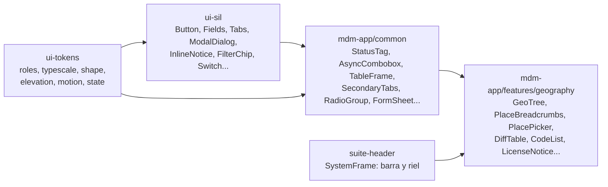
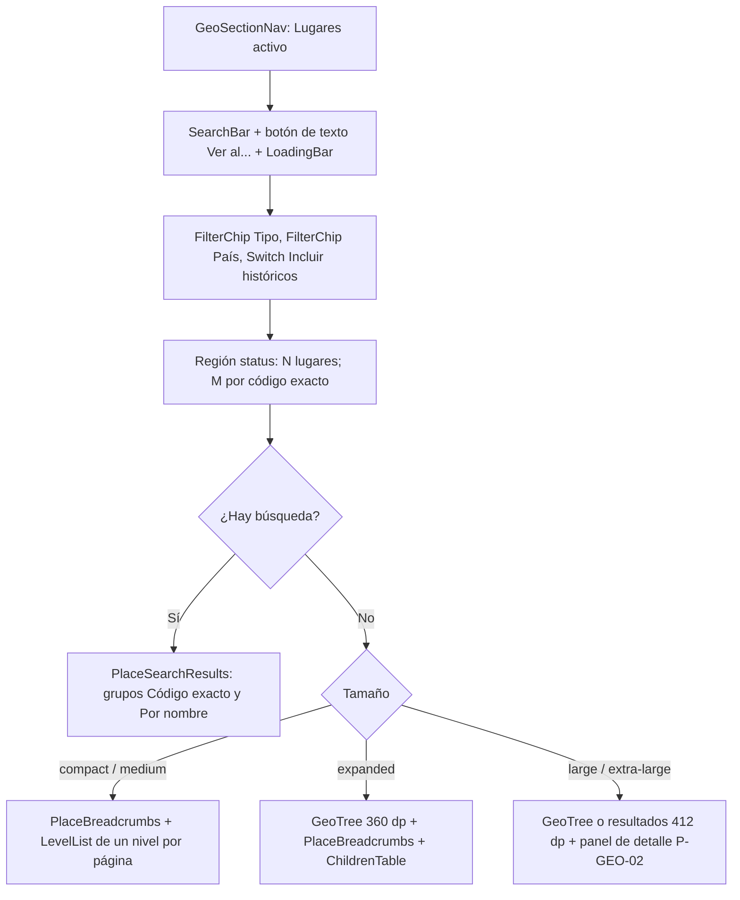
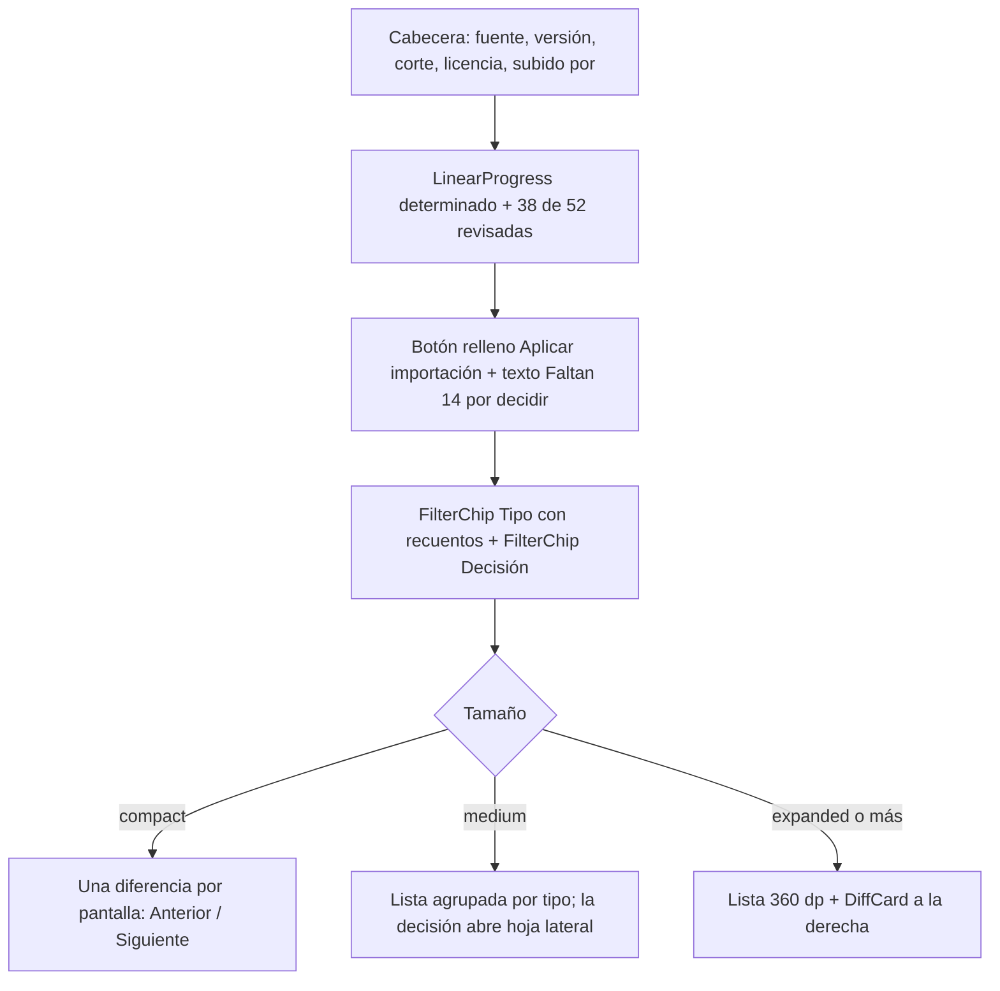

# Especificación UI — geografía de la suite en `mdm-app`: estados, anatomía y componentes

<p align="right">
  
  
  
</p>

> **Código:** `UI-MDM-002`
> **Fase:** 2 — Diseño
> **Deriva de:** [UX-MDM-002](./especificacion-ux-geografia-mdm-001.es.md) (P-GEO-01 a 09, D-GEO-01 a 14, §6 Microcopy, §7 Accesibilidad)
> **Estado:** Borrador. Traduce la especificación UX de la geografía a estados visuales, anatomía y componentes, sobre lo ya aprobado y construido de MDM.
> **Base aprobada:** [UI-MDM-001](./especificacion-ui-mdm-001.es.md) (tonos de etiqueta, marco, diálogos, criterios AC-01 a AC-29) y [UI-SIL-001](./especificacion-ui-sistema-diseno-sil-001.es.md) (sistema de diseño compartido).
> **Contrato:** [API-MDM-003](../03-construccion/contrato-api-geografia-mdm-003.es.md) (solo los estados y campos que la UI pinta).
> **Hub del área:** [MDM — Datos Maestros](./hub-mdm.es.md)

---

**Evidencia y supuestos.** Cada regla cita la sección de UX-MDM-002, de API-MDM-003, de UI-MDM-001 o el archivo de `src/libs` que la sostiene (leídos en solo lectura el 2026-10-25 en la rama `feature/mdm-geografia-diseno`). Los contrastes de §2.9 se **calcularon** con la fórmula de WCAG 2.2 sobre `src/libs/ui-tokens/src/colors.generated.css` (claro y oscuro). Lo que no tiene respaldo se marca **SUPUESTO** con su identificador `SU-UI-GEO-xx` (§7.2).

## 1. Propósito y relación con el sistema de diseño

Fija **cómo se ve y de qué piezas se compone** el destino «Geografía» de `mdm-app`: explorador y ficha de lugares, países, comercio exterior, zonas postales, importaciones con revisión de diferencias y sucesiones con revisión una a una de las direcciones afectadas. Es la especificación de la implementación por etapas en `src/libs/mdm-app/src/presentation/features/geography`, contra el mock de API-MDM-003.

**Alcance implementado en esta iteración:** consulta del explorador y fichas de país y ubicación; alta manual de países con sus tres códigos ISO 3166-1 (CO-02), declaración opcional de escalera (CO-06), divisiones administrativas (PL-03) y localidades sin generar un UBIGEO (PL-03), todo contra el mock. Las divisiones se crean según los niveles y esquemas declarados. Geografía no ofrece puertos, UN/LOCODE ni otras entidades de comercio exterior. La visibilidad de las acciones sigue los roles provisionales del contrato; su ratificación por UMS continúa pendiente en [G-622](../../GAPS.md). La admisión de localidades aún difiere del contrato API y permanece pendiente de decisión en [G-621](../../GAPS.md); las demás pantallas y acciones de esta especificación siguen siendo alcance de diseño, no funciones disponibles.

**Un solo sistema de diseño.** La geografía no tiene sistema visual propio. Consume la cadena de tokens de [UI-SIL-001 §3.1](./especificacion-ui-sistema-diseno-sil-001.es.md#31-la-cadena-de-tokens-y-su-origen) (ADR-0110: Material Design 3 como sistema de tokens sobre Tailwind v4 en modo CSS-first, generados con Style Dictionary en `src/libs/ui-tokens`), los componentes de `ui-sil` y las composiciones de `mdm-app/presentation/common` que ya pinta MDM. Hereda sin cambios las reglas de [UI-MDM-001 §1](./especificacion-ui-mdm-001.es.md#1-propósito-y-relación-con-el-sistema-de-diseño-compartido): solo alias semánticos (`bg-surface`, `text-on-surface-variant`…), ningún literal de color ni valor entre corchetes en `.tsx`, todo fondo con su `on-*`, un solo botón relleno por vista, pesos 400 y 500, espaciado en la escala de 4 dp, sombras `shadow-level-*`, estado nunca solo por color, layout por _window size class_ y **ocultar una acción no es control de acceso** (ADR-0165: el servidor decide y la UI pinta el `403`).

| Capa | Dónde vive | Qué hace la geografía |
| :--- | :--- | :--- |
| Roles de color, tipografía, forma, elevación, movimiento, capas de estado, puntos de corte | `src/libs/ui-tokens/src/colors.generated.css`, `theme.css`, `theme-map.generated.css` | **Solo consume.** Ningún token de sistema nuevo |
| Tokens de componente compartidos (`touch-target`, `focus-ring`, `focus-scroll-margin`, `side-sheet`, `dialog`) | `src/libs/ui-tokens/tokens/component/component.json` | Consume los existentes |
| Componentes base | `src/libs/ui-sil/src` (exportados por `index.ts` y `patterns/index.ts`) | Reutiliza (§5.1) |
| Composiciones comunes de MDM | `src/libs/mdm-app/src/presentation/common` | Reutiliza (§5.2); amplía una (`AsyncCombobox`, §5.3) |
| Composiciones de geografía | `src/libs/mdm-app/src/presentation/features/geography` (a crear) | Las crea solo como composición de lo anterior (§5.3) |

**Tokens nuevos: ninguno de sistema.** Todos los estados de §2 se resuelven con los seis tonos que ya pinta `StatusTag` y con roles existentes. Solo se justifican **dos tokens de componente locales** en `src/libs/mdm-app/src/mdm-tokens.css`, el mismo archivo y la misma regla que `--mdm-establishment-list-width` ([SU-UI-MDM-01](./especificacion-ui-mdm-001.es.md#72-supuestos), [G-583](../../GAPS.md)):

| Token | Valor | Origen | Uso |
| :--- | :--- | :--- | :--- |
| `--mdm-tree-pane-width` | `22.5rem` (360 dp) | Panel del árbol en `expanded` de [UX-MDM-002 §5.2](./especificacion-ux-geografia-mdm-001.es.md#52-adaptación-por-tamaño-de-ventana) | `w-(--mdm-tree-pane-width)` en P-GEO-01 y en la lista de P-GEO-07 y P-GEO-09 en `expanded` |
| `--mdm-list-pane-width` | `25.75rem` (412 dp) | Panel de lista de la lista-detalle de M3; ya especificado en [UI-MDM-001 §1](./especificacion-ui-mdm-001.es.md#1-propósito-y-relación-con-el-sistema-de-diseño-compartido) y **no implementado** (no está en `mdm-tokens.css`) | `w-(--mdm-list-pane-width)` en `large` y superior |

Por qué no se reutiliza `--mdm-establishment-list-width` (también 360 dp): su nombre ata el valor a una pantalla; si cambia el ancho de la lista de establecimientos, el árbol no debe cambiar con él (**SUPUESTO [SU-UI-GEO-01](#72-supuestos)**).



## 2. Mapeo de estados a tono, icono y texto

Todos los estados se pintan con `StatusTag` de `mdm-app` (`src/libs/mdm-app/src/presentation/common/StatusTag.tsx`), que realiza los seis tonos de [UI-MDM-001 §2](./especificacion-ui-mdm-001.es.md#2-mapeo-de-tokens-por-elemento) (`block`, `attention`, `progress`, `outline`, `ready`, `quiet`) y la variante `onSelected` para la fila seleccionada. Cada estado lleva **tono + icono + texto**: el significado va en el texto, el icono es decorativo (`aria-hidden`, `MdmIcon`) y el tono refuerza (WCAG 1.4.1). La derivación de cada estado visible vive en `mdm-app/domain` como función pura probada, no en el componente.

**Regla de fila (heredada).** Solo `block`, `attention` y `progress` llevan contenedor de color; lo nominal (`ready`, `quiet`) calla con icono y texto, y lo terminal (`outline`) va delineado. Una fila muestra a lo sumo un contenedor de color salvo anomalía. En el **árbol** y en las **migas** el estado `Active` no se pinta (lo nominal calla del todo); en tablas y fichas, sí.

Iconos: nombres de Material Symbols. Sin marca, ya existen en `Icon.tsx` de `ui-sil` o en `MdmIcon.tsx`; con † **no existen** y se añaden a `MdmIcon` (estado) o a `Icon` de `ui-sil` (destino del riel) ([G-638](#73-gaps-propuestos)).

### 2.1 Estado del lugar

Fuente: `status` (`Active`, `Inactive`, `Historical`) de las vistas `minimal`, `path` y `full` ([API-MDM-003 §4.3](../03-construccion/contrato-api-geografia-mdm-003.es.md#43-vistas-de-la-ficha-pl-04-y-listas)) y `placeStatus` de PL-02. Texto en masculino («el lugar»); para `Country` el estado `Historical` se dice «Retirado» ([UX-MDM-002 §5.5](./especificacion-ux-geografia-mdm-001.es.md#55-p-geo-03--países)).

| Valor | Texto | Tono | Icono | Por qué |
| :--- | :--- | :--- | :--- | :--- |
| `Active` | Vigente | `ready` | `check_circle` | Nominal: calla |
| `Inactive` | Desactivado | `quiet` | `pause` | Reversible y sin incidencia: no se ofrece para direcciones nuevas, pero no pide actuar (como el establecimiento inactivo de UI-MDM-001 §2.3) |
| `Historical` (división, comercio, lugar propio) | Histórico | `outline` | `history` | Terminal y de solo lectura; el sucesor va como enlace junto a la etiqueta («Sucedido por {nombre}») |
| `Historical` (`Country`) | Retirado | `outline` | `cancel` | Código ISO retirado (UX §7: «retirado, aspa») |

UX pide «icono de reloj» para histórico; `history` es el reloj con flecha de Material y se distingue de `schedule`, que MDM ya usa para «Fuera de vigencia» ([UI-MDM-001 §2.2](./especificacion-ui-mdm-001.es.md#22-estado-del-rol)).

### 2.2 Uso interno por licencia

Fuente: `license.redistribution` agregado de la ficha `full` y `license` de cada código, nombre y punto (`InternalOnly`, `Redistributable`, `RedistributableWithAttribution`; [API-MDM-003 §8.3](../03-construccion/contrato-api-geografia-mdm-003.es.md#83-licencias-uso-interno-no-redistribuible)). Es una **restricción de licencia, no de seguridad** ([UX-MDM-002 §6.1](./especificacion-ux-geografia-mdm-001.es.md#61-vocabulario)): no lleva `block` ni `error`.

| Valor | Texto | Tono | Icono | Dónde |
| :--- | :--- | :--- | :--- | :--- |
| `InternalOnly` | Uso interno | `quiet` | `lock` | Etiqueta junto al estado en resultados, ficha y fila de código; ayuda visible en la ficha (`LicenseNotice`, §5.3) |
| `RedistributableWithAttribution` | Con atribución | `quiet` | `info` | Solo en «Fuente y licencia», con el `attributionText` |
| `Redistributable` | — | — | — | No se pinta: lo nominal calla |

**Hallazgo.** El contrato carga como `InternalOnly` **todas** las fuentes iniciales salvo `ORG` (ISO, UNECE, INEI, RENIEC, SUNAT, SERPOST; [API-MDM-003 §3.9](../03-construccion/contrato-api-geografia-mdm-003.es.md#39-catálogo-de-esquemas-de-código-y-fuentes)), mientras UX la limita a UN/LOCODE e ISO 3166-2 (US-GEO-016). Con el contrato, casi todas las filas llevarían «Uso interno» y la marca deja de distinguir. **Regla de UI:** cuando todas las filas de una lista la comparten, se dice **una vez** en una banda `LicenseNotice` sobre la lista (con el texto de UX §5.6) y la fila no la repite; cuando la lista mezcla licencias, cada fila afectada lleva la etiqueta (**SUPUESTO [SU-UI-GEO-02](#72-supuestos)**, [G-636](#73-gaps-propuestos)). La ficha y la fila de código la llevan siempre.

### 2.3 Sucesión

Fuente: `status` de SU-01 y SU-03 (`Proposed`, `Approved`, `Applied`, `Rejected`) y `appliedParticipantCount` ([API-MDM-003 §3.5](../03-construccion/contrato-api-geografia-mdm-003.es.md#35-sucesiones-territoriales)). Texto en femenino («la sucesión»).

| Valor | Texto | Tono | Icono | Por qué |
| :--- | :--- | :--- | :--- | :--- |
| `Proposed` | Propuesta | `attention` | `pending` † | Pide la decisión del responsable; bloquea a los lugares que participan (`409` `geo.succession.pending_review`) |
| `Approved` | Aprobada · aplicando {n} de {total} | `progress` | `sync` | En marcha sin incidencia: el contrato aplica un lugar por transacción |
| `Applied` | Aplicada | `ready` | `check_circle` | Nominal |
| `Rejected` | Rechazada | `outline` | `cancel` | Terminal |

**El progreso de las direcciones no es un estado.** UX nombra un estado «Revisada» que el contrato no tiene (`SuccessionStatus` no lo incluye). La UI no lo inventa como etiqueta: el progreso se pinta como **texto** en su propia columna («12 de 40 revisadas»; con cero pendientes, «Todas revisadas» con icono `done_all` en `on-surface-variant`) y, en P-GEO-09, con `LinearProgress` determinado. Así una fila nunca suma un segundo contenedor de color (**SUPUESTO [SU-UI-GEO-03](#72-supuestos)**, [G-635](#73-gaps-propuestos)).

### 2.4 Dirección afectada

Fuente: `reviewStatus` de SU-06 (`Pending`, `Reassigned`, `Kept`; `AddressReviewStatus` del OpenAPI).

| Valor | Texto | Tono | Icono |
| :--- | :--- | :--- | :--- |
| `Pending` | Pendiente | `attention` | `pending` † |
| `Reassigned` | Pasada a {sucesor} | `ready` | `check_circle` |
| `Kept` | Mantenida en {origen} | `ready` | `check_circle` |

«Dejar pendiente con nota» de UX (D-GEO-11) no tiene valor ni campo en el contrato: SU-07 solo admite `Reassign` y `Keep` con `reason`. La UI ofrece «Dejar pendiente» **sin guardar nada** (cierra la hoja y pasa a la siguiente) y no pinta nota (**SUPUESTO [SU-UI-GEO-04](#72-supuestos)**, [G-635](#73-gaps-propuestos)).

### 2.5 Importación: lote

Fuente: `status` de IM-01 e IM-03 (nueve valores de `ImportStatus`, [API-MDM-003 §3.8](../03-construccion/contrato-api-geografia-mdm-003.es.md#38-importaciones)). UX nombra seis estados ([§5.8](./especificacion-ux-geografia-mdm-001.es.md#58-p-geo-06--importaciones)); la UI agrupa los del contrato en esos seis y añade uno que UX no prevé. Texto en masculino («el lote»).

| Valor del contrato | Texto | Tono | Icono | Nota |
| :--- | :--- | :--- | :--- | :--- |
| `Received`, `Parsing` | Procesando | `progress` | `sync` | En segundo plano; la persona puede salir |
| `ReadyForReview` | En revisión · {n} por decidir | `attention` | `pending` † | `{n}` = `counts.pendingDecisions`; con `0`, «En revisión · listo para aplicar» |
| `Failed` | Con error | `block` | `error` | Motivo en lenguaje llano en la fila (UX §5.8) |
| `Approved`, `Applying` | Aplicando | `progress` | `sync` | Aprobar ya aplica (IM-06 `202`) |
| `Applied` | Aplicado | `ready` | `check_circle` | Nominal |
| `AppliedWithErrors` | Aplicado con errores | `attention` | `warning` | **No está en UX**: `counts.failed` diferencias no se aplicaron y piden revisión (**SUPUESTO [SU-UI-GEO-05](#72-supuestos)**) |
| `Rejected` | Descartado | `outline` | `cancel` | Vocabulario de UX («Descartar lote»); el contrato lo llama rechazo con motivo y exige permiso **A** |

### 2.6 Importación: diferencias

Fuente: `kind`, `requiresDecision`, `decision` (`Accept`, `Exclude`) y `applyStatus` de `ImportDiff` ([API-MDM-003 §5.7](../03-construccion/contrato-api-geografia-mdm-003.es.md#57-esquema-de-código-fuente-y-lote)). El **tipo** es una categoría, no un estado: va como etiqueta `quiet` (sin contenedor) para no competir con la decisión; la **decisión** es el estado de la fila.

| Tipo (`kind`) | Texto | Tono | Icono |
| :--- | :--- | :--- | :--- |
| `Added` | Alta | `quiet` | `add_circle` † |
| `Changed` | Cambio | `quiet` | `edit` |
| `Removed` | Baja · pasará a desactivado | `quiet` | `remove_circle` † |
| `SuccessionProposed` | Sucesión | `quiet` | `call_split` † |
| `Error` | Línea con error | `block` | `error` |

| Decisión | Texto | Tono | Icono |
| :--- | :--- | :--- | :--- |
| `requiresDecision` y sin `decision` | Pendiente | `attention` | `pending` † |
| `Accept` | Aprobada | `ready` | `check_circle` |
| `Exclude` | Rechazada | `outline` | `cancel` |
| `requiresDecision: false` | No requiere decisión | `quiet` | `remove` |

| Aplicación (`applyStatus`, tras aprobar el lote) | Texto | Tono | Icono |
| :--- | :--- | :--- | :--- |
| `Pending` | Por aplicar | `progress` | `sync` |
| `Applied` | Aplicada | `ready` | `check_circle` |
| `Failed` | No se aplicó | `block` | `error` (con `applyError` en texto debajo) |
| `Skipped` | Omitida | `quiet` | `remove` |

«Baja» se dice siempre con su efecto («pasará a desactivado» o «pasará a histórico»), nunca «borrar» (UX §6.1). UX pide decidir **todas** las diferencias; el contrato solo exige decisión en las que tocan un canónico, un nombre oficial, una baja o una sucesión. La UI cuenta como pendientes solo `counts.pendingDecisions` y deja las demás como «No requiere decisión», sin botones ([G-635](#73-gaps-propuestos)).

### 2.7 UN/LOCODE: estado y funciones

Fuente: `tradeLocation` de TL-03 (`functions[]`, `uneceStatus`, `uneceStatusDate`, `usableInTradeDocuments`; [API-MDM-003 §3.6](../03-construccion/contrato-api-geografia-mdm-003.es.md#36-lugares-de-comercio-exterior-y-lugares-propios)).

**Válido para documentos** es el único estado con etiqueta (derivado por el servidor, RN-GEO-08):

| `usableInTradeDocuments` | Texto | Tono | Icono |
| :--- | :--- | :--- | :--- |
| `true` | Válido para documentos | `ready` | `check_circle` |
| `false` | No válido para documentos | `outline` | `cancel` |

`false` no lleva `block`: con el filtro «Solo válidos para documentos» apagado puede ser la mitad de la lista, y el rojo en cada fila taparía las excepciones reales. El texto lo dice todo.

**Estado UNECE** como texto `body-medium` con el código en `tabular-nums` y su significado («AI · Adoptado por un organismo internacional»), sin etiqueta: es un dato de la fuente, no un estado de MDM. Los significados se toman de la publicación de UNECE y quedan **POR VERIFICAR** antes de la carga (**SUPUESTO [SU-UI-GEO-06](#72-supuestos)**; el conjunto utilizable es [G-628](../../GAPS.md)).

**Funciones** como lista en línea (`<ul>` con elementos separados por « · », `body-medium`), siempre con texto y nunca con el dígito UNECE solo:

| `functions[]` | Texto |
| :--- | :--- |
| `SEAPORT` · `RAIL` · `ROAD` · `AIRPORT` · `POSTAL` | Puerto marítimo · Ferroviario · Carretera · Aeropuerto · Postal |
| `MULTIMODAL` · `FIXED_TRANSPORT` · `INLAND_WATERWAY` | Multimodal o depósito interior · Transporte fijo · Vía navegable interior |
| `SPECIAL_ECONOMIC_ZONE` · `NOT_OFFICIAL` · `BORDER_CROSSING` | Zona económica especial · No oficial · Paso de frontera (legado) |

### 2.8 Código oficial

Fuente: `codes[]` de la ficha `full` (`isCurrent`, `validFrom`, `validTo`, `schemeCode`, `license`) y `isCanonical` del esquema (SC-01). Igual que el identificador de [UI-MDM-001 §2.5](./especificacion-ui-mdm-001.es.md#25-otros-elementos-con-estado).

| Condición | Texto | Tono | Icono |
| :--- | :--- | :--- | :--- |
| `isCurrent` | Vigente | `ready` | `check_circle` |
| no vigente y `validFrom` > hoy | Vigente desde el {dd/mm/aaaa} | `quiet` | `schedule` |
| no vigente y `validTo` < hoy | Vencido el {dd/mm/aaaa} | `outline` | `cancel` |
| Esquema canónico (además del estado) | Canónico | `quiet` | `star` |
| Esquema `InternalOnly` (además) | Uso interno | `quiet` | `lock` |

Un código vencido **sigue resolviendo** en la búsqueda (US-GEO-008): en los resultados por código exacto se ve con «Vencido el…» y, si su lugar es histórico, con el enlace al sucesor (`resolution.successors` de PL-02). La correspondencia (`Equivalent`, `PartOf`, `Overlaps`) no es un estado: se dice en una frase (§3.5).

### 2.9 Contraste verificado

Calculado con WCAG 2.2 sobre los valores actuales de `colors.generated.css` (claro; oscuro por el sistema). Umbrales: 4,5:1 texto, 3:1 icono, borde no textual y anillo de foco. Los pares que la geografía comparte con MDM repiten los valores de [UI-MDM-001 §2.6](./especificacion-ui-mdm-001.es.md#26-contraste-verificado), recalculados y coincidentes.

| Par (primer plano / fondo) | Uso en la geografía | Mínimo | Claro | Oscuro | Resultado |
| :--- | :--- | ---: | ---: | ---: | :--- |
| `on-surface` / `surface` | Texto de `ready` y `outline`; celdas | 4,5 | 16,27 | 14,29 | Cumple |
| `success` / `surface` | Icono de `ready` | 3 | 6,15 | 10,86 | Cumple |
| `success` / `surface-container-low` | Icono de `ready` en hoja lateral (D-GEO-11) | 3 | 5,84 | 10,06 | Cumple |
| `on-surface-variant` / `surface` | `quiet` (desactivado, uso interno, canónico, tipo de diferencia), segunda línea del árbol | 4,5 | 8,88 | 10,82 | Cumple |
| `on-surface-variant` / `surface-container-low` | `quiet` en hoja lateral | 4,5 | 8,43 | 10,01 | Cumple |
| `on-surface-variant` / `surface-container-high` | `quiet` en diálogo básico (D-GEO-05, 08, 10) | 4,5 | 7,62 | 8,43 | Cumple |
| `on-warning-container` / `warning-container` | `attention` (propuesta, pendiente, en revisión, aplicado con errores) | 4,5 | 13,26 | 7,21 | Cumple |
| `on-secondary-container` / `secondary-container` | `progress` (procesando, aplicando); banda «Estás viendo el catálogo al…» | 4,5 | 7,20 | 7,20 | Cumple |
| `on-error-container` / `error-container` | `block` (con error, no se aplicó); D-GEO-13 | 4,5 | 7,24 | 7,24 | Cumple |
| `outline` / `surface` | Borde de `outline` (histórico, retirado, rechazada, vencido) | 3 | 4,28 | 5,84 | Cumple |
| `outline` / `surface-container-low` | Borde de `outline` en hoja lateral | 3 | 4,06 | 5,41 | Cumple |
| `primary` / `surface` | Migas y enlaces de sucesor | 4,5 | 6,14 | 10,87 | Cumple |
| `primary` / `surface-container-low` | Enlaces dentro de la hoja lateral | 4,5 | 5,83 | 10,06 | Cumple |
| `on-surface` / `surface-container-highest` | Texto sobre `Skeleton` cuando termina de cargar | 4,5 | 13,23 | 9,52 | Cumple |
| `success` / `secondary-container` | Icono de `ready` en el nodo **seleccionado** del árbol y en la fila elegida de lista-detalle | 3 | 4,99 | 5,48 | Cumple |
| `on-surface-variant` / `secondary-container` | Segunda línea y `quiet` en el nodo seleccionado | 4,5 | 7,21 | 5,46 | Cumple |
| `primary` / `secondary-container` | Enlace «Sucedido por…» en la fila seleccionada | 4,5 | 4,98 | 5,48 | Cumple (justo en claro) |
| `secondary` / `secondary-container` | Anillo de foco sobre el nodo seleccionado | 3 | 5,01 | 5,46 | Cumple |
| `outline` / `secondary-container` | Borde de `outline` (histórico) en el nodo seleccionado | 3 | 3,47 | **2,95** | **No cumple en oscuro** |

**Regla heredada.** Un lugar histórico seleccionado en el árbol o en la lista-detalle pinta su etiqueta con `StatusTag onSelected` (borde `on-secondary-container`, 7,20:1), como ya hace MDM ([DV-04 de UI-MDM-001](./especificacion-ui-mdm-001.es.md#71-desviaciones), [G-582](../../GAPS.md)). **Por verificar:** los pares de la insignia de pendientes de §3.1 (`on-error` / `error`, 6,46:1 y 7,72:1 según [UI-SIL-001 §3.3](./especificacion-ui-sistema-diseno-sil-001.es.md#33-contraste-calculado-wcag-22), no recalculados aquí) y ampliar `contrast.test.ts` con `primary` / `secondary-container` y `outline` / `secondary-container` ([G-587](../../GAPS.md)).

## 3. Anatomía por pantalla y window size class

Traduce a componentes M3 los wireframes de texto de [UX-MDM-002 §5](./especificacion-ux-geografia-mdm-001.es.md#5-pantallas-y-diálogos). Los tamaños de ventana son los de `theme-map.generated.css` (`--breakpoint-medium` 600 dp, `--breakpoint-expanded` 840 dp, `--breakpoint-large` 1200 dp, `--breakpoint-extra-large` 1600 dp); React los lee con `useWindowSizeClass` de `ui-sil` y el CSS usa las variantes `medium:`, `expanded:`, `large:` y `extra-large:`, nunca anchos en píxeles. `extra-large` se comporta como `large` con ancho de lectura de 840 dp en las fichas.

### 3.1 Marco común y navegación secundaria

| Pieza | Componente M3 | Quién la pinta | Anatomía y tokens |
| :--- | :--- | :--- | :--- |
| Barra superior y riel | _Small top app bar_ y _navigation rail_ / cajón modal | `SystemFrame` de `suite-header` (`src/libs/suite-header/src/frame/SystemFrame.tsx`), sin cambios | El riel de MDM pasa de dos a **tres destinos**: «Organizaciones» (`group`), «Tipos de rol» (`list_alt`) y **«Geografía»** (`public` †). `SystemDestination` se tipa con `IconName` de `ui-sil`, así que `public` debe añadirse a `Icon.tsx` de `ui-sil`, no a `MdmIcon` ([G-638](#73-gaps-propuestos)). El FAB del riel sigue siendo «Nueva organización»: la geografía no aporta FAB (sus altas dependen del nivel o del lugar elegido) |
| Destino activo | Indicador activo del riel | `SystemFrame` | «Geografía» activo en toda ruta `/mdm/geografia/...` (**SUPUESTO [SU-GEO-04](./especificacion-ux-geografia-mdm-001.es.md#81-supuestos)**) |
| Navegación secundaria | _Primary tabs_ desplazables de M3, **como enlaces** | `GeoSectionNav` (nuevo, §5.3) | Seis secciones: Lugares, Países, Comercio exterior, Zonas postales, Importaciones, Sucesiones. 48 dp, etiqueta `title-small`, indicador `primary` de 3 dp, sobre `surface`. Son **rutas**, no paneles: `<nav aria-label="Secciones de Geografía">` con `<a aria-current="page">`, no `role="tablist"` (el patrón _tabs_ del APG es para paneles de la misma página) |
| Insignia de pendientes | _Small badge_ con número de M3 | `GeoSectionNav` | En «Importaciones» y «Sucesiones»: `bg-error text-on-error`, `radius-full`, `text-label-small`, alto 16 dp; el número se lee en el nombre del enlace («Sucesiones, 3 pendientes») y la insignia es `aria-hidden`. Sin pendientes, no se pinta. «Importaciones» no existe para la consulta (UX §5.8) |
| Banda «Ver al» | Composición: `InlineNotice` de ancho completo bajo las pestañas | `AsOfBanner` (nuevo) | `secondary-container` / `on-secondary-container` (UX §5.3), icono `history`, texto «Estás viendo el catálogo al {fecha}.» y botón de texto «Volver a hoy». Persistente, `role="status"` solo al aparecer. Con ella, ninguna acción de escritura se pinta |
| Título de página | `h1` | Cada pantalla | `headline-small-emphasized` desde `medium`; en `compact`, en la barra (`title-large-emphasized`). En P-GEO-02, el nombre oficial; en P-GEO-09, «Sucesión: {efecto}» |
| Margen y separaciones | — | Cada pantalla | Como [UI-MDM-001 §3.1](./especificacion-ui-mdm-001.es.md#31-marco-común): `px-4` en `compact`, `medium:px-6`; `gap-8` entre secciones, `gap-6` entre grupos, `gap-4` entre campos, `gap-2` entre controles |

**Tipografía propia de la geografía** (escala de [UI-SIL-001 §3.4](./especificacion-ui-sistema-diseno-sil-001.es.md#34-tipografía), sin estilos nuevos): códigos (ubigeo, UN/LOCODE, ISO, `ORG-SITE`), coordenadas, fechas y recuentos en `tabular-nums`; nombres oficiales **tal como los publica la autoridad**, sin transformar mayúsculas (`normal-case`); ruta legible en `body-small` `on-surface-variant`.

### 3.2 P-GEO-01 — Lugares: búsqueda y explorador



| Pieza | Componente | Anatomía y tokens |
| :--- | :--- | :--- |
| Búsqueda | `SearchBar` de `mdm-app/common` (56 dp, `surface-container-high`, `radius-full`) | Etiqueta «Buscar por ubigeo, UN/LOCODE, código ISO o nombre»; ayuda de UX §6.5. **Busca al enviar** (`Intro`) como en Organizaciones, no a cada tecla: UX describe 300 ms sin escribir, pero el componente construido busca al enviar y así no se anuncia a cada pausa (**SUPUESTO [SU-UI-GEO-07](#72-supuestos)**) |
| «Ver al…» | Botón de texto con icono `calendar` que abre `DateField` en `ModalDialog` `basic` | Al aplicar, pinta `AsOfBanner` (§3.1) y añade `asOf` a toda consulta |
| Filtros | `FilterChip` «Tipo» (País, División, Comercio exterior, Lugar propio) y «País»; `Switch` «Incluir históricos» | Fila `gap-2`; en `compact`, un chip «Filtros (n)» abre `ModalDialog` `bottom-sheet` |
| Resultados | `PlaceSearchResults` (nuevo): dos grupos con `h2` visualmente oculto «Código exacto» y «Por nombre» | Cada resultado es un elemento de lista de **dos líneas** (72 dp): línea 1 nombre oficial `body-large` + `StatusTag` si no es `Active` + «Uso interno» según §2.2; línea 2 `body-medium` `on-surface-variant`: ruta («Concepción › Junín › Perú»), tipo y nivel local, código canónico con su esquema («Ubigeo INEI 120203»). Todo el elemento es el enlace a la ficha. En `medium` o más, `TABLE_STYLES` de `ui-sil` con columnas Nombre (ruta debajo), Tipo y nivel, Código canónico, Estado |
| Migas | `PlaceBreadcrumbs` (nuevo) | Encima del nivel o del detalle; ver §3.3 |
| Explorador (`compact`, `medium`) | _List_ de M3 de un nivel por página (`LevelList`, nuevo) | `h2` «{Nombre del nivel en plural} de {padre}» («Provincias de Lima»). `compact`: tarjetas delineadas (`outline-variant`, `radius-md`, `p-4`) con nombre `title-medium`, línea «Ubigeo 1501 · 43 distritos» `body-medium` `on-surface-variant` e icono `navigate_next` decorativo; toda la tarjeta es el enlace (≥ 72 dp). `medium`: tabla reducida (nombre, código canónico, número de hijos, estado) dentro de `TableFrame` |
| Árbol (`expanded`) | `GeoTree` (nuevo, §3.3) a la izquierda en `w-(--mdm-tree-pane-width)` | Separación `gap-6` con el panel derecho; el panel derecho lleva migas, `h2` «Distritos de Lima (43)», botón tonal «Nuevo lugar» y `ChildrenTable` (tabla de una línea de 48 dp: Nombre, Código canónico con su esquema en la cabecera, Hijos, Estado) con `Pagination` |
| Lista-detalle (`large`, `extra-large`) | _Canonical layout_ list-detail de M3 | Panel de lista en `w-(--mdm-list-pane-width)` con el árbol o, si hay búsqueda, los resultados; panel de detalle con P-GEO-02 completa como `<section aria-label="Ficha de {nombre}">`. El lugar elegido se marca con `secondary-container` y `aria-current="true"` (resultados) o `aria-selected="true"` (árbol). Las migas pertenecen al detalle (UX §5.2) |
| «Nuevo lugar» | Botón tonal con icono `add` en el encabezado del nivel | Solo si el servidor permitiría la acción según el perfil (SU-GEO-02) **y** el padre está `Active` **y** la escalera tiene nivel siguiente; si no, no se pinta y un texto `body-small` dice por qué cuando la causa es del dato («Lima es el último nivel de la escalera de Perú.»), no cuando es del permiso |

**Por tamaño.** `compact`: búsqueda en la barra superior con «Buscar» de icono que abre la _search view_ a pantalla completa; un nivel por página; migas recortadas; «Cargar más». `medium`: un nivel por página con tabla reducida y migas completas. `expanded`: árbol + tabla de hijos. `large` y `extra-large`: lista-detalle; elegir un lugar actualiza el panel y la dirección (`/mdm/geografia/lugares/{id}`, SU-GEO-04) y el foco no salta al detalle (§6, AC-GEO-06).

### 3.3 Árbol de lugares y migas

**`GeoTree`** sigue el patrón _treeview_ del APG con un solo nodo seleccionable (UX §7, 1.3.1 y 2.1.1):

| Elemento | Marcado | Anatomía y tokens |
| :--- | :--- | :--- |
| Contenedor | `<ul role="tree" aria-label="Lugares de {país}">`; sin país elegido, «Países» | Sobre `surface`; desplazable en vertical dentro de su panel, sin región enfocable propia: el foco ya entra por el nodo itinerante |
| Nodo | `<li role="treeitem" aria-level aria-setsize aria-posinset aria-expanded? aria-selected>`; `tabindex` itinerante (un solo nodo con `0`) | Alto mínimo 48 dp (`--md-comp-touch-target-size`); sangría por nivel con la escala de 4 dp (`ps-4` por nivel: `ps-4`, `ps-8`, `ps-12`… hasta `ps-28` para seis niveles, sin valores entre corchetes); chevron `navigate_next` / `expand_more` de 24 dp `on-surface-variant` decorativo (el estado lo dice `aria-expanded`); nombre `body-large`; segunda línea opcional en `expanded` `body-small` `on-surface-variant` con código canónico y número de hijos; `StatusTag` compacta solo si no es `Active` |
| Hijos | `<ul role="group">` dentro del nodo | Cargados **por nivel y bajo demanda** con `parentId` (nunca el árbol completo, D11); `aria-busy="true"` mientras cargan |
| Nombre accesible del nodo | Texto visible + nivel local en texto oculto | «Lima, departamento» (el lector añade «3 de 25, contraído» por `aria-posinset`, `aria-setsize` y `aria-expanded`) |
| Nodo cargando | `treeitem` no seleccionable con «Cargando provincias de Lima…» y `Skeleton` | El anuncio va por la región `role="status"` de la pantalla; el foco **no se mueve** (UX §7, 2.4.3) |
| Nodo de error | `treeitem` con texto «No pudimos cargar las provincias de Lima. Pulsa Intro para reintentar.» e icono `error` | Un `treeitem` no puede contener un botón; `Intro` sobre él reintenta. Los niveles ya abiertos se conservan |
| Más hijos | `treeitem` «Cargar 20 más de {padre}» si `totalCount` supera la página | Ningún país del catálogo inicial lo necesita en el Perú; queda para países con niveles anchos (**SUPUESTO [SU-UI-GEO-08](#72-supuestos)**) |
| Seleccionado | `aria-selected="true"` | `secondary-container` / `on-secondary-container`; `StatusTag onSelected` (§2.9) |
| Qué contiene | Solo `Country` y `AdministrativeDivision` | Los lugares de comercio y propios cuelgan de su división pero se listan en la tabla de hijos con su tipo, no como nodos (**SUPUESTO [SU-UI-GEO-09](#72-supuestos)**) |

Teclado (APG): `↑` `↓` entre nodos visibles; `→` abre o va al primer hijo; `←` cierra o sube al padre; `Inicio`, `Fin`; `*` abre los hermanos; escritura anticipada por nombre normalizado (sin tildes); `Intro` o `Espacio` selecciona y muestra los hijos en el panel derecho; en `large`, `Intro` abre la ficha en el detalle.

**`PlaceBreadcrumbs`**, a partir de `ancestors` de la vista `path` (de la raíz al padre) más el lugar actual:

| Elemento | Marcado | Anatomía y tokens |
| :--- | :--- | :--- |
| Contenedor | `<nav aria-label="Ruta del lugar"><ol>` | Fila `body-medium`, `gap-1`, envuelve en varias líneas antes que desbordar (1.4.10) |
| Antepasado | `<li><a>` | `primary`, objetivo de 48 dp de alto con relleno vertical; separador `navigate_next` 18 dp `on-surface-variant` `aria-hidden` |
| Lugar actual | `<li><span aria-current="location">` | `on-surface`, no enlace |
| Recorte (`compact`) | Primer elemento + `IconButton` `more_horiz` «Mostrar 2 niveles ocultos» con `ActionMenu` + los dos últimos | «… › Lima › Lima» de UX §5.2; el menú lista los niveles ocultos como enlaces |

La ruta de las migas va de la raíz a la hoja («Perú › Lima › Lima › Miraflores»); la ruta legible de un resultado (`displayPath`) va de la hoja a la raíz («Lima › Lima › Perú») porque distingue homónimos leyendo de izquierda a derecha. Las dos convenciones son del contrato y de UX y no se mezclan en la misma pieza.

### 3.4 P-GEO-02 — Ficha del lugar

| Pieza | Componente | Anatomía y tokens |
| :--- | :--- | :--- |
| Volver | `BackLink` de `mdm-app/common` (por debajo de `large`) | «Volver a Lugares», conserva búsqueda, filtros y nivel |
| Migas | `PlaceBreadcrumbs` | Visibles en cuanto se conoce la ruta, aunque la ficha siga cargando |
| Cabecera | Composición sin tarjeta sobre `surface` (`PlaceHeader`, nuevo) | `h1` nombre oficial; fila `body-medium` `on-surface-variant` con tipo y nivel local («Distrito»); fila de etiquetas `size="regular"` (32 dp): estado (§2.1) y «Uso interno» (§2.2); código canónico `body-large` `tabular-nums` con su esquema y `IconButton` `content_copy` «Copiar código 150122» (snackbar «Código copiado.»). A la derecha (`expanded` o más) botón tonal «Corregir» y `ActionMenu` con `triggerText="Acciones"`; en `compact`, `ActionMenu` de icono `more_vert` |
| Avisos de estado | `InlineNotice` bajo la cabecera | `Inactive`: `neutral`, icono `pause`, «No se ofrece para direcciones nuevas; las existentes se conservan.». `Historical`: `neutral`, icono `history`, «Histórico desde el {fecha}. Sucedido por {sucesores}.» con enlaces. Sucesión `Proposed` en curso: `warning`, «Este lugar participa en una sucesión propuesta; no se puede desactivar ni mover hasta que se decida.» con enlace (contrato §3.5, paso 1) |
| Secciones | `Tabs` de `ui-sil` (pestañas primarias desplazables, `medium` o más); en `compact`, secciones apiladas con `h2` y botón de divulgación (`useDisclosure`, `aria-expanded`); las de solo texto (Punto de referencia, Fuente y licencia) pueden usar `DefinitionSection` de `ui-sil` (`<details>` nativo) | Datos, Códigos, Correspondencias, Comercio exterior (solo `TradeLocation`), Zonas postales, Punto de referencia, Sucesión, Fuente y licencia, Historial; en países, además Escalera de niveles. Contador en Códigos y Correspondencias («Códigos (3)») |
| Datos | `dl` de pares etiqueta-valor con la anatomía de `GeneralDataPanel` de la ficha de Party (etiqueta `body-small` `on-surface-variant`, valor `body-large`) | Nombre oficial, nombres alternativos (lista con idioma y tipo en texto: «Cuzco · español · alternativo»), padre (enlace), nivel, hijos (enlace al explorador con el número); dos columnas desde `expanded` |
| Códigos | `CodeList` (nuevo): tabla de una línea (`SECTION_TABLE`) en `medium` o más, tarjetas en `compact` | Columnas Esquema, Valor (`tabular-nums`), Autoridad, Vigencia («desde 01/01/1990»), Estado (§2.8: vigente o vencido + «Canónico» + «Uso interno»), acciones por fila (`ActionMenu` «Más acciones del código Ubigeo RENIEC 150122»: «Vencer»). `SectionToolbar` con `Switch` «Mostrar vencidos» y botón tonal «Agregar código» |
| Correspondencias | Tabla de sección | Columnas Desde (esquema y valor), Tipo dicho en frase («es parte de»), Hacia, Vigencia; fila con la frase completa en `body-small` debajo en `medium` |
| Comercio exterior | `dl` + lista de lugares propios | UN/LOCODE, funciones (§2.7), estado UNECE en texto, «Válido para documentos» (§2.7), IATA; lugares propios como lista con código `ORG-SITE`, tipo y enlace; botón tonal «Nuevo lugar propio» |
| Punto de referencia | `dl` | Latitud y longitud en grados decimales con seis decimales `tabular-nums`, precisión en texto («Localidad»), fuente («Punto de referencia de UN/LOCODE») y «Uso interno»; sin mapa ([G-634](../../GAPS.md)) |
| Sucesión | Lista `<ol>` de sucesiones del lugar | Por elemento: tipo y efecto en una frase, norma legal, fecha de efecto `tabular-nums`, `StatusTag` de la sucesión (§2.3) y enlace a P-GEO-09 |
| Fuente y licencia | `dl` + `LicenseNotice` | Fuente, versión, fecha de corte, lote (enlace a P-GEO-07), licencia en texto y su efecto |
| Historial | _List_ en línea de tiempo (como `PartyHistoryList`) | Elemento de 56 dp: icono `history`, texto `body-medium` «{qué} por {quién}», fecha y fuente `body-small` `tabular-nums` |

**Por tamaño.** `compact`: página propia, secciones apiladas, acciones en el menú de desbordamiento, tablas como tarjetas. `medium`: página propia, pestañas, tablas reducidas. `expanded`: página propia con tablas completas. `large`: dentro del panel de detalle de P-GEO-01, sin `BackLink`. `extra-large`: igual con `Datos` y `Fuente y licencia` limitados a 840 dp.

### 3.5 P-GEO-03 a P-GEO-06 y P-GEO-08 — Listas

Todas siguen la pauta de P-MDM-04 ([UI-MDM-001 §3.7](./especificacion-ui-mdm-001.es.md#37-p-mdm-04--tipos-de-rol)): `h1` + texto de apoyo, `SectionToolbar` (filtro a la izquierda, botón tonal de alta a la derecha), recuento en `role="status"`, tarjetas en `compact`, tabla reducida en `medium`, tabla completa desde `expanded` y **lista-detalle en `large`** (la fila abre la ficha o el lote en el panel de detalle, UX §5.2).

| Pantalla | Filtros y acción | Columnas en `expanded` (las de `medium` en **negrita**) | Particularidades |
| :--- | :--- | :--- | :--- |
| P-GEO-03 Países | `Switch` «Incluir retirados»; «Nuevo país» (solo perfil con permiso **A**) | **Nombre**, **Alfa-2** (canónico), Alfa-3, Numérico, **Escalera** («Departamento › Provincia › Distrito» o «Sin divisiones»), Lugares, **Estado** | La ficha del país añade la pestaña «Escalera de niveles» con botón tonal «Editar escalera» (D-GEO-06) |
| P-GEO-04 Comercio exterior | `FilterChip` País, Función, Estado UNECE; `Switch` «Solo válidos para documentos» (encendido); sin alta de UN/LOCODE (SU-GEO-15) | **UN/LOCODE**, **Nombre** (nombre sin diacríticos debajo si difiere), Funciones, Estado UNECE, **Válido para documentos**, Contenido en | Lugares propios como filas hijas **sangradas** (`ps-8`) bajo su UN/LOCODE con el código `ORG-SITE`, en el mismo `<tbody>` y con `aria-describedby` a «Lugar propio de {UN/LOCODE}»; «Nuevo lugar propio» en el menú de la fila del UN/LOCODE. Banda `LicenseNotice` sobre la tabla (§2.2) |
| P-GEO-05 Zonas postales | `SelectField` País obligatorio; «Nueva zona postal» | **Código**, **Lugares que cubre** («Miraflores, Surquillo, Barranco y 4 más»), Vigencia | Sin país: `EmptyState` «Elige un país para ver sus zonas postales.»; país con `usesPostalCode: false`: `EmptyState` «Este país no usa código postal en el catálogo.» sin botón de alta |
| P-GEO-06 Importaciones | `FilterChip` Estado y Fuente; «Nueva importación» | **Fuente y versión**, Fecha de corte, Licencia, Subido por, **Estado** (§2.5), **Diferencias** («4 altas · 45 cambios · 2 bajas · 1 sucesión») | Pendientes del responsable arriba; lote `Failed` con el motivo en `body-small` `on-surface-variant` bajo el estado y botón de texto «Subir otro archivo» |
| P-GEO-08 Sucesiones | `FilterChip` Estado (por defecto «Con direcciones pendientes» para quien puede revisar) y Tipo; «Proponer sucesión» | **Tipo y efecto**, Predecesores, Sucesores, Norma legal, **Fecha de efecto**, **Estado** (§2.3), Direcciones («12 de 40 revisadas») | El progreso es texto, no etiqueta (§2.3) |

### 3.6 P-GEO-07 — Revisión de diferencias



| Pieza | Componente | Anatomía y tokens |
| :--- | :--- | :--- |
| Cabecera | `dl` en una fila (`expanded`) o apilada | Fuente, versión, fecha de corte, licencia (con «Uso interno» si aplica), subido por y cuándo |
| Progreso | `LinearProgress` de `ui-sil` determinado | `aria-valuenow`, `aria-valuemax`, nombre «Diferencias decididas»; texto visible «{n} de {total} diferencias decididas» `body-medium` |
| Aplicar | Botón **relleno** «Aplicar importación» (único de la vista) | Con pendientes: `aria-disabled="true"` y texto `body-small` visible «Faltan {n} por decidir.» enlazado con `aria-describedby` (como `SectionToolbar` bloqueada). Abre D-GEO-08 |
| Filtros | `FilterChip` «Tipo» con recuento en cada opción y «Decisión» (Pendiente, Aprobada, Rechazada, No requiere decisión) | Por defecto, «Pendiente» |
| Lista | Elementos de dos líneas (72 dp): lugar y ruta; tipo (§2.6) y decisión | El elegido con `secondary-container` y `aria-current="true"`; en `expanded`, `w-(--mdm-tree-pane-width)` |
| Tarjeta de diferencia | `DiffCard` (nuevo) con `DiffTable` (nuevo) | `h2` «{Tipo} · {ruta}»; para `Changed`, `DiffTable` (§5.3) con solo los campos que cambian y la frase debajo («Nombre: Ancash → Áncash», con «pasa a» en texto oculto para el lector); para `Added`, `dl` con lo propuesto; para `Removed`, frase «Pasará a desactivado» o «Pasará a histórico»; para `SuccessionProposed`, efecto en una frase y «Se creará una sucesión propuesta, que no cambia nada hasta aprobarla.»; para `Error`, línea del archivo y motivo |
| Decisión | Botón tonal «Aprobar» y botón delineado «Rechazar» al pie de la tarjeta | «Rechazar» despliega un `TextAreaField` «Motivo» obligatorio y el botón «Confirmar rechazo» (el contrato no muestra dónde se guarda el motivo, [G-635](#73-gaps-propuestos)). Tras decidir, la lista avanza a la siguiente pendiente y el foco va al `h2` de la tarjeta |
| Solo lectura | Quien subió el lote, o perfil sin permiso **A** | Sin botones de decisión ni «Aplicar»; `InlineNotice` `neutral` «Otra persona responsable debe aprobar este lote.» solo para quien lo subió (G-629: el contrato no lo impone; la UI lo aplica por defecto, SU-GEO-02) |

**Por tamaño.** `compact`: una diferencia por pantalla con `IconButton` «Diferencia anterior» y «Diferencia siguiente» y el progreso arriba; «Aplicar» en `DockedActionBar` de 80 dp. `medium`: lista agrupada por tipo con `h3` por grupo; la tarjeta se abre en `ModalDialog` `side-sheet`. `expanded`: lista + tarjeta lado a lado. `large`: igual con la cabecera en una sola fila.

### 3.7 P-GEO-09 — Sucesión y direcciones afectadas

| Pieza | Componente | Anatomía y tokens |
| :--- | :--- | :--- |
| Cabecera | `h1` «Sucesión: {efecto}» + `dl` | Tipo, norma legal, fecha de efecto, propuesta por, aprobada por; `StatusTag` `regular` (§2.3) |
| Antes y después | Dos listas con `h2` «Predecesores» y «Sucesores» lado a lado desde `expanded`, apiladas por debajo | Por lugar: nombre (enlace), ruta `body-small`, códigos; los que pasan a histórico con `StatusTag` «Pasará a histórico» `outline` `history` (o «Histórico» ya aplicado) |
| Decisión del responsable | `Proposed`: botón relleno «Aprobar sucesión» y botón delineado «Rechazar» | Encima, `body-medium`: «{n} direcciones apuntan a los lugares de origen.» Abren D-GEO-10. Quien la propuso no los ve (SU-GEO-02) |
| Direcciones afectadas | `h2` + `LinearProgress` + `SectionToolbar` (`FilterChip` Decisión, botón tonal «Revisar la siguiente pendiente») + tabla de sección | Columnas: Organización o establecimiento (enlace a la ficha de la Party), Dirección, Origen, Decisión (§2.4), Por y cuándo. **Sin casillas de selección ni acción masiva** (D-048 (3)) |
| Revisión una a una | D-GEO-11 (§3.8) | Se abre desde «Revisar la siguiente pendiente» o desde el menú de la fila |

El contrato solo devuelve **identificadores** de la dirección (`partyId`, `establishmentId`, `currentPlaceId`; [API-MDM-003 §5.6](../03-construccion/contrato-api-geografia-mdm-003.es.md#56-sucesión-su-02-su-04-su-07)); el nombre de la organización y el texto de la dirección se leen de API-MDM-002 por fila. Mientras cargan, la celda muestra `Skeleton`; si fallan, «No pudimos cargar esta dirección» y la fila sigue revisable por su identificador ([G-637](#73-gaps-propuestos)).

### 3.8 Diálogos y hojas (D-GEO-01 a D-GEO-14)

Todos con `ModalDialog` de `ui-sil` a través de `FormSheet` y `ConfirmDialog` de `mdm-app/common/dialogs` (foco atrapado, `Escape`, retorno al disparador, resto `inert`), con la variante por tamaño de [UI-MDM-001 §3.5](./especificacion-ui-mdm-001.es.md#35-diálogos-y-hojas-d-mdm-01-a-d-mdm-14): formularios `full-screen` en `compact` y `side-sheet` (≤ 400 dp, `surface-container-low`) desde `medium`; confirmaciones `basic` en todos los tamaños. Excepción de UX: **D-GEO-09 es `full-screen` en todos los tamaños** (formulario largo con buscadores múltiples).

| ID | Contenedor | Componentes del cuerpo |
| :--- | :--- | :--- |
| D-GEO-01 Nuevo lugar | `FormSheet` | `ReadOnlyField` padre (con ruta) y nivel; `TextField` nombre oficial (200); `TextField` código canónico con la etiqueta del esquema («Ubigeo INEI (obligatorio)»), `inputMode="numeric"` en ubigeo y ayuda «Empieza por 1506.»; nombres alternativos como filas (nombre, `SelectField` idioma, `SelectField` tipo) con «Agregar otro nombre». **Lugar propio:** `ReadOnlyField` contenedor UN/LOCODE; `TextField` código con prefijo visible fijo («PECLL-») y ayuda de UX §6.5; `SelectField` tipo (`siteKind`: Terminal, Depósito temporal, Patio de contenedores, Planta, Otro); establecimiento vinculado opcional con `AsyncCombobox` |
| D-GEO-02 Corregir lugar | `FormSheet` | `ReadOnlyField` código, padre y nivel; `TextField` nombre oficial con `changed`; `TextAreaField` motivo (PL-05 lo recibe); nombres alternativos con «Vencer» por fila |
| D-GEO-03 Agregar o vencer código | `FormSheet` | Agregar: `SelectField` esquema (SC-01 filtrado por tipo y país), autoridad como texto derivado, `TextField` valor con el patrón explicado en la ayuda, `DateField` desde. Vencer: valor `body-large` `tabular-nums`, `DateField` «Vence el», `TextAreaField` motivo; si es el último canónico abierto, la acción no se ofrece y el menú muestra la razón (`MenuItem.disabled` + `reason`) |
| D-GEO-04 Registrar correspondencia | `FormSheet` | Origen como texto; `SelectField` esquema destino + `PlacePicker` o `TextField` valor; `RadioGroup` tipo (Equivalente, Parte de, Se solapa) con la ayuda de UX §6.5 en cada opción; frase de vista previa `body-medium` en `aria-live="polite"` |
| D-GEO-05 Desactivar lugar | `ConfirmDialog` `tone="primary"` | Texto de UX §6.3 con el número de direcciones y de hijos (SU-GEO-16); reversible: botón relleno `primary`, no `DangerButton` |
| D-GEO-06 Escalera de niveles | `FormSheet` | Lista ordenada (`<ol>`) de filas: canónico `ADM{n}` como texto, `TextField` nombre local, `IconButton` «Subir {nivel}», «Bajar {nivel}» y «Quitar {nivel}» (sin arrastrar: 2.5.7); `Checkbox` «Nivel de dirección» (a lo sumo uno, `RadioGroup` si se prefiere); un nivel con lugares muestra «Tiene {n} lugares» y sus botones de quitar y mover quedan `aria-disabled` con el motivo visible |
| D-GEO-07 Nueva importación | `FormSheet` | `SelectField` fuente; `TextField` versión; `DateField` fecha de corte con la ayuda de UX §6.5; `RadioGroup` licencia confirmada (Sí, No, Sin confirmar); `FileField` (nuevo, §5.3) con tipos admitidos y 50 MB en la ayuda |
| D-GEO-08 Aplicar importación | `ConfirmDialog` `tone="danger"` | Recuentos por tipo y decisión en `dl`; texto de UX §6.3; foco inicial en «Cancelar» |
| D-GEO-09 Proponer sucesión | `ModalDialog` `full-screen` con `FormSheet` | `RadioGroup` tipo (seis, con una frase cada uno); `PlacePicker` múltiple «Predecesores» y «Sucesores» (lista de elegidos con «Quitar {nombre}»); botón de texto «Nuevo lugar» que abre D-GEO-01 apilado; `TextField` norma legal; `DateField` fecha de efecto; vista previa en una frase en `aria-live="polite"`. Desde `expanded`, dos columnas: datos a la izquierda, vista previa fija a la derecha |
| D-GEO-10 Aprobar o rechazar sucesión | `ConfirmDialog` `tone="danger"` | Lista de lugares que pasan a histórico; número de direcciones y «ninguna se cambia sola»; «Rechazar» abre su propio `ConfirmDialog` con `TextAreaField` motivo obligatorio. Tres botones de UX §6.3 se separan en dos diálogos para mantener un solo verbo por confirmación (**SUPUESTO [SU-UI-GEO-10](#72-supuestos)**) |
| D-GEO-11 Revisar dirección | `side-sheet` desde `medium`; página en `compact` | Título «Revisar dirección {i} de {n}» enfocable; `dl` con organización (enlace), dirección y origen con ruta; `RadioGroup` «¿A qué lugar pasa esta dirección? (obligatorio)» **sin valor inicial**, una opción por candidato (`candidatePlaceIds`) con su ruta, «Mantener en {origen}» solo si sigue `Active`, y «Dejar pendiente»; `TextAreaField` nota; acciones «Anterior» (texto) y «Guardar y siguiente» (relleno) |
| D-GEO-12 Selector de lugar | Campo dentro de otros formularios | `PlacePicker` (§5.3) sobre `AsyncCombobox`; bajo el campo, la ruta elegida `body-small` |
| D-GEO-13 El elemento cambió | `VersionConflictNotice` con `text` propio | «{Este lugar · Esta dirección · Este lote} cambió mientras lo editabas. Tus cambios siguen aquí.» dentro del formulario abierto; `role="alert"` |
| D-GEO-14 Zona postal | `FormSheet` | País como texto si viene de P-GEO-05; `TextField` código con el patrón del país en la ayuda; `PlacePicker` múltiple «Lugares que cubre»; `DateField` desde y hasta |

### 3.9 Resumen por tamaño de ventana

| Clase | P-GEO-01 | P-GEO-02 | Listas (03 a 06, 08) | P-GEO-07 y 09 | Formularios | Confirmaciones |
| :--- | :--- | :--- | :--- | :--- | :--- | :--- |
| `compact` | Un nivel por página en tarjetas, migas recortadas, búsqueda en la barra | Página; secciones apiladas con divulgación | Tarjetas, «Filtros» en hoja inferior, «Cargar más» | Una diferencia o dirección por pantalla | `full-screen` | `basic` |
| `medium` | Un nivel por página en tabla reducida, migas completas | Página; pestañas | Tabla reducida | Lista agrupada; decisión en `side-sheet` | `side-sheet` | `basic` |
| `expanded` | `GeoTree` 360 dp + tabla de hijos | Página; tablas completas | Tabla completa | Lista 360 dp + tarjeta | `side-sheet` (D-GEO-09 `full-screen`) | `basic` |
| `large` y `extra-large` | Lista-detalle: árbol o resultados 412 dp + ficha | Panel de detalle | Lista-detalle | Igual que `expanded` con columna de contexto | `side-sheet` (D-GEO-09 `full-screen`) | `basic` |

## 4. Estados interactivos y de carga, error, vacío, sin permiso y solo lectura

### 4.1 Estados interactivos (capas de estado)

Se derivan de las capas de [UI-SIL-001 §3.9](./especificacion-ui-sistema-diseno-sil-001.es.md#39-capas-de-estado) (`--md-sys-state-*-opacity`, utilidad `state-layer`), como en [UI-MDM-001 §4.1](./especificacion-ui-mdm-001.es.md#41-estados-interactivos-capas-de-estado), cuya tabla se aplica tal cual a botones, campos, pestañas, chips, interruptores, menús y filas. La geografía añade cuatro piezas interactivas:

| Componente | Enabled | Hover (8 %, solo `hover: hover`) | Focused (10 % + anillo 3 dp `secondary`) | Pressed (10 %) | Disabled | Otros |
| :--- | :--- | :--- | :--- | :--- | :--- | :--- |
| Nodo de `GeoTree` | `surface`, texto `on-surface` | Capa `on-surface` | Capa + anillo **hacia dentro** (`outline-offset: -3px`), para que el panel no lo recorte | Capa | No aplica | **Seleccionado**: `secondary-container` / `on-secondary-container` (no capa); **abierto**: chevron `expand_more`; **cargando**: `aria-busy` en el grupo |
| Miga (enlace) | `primary` | Subrayado + capa | Anillo a 2 dp | Capa | No aplica | **Actual**: `on-surface`, sin enlace |
| Enlace de `GeoSectionNav` | Etiqueta `on-surface-variant` | Capa | Capa + anillo | Capa | No aplica | **Actual**: etiqueta `primary`, indicador `primary` 3 dp, `aria-current="page"` |
| Elemento de lista de diferencias y de resultados | `surface` | Capa | Anillo hacia dentro sobre el enlace que cubre el elemento | Capa | No aplica | **Elegido** (lista-detalle): `secondary-container`, `aria-current="true"` |
| `RadioGroup` de D-GEO-11 | Rol M3 | Capa en el radio | Capa + anillo | Capa | 12 % / 38 % (`readOnly` mientras guarda) | **Sin selección inicial**: ningún radio marcado; el grupo es un solo punto de tabulación |

`StatusTag`, la insignia de pendientes y la banda «Ver al» no son interactivas: sin capa ni foco.

### 4.2 Estados de carga, error, vacío, sin permiso y solo lectura

Textos de [UX-MDM-002 §5 y §6](./especificacion-ux-geografia-mdm-001.es.md#6-microcopy); aquí, el componente que los pinta.

| Componente clave | Cargando | Error | Vacío | Sin permiso | Solo lectura |
| :--- | :--- | :--- | :--- | :--- | :--- |
| Resultados de búsqueda (P-GEO-01) | `LoadingBar` + filas `Skeleton` del alto final; la búsqueda sigue operable | `LoadError` con «Reintentar»; los resultados anteriores se retiran (no se dan por buenos) | `EmptyState` `announce` «Ningún lugar coincide con «{texto}».» + `Switch` «Incluir históricos» si estaba apagado + «Nuevo lugar» con el nombre escrito (si hay permiso) | Sin «Nuevo lugar» | Vista «Ver al»: sin «Nuevo lugar» |
| `GeoTree` y `LevelList` | Nodo o nivel con `Skeleton` y «Cargando {nivel}…» en `role="status"`; los niveles abiertos siguen operables | Nodo de error con reintento (§3.3) o `InlineNotice` `error` en el nivel; nunca lista parcial como completa | Catálogo vacío: `EmptyState` «Aún no hay países en el catálogo.» + «Ir a Importaciones»; nivel sin hijos: «{Nombre} no tiene {nivel siguiente en plural} registrados.»; escalera vacía: «Este país no tiene divisiones registradas.» | Sin «Nuevo lugar» | Histórico: nodo con `StatusTag` y sin «Nuevo lugar» |
| Cabecera de P-GEO-02 | Migas en cuanto llegan; `Skeleton` de nombre, etiquetas y código | `LoadError` de página con «Reintentar» y «Volver a Lugares»; `404`: `NotFound` «Este lugar no existe.» (nunca para un histórico) | — | Sin botones ni menú de acciones; todo se lee | `Historical`: sin acciones salvo «Copiar código»; aviso `neutral` (§3.4). «Ver al»: igual |
| Pestaña de la ficha | `Skeleton` del panel | `InlineNotice` `error` **solo en ese panel** + «Reintentar» | `EmptyState` de sección: «Sin códigos de otras autoridades.», «Sin correspondencias registradas.», «Sin punto de referencia.», «Sin sucesiones.» | Sin botón tonal de alta ni menú por fila | Sin botón ni menú; códigos vencidos sin menú |
| Listas P-GEO-03 a 06 y 08 | `LoadingBar` + `SkeletonRows` | `LoadError` | `EmptyState` con el texto de UX de cada pantalla y su acción si procede | Sin botón de alta; «Importaciones» no aparece en `GeoSectionNav` para la consulta | — |
| P-GEO-07 Revisión | `Skeleton` de la tarjeta; la lista sigue | `InlineNotice` `error` en la tarjeta | «Esta publicación no cambia nada del catálogo.» + «Cerrar lote» | Sin decisiones ni «Aplicar» | Quien subió el lote: aviso `neutral` (§3.6). Lote `Applied`, `Rejected` o `Failed`: todo en lectura con `applyStatus` |
| P-GEO-09 Direcciones afectadas | `LinearProgress` con el último valor conocido + `SkeletonRows`; celdas de Party con `Skeleton` | Error de la lista: `InlineNotice` `error` + «Reintentar» **sin ocultar la cabecera**; error de una fila de Party: texto en la celda (§3.7) | «Ninguna dirección apuntaba a los lugares de origen.»; todas revisadas: `EmptyState` `announce` «Todas las direcciones de esta sucesión están revisadas.» | Sin «Revisar la siguiente pendiente» ni menú de fila | `Rejected`: sin lista |
| Formularios D-GEO | Catálogos (esquemas, fuentes) con «Cargando opciones…»; acción principal deshabilitada hasta tenerlos | `ErrorSummary` enfocado al enviar + error en el campo (`409` `geo.code.duplicate` con enlace al lugar que lo tiene); `422` de nivel o padre en `InlineNotice`; `412` → D-GEO-13 | — | `403` → `WriteNotice` con el texto de UX §6.2; el formulario **no se cierra** y conserva el borrador | — |
| Envío | Botón principal en _loading_ (`aria-busy`, «Guardando…»), campos `readOnly` (no `disabled`) | Ver fila anterior | — | — | — |
| Confirmaciones D-GEO-05, 08, 10 | Botón de la acción en _loading_ | `InlineNotice` `error` dentro del diálogo; no se cierra. `409` `geo.import.stale`: «El catálogo cambió después de calcular estas diferencias. Sube de nuevo el archivo para recalcularlas.» (contrato; UX pedía volver a pendiente, [G-635](#73-gaps-propuestos)) | — | `403` en el diálogo | — |
| `PlacePicker` (D-GEO-12) | «Buscando…» en la lista (`aria-busy`) | Opción «No pudimos buscar. Reintentar» | «Ningún lugar coincide…» | — | Campo `readOnly` con la ruta |
| Insignia de pendientes | No se pinta hasta tener el número | No se pinta (no se inventa un cero) | No se pinta | No se pinta | — |

**Ocultar no es control de acceso** (ADR-0165). La matriz rol × acción de [UX-MDM-002 §2.2](./especificacion-ux-geografia-mdm-001.es.md#22-matriz-rol--acción) y los tres permisos supuestos del [contrato §8.2](../03-construccion/contrato-api-geografia-mdm-003.es.md#82-autorización-tres-permisos) (`geo.read`, `geo.maintain`, `geo.approve`, [G-622](../../GAPS.md)) sirven solo para **no ofrecer** lo que no se puede hacer. El servidor decide, y todo `403` (`auth.forbidden` o `geo.license.restricted`) se pinta aunque la UI hubiera ofrecido la acción. Las dos fuentes discrepan en quién resuelve direcciones afectadas (UX: analista y responsable; contrato: solo **A**): la UI ofrece la acción a quien tenga `geo.approve` y pinta el `403` si el servidor cambia de criterio ([G-635](#73-gaps-propuestos)).

## 5. Inventario de componentes

Rutas relativas a la raíz del repositorio. Lo de `ui-sil` se importa desde `@sil/ui` (`src/libs/ui-sil/src/index.ts`, que también reexporta `patterns/index.ts`). `mdm-app` no importa `sil-app` (frontera de [D-026](../../DECISIONS.md#decisiones-locales)).

### 5.1 Reutilizados de `ui-sil` y `suite-header`

| Componente | Ruta | Uso en la geografía |
| :--- | :--- | :--- |
| `SystemFrame` | `src/libs/suite-header/src/frame/SystemFrame.tsx` | Barra y riel con el tercer destino «Geografía» (§3.1) |
| `Button`, `IconButton` | `src/libs/ui-sil/src/Button.tsx` | Acciones, copiar código, navegación de diferencias |
| `TextField`, `SelectField`, `TextAreaField` | `src/libs/ui-sil/src/Fields.tsx` | Formularios D-GEO |
| `DateField` | `src/libs/ui-sil/src/DateField.tsx` | «Ver al», vigencias, fecha de corte, fecha de efecto |
| `InlineNotice` | `src/libs/ui-sil/src/InlineNotice.tsx` | Avisos de estado del lugar, de sucesión en curso, de error por panel |
| `ModalDialog` | `src/libs/ui-sil/src/ModalDialog.tsx` | Base de `FormSheet` y `ConfirmDialog`; `bottom-sheet` de filtros; `full-screen` de D-GEO-09 |
| `ActionMenu`, `SelectionMenu`, `MenuItem` | `src/libs/ui-sil/src/ActionMenu.tsx` | «Acciones» de la ficha, menú por fila, migas ocultas, filas por página |
| `FilterChip` | `src/libs/ui-sil/src/FilterChip.tsx` | Tipo, País, Función, Estado, Decisión |
| `Switch` | `src/libs/ui-sil/src/Switch.tsx` | «Incluir históricos», «Incluir retirados», «Solo válidos para documentos», «Mostrar vencidos» |
| `Tabs`, `tabId`, `panelId` | `src/libs/ui-sil/src/Tabs.tsx` | Secciones de la ficha (paneles de la misma página) |
| `LoadingBar`, `Skeleton` | `src/libs/ui-sil/src/Loading.tsx` | Carga de página, nivel y panel |
| `LinearProgress` | `src/libs/ui-sil/src/LinearProgress.tsx` | Progreso de decisiones (P-GEO-07) y de direcciones (P-GEO-09): `value`, `max`, `label`, `text` |
| `LoadError` | `src/libs/ui-sil/src/LoadError.tsx` | Errores de lectura con «Reintentar» |
| `SnackbarProvider`, `useSnackbar` | `src/libs/ui-sil/src/Snackbar.tsx` | Éxitos de UX §6.4; nunca errores |
| `Icon` | `src/libs/ui-sil/src/Icon.tsx` | Iconos existentes; añadir `public` para el destino ([G-638](#73-gaps-propuestos)) |
| `TABLE_STYLES` | `src/libs/ui-sil/src/table-styles.ts` | Resultados y listas de página |
| `ReadOnlyField` | `src/libs/ui-sil/src/patterns/ReadOnlyField.tsx` | Padre, nivel y código no editables en D-GEO-01 y 02 (`label`, `value`, `reason`). Primer uso en `mdm-app` |
| `DefinitionSection` | `src/libs/ui-sil/src/patterns/DefinitionSection.tsx` | Secciones de solo texto plegables en `compact` (valores `string`) |
| `SkeletonRows` | `src/libs/ui-sil/src/patterns/SkeletonRows.tsx` | Carga de tablas |
| `DockedActionBar` | `src/libs/ui-sil/src/patterns/DockedActionBar.tsx` | «Aplicar importación» y «Guardar y siguiente» en `compact` |
| `useWindowSizeClass`, `useDisclosure`, `useDocumentTitle`, `formatCivilDate`, `formatDateTime` | `src/libs/ui-sil/src/use-window-size-class.ts`, `use-disclosure.ts`, `use-document-title.ts`, `format.ts` | Variante por tamaño, divulgación, título del documento, fechas `es-PE` |

### 5.2 Reutilizados de `mdm-app/presentation/common`

| Componente | Ruta | Uso en la geografía |
| :--- | :--- | :--- |
| `StatusTag` (`tone`, `icon`, `text`, `size`, `onSelected`) | `src/libs/mdm-app/src/presentation/common/StatusTag.tsx` | Todas las etiquetas de §2, a través de los mapas de §5.3 |
| `MdmIcon` | `src/libs/mdm-app/src/presentation/common/MdmIcon.tsx` | Iconos locales; añadir `pending`, `add_circle`, `remove_circle`, `call_split` ([G-638](#73-gaps-propuestos)) |
| `AsyncCombobox` | `src/libs/mdm-app/src/presentation/common/AsyncCombobox.tsx` | Base de `PlacePicker` (§5.3) |
| `SearchBar` | `src/libs/mdm-app/src/presentation/common/SearchBar.tsx` | Búsqueda de P-GEO-01 |
| `Pagination` | `src/libs/mdm-app/src/presentation/common/Pagination.tsx` | Tablas de hijos y listas |
| `TableFrame`, `SECTION_TABLE` | `src/libs/mdm-app/src/presentation/common/TableFrame.tsx`, `table-styles.ts` | Tablas de sección de la ficha y de P-GEO-09 |
| `SecondaryTabs` | `src/libs/mdm-app/src/presentation/common/SecondaryTabs.tsx` | Filtro segmentado «Pendientes · Decididas · Todas» de la lista de diferencias en `medium` (opcional frente a `FilterChip`) |
| `SectionToolbar` | `src/libs/mdm-app/src/presentation/common/SectionToolbar.tsx` | Filtro + acción tonal de cada sección y lista; acción bloqueada con motivo visible |
| `EmptyState` | `src/libs/mdm-app/src/presentation/common/EmptyState.tsx` | Vacíos de §4.2 |
| `ErrorSummary` | `src/libs/mdm-app/src/presentation/common/ErrorSummary.tsx` | Formularios D-GEO |
| `Checkbox`, `RadioGroup` | `src/libs/mdm-app/src/presentation/common/Checkbox.tsx`, `RadioGroup.tsx` | D-GEO-04, 06, 07, 09 y 11 (sin valor inicial en 11) |
| `BackLink`, `NotFound` | `src/libs/mdm-app/src/presentation/common/BackLink.tsx`, `NotFound.tsx` | Volver a Lugares; lugar inexistente |
| `DangerButton` | `src/libs/mdm-app/src/presentation/common/DangerButton.tsx` | Vía `ConfirmDialog tone="danger"` en D-GEO-08 y 10 |
| `FormSheet`, `ConfirmDialog`, `WriteNotice` | `src/libs/mdm-app/src/presentation/common/dialogs/` | Todos los D-GEO |
| `VersionConflictNotice` (`text`) | `src/libs/mdm-app/src/presentation/common/VersionConflictNotice.tsx` | D-GEO-13 con el sujeto de cada elemento |
| `use-focus-rescue` | `src/libs/mdm-app/src/presentation/common/use-focus-rescue.ts` | Foco al encabezado cuando el disparador desaparece (dirección revisada con filtro «Pendiente») |

### 5.3 Componentes nuevos en `mdm-app`

En `src/libs/mdm-app/src/presentation/features/geography` (identificadores en inglés, [D-025](../../DECISIONS.md#decisiones-locales)). Ninguno introduce color ni medida: componen §5.1 y §5.2 con alias semánticos y los dos tokens locales de §1.

| Componente | Props principales | ARIA y comportamiento |
| :--- | :--- | :--- |
| `PlaceStatusTag` | `status: PlaceStatus`, `type: PlaceType`, `size?`, `onSelected?` | `StatusTag` con el mapa de §2.1 (`PLACE_STATUS_DISPLAY`) |
| `LicenseTag` | `redistribution: Redistribution` | §2.2; no pinta nada con `Redistributable` |
| `SuccessionStatusTag`, `AddressReviewTag`, `ImportStatusTag`, `DiffKindTag`, `DiffDecisionTag`, `DiffApplyTag`, `TradeUsabilityTag`, `CodeStatusTags` | El valor del contrato (y `today` en `CodeStatusTags`) | Mapas de §2.3 a §2.8 como constantes `*_DISPLAY` probadas; derivación de vigencia en `domain/` |
| `GeoSectionNav` | `current: GeoSection`, `pending: { imports?: number; successions?: number }`, `canSeeImports: boolean` | `<nav aria-label="Secciones de Geografía">` con enlaces; `aria-current="page"`; insignia `aria-hidden` con el número dentro del nombre accesible; desplazable con flechas visibles en `compact` |
| `AsOfBanner` | `asOf: string`, `onBackToToday` | `role="status"` al aparecer; botón «Volver a hoy» |
| `PlaceSearchResults` | `exact: PlaceSummary[]`, `byName: PlaceSummary[]`, `selectedId?`, `variant: 'list' \| 'table'` | Dos grupos con `h2` (oculto si hace falta); cada resultado un enlace con nombre «{nombre}, {tipo}, {ruta}»; `aria-current` en el elegido (lista-detalle) |
| `GeoTree` | `country`, `loadChildren(parentId, page)`, `selectedId`, `onSelect(place)`, `onOpen(place)`, `label` | Patrón _treeview_ del APG (§3.3): `role="tree"`, `treeitem` con `aria-level`, `aria-setsize`, `aria-posinset`, `aria-expanded`, `aria-selected`; `group` con `aria-busy`; `tabindex` itinerante; escritura anticipada; no mueve el foco al cargar |
| `LevelList` | `parent`, `levelLabelPlural`, `items`, `variant: 'cards' \| 'table'`, `onLoadMore?` | `h2` con el nivel; `<ul>` de tarjetas-enlace o tabla con `caption` |
| `PlaceBreadcrumbs` | `ancestors: PlaceMinimal[]`, `current: PlaceMinimal`, `collapse?: boolean` | `<nav aria-label="Ruta del lugar">` + `<ol>`; `aria-current="location"` en el último; recorte con `ActionMenu` «Mostrar {n} niveles ocultos» |
| `PlaceHeader` | `place: PlaceFull`, `actions: MenuItem[]`, `primaryAction?` | `h1` con el nombre oficial; copiar código con `navigator.clipboard` y snackbar; `ActionMenu` con `triggerText` o de icono según tamaño |
| `PlaceStateNotice` | `status`, `validTo?`, `successors?`, `pendingSuccession?` | `InlineNotice` `neutral` o `warning` sin `announce` (persistente al cargar) |
| `CodeList` | `codes: PlaceCode[]`, `showExpired`, `onAction(codeId, 'expire')`, `readOnly`, `caption` | Tabla con `<caption>` («Códigos de Miraflores»), `th scope="col"`; tarjetas en `compact`; menú de fila con nombre «Más acciones del código {esquema} {valor}» |
| `CorrespondenceList` | `items`, `readOnly`, `caption` | Tabla; el tipo dicho en frase |
| `TradeFunctionList` | `functions: TradeFunction[]` | `<ul>` en línea con texto de §2.7; nunca el dígito solo |
| `LicenseNotice` | `source: { code, licenseName, redistribution, attributionText? }`, `placement: 'list' \| 'detail'` | `InlineNotice` `neutral` con icono `lock` y el texto de UX §5.2/§5.6; sin `announce` |
| `ChildrenTable` | `parent`, `items`, `levelLabel`, `sort`, `onSort`, `pagination` | Tabla con `caption` «{Nivel en plural} de {padre}, {n}», `aria-sort` |
| `ImportBatchSummary` | `batch: ImportBatch` | `dl` de cabecera y recuentos |
| `DiffList` | `diffs`, `selectedId`, `onSelect` | Lista con `aria-current`; cada elemento enlace con nombre «{lugar}, {tipo}, {decisión}» |
| `DiffCard` | `diff: ImportDiff`, `canDecide`, `onAccept`, `onExclude(reason)` | `h2` enfocable (`tabIndex=-1`) que recibe el foco al avanzar; acciones con verbo exacto |
| `DiffTable` | `before: Record<string, unknown>`, `after: Record<string, unknown>`, `fieldLabels`, `caption` | `<table>` con `<caption>` («Cambios propuestos para {lugar}»), cabeceras `th scope="col"` «Campo · Vigente · Propuesto» y el nombre del campo como `th scope="row"`; solo los campos que difieren; sin color de fondo para distinguir columnas (UX §7, 1.4.1); frase textual debajo con «pasa a» oculto |
| `SuccessionParticipants` | `predecessors`, `successors`, `status` | Dos listas con `h2`; etiqueta «Pasará a histórico» en los que no continúan |
| `AffectedAddressTable` | `items`, `partyLookup`, `onReview(reviewId)`, `readOnly` | Tabla de sección sin selección múltiple; celdas de Party con carga propia; menú de fila «Revisar la dirección de {organización}» |
| `AddressReviewSheet` (D-GEO-11) | `review`, `candidates`, `origin`, `position: { index; total }`, `onSave(decision)`, `onPrevious` | Título «Revisar dirección {i} de {n}» enfocable al abrir y tras «Guardar y siguiente»; `RadioGroup` sin valor inicial; error si se guarda sin decidir |
| `PlacePicker` (D-GEO-12) | `label`, `countryCode`, `usableForAddresses`, `asOf?`, `multiple?`, `value`, `onChange`, `required?`, `error?` | Sobre `AsyncCombobox`: busca con PL-01 (`usableForAddresses`, `name`, `code`) a partir de 2 caracteres; cada opción se lee con su ruta («Aco, distrito, Concepción, Junín»); con `multiple`, los elegidos van en una lista con «Quitar {nombre}» y el campo vuelve a quedar vacío. Ver la ampliación de `AsyncCombobox` abajo |
| `LadderEditor` (D-GEO-06) | `levels`, `usage: Record<order, number>`, `onChange` | `<ol>` con botones «Subir», «Bajar», «Quitar» con el nivel en el nombre; tras mover, el foco sigue al nivel movido y `role="status"` anuncia «{nivel} ahora es el nivel {n}» |
| `FileField` (D-GEO-07) | `label`, `accept`, `maxBytes`, `value`, `onChange`, `error?`, `help?` | `input type="file"` nativo con `label` visible; nombre y tamaño del archivo elegido como texto; error en el campo para tipo o tamaño (`413`, `415`). Genérico: candidato a `ui-sil` |

**Ampliación de `AsyncCombobox` (sin componente nuevo).** `ComboboxOption` solo tiene `id` y `label`; el selector de lugar necesita una **segunda línea** con la ruta para distinguir homónimos (RN-GEO-06). Se propone el campo opcional `description?: string`, pintado en `body-small` `on-surface-variant` y unido al nombre accesible de la opción. Es un cambio compatible del componente común, no un componente paralelo ([G-639](#73-gaps-propuestos)).

## 6. Accesibilidad verificable

Criterios **binarios** (se cumple o no) que concretan [UX-MDM-002 §7](./especificacion-ux-geografia-mdm-001.es.md#7-accesibilidad-wcag-22-aa) por componente. Se suman a AC-01 a AC-29 de [UI-MDM-001 §6](./especificacion-ui-mdm-001.es.md#6-accesibilidad-verificable), que siguen vigentes para las piezas compartidas (tablas, diálogos, campos, resumen de errores, reflujo, zoom, movimiento reducido, títulos). WCAG 2.2 AA es el piso; objetivo táctil de 48 × 48 dp con 8 dp de separación (ADR-0110). «Cómo»: **A** automática (Vitest + Testing Library, o Playwright con axe), **M** manual con teclado y lector de pantalla ([G-633](../../GAPS.md); la parte automática amplía [G-587](../../GAPS.md)).

| ID | Componente | Criterio (sí o no) | WCAG | Cómo |
| :--- | :--- | :--- | :--- | :--- |
| AC-GEO-01 | Toda etiqueta de §2 | Con el color desactivado el estado se entiende: hay texto visible y el icono es `aria-hidden` | 1.4.1 | A |
| AC-GEO-02 | Toda etiqueta de §2 | Sus pares de §2.9 cumplen en claro y oscuro, incluido el nodo o la fila seleccionados con `onSelected` | 1.4.3, 1.4.11 | A (ampliar `contrast.test.ts`) |
| AC-GEO-03 | `GeoTree` | Tiene `role="tree"` con nombre; cada nodo es `treeitem` con `aria-level`, `aria-setsize` y `aria-posinset`; los nodos con hijos llevan `aria-expanded` y sus hijos están en `role="group"` | 1.3.1, 4.1.2 | A |
| AC-GEO-04 | `GeoTree` | `↑`, `↓`, `→`, `←`, `Inicio`, `Fin`, `*` y la escritura anticipada se comportan como el APG; solo un nodo tiene `tabindex="0"` | 2.1.1 | A |
| AC-GEO-05 | `GeoTree` | Al abrir un nodo y cargar sus hijos, `document.activeElement` sigue siendo el nodo abierto y la región `status` anuncia la carga y el número de hijos | 2.4.3, 4.1.3 | A |
| AC-GEO-06 | Lista-detalle (`large`) | Elegir un lugar actualiza el detalle sin mover el foco; el orden del DOM es lista → detalle; el detalle es una región con nombre «Ficha de {nombre}» | 1.3.2, 2.4.3 | A |
| AC-GEO-07 | Nodo de error del árbol | `Intro` sobre él reintenta la carga, y su texto dice cómo hacerlo | 2.1.1, 3.3.3 | A |
| AC-GEO-08 | `PlaceBreadcrumbs` | Es un `nav` con nombre «Ruta del lugar» y una lista ordenada; el último elemento lleva `aria-current="location"` y no es enlace | 1.3.1, 4.1.2 | A |
| AC-GEO-09 | `PlaceBreadcrumbs` en `compact` | Los niveles ocultos se alcanzan con teclado desde el botón «Mostrar {n} niveles ocultos» | 2.1.1, 1.4.10 | A |
| AC-GEO-10 | `GeoSectionNav` | Es un `nav` de enlaces (no `tablist`); el actual lleva `aria-current="page"`; con pendientes, el nombre accesible incluye el número («Sucesiones, 3 pendientes») | 1.3.1, 4.1.2 | A |
| AC-GEO-11 | Resultados de búsqueda | Cada resultado tiene un nombre accesible que incluye la ruta, de modo que dos homónimos («Aco») no se leen igual | 2.4.4, 1.3.1 | A |
| AC-GEO-12 | Búsqueda y filtros | El número de resultados («12 lugares; 1 por código exacto») se anuncia en `role="status"` sin mover el foco | 4.1.3 | A |
| AC-GEO-13 | Búsqueda sin resultado → D-GEO-01 | El nombre escrito llega al campo «Nombre oficial»; el padre y el nivel llegan fijados desde el explorador | 3.3.7 | A |
| AC-GEO-14 | `DiffTable` | Es una `<table>` con `<caption>`, cabeceras «Vigente» y «Propuesto» `th scope="col"` y el campo como `th scope="row"`; ninguna columna se distingue solo por color | 1.3.1, 1.4.1 | A |
| AC-GEO-15 | «Aplicar importación» con pendientes | Lleva `aria-disabled="true"` y su motivo («Faltan {n} por decidir.») es texto visible enlazado con `aria-describedby` | 3.3.2, 1.4.13 | A |
| AC-GEO-16 | D-GEO-08 y D-GEO-10 | El foco inicial está en «Cancelar»; el cuerpo dice el efecto y que no se deshace | 3.3.4 | A |
| AC-GEO-17 | D-GEO-11 | El `RadioGroup` no tiene valor inicial; guardar sin decidir muestra el error en el grupo; no existe ninguna acción masiva ni casilla de selección en P-GEO-09 | 3.3.1, 3.3.4 | A |
| AC-GEO-18 | D-GEO-11 | Tras «Guardar y siguiente», el foco va al título «Revisar dirección {i} de {n}» y `role="status"` anuncia «Dirección revisada. Quedan {n}.» | 2.4.3, 4.1.3 | A |
| AC-GEO-19 | `PlacePicker` | Sigue el _combobox_ de ARIA 1.2 (`aria-expanded`, `aria-controls`, `aria-activedescendant`); cada opción se lee con su ruta; el número de resultados se anuncia | 4.1.2, 4.1.3 | A |
| AC-GEO-20 | `PlacePicker` | Cambiar el país filtra el nivel admisible sin enviar el formulario ni navegar | 3.2.2 | A |
| AC-GEO-21 | `LadderEditor` | Reordenar se hace con botones (sin arrastrar); el foco sigue al nivel movido y el cambio se anuncia | 2.5.7, 4.1.3 | A |
| AC-GEO-22 | `GeoSectionNav`, banda «Ver al» y barra superior | Ningún elemento enfocado queda tapado por ellas al desplazar (`scroll-padding` con `--md-comp-focus-scroll-margin-*`) | 2.4.11 | M |
| AC-GEO-23 | Nodos, migas, chips, radios de D-GEO-11, botón de copiar | Miden ≥ 48 × 48 dp con ≥ 8 dp de separación | 2.5.8 | A |
| AC-GEO-24 | Acción no ofrecida por permiso | No se pinta; si el servidor responde `403` (`auth.forbidden` o `geo.license.restricted`), se muestra el texto de UX §6.2 y el formulario no se cierra | — (ADR-0165) | A |
| AC-GEO-25 | Vista «Ver al» | Mientras está activa no existe en el DOM ninguna acción de escritura | — (US-GEO-004) | A |
| AC-GEO-26 | Dato de uso interno | La marca «Uso interno» se pinta en la ficha y en la fila de código, y una vez por lista cuando todas las filas la comparten (§2.2); no existe acción de exportar | 1.4.1 | A |
| AC-GEO-27 | P-GEO-01 a 09 a 320 px CSS | Sin desplazamiento horizontal: en `compact` no hay árbol ni tablas | 1.4.10 | A (Playwright) |
| AC-GEO-28 | Nombres oficiales y códigos | Los nombres conservan tildes y grafía de la autoridad; los códigos llevan `tabular-nums` y `translate="no"` | — (RNF-GEO-03) | A |
| AC-GEO-29 | Árbol, búsqueda, `PlacePicker` y D-GEO-11 con NVDA o VoiceOver (escritorio) y TalkBack o VoiceOver (móvil), en `compact` y `expanded` | Se completan US-GEO-001, 002, 014 y 015 sin ver la pantalla | Conjunto | M |

## 7. Desviaciones, supuestos y gaps propuestos

### 7.1 Desviaciones

| ID | Desviación | Respecto de | Motivo |
| :--- | :--- | :--- | :--- |
| DV-GEO-01 | La navegación secundaria de Geografía son pestañas primarias **como enlaces** (`nav` + `aria-current`), no `role="tablist"` | UX-MDM-002 §5.2 («pestañas desplazables») | Cambian de ruta, no de panel; el patrón _tabs_ del APG anunciaría paneles que no existen. Visualmente, idénticas a M3 |
| DV-GEO-02 | La búsqueda de lugares busca al enviar, no tras 300 ms sin escribir | UX-MDM-002 §4.2 y §7 (4.1.3) | `SearchBar` construido de `mdm-app` busca al enviar; evita anunciar a cada pausa. Lo de 300 ms se conserva para `PlacePicker`, que sí busca al escribir (SU-UI-GEO-07) |
| DV-GEO-03 | El progreso de direcciones y el «Revisada» de UX se pintan como texto y no como estado | UX-MDM-002 §5.10 | El contrato no tiene ese estado; una segunda etiqueta de color en la fila rompería la regla de fila (§2.3) |
| DV-GEO-04 | «Uso interno» se dice una vez por lista cuando todas las filas lo comparten | UX-MDM-002 US-GEO-016 y §5.3 (etiqueta en cada resultado) | Con el contrato casi todo es `InternalOnly` (§2.2) |
| DV-GEO-05 | D-GEO-10 se separa en dos confirmaciones (aprobar; rechazar con motivo) | UX-MDM-002 §6.3 (tres botones en un diálogo) | Un verbo por confirmación y foco inicial inequívoco en «Cancelar» |

Heredadas sin cambios: DV-01 a DV-04 de [UI-MDM-001 §7.1](./especificacion-ui-mdm-001.es.md#71-desviaciones) (tabla como composición, `success` y `warning` provisionales, aviso neutro en `surface-container-low`, `outline` sobre selección). La forma expresiva de M3 Expressive no se adopta ([G-237](../../GAPS.md)).

### 7.2 Supuestos

| ID | Supuesto | Dónde se usa | Gap |
| :--- | :--- | :--- | :--- |
| SU-UI-GEO-01 | Dos tokens de componente locales (`--mdm-tree-pane-width`, `--mdm-list-pane-width`) en `mdm-tokens.css` son aceptables sin pasar por `ui-tokens`, y el árbol no comparte token con la lista de establecimientos aunque midan lo mismo | §1, §3.2, §3.6 | [G-583](../../GAPS.md) |
| SU-UI-GEO-02 | «Uso interno» una vez por lista cuando todas las filas lo comparten cumple la intención de US-GEO-016 | §2.2, AC-GEO-26 | [G-636](#73-gaps-propuestos) |
| SU-UI-GEO-03 | El progreso de direcciones como texto sustituye al estado «Revisada» de UX | §2.3, §3.5 | [G-635](#73-gaps-propuestos) |
| SU-UI-GEO-04 | «Dejar pendiente» no guarda nada (el contrato no admite nota sin decisión) | §2.4, D-GEO-11 | [G-635](#73-gaps-propuestos) |
| SU-UI-GEO-05 | `AppliedWithErrors` se dice «Aplicado con errores» con tono `attention` | §2.5 | [G-635](#73-gaps-propuestos) |
| SU-UI-GEO-06 | Los significados en español de los estados UNECE se toman de la publicación de UNECE; están POR VERIFICAR | §2.7 | [G-628](../../GAPS.md) |
| SU-UI-GEO-07 | Buscar al enviar es suficiente en P-GEO-01; en `PlacePicker`, búsqueda al escribir con 300 ms y 2 caracteres | §3.2, DV-GEO-02 | — |
| SU-UI-GEO-08 | Ningún nivel del catálogo inicial del Perú supera 100 hijos; el nodo «Cargar más» queda para otros países | §3.3 | — |
| SU-UI-GEO-09 | El árbol solo contiene países y divisiones; comercio exterior y lugares propios se ven en la tabla de hijos y en P-GEO-04 | §3.3 | — |
| SU-UI-GEO-10 | Separar «Rechazar» de «Aprobar sucesión» en dos diálogos no contradice la intención de UX | §3.8, DV-GEO-05 | — |

Se heredan los supuestos de UX que la UI pinta, en especial [SU-GEO-02](./especificacion-ux-geografia-mdm-001.es.md#81-supuestos) (matriz rol × acción), SU-GEO-04 (rutas), SU-GEO-05 (consulta por fecha, que el contrato confirma con `asOf`) y SU-GEO-12 (microcopy sin validar).

### 7.3 Gaps propuestos

Propuestos para [GAPS.md](../../GAPS.md) en el rango **G-635 a G-639**. Este documento no edita `GAPS.md`: las filas las registra quien integre el cambio.

| Gap | Resumen |
| :--- | :--- |
| G-635 | UX-MDM-002 y API-MDM-003 discrepan en lo que la UI pinta: ciclo del lote (seis estados frente a nueve, sin «Aplicado con errores» en UX), estado «Revisada» de la sucesión y «Dejar pendiente con nota» sin soporte en el contrato, diferencias que no exigen decisión, `geo.import.stale` (subir de nuevo frente a volver a pendiente), motivo al rechazar una diferencia sin campo, y quién resuelve direcciones afectadas (UX: analista y responsable; contrato: solo `geo.approve`) |
| G-636 | El contrato marca `InternalOnly` todas las fuentes iniciales salvo `ORG` (también INEI, RENIEC, SUNAT y SERPOST), mientras UX limita «Uso interno» a UN/LOCODE e ISO 3166-2; con la marca en cada fila deja de distinguir. Falta decidir la regla de presentación y confirmar qué fuentes son realmente restringidas |
| G-637 | La lista de direcciones afectadas (SU-06) solo trae identificadores; la UI necesita el nombre de la organización y el texto de la dirección de API-MDM-002 por fila, sin operación por lotes: N+1 lecturas por página de hasta 100 filas |
| G-638 | Faltan iconos de estado: `pending`, `add_circle`, `remove_circle` y `call_split` en `MdmIcon`; el icono `public` del destino «Geografía» ya se incorporó a `Icon.tsx` de `ui-sil`. Sin los iconos pendientes, algunas etiquetas pierden el refuerzo de forma |
| G-639 | `mdm-app/common` mantiene copias locales de piezas que `ui-sil` ya exporta (`Tag` frente a `StatusTag`, `EmptyState`, `ErrorSummary`, `ConfirmDialog`; sus comentarios dicen que no existen en `ui-sil`), y `AsyncCombobox` no admite segunda línea en las opciones; la geografía multiplicaría el uso de ambas variantes si no se decide antes cuál es la canónica |

Filas propuestas para [GAPS.md](../../GAPS.md) (enlaces desde la raíz):

```text
| G-635 | UX y contrato de la geografía discrepan en lo que la UI pinta: ciclo del lote, estado «Revisada» y «Dejar pendiente con nota» de la sucesión, diferencias sin decisión exigida, `geo.import.stale`, motivo al rechazar una diferencia y permiso para resolver direcciones afectadas ([UI-MDM-002](./docs/02-diseno/especificacion-ui-geografia-mdm-001.es.md) §2.3 a §2.6 y §4.2; [UX-MDM-002](./docs/02-diseno/especificacion-ux-geografia-mdm-001.es.md) §5.8 a §5.11; [API-MDM-003](./docs/03-construccion/contrato-api-geografia-mdm-003.es.md) §3.5, §3.8 y §8.2) | Alta | Baja | Pendiente | SDLC-Diseno | — | 2026-10-24 |
| G-636 | El contrato marca `InternalOnly` casi todas las fuentes iniciales y UX limita «Uso interno» a UN/LOCODE e ISO 3166-2; la marca por fila deja de distinguir y falta la regla de presentación ([UI-MDM-002](./docs/02-diseno/especificacion-ui-geografia-mdm-001.es.md) §2.2, SU-UI-GEO-02; [API-MDM-003](./docs/03-construccion/contrato-api-geografia-mdm-003.es.md) §3.9 y §8.3; [G-616](./GAPS.md)) | Media | Baja | Pendiente | SDLC-Diseno | — | 2026-10-24 |
| G-637 | Las direcciones afectadas por una sucesión solo traen identificadores; pintar organización y dirección exige una lectura de Party por fila sin operación por lotes ([UI-MDM-002](./docs/02-diseno/especificacion-ui-geografia-mdm-001.es.md) §3.7; [API-MDM-003](./docs/03-construccion/contrato-api-geografia-mdm-003.es.md) §5.6 y §8.2; [API-MDM-002](./docs/03-construccion/contrato-api-party-mdm-002.es.md)) | Media | Media | Pendiente | Arq-Rendimiento | — | 2026-10-24 |
| G-638 | Faltan iconos para la geografía: `public` en `Icon.tsx` de `ui-sil` para el destino del riel y `pending`, `add_circle`, `remove_circle` y `call_split` en `MdmIcon` para los estados ([UI-MDM-002](./docs/02-diseno/especificacion-ui-geografia-mdm-001.es.md) §2 y §3.1; amplía [G-581](./GAPS.md)) | Baja | Baja | Pendiente | SDLC-Construccion | — | 2026-10-24 |
| G-639 | `mdm-app/common` duplica piezas que `ui-sil` ya exporta (`Tag`, `EmptyState`, `ErrorSummary`, `ConfirmDialog`) y `AsyncCombobox` no admite segunda línea en las opciones; falta decidir la versión canónica antes de que la geografía las multiplique ([UI-MDM-002](./docs/02-diseno/especificacion-ui-geografia-mdm-001.es.md) §5.2 y §5.3; [G-580](./GAPS.md), [G-586](./GAPS.md)) | Media | Media | Pendiente | Arq-Mantenibilidad | — | 2026-10-24 |
```

## 8. Historial de cambios

| Versión | Fecha | Autor | Cambio |
| :--- | :--- | :--- | :--- |
| 0.1.0 | 2026-10-25 | Agente `organizacion-ui` | Versión inicial derivada de UX-MDM-002 y API-MDM-003: sin tokens de sistema nuevos y dos tokens de componente locales de ancho de panel; mapeo a tono, icono y texto de lugar, uso interno, sucesión, dirección afectada, lote, diferencias, UN/LOCODE y código, con contraste calculado; anatomía de P-GEO-01 a 09 y D-GEO-01 a 14 por tamaño de ventana (árbol ARIA, migas, lista-detalle, tabla de diferencias); estados interactivos y de carga, error, vacío, sin permiso y solo lectura; inventario de 21 piezas de `ui-sil` y `suite-header`, 16 de `mdm-app/common` y 26 entradas de composiciones nuevas; criterios AC-GEO-01 a 29; desviaciones DV-GEO-01 a 05, supuestos SU-UI-GEO-01 a 10 y gaps propuestos G-635 a G-639 |

---

<p align="center">
  <strong>© Organización S.A.</strong> · RUC 20100412447 · Operador Logístico Aduanero desde 1978
</p>
