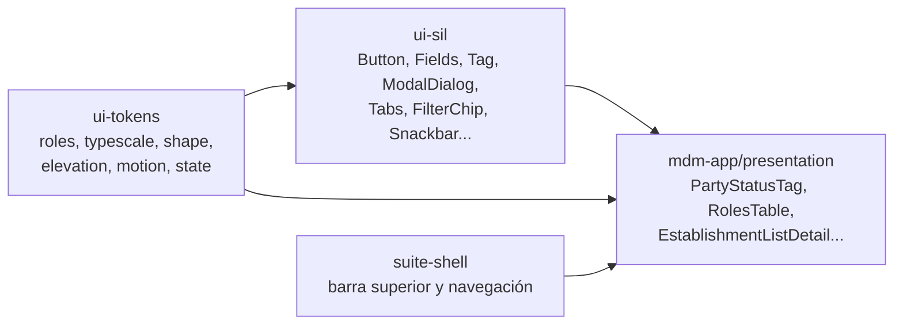
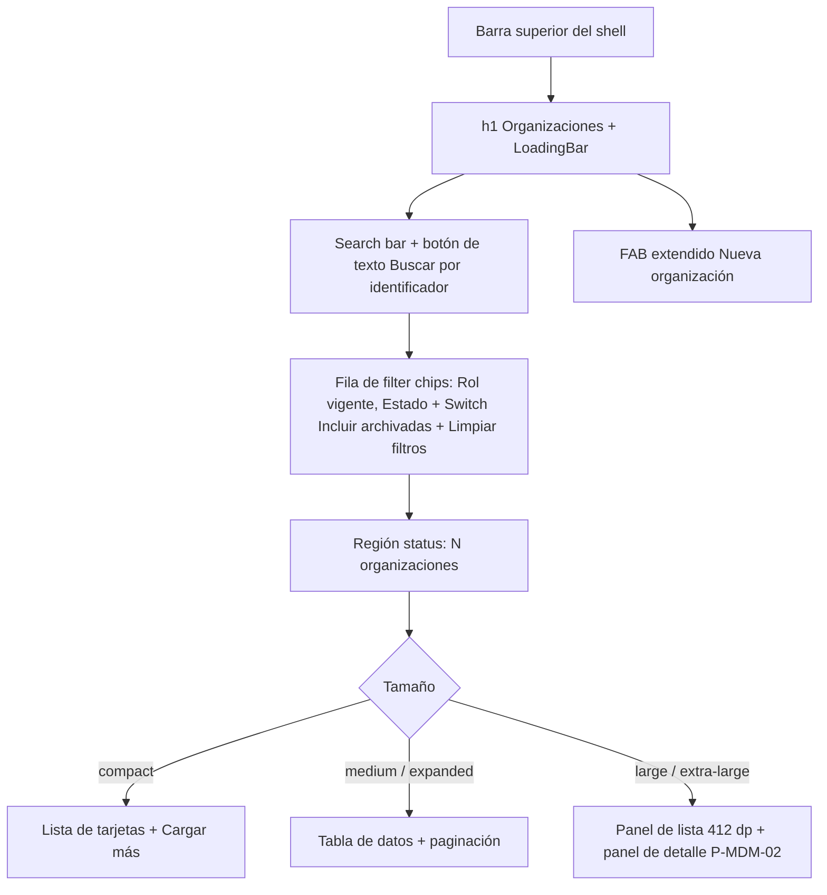
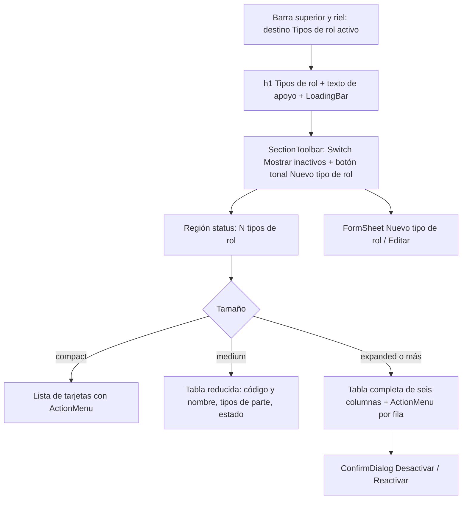

# Especificación UI — MDM: tokens, anatomía y componentes de `mdm-app`

  
  
  

> **Código:** `UI-MDM-001`
> **Fase:** 2 — Diseño
> **Estado:** Borrador. Paso 3 del orden de [D-044](../../DECISIONS.md#decisiones-locales): traduce la especificación UX a tokens, anatomía y componentes.
> **Entrada UX:** [UX-MDM-001](./especificacion-ux-mdm-001.es.md) (§5 Pantallas, §6 Microcopy, §7 Accesibilidad).
> **Sistema de diseño compartido:** [UI-SIL-001](./especificacion-ui-sistema-diseno-sil-001.es.md), implementado en `src/libs/ui-tokens` y `src/libs/ui-sil`.
> **Contrato:** [contrato de la API de Party](../03-construccion/contrato-api-party-mdm-002.es.md) (solo los campos y estados que la UI pinta).
> **Hub del área:** [MDM — Datos Maestros](./hub-mdm.es.md)

---

**Evidencia y supuestos.** Cada regla cita la sección de UX-MDM-001, de UI-SIL-001 o el archivo de `src/libs` que la sostiene (leídos el 2026-10-24). Los contrastes de §2 se **calcularon** con la fórmula de WCAG 2.2 sobre `src/libs/ui-tokens/src/colors.generated.css` (claro y oscuro). Lo que no tiene respaldo se marca **SUPUESTO** con su identificador `SU-UI-MDM-xx` (§7.2).

## 1. Propósito y relación con el sistema de diseño compartido

Fija **cómo se ve y de qué piezas se compone** la interfaz web de MDM (`mdm-app`, montada en el shell de la suite como un `SystemModule` más según [D-044](../../DECISIONS.md#decisiones-locales) y [D-026](../../DECISIONS.md#decisiones-locales)). Es la entrada de la implementación de `src/libs/mdm-app`, que **aún no existe** (`ls src/libs`, 2026-10-24).

**Un solo sistema de diseño para la suite.** MDM no tiene sistema visual propio: consume la cadena de tokens de [UI-SIL-001 §3.1](./especificacion-ui-sistema-diseno-sil-001.es.md#31-la-cadena-de-tokens-y-su-origen) (ADR-0110, Material Design 3 sobre Tailwind v4 en modo CSS-first) y los componentes de `ui-sil`, con el color de [D-023](../../DECISIONS.md#decisiones-locales) y la conformidad M3 en los cinco tamaños de ventana de [D-021](../../DECISIONS.md#decisiones-locales).

| Capa | Dónde vive | Qué hace MDM |
| :--- | :--- | :--- |
| Nivel 1 y 2: roles de color, escala tipográfica, forma, elevación, movimiento, capas de estado, puntos de corte | `src/libs/ui-tokens/src/colors.generated.css` y `theme.css` | **Solo consume.** No crea tokens de color, tipografía, forma ni movimiento |
| Nivel 3: tokens de componente compartidos (`--table-header`, `--table-row-one-line`, `--table-row-two-lines`, `--field-background`) | `theme.css` | Consume los existentes |
| Componentes base | `src/libs/ui-sil/src` | Reutiliza (§5.1); propone a `ui-sil` lo que sea genérico (§5.3) |
| Composiciones de dominio (etiqueta de estado de la Party, tabla de roles, etc.) | `src/libs/mdm-app/src/presentation` (a crear) | Las crea **solo** como composición de componentes de `ui-sil` con alias semánticos |

**Tokens nuevos: ninguno de sistema.** El análisis de §2 resuelve todos los estados con los roles existentes (`success`, `warning`, `error`, `secondary-container`, `outline`, `on-surface-variant`) y los seis tonos de `Tag`. Solo se justifica **un token de componente**, local a `mdm-app` y derivado de la escala: el ancho del panel de lista en lista-detalle (`--mdm-list-pane-width: 25.75rem`, 412 dp, de [UX-MDM-001 §5.2](./especificacion-ux-mdm-001.es.md#52-adaptación-por-tamaño-de-ventana)), y el de la lista de establecimientos (`--mdm-establishment-list-width: 22.5rem`, 360 dp). Ambos son anchos de panel de M3 y no colores ni medidas arbitrarias; se declaran en la hoja de estilos de `mdm-app` y se consumen como `w-(--mdm-list-pane-width)` (**SUPUESTO [SU-UI-MDM-01](#72-supuestos)**: que un token de componente local sea aceptable sin pasar por `ui-tokens`).

**Reglas heredadas sin cambios** ([UI-SIL-001 §3.12](./especificacion-ui-sistema-diseno-sil-001.es.md#312-reglas-de-uso-y-prohibiciones)): ningún literal de color ni valor entre corchetes en `.tsx`; todo fondo con su `on-*`; un solo botón relleno por vista; pesos 400 y 500; espaciado en la escala de 4 dp; sombras solo `shadow-level-*`; estado nunca solo por color; **ocultar una acción no es control de acceso** (ADR-0165 P-SEC-01: el servidor decide y la UI pinta el `403`).

## 2. Mapeo de tokens por elemento

Todos los estados se pintan con el componente `Tag` de `ui-sil` (`src/libs/ui-sil/src/Tag.tsx`), que implementa los seis tonos de [UI-SIL-001 §4.8](./especificacion-ui-sistema-diseno-sil-001.es.md#48-etiqueta-de-estado-y-semáforo) (`block`, `attention`, `progress`, `outline`, `ready`, `quiet`). Cada estado lleva **tono + icono + texto**: el significado va en el texto, el icono es decorativo (`aria-hidden`) y el tono refuerza (WCAG 1.4.1). Los iconos siguen [UX-MDM-001 §7](./especificacion-ux-mdm-001.es.md#7-accesibilidad) (activa = círculo, suspendida = pausa, archivada = caja, fusionada = flechas que se unen, cerrado y terminado = aspa, fuera de vigencia = reloj). Los nombres son de Material Symbols; los marcados con † **no existen** hoy en `Icon.tsx` y hay que añadirlos ([§5.3](#53-componentes-a-proponer-para-ui-sil), [G-581](../../GAPS.md)).

**Regla de fila (heredada).** Solo `block`, `attention` y `progress` llevan contenedor de color; lo nominal (`ready`, `quiet`) calla con icono y texto, y lo terminal (`outline`) va delineado. Así una fila de la tabla muestra a lo sumo un contenedor de color salvo anomalía.

### 2.1 Estado de la Party

Fuente: `status` de P-01 y P-03 ([contrato §4 y §5.2](../03-construccion/contrato-api-party-mdm-002.es.md#52-ficha-de-party-p-03)).

| Valor del contrato | Texto (femenino: «la organización») | Tono `Tag` | Fondo / texto / icono | Icono | Por qué |
| :--- | :--- | :--- | :--- | :--- | :--- |
| `Active` | Activa | `ready` | sin fondo / `on-surface` / `success` | `check_circle` | Nominal: calla |
| `Suspended` | Suspendida | `attention` | `warning-container` / `on-warning-container` | `pause` † | Restringe acciones (contrato §6.2): pide atención |
| `Archived` | Archivada | `outline` | borde `outline` / `on-surface` / `on-surface-variant` | `inventory_2` † | Terminal, solo lectura |
| `Merged` | Fusionada | `outline` | igual que `Archived` | `merge` † | Terminal; se muestra, no se produce ([G-537](../../GAPS.md)) |

### 2.2 Estado del rol

El estado visible se **deriva** de `status` (`Active`, `Suspended`, `Terminated`, [DOM-MDM-002 §4.4](./modelo-dominio-organizacion-erp-mdm-002.es.md); el literal es **SUPUESTO [SU-UI-MDM-05](#72-supuestos)**) y de `isCurrent`, `validFrom` y `validTo`, porque «la vigencia manda sobre el estado». La derivación vive en `mdm-app/domain` (función pura, probada), no en el componente.

| Condición | Estado visible | Texto | Tono | Icono |
| :--- | :--- | :--- | :--- | :--- |
| `Active` e `isCurrent` | Vigente | Vigente | `ready` | `check_circle` |
| `Active`, no vigente y `validFrom` > hoy | Futuro | Fuera de vigencia · empieza el {dd/mm/aaaa} | `quiet` | `schedule` |
| `Active`, no vigente y `validTo` < hoy | Vencido | Fuera de vigencia · venció el {dd/mm/aaaa} | `quiet` | `schedule` |
| `Suspended` | Suspendido | Suspendido | `attention` | `pause` † |
| `Terminated` | Terminado | Terminado | `outline` | `cancel` |

«Fuera de vigencia» es el término de [UX-MDM-001 §5.4](./especificacion-ux-mdm-001.es.md#54-p-mdm-02--ficha-de-la-organización); el sufijo con la fecha distingue futuro de vencido **con texto**, no con color ni icono (**SUPUESTO [SU-UI-MDM-02](#72-supuestos)**: que el rol vencido sin terminar no merezca `attention`; si negocio lo considera una anomalía que pide terminarlo, pasa a `attention`). «Hoy» es la fecha de `America/Lima` ([SU-MDM-03](./especificacion-ux-mdm-001.es.md#81-supuestos)); la UI no recalcula `isCurrent` del servidor salvo para distinguir futuro de vencido.

### 2.3 Estado del establecimiento

Fuente: `isActive`, `isClosed`, `isPrincipal`, `closedAt` de P-03 y P-16. «Principal» es un **atributo**, no un estado: se muestra como segunda etiqueta junto al estado.

| Condición | Texto | Tono | Icono |
| :--- | :--- | :--- | :--- |
| `isActive` y no `isClosed` | Activo | `ready` | `check_circle` |
| no `isActive` y no `isClosed` | Inactivo | `quiet` | `pause` † |
| `isClosed` | Cerrado el {dd/mm/aaaa} (de `closedAt`) | `outline` | `cancel` |
| `isPrincipal` (además del estado) | Principal | `quiet` | `star` † |

### 2.4 Estado de la referencia externa

Fuente: `syncStatus` de X-01 ([contrato §5.3](../03-construccion/contrato-api-party-mdm-002.es.md#53-cuerpos-de-los-subrecursos)).

| Valor | Texto | Tono | Icono | Nota |
| :--- | :--- | :--- | :--- | :--- |
| `Linked` | Vinculada | `ready` | `link` † | Nominal |
| `PendingSync` | Pendiente de sincronizar | `progress` | `sync` † | En marcha sin incidencia |
| `SyncFailed` | Falló la sincronización | `block` | `sync_problem` † | Sin causa ni reintento: el contrato no los expone ([SU-MDM-17](./especificacion-ux-mdm-001.es.md#81-supuestos), [G-568](../../GAPS.md)) |
| `Unlinked` | Desvinculada | `outline` | `link_off` † | Terminal |

### 2.5 Otros elementos con estado

| Elemento | Condición → texto, tono e icono |
| :--- | :--- |
| Identificador | `isCurrent` → «Vigente», `ready`, `check_circle`; no vigente → «Vencido el {fecha}», `outline`, `cancel`; `isPrimary` → segunda etiqueta «Primario», `quiet`, `star` † |
| Relación | `Active` e `isCurrent` → «Vigente», `ready`; `Active` no vigente → «Fuera de vigencia · …» como el rol, `quiet`, `schedule`; `Ended` → «Terminada», `outline`, `cancel` |
| Aviso de Party suspendida (P-MDM-02) | `InlineNotice` `severity="warning"` (`warning-container` / `on-warning-container`, icono `warning`) |
| Aviso de Party archivada o fusionada | `InlineNotice` `severity="neutral"` con icono `inventory_2` †. UX pide `surface-container-highest`; el `neutral` de `ui-sil` usa `surface-container-low` ([§7.1](#71-desviaciones)) |
| Conflicto `412` (D-MDM-14) | `InlineNotice` `severity="error"` con `announce` (`role="alert"`) |

### 2.6 Contraste verificado

Calculado con WCAG 2.2 (luminancia relativa, `(L1 + 0,05)/(L2 + 0,05)`) sobre los valores actuales de `colors.generated.css`. Umbrales: 4,5:1 texto, 3:1 icono y borde no textual. «Superficie» indica dónde aparece la etiqueta en MDM.

| Par (primer plano / fondo) | Uso en MDM | Mínimo | Claro | Oscuro | Resultado |
| :--- | :--- | ---: | ---: | ---: | :--- |
| `on-surface` / `surface` | Texto de `ready` y `outline` en tabla y tarjeta | 4,5 | 16,27 | 14,29 | Cumple |
| `success` / `surface` | Icono de `ready` | 3 | 6,15 | 10,86 | Cumple |
| `success` / `surface-container-low` | Icono de `ready` en hoja lateral | 3 | 5,84 | 10,06 | Cumple |
| `success` / `surface-container-high` | Icono de `ready` en diálogo básico | 3 | 5,27 | 8,47 | Cumple |
| `on-surface-variant` / `surface` | `quiet` (fuera de vigencia, inactivo, principal) | 4,5 | 8,88 | 10,82 | Cumple |
| `on-surface-variant` / `surface-container-low` | `quiet` en hoja lateral | 4,5 | 8,43 | 10,01 | Cumple |
| `on-warning-container` / `warning-container` | `attention` (suspendida, suspendido) y aviso de suspendida | 4,5 | 13,26 | 7,21 | Cumple |
| `on-secondary-container` / `secondary-container` | `progress` (pendiente de sincronizar) | 4,5 | 7,20 | 7,20 | Cumple |
| `on-error-container` / `error-container` | `block` (falló la sincronización) y aviso `412` | 4,5 | 7,24 | 7,24 | Cumple |
| `outline` / `surface` | Borde de `outline` (archivada, terminado, cerrado, desvinculada) | 3 | 4,28 | 5,84 | Cumple |
| `outline` / `surface-container-low` | Borde de `outline` en hoja lateral | 3 | 4,06 | 5,41 | Cumple |
| `outline` / `surface-container-high` | Borde de `outline` en diálogo | 3 | 3,67 | 4,55 | Cumple |
| `success` / `secondary-container` | Icono de `ready` en la fila **seleccionada** de lista-detalle | 3 | 4,99 | 5,48 | Cumple |
| `on-surface-variant` / `secondary-container` | `quiet` en la fila seleccionada | 4,5 | 7,21 | 5,46 | Cumple |
| `outline` / `secondary-container` | Borde de `outline` en la fila seleccionada | 3 | 3,47 | **2,95** | **No cumple en oscuro** |

**Hallazgo.** En `large` y superior la organización elegida en la lista se pinta con `secondary-container` ([UI-SIL-001 §3.9](./especificacion-ui-sistema-diseno-sil-001.es.md#39-capas-de-estado)); una organización archivada o fusionada seleccionada tiene su borde de etiqueta a 2,95:1 en oscuro. El texto («Archivada») sigue a 14:1 y lleva el significado, así que no se pierde información, pero el borde deja de delimitar la etiqueta. **Regla de MDM:** en la fila seleccionada la etiqueta `outline` cambia su borde a `on-secondary-container` (7,20:1). Es una variante que `Tag` no ofrece hoy ([G-582](../../GAPS.md)). **Por verificar:** el par equivalente en las tablas de SIL con fila seleccionada (fuera del alcance de este documento).

Las etiquetas no son interactivas: no tienen capa de estado ni foco, así que no aplica la tabla de capas de [UI-SIL-001 §3.3](./especificacion-ui-sistema-diseno-sil-001.es.md#33-contraste-calculado-wcag-22).

## 3. Anatomía por pantalla y diálogo

Traduce a componentes M3 los wireframes de texto de [UX-MDM-001 §5](./especificacion-ux-mdm-001.es.md#5-pantallas). Los tamaños de ventana y sus puntos de corte son los de `theme.css` (`--breakpoint-medium` 600 dp, `--breakpoint-expanded` 840 dp, `--breakpoint-large` 1200 dp, `--breakpoint-extra-large` 1600 dp) y se leen en React con `useWindowSizeClass` de `ui-sil`; el CSS usa las variantes `medium:`, `expanded:`, `large:` y `extra-large:`, nunca anchos en píxeles.

### 3.1 Marco común

| Pieza | Componente M3 | Quién la pinta | Tokens y medidas |
| :--- | :--- | :--- | :--- |
| Barra superior | _Small top app bar_ (64 dp) | `SystemFrame` de `suite-header` ([UI-SIL-001 §4.1](./especificacion-ui-sistema-diseno-sil-001.es.md#41-barra-superior-top-app-bar)), el mismo que SIL | Desde `medium`, cabecera de la suite en `surface-container` (conmutador, marca, «MDM», nombre, rol y sede, campana, ayuda y cuenta); en `compact`, `surface` → `surface-container` al desplazar |
| Navegación del sistema | _Navigation rail_ (`medium` o más) o cajón modal (`compact`) | `SystemFrame` de `suite-header` con los destinos que aporta `mdm-app` ([ADR-0245](https://github.com/organizacion-peru/organizacion_arch/blob/main/reference/architecture/adrs/core/0245-portal-comun-de-la-suite-y-traspaso-de-sesion.es.md) D4.1) | **El mismo marco y riel que SIL** ([UI-SIL-001 §4.2](./especificacion-ui-sistema-diseno-sil-001.es.md#42-navegación-riel-barra-inferior-y-cajón)): riel contraído de 96 dp en `medium` y expandido de 224 dp desde `expanded` (D-036), y en `compact` el cajón que abre el botón de menú. Destinos «Organizaciones», activo también en la ficha y en el alta, y «Tipos de rol» (icono `list_alt`, P-MDM-04, [§3.7](#37-p-mdm-04--tipos-de-rol)); sin barra inferior (M3 pide de 3 a 5 destinos). El FAB «Nueva organización» va arriba del riel y, en `compact`, flota abajo a la derecha en P-MDM-01; solo para analista y responsable (SU-MDM-02). Sustituye a [SU-UI-MDM-03](#72-supuestos) y cierra [G-584](../../GAPS.md) |
| Título de página | Encabezado `h1` | `mdm-app` | `headline-small-emphasized` desde `medium`; en `compact` el título va en la barra superior (`title-large-emphasized`) |
| Margen de página | — | `mdm-app` | `px-4` (16 dp) en `compact`, `medium:px-6` (24 dp); formularios y texto con ancho máximo de 840 dp; tablas a todo el ancho |
| Separaciones | — | `mdm-app` | Entre secciones `gap-8` (32 dp); entre grupos `gap-6` (24 dp); entre campos `gap-4` (16 dp); entre controles contiguos `gap-2` (8 dp) |
| Pie institucional | — | No se pinta en `mdm-app` (pantallas densas, como el shell de SIL, [UI-SIL-001 §4.14](./especificacion-ui-sistema-diseno-sil-001.es.md#414-pie-institucional)) | — |

**Jerarquía tipográfica común** (escala de [UI-SIL-001 §3.4](./especificacion-ui-sistema-diseno-sil-001.es.md#34-tipografía), sin estilos nuevos):

| Nivel | Estilo | Ejemplo en MDM |
| :--- | :--- | :--- |
| `h1` de pantalla | `headline-small-emphasized` (24/32/500) | «Organizaciones», código de la organización en P-MDM-02 |
| Subtítulo de cabecera | `body-large` | Razón social y nombre comercial bajo el código |
| `h2` de sección o pestaña | `title-large` (22/28/400) | «Roles de ACME» (visualmente oculto si la pestaña ya lo nombra) |
| Grupo de formulario (`legend`) | `title-medium` (16/24/500) | «Identificador primario» |
| Cabecera de columna, pestaña | `title-small` (14/20/500) | «Razón social» |
| Celda | `body-medium` | Valores de la tabla |
| Código de la fila (enlace) | `body-medium-emphasized`, `primary` (`TABLE_STYLES.rowLink`) | «ACME» |
| Segunda línea de celda | `body-small`, `on-surface-variant` (`TABLE_STYLES.secondaryLine`) | Razón social bajo el código en `medium` |
| Fechas, identificadores, ubigeo, anexo | `tabular-nums` | «20601234567», «01/01/2024» |

### 3.2 P-MDM-01 — Organizaciones

| Pieza | Componente | Anatomía y tokens |
| :--- | :--- | :--- |
| Búsqueda por texto | _Search bar_ de M3 (56 dp, `surface-container-high`, `radius-full`) | Icono `search` inicial, campo `body-large`, botón de icono `close` para limpiar. `SearchBar` existe solo en `sil-app` ([§5.3](#53-componentes-a-proponer-para-ui-sil)) |
| Búsqueda por identificador | Botón de texto que despliega (`aria-expanded`) tres campos: `SelectField` País, `SelectField` Esquema (C-01), `TextField` Valor y un botón tonal «Buscar» | En `expanded` o más, en línea bajo la búsqueda con `gap-2`; en `compact` y `medium`, `ModalDialog` `bottom-sheet` |
| Filtros | `FilterChip` «Rol vigente» y «Estado» (32 dp, `radius-sm`); `Switch` «Incluir archivadas»; botón de texto «Limpiar filtros» visible solo con filtros aplicados | Fila con `gap-2`; en `compact`, un chip «Filtros (n)» abre `bottom-sheet` con los mismos controles y los chips aplicados quedan visibles debajo |
| Resultados | Tabla de datos como composición (`TABLE_STYLES`) | Cabecera `--table-header` (48 dp); filas de **una línea** en `expanded` (`--table-row-one-line`, 48 dp) y de **dos líneas** en `medium` (`--table-row-two-lines`, 56 dp: código y razón social debajo). Columnas de UX §5.3; estado con `Tag` `size="compact"` (24 dp); el código es el enlace que cubre la fila; orden con botón en la cabecera y `aria-sort` |
| Lista (`compact`) | _List_ de M3 como tarjetas delineadas sin relleno (borde `outline-variant`, `radius-md`, `p-4`) | Línea 1 código `title-medium`; línea 2 razón social `body-large`; línea 3 identificador primario y roles `body-medium` `on-surface-variant`; línea 4 `Tag` compacta. Toda la tarjeta es el enlace (≥ 88 dp de alto) |
| Paginación | Composición: `SelectionMenu` «Filas por página», texto «1–20 de 134», `IconButton` `navigate_before` y `navigate_next` | `Pagination` existe solo en `sil-app`; `compact` usa botón tonal «Cargar más» |
| Acción primaria | FAB extendido (`fabStyles`, 56 dp, `primary-container`, `radius-lg`, `shadow-level-3`) con icono `add` | La pinta el riel de MDM, no la pantalla ([§3.1](#31-marco-común)): arriba del riel desde `medium` y abajo a la derecha a 16 dp en `compact`, contraído a icono al desplazar (R-18); el contenido reserva su alto |

**Por tamaño.** `compact`: barra superior, búsqueda, chip «Filtros», lista, «Cargar más», FAB. `medium`: tabla reducida (código + razón social, identificador primario, estado). `expanded`: tabla completa con siete columnas. `large` y `extra-large`: **lista-detalle** de M3 (_canonical layout_ list-detail): panel de lista de 412 dp (`--mdm-list-pane-width`) con elementos de lista de dos líneas y `Tag`, separación de 24 dp y panel de detalle con P-MDM-02; la organización elegida se marca con `secondary-container` y `aria-current="true"` ([§2.6](#26-contraste-verificado)). En `extra-large` el detalle se limita a 840 dp de ancho de lectura en Datos generales.

### 3.3 P-MDM-02 — Ficha de la organización

| Pieza | Componente | Anatomía y tokens |
| :--- | :--- | :--- |
| Volver | `IconButton` `arrow_back` con `aria-label` «Volver a Organizaciones» (por debajo de `large`) | En la barra de la página, 48 dp |
| Cabecera | Composición sin tarjeta, sobre `surface` | `h1` código; razón social · nombre comercial en `body-large`; fila con `Tag` de estado `size="standard"` (32 dp), identificador primario y roles vigentes en `body-medium` `on-surface-variant`, `gap-2`. A la derecha (`expanded` o más) `ActionMenu` con `triggerText="Acciones"`; en `compact` `ActionMenu` de icono `more_vert` |
| Avisos de estado | `InlineNotice` bajo la cabecera | `warning` si `Suspended`; `neutral` con icono de archivo si `Archived` o `Merged` ([§2.5](#25-otros-elementos-con-estado)) |
| Secciones | _Primary tabs_ (`Tabs`, desplazables) | Siete pestañas; indicador `primary` de 3 dp; etiqueta `title-small`; contador opcional («Roles (3)»). Cada panel `role="tabpanel"` con `h2` |
| Datos generales | _List_ de pares etiqueta-valor (`dl`) | Etiqueta `body-small` `on-surface-variant`, valor `body-large`; dos columnas desde `expanded`; auditoría en `body-small` |
| Identificadores, Roles, Relaciones, Referencias externas | Tabla de datos de una línea (48 dp) en `medium` o más; lista de tarjetas en `compact` | Barra de sección: interruptor (`Switch`) de filtro a la izquierda y botón tonal con la acción primaria a la derecha («Asignar rol»); `ActionMenu` de icono por fila con `aria-label` que nombra el objeto. Estado con `Tag` compacta (§2) |
| Establecimientos | _Secondary tabs_ «Activos · Inactivos · Cerrados · Todos» + **lista-detalle** en `expanded` o más | Lista de 360 dp (`--mdm-establishment-list-width`) con elementos de dos líneas (nombre `body-large`; tipo · anexo · principal `body-medium`); detalle con `dl` de la dirección y las referencias externas del establecimiento. En `compact` y `medium`, lista de tarjetas y el detalle se abre como página o hoja. `Tabs` de `ui-sil` solo pinta pestañas primarias ([§5.3](#53-componentes-a-proponer-para-ui-sil)) |
| Historial | _List_ en línea de tiempo | Elemento de 56 dp: icono `history` 24 dp `on-surface-variant`, texto `body-medium`, fecha `body-small` `tabular-nums`; solo lectura |
| Acciones deshabilitadas por estado | Botón con `aria-disabled="true"` + texto de apoyo visible `body-small` | En suspendida, «Asignar rol» y «Abrir establecimiento» quedan deshabilitados con su explicación (UX §5.4); en el menú, `MenuItem.disabled` con `reason` |

**Por tamaño.** `compact`: cabecera apilada, pestañas desplazables, listas de tarjetas, acción primaria de sección como botón tonal al inicio de la lista (no FAB). `medium`: cabecera en dos columnas, tablas reducidas. `expanded`: tablas completas y lista-detalle en Establecimientos. `large`: igual dentro del panel de detalle de P-MDM-01. `extra-large`: Relaciones y Referencias externas muestran sus columnas ocultables (UX §5.2).

### 3.4 P-MDM-03 — Nueva organización

| Pieza | Componente | Anatomía y tokens |
| :--- | :--- | :--- |
| Apoyo inicial | Párrafo `body-medium` con enlace `primary` «Buscar» | Sobre el formulario |
| Resumen de errores | `InlineNotice` `error` enfocable, con lista de enlaces a los campos | Al inicio; recibe el foco al enviar con errores. `ErrorSummary` existe dos veces en `sil-app` y ninguna en `ui-sil` ([§5.3](#53-componentes-a-proponer-para-ui-sil)) |
| Grupos | `fieldset` + `legend` `title-medium` | «Datos», «Identificador primario», «Roles iniciales (opcional)»; `gap-6` entre grupos |
| Campos | `TextField` (código, razón social, nombre comercial, valor), `SelectField` (país, esquema, tipo de rol), `DateField` (vigente desde, desde, hasta) | Delineados de 56 dp, `radius-xs`, etiqueta persistente, texto de apoyo o error `body-small` con icono `error`. Obligatorio en la etiqueta («(obligatorio)»); `DateField` con selector acoplado desde `medium` y modal en `compact` |
| Filas de roles iniciales | Composición: tipo + desde + hasta + `IconButton` `close` «Quitar el rol {tipo}» | Botón de texto `add` «Agregar otro rol» |
| Duplicado `409` | `InlineNotice` `warning` sobre el grupo identificador, con la organización encontrada y dos botones de texto | «Abrir organización existente», «Corregir identificador» |
| Acciones | Botón relleno «Registrar» (único de la vista) y botón de texto «Cancelar» | `compact`: barra inferior fija de 80 dp `surface-container` con «Registrar»; `expanded` o más: al final del formulario, alineados a la derecha |

**Por tamaño.** `compact` y `medium`: una columna de hasta 840 dp. `expanded` o más: dos columnas iguales (Datos e Identificador a la izquierda; Roles iniciales a la derecha), `gap-6`.

### 3.5 Diálogos y hojas (D-MDM-01 a D-MDM-14)

Todos se construyen con `ModalDialog` de `ui-sil` (`<dialog>` nativo: foco atrapado, `Escape`, retorno al disparador, resto `inert`). La variante sale del tamaño de ventana, no del diálogo:

| Tipo de diálogo | `compact` | `medium` a `extra-large` | Anatomía |
| :--- | :--- | :--- | :--- |
| Formulario (D-MDM-01 a 07) | `variant="full-screen"`: barra de 64 dp con `IconButton` `close` a la izquierda, título `title-large-emphasized` y botón de texto «Guardar» a la derecha | `variant="side-sheet"` (≤ 400 dp, `surface-container-low`, `radius-lg` interior, `shadow-level-1`), acciones fijas al pie con borde `outline-variant`: «Cancelar» (texto) y la acción (relleno) | Campos con `--field-background` del contenedor; resumen de errores al inicio; `InlineNotice` de D-MDM-14 al inicio si hay `412` |
| Confirmación (D-MDM-08 a 13) | `variant="basic"` | `variant="basic"` | `surface-container-high`, `radius-xl`, `p-6`, `shadow-level-3`; título `headline-small` en forma de pregunta; cuerpo `body-medium` `on-surface-variant`; campos de fecha y motivo cuando el contrato los recibe; acciones: «Cancelar» (texto, foco inicial) y verbo exacto. Terminales (08 a 12): botón con `bg-error text-on-error` (6,46:1 claro y 7,72:1 oscuro, [UI-SIL-001 §3.3](./especificacion-ui-sistema-diseno-sil-001.es.md#33-contraste-calculado-wcag-22)); D-MDM-13 (reversible): botón relleno `primary` |

| ID | Componentes del cuerpo |
| :--- | :--- |
| D-MDM-01 Editar nombres | `dl` de solo lectura (código, tipo, identificadores); `TextField` razón social (contador 200) y nombre comercial |
| D-MDM-02 Agregar identificador | `SelectField` país y esquema; `TextField` valor; `DateField` desde; casilla «Es primario»; casilla condicional «Reemplaza al primario actual» con el valor vigente en `body-medium` (aparece con `aria-live="polite"`) |
| D-MDM-03 Vencer identificador | Valor en `body-large` `tabular-nums`; `DateField` «Vence el»; `TextAreaField` motivo (opcional) |
| D-MDM-04 Asignar rol | `SelectField` tipo (C-02); `DateField` desde y hasta; `InlineNotice` `warning` de solape calculado con los roles cargados |
| D-MDM-05 Abrir o editar establecimiento | `fieldset` «Establecimiento» (código, tipo con C-03, nombre, anexo SUNAT, casilla «Principal» con aviso que nombra al principal actual) y `fieldset` «Dirección» con `autocomplete`; en `side-sheet` el formulario es largo: cabecera y pie fijos, cuerpo desplazable |
| D-MDM-06 Nueva relación | `SelectField` tipo (C-04); frase de sentido en `body-medium` («ACME es matriz de…»); combobox de organización con búsqueda en el servidor (P-01) ([§5.2](#52-componentes-nuevos-en-mdm-app)); `DateField` desde y hasta |
| D-MDM-07 Vincular referencia | Grupo de radio «Objeto» (la organización o un establecimiento no cerrado); `TextField` sistema, instancia, tipo de objeto y clave |
| D-MDM-08 a 12 | Ver la tabla de confirmaciones de [UX-MDM-001 §5.6](./especificacion-ux-mdm-001.es.md#56-diálogos-y-hojas); el prerrequisito visible es un `InlineNotice` `neutral` dentro del cuerpo; `DateField` «Termina el» en 10 y 11; `TextAreaField` motivo solo en 10 y 11 (y en 03) |
| D-MDM-13 Suspender | Lista `body-medium` de las cuatro acciones que quedan deshabilitadas |
| D-MDM-14 La organización cambió | No es un diálogo: `InlineNotice` `error` con `announce` dentro del formulario abierto y dos botones de texto «Recargar y revisar» y «Descartar mis cambios» |

### 3.6 Resumen por tamaño de ventana

| Clase | Navegación | P-MDM-01 | P-MDM-02 | P-MDM-03 | Formularios | Confirmaciones |
| :--- | :--- | :--- | :--- | :--- | :--- | :--- |
| `compact` | Barra superior con menú que abre el cajón; sin barra inferior | Lista de tarjetas, «Cargar más», FAB | Listas de tarjetas, pestañas desplazables | Una columna, barra inferior con «Registrar» | `full-screen` | `basic` |
| `medium` | Riel contraído de `SystemFrame` | Tabla reducida de dos líneas | Tablas reducidas | Una columna | `side-sheet` | `basic` |
| `expanded` | Riel expandido de `SystemFrame` | Tabla completa | Tablas completas; lista-detalle en Establecimientos | Dos columnas | `side-sheet` | `basic` |
| `large` | Riel expandido de `SystemFrame` | Lista-detalle 412 dp + ficha | Dentro del panel de detalle | Dos columnas | `side-sheet` | `basic` |
| `extra-large` | Riel expandido de `SystemFrame` | Igual que `large` | Columnas ocultables visibles | Dos columnas | `side-sheet` | `basic` |

P-MDM-04 sigue la misma pauta: tarjetas en `compact`, tabla reducida en `medium` y tabla completa desde `expanded` ([§3.7](#37-p-mdm-04--tipos-de-rol)).

### 3.7 P-MDM-04 — Tipos de rol

Catálogo `PartyRoleType` administrable ([D-046](../../DECISIONS.md#decisiones-locales); [UX-MDM-001 §5.7](./especificacion-ux-mdm-001.es.md#57-p-mdm-04--tipos-de-rol), US-MDM-014). Sin tokens ni componentes nuevos: reutiliza las composiciones de la ficha.

| Pieza | Componente | Anatomía y tokens |
| :--- | :--- | :--- |
| Encabezado | `h1` `headline-small` enfocable (`tabIndex=-1`) y párrafo `body-medium` `on-surface-variant` de ancho de lectura | El `h1` recibe el foco si el disparador de un diálogo ya no existe (la fila de un tipo que se desactivó con el filtro «activos») |
| Barra | `SectionToolbar` de `mdm-app`: `Switch` «Mostrar inactivos» con descripción a la izquierda y botón tonal «Nuevo tipo de rol» a la derecha | El botón solo existe para quien administra (analista y responsable, SUPUESTO); el FAB del riel sigue siendo «Nueva organización» |
| Recuento | Párrafo `role="status"` `body-medium` `on-surface-variant` | «13 tipos de rol» |
| Tabla (`medium` o más) | Tabla de sección (`SECTION_TABLE`) dentro de `TableFrame` (región desplazable con nombre si no cabe) | Cabecera `title-small` sobre `surface-container-low`; filas de 48 dp en `expanded` y de 56 dp en `medium`. Columnas en `expanded`: código (`body-medium-emphasized`), nombre con la descripción debajo (`body-small` `on-surface-variant`), UN/EDIFACT 3035 (`tabular-nums`; «—» con texto oculto «Sin código»), tipos de parte, «Exige identificador fiscal» (Sí · No), estado y la columna de acciones con encabezado oculto. En `medium`: código con nombre debajo, tipos de parte y estado |
| Tarjetas (`compact`) | Lista con nombre (`aria-label` «Tipos de rol») de tarjetas delineadas sin relleno (`outline-variant`, `radius-md`, `p-4`) | Nombre `title-medium`; código `body-medium`; descripción `body-medium` `on-surface-variant`; `dl` de UN/EDIFACT, tipos de parte e identificador fiscal; etiqueta de estado; `ActionMenu` de icono a la derecha |
| Estado | `StatusTag` compacta (24 dp) | «Activo»: `ready`, icono `check_circle` en `success`. «Inactivo»: `quiet`, icono `pause`. Como el establecimiento ([§2.3](#23-estado-del-establecimiento)): el estado se lee por el texto |
| Acciones por fila | `ActionMenu` de icono `more_vert` con `aria-label` «Más acciones del tipo de rol {nombre}» | «Editar» y «Desactivar» o «Reactivar»; no se pinta para quien solo consulta. El foco vuelve al botón del menú al cerrar el diálogo |
| Alta y edición | `FormSheet` (`full-screen` en `compact`, `side-sheet` desde `medium`) | En el alta, `TextField` «Código» con foco inicial y ayuda que muestra cómo se guardará (`OPERADOR_PORTUARIO`); en la edición, el código como texto `body-large` y el foco en «Nombre». `TextField` nombre (200), `TextAreaField` descripción con contador (500), `TextField` UN/EDIFACT 3035 (2, en mayúsculas), `fieldset` «Tipos de parte admitidos (obligatorio)» con dos `Checkbox` y su error en `body-small` `error`, `Checkbox` «Exige identificador fiscal vigente» con descripción. Resumen de errores al inicio; `409` y `422` en su campo; `412` con `VersionConflictNotice` y el texto del tipo de rol |
| Desactivar y reactivar | `ConfirmDialog` `basic`, tono `primary` (reversible) | Título en pregunta, nombre y código en `body-large` `on-surface`, efecto en `body-medium`: al desactivar, que los roles existentes se conservan; foco inicial en «Cancelar»; `412` y `409` con `WriteNotice` |

## 4. Estados interactivos y de carga, error, vacío, sin permiso y solo lectura

### 4.1 Estados interactivos (capas de estado)

Se derivan de las capas de [UI-SIL-001 §3.9](./especificacion-ui-sistema-diseno-sil-001.es.md#39-capas-de-estado) (`--md-sys-state-*-opacity` de `theme.css`), nunca de un color por control. MDM no añade estados.

| Componente | Enabled | Hover (8 %, solo `hover: hover`) | Focused (10 % + anillo 3 dp `secondary`) | Pressed (10 %) | Disabled (12 % / 38 %) | Otros |
| :--- | :--- | :--- | :--- | :--- | :--- | :--- |
| Botón relleno, tonal, de texto, FAB | Rol de la variante | Capa `currentColor` | Capa + anillo a 2 dp | Capa | Contenedor `on-surface` 12 %, texto 38 %; `aria-disabled` si debe conservar el foco y explicar el motivo | _Loading_: `aria-busy`, «Guardando…», sin perder el foco |
| Botón de error (confirmaciones terminales) | `error` / `on-error` | Capa `on-error` | Capa + anillo | Capa | Igual | — |
| Fila de tabla y tarjeta de lista | `surface` | Capa `on-surface` 8 % | Anillo **hacia dentro** (`outline-offset: -3px`) sobre el enlace que cubre la fila | Capa 10 % | No aplica | **Seleccionada** (lista-detalle): `secondary-container` / `on-secondary-container`, no capa |
| Pestaña | Etiqueta `on-surface-variant` | Capa | Capa + anillo | Capa | No aplica | **Activa**: etiqueta `primary`, indicador `primary` 3 dp, `aria-selected="true"` |
| `FilterChip` | Borde `outline`, texto `on-surface-variant` | Capa | Capa + anillo | Capa | 12 % / 38 % | **Aplicado**: `secondary-container`, icono `check`, valor visible |
| Campo de texto, selector, fecha | Borde 1 dp `outline` | Borde `on-surface` | Borde 2 dp `primary`, etiqueta `primary` | — | Borde 12 %, texto 38 % | **Error**: borde 2 dp `error`, icono y mensaje; **cambiado** (D-MDM-01, 05 al editar): borde 2 dp `primary` |
| `Switch`, casilla, radio | Rol M3 | Capa en el asa | Capa + anillo | Capa | 12 % / 38 % | **Seleccionado**: `primary` con icono |
| `ActionMenu` (elemento) | `on-surface` sobre `surface-container` | Capa | Capa + anillo | Capa | Texto 38 % + `reason` visible como segunda línea | — |
| `Tag` | — | — | — | — | — | No interactiva: sin capa ni foco |

### 4.2 Estados de carga, error, vacío, sin permiso y solo lectura

| Componente clave | Cargando | Error | Vacío | Sin permiso | Solo lectura |
| :--- | :--- | :--- | :--- | :--- | :--- |
| Tabla o lista de P-MDM-01 | `LoadingBar` bajo la barra + filas `Skeleton` (`surface-container-highest`) del alto final; la búsqueda sigue activa | `LoadError` (`InlineNotice` `error` + «Reintentar»); nunca lista parcial como completa | `EmptyState` `placement="page"` con las cuatro variantes de [UX-MDM-001 §6.4](./especificacion-ux-mdm-001.es.md#64-estados-vacíos); `announce` si viene de buscar o filtrar | Sin FAB ni acción de alta; la lista se lee igual | No aplica |
| Cabecera de P-MDM-02 | `Skeleton` de código, nombre y etiqueta | `LoadError` a página completa con «Volver a Organizaciones»; `404` con su texto | — | Acciones no concedidas **ocultas**; `403` del servidor → `InlineNotice` `error` con el texto de UX §6.1 | `Archived`/`Merged`: sin «Acciones»; aviso `neutral` |
| Pestaña de sección | `Skeleton` del panel; `LoadingBar` | `InlineNotice` `error` **solo en ese panel** + «Reintentar»; el resto de la ficha sigue | `EmptyState` `placement="sheet"` con su acción si la persona puede | Sin botón tonal de alta ni menú de fila | Sin botón ni menú por fila; filas terminales sin menú |
| Botón de acción de sección | — | — | — | Oculto | Oculto; si la Party está `Suspended` y la acción está bloqueada, **deshabilitado con texto de apoyo visible** |
| Formulario (P-MDM-03, D-MDM-01 a 07) | Catálogos: `MasterDataField`/`SelectField` con «Cargando opciones…»; acción principal deshabilitada hasta tenerlos | Catálogo: `InlineNotice` `error` + «Reintentar». Envío: resumen de errores + error en el campo; `409` de negocio en su campo o en aviso; `412` → D-MDM-14 | — | No se ofrece; por dirección, `EmptyState` sin permiso + «Volver a Organizaciones» | — |
| Envío de formulario | Botón principal en _loading_ (`aria-busy`), campos `readOnly` (no `disabled`, para no perder el foco ni el contraste) | Ver fila anterior | — | `403` → aviso en el formulario, borrador conservado | — |
| Confirmación terminal | Botón de error en _loading_ | `InlineNotice` `error` dentro del diálogo; el diálogo no se cierra | — | — | — |
| Snackbar de éxito | — | **Nunca** para errores | — | — | — |
| Combobox de D-MDM-06 | «Buscando…» dentro de la lista (`aria-busy`) | Opción no seleccionable «No pudimos buscar. Reintentar» | «Ninguna organización coincide…» (UX §6.4) | — | — |

**Ocultar no es control de acceso.** La matriz rol × acción de [UX-MDM-001 §2.2](./especificacion-ux-mdm-001.es.md#22-matriz-rol--acción) es **SUPUESTO** ([SU-MDM-02](./especificacion-ux-mdm-001.es.md#81-supuestos)); la UI la usa solo para no ofrecer lo que no se puede hacer. El servidor decide (ADR-0165) y todo `403` se pinta aunque la UI hubiera ofrecido la acción.

## 5. Inventario de componentes

Rutas relativas a la raíz del repositorio; todos los de `ui-sil` se importan desde el índice de la lib (`src/libs/ui-sil/src/index.ts`). `mdm-app` no puede importar `sil-app` (frontera de [D-026](../../DECISIONS.md#decisiones-locales) aplicada por `@nx/enforce-module-boundaries`), así que lo que hoy vive en `sil-app` y MDM necesita se **promueve** a `ui-sil` o se rehace (§5.3).

### 5.1 Reutilizados de `ui-sil`

| Componente | Ruta | Uso en MDM | Props que usa MDM | ARIA ya resuelto |
| :--- | :--- | :--- | :--- | :--- |
| `Button`, `IconButton`, `fabStyles` | `src/libs/ui-sil/src/Button.tsx` | Acciones, botón de fila, FAB «Nueva organización» | `variant` (`filled`, `tonal`, `outlined`, `text`), `aria-label` en `IconButton` | Objetivo 48 dp por `::after`; `type="button"` por defecto |
| `TextField`, `SelectField`, `TextAreaField` | `src/libs/ui-sil/src/Fields.tsx` | Formularios | `label`, `help`, `error`, `required`, `changed`, `max` | `label` asociada, `aria-invalid`, `aria-describedby` al apoyo o error |
| `DateField` | `src/libs/ui-sil/src/DateField.tsx` | Vigencias, «Vence el», «Termina el» | `label`, `value`, `onValueChange`, `error`, `help` | Selector acoplado o modal; escritura `dd/mm/aaaa` |
| `MasterDataField` | `src/libs/ui-sil/src/MasterDataField.tsx` | Catálogos largos (esquemas, tipos) si superan el `select` nativo | `options`, `loading`, `error` | Combobox del APG (ARIA 1.2) |
| `Tag` | `src/libs/ui-sil/src/Tag.tsx` | Todas las etiquetas de §2 | `tone`, `icon`, `size` | Texto como significado; icono `aria-hidden` |
| `InlineNotice` | `src/libs/ui-sil/src/InlineNotice.tsx` | Avisos de suspendida, archivada, duplicado, solape, `412` | `severity`, `title`, `actions`, `announce` | `role="alert"` con `announce`; palabra de gravedad |
| `ModalDialog` | `src/libs/ui-sil/src/ModalDialog.tsx` | D-MDM-01 a 13; hojas inferiores de filtros | `variant` (`basic`, `side-sheet`, `full-screen`, `bottom-sheet`), `title`, `actions`, `focusTitle` | `<dialog>` nativo, `aria-labelledby`, foco atrapado, `Escape`, retorno |
| `SnackbarProvider`, `useSnackbar` | `src/libs/ui-sil/src/Snackbar.tsx` | Éxitos de §5.6 de UX | `show({ text, action })` | Región `role="status"` siempre presente |
| `EmptyState` | `src/libs/ui-sil/src/EmptyState.tsx` | Vacíos de UX §6.4 y sin permiso | `icon`, `title`, `action`, `placement`, `announce` | Icono decorativo; `role="status"` con `announce` |
| `LoadingBar`, `Skeleton` | `src/libs/ui-sil/src/Loading.tsx` | Carga de página y de sección | `subject` | Texto de carga accesible |
| `LoadError` | `src/libs/ui-sil/src/LoadError.tsx` | Errores de lectura | `subject`, `error`, `onRetry` | Aviso de error con reintento |
| `ActionMenu`, `SelectionMenu` | `src/libs/ui-sil/src/ActionMenu.tsx` | «Acciones» de la cabecera, menú por fila, filas por página | `label`, `items` (`MenuItem` con `disabled` y `reason`), `triggerText` | Patrón de menú del APG; `Escape` devuelve el foco |
| `FilterChip` | `src/libs/ui-sil/src/FilterChip.tsx` | «Rol vigente», «Estado» | `label`, `options`, `selection`, `noSelectionText` | `aria-expanded`; menú de casillas; `Escape` |
| `Switch` | `src/libs/ui-sil/src/Switch.tsx` | «Incluir archivadas», «Mostrar vencidos», «Solo vigentes» | `label`, `description`, `active`, `onChange` | `role="switch"` con `aria-checked` |
| `Tabs` | `src/libs/ui-sil/src/Tabs.tsx` | Siete pestañas de P-MDM-02 | `label`, `items` (con `count`), `value`, `baseId`; `tabId`, `panelId` | `tablist`/`tab`/`tabpanel`, flechas |
| `Tooltip` | `src/libs/ui-sil/src/Tooltip.tsx` | Botones de icono | `text` | Aparece con foco y se cierra con `Escape` |
| `Icon` | `src/libs/ui-sil/src/Icon.tsx` | Iconos de §2 | `name` | `aria-hidden` por defecto. Faltan ocho iconos († en §2) |
| `TABLE_STYLES` | `src/libs/ui-sil/src/table-styles.ts` | Todas las tablas | `wrapper`, `table`, `headerRow`, `headerCell`, `row`, `cell`, `rowLink`, `secondaryLine` | Enlace que cubre la fila |
| `useWindowSizeClass`, `useDisclosure`, `useDocumentTitle`, `formatCivilDate`, `formatDateTime` | `src/libs/ui-sil/src/use-window-size-class.ts`, `use-disclosure.ts`, `use-document-title.ts`, `format.ts` | Variante por tamaño, apertura de diálogos, título del documento, fechas `es-PE` | — | `useDocumentTitle` cumple WCAG 2.4.2 |

### 5.2 Componentes nuevos en `mdm-app`

Composiciones de dominio en `src/libs/mdm-app/src/presentation` (identificadores en inglés, [D-025](../../DECISIONS.md#decisiones-locales)). Ninguna introduce color ni medida: solo componen los de §5.1.

| Componente | Props principales | ARIA y comportamiento |
| :--- | :--- | :--- |
| `PartyStatusTag` | `status: PartyStatus`, `size` | `Tag` con el mapa de §2.1 |
| `RoleStatusTag` | `role: { status, isCurrent, validFrom, validTo }`, `today` | `Tag` con la derivación de §2.2 (función pura `roleDisplayState` en `domain/`) |
| `EstablishmentStatusTags` | `establishment: { isActive, isClosed, isPrincipal, closedAt }` | Una o dos `Tag` (§2.3), en una `span` sin rol |
| `SyncStatusTag` | `syncStatus: SyncStatus` | `Tag` con el mapa de §2.4 |
| `OrganizationsTable` | `items`, `sort`, `onSort`, `caption`, `variant: 'reduced' \| 'full'` | `<table>` con `<caption>` («Organizaciones, 134 resultados»), `th scope="col"`, `aria-sort` en la columna ordenada; código como enlace que cubre la fila |
| `OrganizationCardList` | `items`, `onLoadMore`, `hasMore` | `<ul>`; cada tarjeta un `<li>` con el título como enlace; «Cargar más» anuncia en `role="status"` cuántas se añadieron |
| `OrganizationListDetail` | `selectedId`, `list`, `detail` | Lista con `aria-current="true"` en la elegida; detalle como `region` con nombre «Ficha de {código}»; DOM en orden lista → detalle |
| `IdentifierSearchForm` | `onSearch(country, scheme, value)`, `schemes`, `initial` | `fieldset` con `legend` «Buscar por identificador»; no envía con campos vacíos |
| `PartyHeader` | `party`, `actions: MenuItem[]` | `h1` con el código; `ActionMenu` con `triggerText` o de icono según tamaño |
| `PartyStateNotice` | `status`, `archivedAt?`, `onActivate?` | `InlineNotice` `warning` o `neutral` sin `announce` (persistente al cargar) |
| `SectionToolbar` | `filter?: ReactNode`, `primaryAction?: ReactNode`, `blockedReason?: string` | Si `blockedReason`, el botón lleva `aria-disabled="true"` y `aria-describedby` al texto visible |
| `IdentifiersTable`, `RolesTable`, `RelationshipsTable`, `ExternalReferencesTable` | `items`, `onAction(id, action)`, `readOnly`, `caption` | Como `OrganizationsTable`; `ActionMenu` por fila con nombre «Más acciones del rol Cliente»; en `compact` se pintan como lista de tarjetas |
| `EstablishmentListDetail` | `items`, `filter`, `onFilter`, `selectedId` | Pestañas secundarias + lista con `aria-current`; detalle como `region` |
| `PartyHistoryList` | `events` (derivados, [G-565](../../GAPS.md)) | `<ol>` con `<time datetime>` |
| `OrganizationForm` (P-MDM-03) | `initialIdentifier?`, `onSubmit`, `errors` | `fieldset`/`legend`; resumen de errores enfocado al enviar; conserva el borrador |
| `NamesForm`, `IdentifierForm`, `RoleForm`, `EstablishmentForm`, `RelationshipForm`, `ExternalReferenceForm` | `party`, `etag`, `onClose`, `onSaved` | Dentro de `ModalDialog` con la variante por tamaño; foco inicial en el primer campo; D-MDM-14 al recibir `412` |
| `TerminalConfirmDialog` | `title`, `effect`, `prerequisite?`, `dateField?`, `reasonField?`, `confirmLabel`, `onConfirm` | `ModalDialog` `basic`; foco inicial en «Cancelar»; botón de confirmar con `bg-error text-on-error` |
| `VersionConflictNotice` (D-MDM-14) | `onReload`, `onDiscard` | `InlineNotice` `error` con `announce` |

### 5.3 Componentes a proponer para `ui-sil`

Genéricos, sin dominio de MDM ni de SIL. Mientras no existan en `ui-sil`, `mdm-app` no puede copiarlos de `sil-app` sin duplicar código ([G-580](../../GAPS.md)).

| Componente | Hoy | Props principales | ARIA |
| :--- | :--- | :--- | :--- |
| `SearchBar` | `src/libs/sil-app/src/presentation/features/inbox/SearchBar.tsx` | `label`, `value`, `onSearch`, `onClear` | `role="search"` en el contenedor; `input type="search"` con `label` (visualmente oculta si el texto de ayuda la repite) |
| `Pagination` | `src/libs/sil-app/src/presentation/features/inbox/Pagination.tsx` | `page`, `pageSize`, `total`, `onPage`, `onPageSize` | `nav` con nombre «Paginación»; botones con nombre «Página anterior/siguiente»; rango en `role="status"` |
| `ErrorSummary` | Dos versiones privadas en `sil-app` (`RegistrationPage.tsx`, `AmendmentNotices.tsx`) | `errors: { fieldId, message }[]`, `title` | `InlineNotice` `error` con `tabIndex={-1}` que recibe el foco; enlaces a cada `fieldId` |
| `Checkbox` | No existe (solo casillas internas de `FilterChip`) | `label`, `checked`, `onChange`, `description`, `error` | `input type="checkbox"` nativo con `label`; objetivo 48 dp |
| `RadioGroup` | No existe | `legend`, `options`, `value`, `onChange` | `fieldset`/`legend`, radios nativos |
| `SecondaryTabs` (o variante `secondary` de `Tabs`) | `Tabs` solo pinta pestañas primarias | Las de `Tabs` + `variant: 'primary' \| 'secondary'` | Igual que `Tabs`; indicador de 2 dp a todo el ancho de la pestaña |
| `AsyncComboboxField` (o `onQueryChange` en `MasterDataField`) | `MasterDataField` filtra en local una lista dada | `label`, `onQueryChange(text)`, `options`, `loading`, `error`, `minChars` | Combobox del APG con `aria-busy` y número de resultados anunciado |
| Variante de `Tag` sobre selección | `Tag` `outline` usa siempre borde `outline` | `onSelected?: boolean` (borde `on-secondary-container`) | Sin cambios ([§2.6](#26-contraste-verificado), [G-582](../../GAPS.md)) |
| Iconos `pause`, `inventory_2`, `merge`, `star`, `link`, `link_off`, `sync`, `sync_problem` | No están en `Icon.tsx` (41 trazos copiados) | — | Decorativos ([G-581](../../GAPS.md); el origen en sprite oficial es [G-234](../../GAPS.md)) |
| `ListDetailLayout` | No existe en `ui-sil`; MDM lo necesita en dos sitios | `list`, `detail`, `listWidth`, `selectedLabel` | Dos `region` con nombre; en `compact` solo uno visible y «Atrás» al otro |

## 6. Accesibilidad verificable

Criterios **binarios** (se cumple o no) que concretan [UX-MDM-001 §7](./especificacion-ux-mdm-001.es.md#7-accesibilidad) por componente. WCAG 2.2 AA es el piso; el objetivo táctil es 48 × 48 dp con 8 dp de separación (ADR-0110). La columna «Cómo» indica la prueba: **A** automática (Vitest + Testing Library o Playwright con axe), **M** manual (teclado y lector de pantalla; no planificada aún, [G-569](../../GAPS.md)).

| ID | Componente | Criterio (sí o no) | WCAG | Cómo |
| :--- | :--- | :--- | :--- | :--- |
| AC-01 | Toda etiqueta de estado | El estado se entiende con el color desactivado: tiene texto visible y el icono es `aria-hidden` | 1.4.1 | A |
| AC-02 | Toda etiqueta de estado | Sus pares miden ≥ 4,5:1 (texto) y ≥ 3:1 (icono y borde) en claro y oscuro, incluida la fila seleccionada (§2.6) | 1.4.3, 1.4.11 | A (ampliar `contrast.test.ts`) |
| AC-03 | `OrganizationsTable` y tablas de sección | Tiene `<caption>`, cada cabecera es `th scope="col"` y la columna ordenada lleva `aria-sort` | 1.3.1 | A |
| AC-04 | Fila de tabla y tarjeta | La fila entera es un objetivo ≥ 48 dp de alto con un único elemento enfocable (el enlace del código) | 2.5.8, 2.1.1 | A |
| AC-05 | Fila y tarjeta enfocadas | El anillo de foco (≥ 3:1) se ve completo: se dibuja hacia dentro y no lo recorta el contenedor | 2.4.7, 2.4.11 | M |
| AC-06 | Barra superior, barra inferior de «Registrar» y FAB | Con teclado, ningún control enfocado queda tapado por ellos (`scroll-padding` reservado) | 2.4.11 | M |
| AC-07 | `IconButton` de fila | Su nombre accesible incluye el objeto («Más acciones del rol Cliente») | 2.5.3, 4.1.2 | A |
| AC-08 | `Tabs` de P-MDM-02 | Las flechas, `Inicio` y `Fin` mueven la pestaña; solo la activa está en el orden de tabulación; cada panel tiene `aria-labelledby` | 2.1.1, 4.1.2 | A |
| AC-09 | `ModalDialog` (formularios) | Al abrir, el foco va al primer campo; `Tab` no sale del diálogo; `Escape` cierra (pide confirmación si hay cambios) | 2.4.3, 2.1.2 | A |
| AC-10 | `ModalDialog` (confirmaciones terminales) | El foco inicial está en «Cancelar», no en la acción destructiva | 3.3.4 | A |
| AC-11 | Todo diálogo y hoja | Al cerrarse, el foco vuelve al disparador; si este ya no existe, al `h2` de la sección | 2.4.3 | A |
| AC-12 | Hoja inferior de filtros | Se cierra con un botón y con `Escape`, no solo arrastrando | 2.5.7 | A |
| AC-13 | Campos de formulario | Cada campo tiene `label` visible asociada; el obligatorio lo dice en la etiqueta además de `required` | 1.3.1, 3.3.2 | A |
| AC-14 | Campos con error | Llevan `aria-invalid="true"`, `aria-describedby` al mensaje, icono y texto que dice cómo corregir | 3.3.1, 3.3.3 | A |
| AC-15 | `ErrorSummary` | Al enviar con errores recibe el foco y cada enlace lleva al campo | 3.3.1, 2.4.3 | A |
| AC-16 | Búsqueda por identificador sin resultado → P-MDM-03 | País, esquema y valor llegan escritos | 3.3.7 | A |
| AC-17 | D-MDM-14 | Tras `412` el borrador sigue en los campos y el aviso se anuncia con `role="alert"` | 3.3.7, 4.1.3 | A |
| AC-18 | Resultados de P-MDM-01 y filtros de sección | El número de resultados se anuncia en `role="status"` sin mover el foco | 4.1.3 | A |
| AC-19 | `Snackbar` | Se anuncia por la región `status`; ningún error se comunica solo por snackbar | 4.1.3 | A |
| AC-20 | Acción bloqueada por suspensión | Lleva `aria-disabled="true"` y su motivo es **texto visible** enlazado con `aria-describedby`, no solo _tooltip_ | 1.4.13, 3.3.2 | A |
| AC-21 | Acción no concedida | No se pinta; si el servidor responde `403`, se muestra el mensaje de UX §6.1 | — (ADR-0165) | A |
| AC-22 | Todas las pantallas a 320 px CSS | Sin desplazamiento horizontal (en `compact` no hay tablas) | 1.4.10 | A (Playwright) |
| AC-23 | Todas las pantallas al 200 % de zoom | Etiqueta y valor de los campos no se solapan; las etiquetas de estado no se cortan sin `title` | 1.4.4 | M |
| AC-24 | Lista-detalle (`large`) | El orden del DOM es lista → detalle; el detalle es una `region` con nombre; la elegida lleva `aria-current` | 1.3.2, 4.1.2 | A |
| AC-25 | Dirección del establecimiento | Los campos llevan `autocomplete` (`address-line1`, `address-line2`, `postal-code`, `country`) | 1.3.5 | A |
| AC-26 | Hojas, diálogos, pestañas y carga con `prefers-reduced-motion: reduce` | Solo fundido; el indicador de pestaña no se desliza; `Skeleton` no late; `LoadingBar` estática con «Cargando…» | 2.3.3 | A |
| AC-27 | Cada pantalla | Tiene un único `h1` y título de documento propio (`useDocumentTitle`) | 2.4.2, 2.4.6 | A |
| AC-28 | Todo objetivo táctil (chips, casillas, interruptores, botones de icono) | Mide ≥ 48 × 48 dp con ≥ 8 dp de separación | 2.5.8 | A |
| AC-29 | P-MDM-01 a 03 con NVDA o VoiceOver (escritorio) y TalkBack o VoiceOver (móvil), en `compact` y `expanded` | Se completa US-MDM-001, 003 y 007 sin ver la pantalla | Conjunto | M |

## 7. Desviaciones de M3, supuestos y gaps

### 7.1 Desviaciones

| ID | Desviación | Respecto de | Motivo |
| :--- | :--- | :--- | :--- |
| DV-01 | La tabla de datos es una composición con tokens | M3 (no tiene componente de tabla) | Heredada de UI-SIL-001 §4.7 ([G-136](../../GAPS.md)) |
| DV-02 | `success` y `warning` son colores personalizados provisionales | Paleta de ADR-0228 §2.6 (`Borrador`) | Heredada ([G-123](../../GAPS.md), [G-231](../../GAPS.md)); MDM los usa en `ready` y `attention` |
| DV-03 | El aviso de organización archivada usa `InlineNotice` `neutral` (`surface-container-low`) en lugar de `surface-container-highest` | UX-MDM-001 §5.4 | El componente compartido define una sola superficie neutra; añadir una variante sería un token de uso nuevo sin necesidad: la distinción la dan el icono y el texto. Se propone corregir UX en su próxima versión (**SUPUESTO [SU-UI-MDM-04](#72-supuestos)**) |
| DV-04 | La etiqueta `outline` cambia su borde a `on-secondary-container` sobre fila seleccionada | UI-SIL-001 §4.8 | Contraste 2,95:1 en oscuro (§2.6); [G-582](../../GAPS.md) |

No hay desviaciones de M3 propias de MDM: forma, elevación, movimiento y tipografía se usan como en el sistema compartido. La forma expresiva de M3 Expressive no se adopta, como en SIL ([G-237](../../GAPS.md)).

### 7.2 Supuestos

| ID | Supuesto | Dónde se usa | Gap |
| :--- | :--- | :--- | :--- |
| SU-UI-MDM-01 | Un token de componente local de `mdm-app` (anchos de panel de 412 y 360 dp) es aceptable sin pasar por `ui-tokens` | §1, §3.2, §3.3 | [G-583](../../GAPS.md) |
| SU-UI-MDM-02 | Un rol `Active` vencido y no terminado no es una anomalía que pida atención (`quiet`, no `attention`) | §2.2 | [G-560](../../GAPS.md) |
| SU-UI-MDM-03 | ~~MDM aporta un solo destino de navegación en la primera entrega y el shell de la suite no pinta barra inferior con un destino~~ **Sustituido el 2026-10-24:** MDM usa el riel compartido `SystemFrame` ([G-584](../../GAPS.md), cerrado) | §3.1, §3.6 | [G-584](../../GAPS.md) |
| SU-UI-MDM-04 | El aviso de archivada en `surface-container-low` cumple la intención de UX (el texto y el icono distinguen, no el tono) | §2.5, DV-03 | — |
| SU-UI-MDM-05 | El literal de `status` del rol es `Terminated`, tomado de DOM-MDM-002 §4.4; el contrato no enumera los valores de `status` del rol | §2.2 | [G-585](../../GAPS.md) |
| SU-UI-MDM-06 | La densidad cómoda es la de MDM (filas de 48 y 56 dp); no hay investigación con las personas de uso | §3.2, §3.3 | [G-236](../../GAPS.md) |
| SU-UI-MDM-07 | Los textos de las etiquetas de §2 («Pendiente de sincronizar», «Falló la sincronización», «Fuera de vigencia · venció el …») son propuesta de diseño sin validar | §2 | [G-560](../../GAPS.md) |

### 7.3 Gaps propuestos

Propuestos para [GAPS.md](../../GAPS.md) en el rango G-580 a G-589 (este documento no edita GAPS.md).

| Gap | Resumen |
| :--- | :--- |
| [G-580](../../GAPS.md) | `SearchBar`, `Pagination` y `ErrorSummary` viven en `sil-app` (el último duplicado) y `mdm-app` no puede importarlos por la frontera de D-026; hay que promoverlos a `ui-sil` antes de construir `mdm-app` o se duplicarán |
| [G-581](../../GAPS.md) | Faltan en `Icon.tsx` ocho iconos que MDM necesita para comunicar estado (`pause`, `inventory_2`, `merge`, `star`, `link`, `link_off`, `sync`, `sync_problem`); sin ellos las etiquetas pierden el refuerzo de forma |
| [G-582](../../GAPS.md) | La etiqueta `outline` sobre una fila seleccionada (`secondary-container`) mide 2,95:1 en oscuro (borde `outline`); `Tag` no tiene variante para superficie seleccionada y `contrast.test.ts` no comprueba ese par |
| [G-583](../../GAPS.md) | No hay regla sobre dónde viven los tokens de componente propios de un sistema (`mdm-app`) ni componente `ListDetailLayout` compartido para el _canonical layout_ lista-detalle de M3 |
| [G-584](../../GAPS.md) | El shell de la suite no define la navegación de un sistema con un solo destino (sin barra inferior en `compact`, riel en `medium` o más); MDM y futuros sistemas dependen de ello |
| [G-585](../../GAPS.md) | El contrato de Party no enumera los valores de `status` del rol (`Active`, `Suspended`, `Terminated`) ni del establecimiento; la UI los toma del modelo de dominio |
| [G-586](../../GAPS.md) | `ui-sil` no tiene `Checkbox`, `RadioGroup`, pestañas secundarias ni combobox con búsqueda en el servidor, que los formularios y la ficha de MDM necesitan (D-MDM-02, 05, 06, 07 y Establecimientos) |
| [G-587](../../GAPS.md) | Los criterios AC-01 a AC-29 no tienen pruebas automáticas ni plan de pruebas manuales en `mdm-app`; complementa [G-569](../../GAPS.md) con la parte automática (axe, contraste, foco) |

## 8. Historial de cambios

| Versión | Fecha | Autor | Cambio |
| :--- | :--- | :--- | :--- |
| 0.2.0 | 2026-10-24 | Agente `organizacion-dev-frontend` | §3.1: el riel suma el destino «Tipos de rol» (`list_alt`). §3.7 nueva: anatomía de P-MDM-04 «Tipos de rol» (D-046) por tamaño de ventana, con tabla, tarjetas, etiqueta de estado activo e inactivo, formulario de alta y edición y confirmaciones de desactivar y reactivar; sin tokens ni componentes nuevos |
| 0.1.2 | 2026-10-24 | aarroyo, con el agente `organizacion-dev-frontend` | §3.1, §3.2 y §3.6: MDM ya tiene riel. Usa el marco común `SystemFrame` de `suite-header`, el mismo que SIL (decisión del propietario dentro de ADR-0245 D4.1): riel con «Organizaciones» y el FAB «Nueva organización» solo para analista y responsable; P-MDM-01 deja de pintar su propio FAB. Sustituye a SU-UI-MDM-03 y cierra G-584 |
| 0.1.1 | 2026-10-24 | aarroyo | Aprobada por el propietario como base de la implementación de `mdm-app` contra el mock ([D-044](../../DECISIONS.md#decisiones-locales), paso 4) |
| 0.1.0 | 2026-10-24 | aarroyo, con el agente `organizacion-ui` | Versión inicial: relación con `ui-tokens` y `ui-sil` sin tokens de sistema nuevos; mapeo de estados de Party, rol, establecimiento, referencia externa, identificador y relación a tono, icono y texto con contraste calculado (hallazgo de 2,95:1 en fila seleccionada oscura); anatomía de P-MDM-01 a 03 y D-MDM-01 a 14 por tamaño de ventana; estados interactivos y de carga, error, vacío, sin permiso y solo lectura; inventario de 19 entradas reutilizadas de `ui-sil`, 18 composiciones nuevas en `mdm-app` y 10 propuestas para `ui-sil`; criterios AC-01 a AC-29; desviaciones DV-01 a 04, supuestos SU-UI-MDM-01 a 07 y gaps G-580 a G-587 |

---

  <strong>© Organización S.A.</strong> · RUC 20100412447 · Operador Logístico Aduanero desde 1978

