# Especificación UX — geografía de la suite

<p align="right">
  
  
  
</p>

> **Código:** `UX-MDM-002`
> **Fase:** 2 — Diseño
> **Deriva de:** [PRD-MDM-002](../01-concepcion/prd-mdm-002.es.md) (RF-GEO-001 a RF-GEO-020)
> **Estado:** Borrador. Alcance, personas, historias, flujos, pantallas, microcopy y accesibilidad en un solo documento.
> **Decisiones que respeta:** [D-047](../../DECISIONS.md#decisiones-locales) y [D-048](../../DECISIONS.md#decisiones-locales) (ubigeo canónico INEI, países ISO 3166-1 alfa-2, lugares de comercio UN/LOCODE, sucesiones e importaciones con revisión humana, uso interno por licencia, responsable del catálogo); modelo en [ADR-MDM-002](../../reference/architecture/adrs/MDM-002-modelo-geografico-de-la-suite.es.md) (`Borrador`, detalle local del ADR-0266 del núcleo, `Aceptado`), decisiones D1 a D12.
> **Contrato:** [API-MDM-003 — contrato de la API de geografía](../03-construccion/contrato-api-geografia-mdm-003.es.md), en redacción en paralelo. Esta especificación no depende de su detalle: nombra las operaciones por lo que hacen y deja los códigos de error al contrato.
> **Patrones que hereda:** [UX-MDM-001](./especificacion-ux-mdm-001.es.md) (personas, reglas de diálogos, confirmaciones, `412`, adaptación por tamaño, accesibilidad).
> **Hub del área:** [MDM — Datos Maestros](./hub-mdm.es.md)

---

**Evidencia y supuestos.** Cada historia cita el requisito (`RF-GEO-NNN`), la regla (`RN-GEO-NN`) o la decisión del ADR (`D1` a `D12`) que la sostiene. Lo que no tiene respaldo en esas fuentes está marcado **SUPUESTO** y figura en §8 con su identificador `SU-GEO-xx`.

## 1. Propósito y alcance

Describe **qué hace cada persona de uso** con el catálogo geográfico dentro de `mdm-app` (montada en el shell de la suite, [D-044](../../DECISIONS.md#decisiones-locales)) y **cómo recorre** sus tareas: encontrar un lugar, explorar la jerarquía de un país, mantener lugares y códigos, importar catálogos oficiales con revisión y registrar los cambios territoriales sin perder la historia. Es la entrada de la especificación UI y del mock del contrato [API-MDM-003](../03-construccion/contrato-api-geografia-mdm-003.es.md).

| Dentro (primera etapa) | Fuera |
| :--- | :--- |
| **Países** con ISO 3166-1 alfa-2 (canónico), alfa-3 y numérico, incluidos los retirados (RF-GEO-002, [D-048](../../DECISIONS.md#decisiones-locales)) | Puntos de interés generales, rutas, distancias y tiempos de viaje (PRD-MDM-002 §5.2) |
| **Escalera de niveles por país** como dato: número y nombre de niveles propios (RF-GEO-003, D2) | Centros poblados por debajo del distrito, hasta [P-GEO-06](../01-concepcion/fuentes/analisis-geografia-mdm.es.md#8-preguntas-para-negocio) |
| **Divisiones administrativas y ubigeo**: en el Perú, departamento, provincia y distrito con su ubigeo INEI canónico (RF-GEO-004, D4) | Coordenadas de cada dirección y su edición (RF-GEO-015, etapa posterior) |
| **Lugares de comercio exterior UN/LOCODE** con función, estado y división que los contiene, y **lugares propios** sin UN/LOCODE dentro de uno (RF-GEO-011, RF-GEO-012, D7) | **Geocodificación** de direcciones (RF-GEO-016, etapa posterior; proveedor sin elegir, [G-614](../../GAPS.md)) |
| **Códigos oficiales** por autoridad y vigencia (INEI, RENIEC, SUNAT, ISO, UNECE, `ORG-SITE`) y **correspondencias** entre esquemas, incluidas las que no son uno a uno (RF-GEO-005, RF-GEO-006, D4, D5) | Un mapa interactivo: la primera etapa muestra el punto de referencia como texto (**SUPUESTO [SU-GEO-09](#81-supuestos)**, [G-634](../../GAPS.md)) |
| **Sucesiones territoriales** propuestas, aprobadas por el responsable y con la lista de **direcciones afectadas revisadas una a una**: ninguna se reasigna sola (RF-GEO-009, RF-GEO-010, D6, [D-048](../../DECISIONS.md#decisiones-locales)) | La dirección como dato de la organización (calle, número): sigue en [UX-MDM-001](./especificacion-ux-mdm-001.es.md); aquí solo el **selector de lugar** que la dirección usa |
| **Zonas postales** por país, solo donde el país las use (RF-GEO-013, D8) | Códigos propios de aduanas mientras no se resuelva [P-GEO-05](../01-concepcion/fuentes/analisis-geografia-mdm.es.md#8-preguntas-para-negocio) ([G-620](../../GAPS.md)) |
| **Importaciones** de catálogos oficiales con **revisión de diferencias** y aprobación del responsable; fuente, versión, fecha de corte y licencia registradas (RF-GEO-008, RF-GEO-020, D10) | La publicación a la suite (eventos, XMS): no tiene pantalla, es del contrato (RF-GEO-019, D11) |
| **Coordenadas, primera etapa:** solo mostrar el punto de referencia que trae el catálogo oficial, con su fuente (RF-GEO-014, D9) | La conciliación masiva de direcciones en texto libre (RF-GEO-017): se especifica el selector, no la bandeja de conciliación ([G-632](../../GAPS.md)) |
| **Marca de uso interno** en los datos cuya licencia no permite redistribuir (UN/LOCODE, ISO 3166-2) hasta resolver [G-616](../../GAPS.md) (RN-GEO-05, [D-048](../../DECISIONS.md#decisiones-locales)) | — |

## 2. Personas y permisos

### 2.1 Personas de uso

**SUPUESTO ([SU-GEO-01](#81-supuestos)).** [D-048](../../DECISIONS.md#decisiones-locales) fija que habrá **un responsable del catálogo geográfico** que aprueba cambios e importaciones, pero no lo nombra ([G-619](../../GAPS.md)); las demás personas y todas las frecuencias se infieren de PRD-MDM-002 §6, sin entrevistas ([G-560](../../GAPS.md)).

| Persona | Objetivo | Frecuencia (SUPUESTO) | Tareas principales |
| :--- | :--- | :--- | :--- |
| **Responsable del catálogo geográfico** | Que ningún cambio oficial ni territorial entre sin revisión y que todo deje constancia | Semanal y en cada publicación oficial | Aprobar o rechazar diferencias de importación, aprobar sucesiones, desactivar lugares, mantener la escalera de niveles |
| **Analista de datos maestros** | Que cada lugar exista una vez, con sus códigos por autoridad, y que las direcciones apunten a él | Diaria | Buscar y explorar, dar de alta y corregir lugares, agregar códigos y correspondencias, preparar importaciones, proponer sucesiones, revisar direcciones afectadas |
| **Consulta** (operador de comercio exterior, consultor, quien registra una dirección) | Usar el país, el distrito o el puerto correcto en otro sistema o documento | Diaria | Buscar por ubigeo, UN/LOCODE o nombre; leer la ficha y la jerarquía |

### 2.2 Matriz rol × acción

**SUPUESTO ([SU-GEO-02](#81-supuestos)).** Como en [UX-MDM-001 §2.2](./especificacion-ux-mdm-001.es.md#22-matriz-rol--acción), la matriz es **intención de diseño**: la autorización la decide el servidor y la UI solo refleja su respuesta (`403`). Ocultar un botón no es control de acceso. Si quien prepara una importación o propone una sucesión puede también aprobarla está sin decidir ([G-629](../../GAPS.md)): la UI la impide por defecto.

| Acción | Responsable | Analista | Consulta |
| :--- | :---: | :---: | :---: |
| Buscar, explorar y ver la ficha de un lugar | Sí | Sí | Sí |
| Ver datos de uso interno (UN/LOCODE, ISO 3166-2) | Sí | Sí | Sí, con la marca de uso interno |
| Alta y corrección de lugares, nombres alternativos y lugares propios | Sí | Sí | No |
| Agregar y vencer códigos oficiales; registrar correspondencias | Sí | Sí | No |
| Desactivar y reactivar un lugar | Sí | No | No |
| Mantener la escalera de niveles de un país | Sí | No | No |
| Alta y edición de zonas postales | Sí | Sí | No |
| Preparar una importación (subir, ver diferencias) | Sí | Sí | No |
| Aprobar o rechazar diferencias y aplicar una importación | Sí, si no la preparó ([G-629](../../GAPS.md)) | No | No |
| Proponer una sucesión | Sí | Sí | No |
| Aprobar o rechazar una sucesión | Sí, si no la propuso ([G-629](../../GAPS.md)) | No | No |
| Revisar una a una las direcciones afectadas | Sí | Sí | No |

## 3. Historias de usuario

Cada criterio es verificable contra el mock del contrato. «Sostén» cita el requisito, la regla o la decisión; la UI anticipa las reglas cuando puede, pero las decide el servidor.

| Historia | Título | Requisitos |
| :--- | :--- | :--- |
| US-GEO-001 | Buscar un lugar por código o por nombre | RF-GEO-001, 018 |
| US-GEO-002 | Explorar la jerarquía de un país | RF-GEO-003, 004 |
| US-GEO-003 | Consultar la ficha de un lugar | RF-GEO-005, 006, 014, 020 |
| US-GEO-004 | Ver el catálogo tal como era en una fecha | RF-GEO-009 |
| US-GEO-005 | Mantener un país y su escalera de niveles | RF-GEO-002, 003 |
| US-GEO-006 | Dar de alta un lugar con validación de nivel | RF-GEO-004, 007 |
| US-GEO-007 | Corregir, desactivar y reactivar un lugar | RF-GEO-007, 018 |
| US-GEO-008 | Mantener códigos oficiales y correspondencias | RF-GEO-005, 006 |
| US-GEO-009 | Consultar y mantener los lugares de comercio exterior | RF-GEO-011, 014 |
| US-GEO-010 | Registrar un lugar propio dentro de un UN/LOCODE | RF-GEO-012 |
| US-GEO-011 | Mantener las zonas postales | RF-GEO-013 |
| US-GEO-012 | Importar un catálogo oficial con revisión de diferencias | RF-GEO-008, 020 |
| US-GEO-013 | Proponer y aprobar una sucesión territorial | RF-GEO-009 |
| US-GEO-014 | Revisar una a una las direcciones afectadas | RF-GEO-010 |
| US-GEO-015 | Elegir el lugar de una dirección | RF-GEO-017 |
| US-GEO-016 | Reconocer el dato de uso interno por licencia | RF-GEO-020 |
| US-GEO-017 | Recuperarse de un conflicto de versión | RNF-GEO-01 |
| US-GEO-018 | Recibir ayuda contextual y una guía rápida en el módulo | RNF-GEO-07; campos de RF-GEO-002 a 007 (**SUPUESTO [SU-GEO-17](#81-supuestos)**) |
| US-GEO-019 | Dar de alta países y divisiones con menos pasos | RF-GEO-002, 003, 004, 007 |
| US-GEO-020 | Recorrer la jerarquía por país con filtros rápidos y buscador | RF-GEO-001, 003, 004 |
| US-GEO-021 | Disponer de datos de ejemplo completos como referencia | RF-GEO-001 a 014 (cobertura de variantes; **SUPUESTO [SU-GEO-19](#81-supuestos)**) |

### US-GEO-001 — Buscar un lugar por código o por nombre

Como **operador de comercio exterior** (consulta), quiero encontrar un lugar escribiendo su ubigeo, su UN/LOCODE, su código ISO o su nombre, para usar el correcto sin conocer la jerarquía de memoria.

- **Dado** que escribo `150101`, `PECLL`, `PE-LMA` o `PE`, **cuando** busco, **entonces** el código exacto aparece primero, con el esquema y la autoridad que lo emite («Ubigeo INEI», «UN/LOCODE»), aunque el lugar esté desactivado o sea histórico, y su estado se ve en el resultado.
- **Dado** que escribo «ancash» o «cuzco», **cuando** busco, **entonces** encuentro «Áncash» y «Cusco»: la búsqueda tolera tildes, mayúsculas y nombres alternativos, y el resultado muestra el nombre oficial tal cual.
- **Dado** que escribo «aco», **cuando** busco, **entonces** veo los dos distritos Aco, cada uno con su ruta («Aco · Concepción · Junín · Perú» y «Aco · Corongo · Áncash · Perú»): nunca dos resultados iguales a la vista.
- **Dado** que filtro por tipo (país, división, comercio exterior, lugar propio) o por país, **cuando** busco, **entonces** solo veo ese tipo; los históricos aparecen solo con «Incluir históricos» o en la búsqueda por código exacto.
- **Dado** que no hay resultados, **cuando** termina la búsqueda, **entonces** se anuncia «Ningún lugar coincide…» y, si tengo permiso, se ofrece «Nuevo lugar» con el nombre ya escrito.

Sostén: RF-GEO-001, RF-GEO-018; RN-GEO-06 (un nombre nunca identifica); D3 (nombre normalizado y alternativas), D4 (un código vencido sigue resolviendo).

### US-GEO-002 — Explorar la jerarquía de un país

Como **analista de datos maestros**, quiero recorrer País → Departamento → Provincia → Distrito (o la escalera que tenga cada país), para ver qué hay en cada nivel y llegar a un lugar sin conocer su código.

- **Dado** que elijo «Perú», **cuando** se abre, **entonces** veo sus departamentos con el nombre del nivel que declara su escalera («Departamento»), su ubigeo de dos dígitos y su número de hijos; al abrir Lima veo «Provincia», y al abrir una provincia, «Distrito».
- **Dado** que elijo «Chile», **cuando** se abre, **entonces** los niveles se llaman como su escalera dice (Región, Provincia, Comuna), sin la peruana impuesta; un país con escalera vacía muestra «Este país no tiene divisiones registradas» y sigue siendo válido.
- **Dado** que bajo varios niveles, **cuando** miro la cabecera, **entonces** las migas muestran la ruta («Perú › Lima › Lima › Miraflores») y cada una me devuelve a su nivel.
- **Dado** el Callao, **cuando** lo abro, **entonces** veo un departamento con una sola provincia, sin trato especial.
- **Dado** que activo «Incluir históricos», **cuando** recorro, **entonces** los lugares históricos aparecen con su etiqueta y un enlace a su sucesor.

Sostén: RF-GEO-003, RF-GEO-004; RN-GEO-07; D2 (escalera como dato), D3 (ruta materializada, un solo padre).

### US-GEO-003 — Consultar la ficha de un lugar

Como **consulta**, quiero ver en una ficha todo lo que identifica a un lugar, para saber qué código usar en cada trámite.

- **Dado** que abro un distrito, **cuando** carga, **entonces** veo su nombre oficial, su ruta, su nivel, su estado y sus **códigos por autoridad** (Ubigeo INEI marcado como canónico, RENIEC y SUNAT si existen), cada uno con su vigencia.
- **Dado** que el lugar tiene correspondencias (por ejemplo, la provincia de Lima con `PE-LMA`), **cuando** abro «Correspondencias», **entonces** veo el tipo (equivalente, parte de, se solapa) dicho en texto, no deducido del código.
- **Dado** un lugar con punto de referencia del catálogo, **cuando** lo veo, **entonces** se muestran latitud y longitud con su fuente («Punto de referencia de UN/LOCODE»); sin punto, leo «Sin punto de referencia» y el lugar sigue siendo válido.
- **Dado** cualquier lugar, **cuando** abro «Fuente y licencia», **entonces** veo de qué fuente, versión y fecha de corte viene, y si su licencia lo limita al uso interno.
- **Dado** un lugar histórico, **cuando** lo abro, **entonces** la ficha es de solo lectura, dice desde cuándo y enlaza a sus sucesores y a la sucesión que lo cerró.

Sostén: RF-GEO-005, 006, 014, 020; RN-GEO-04, 05; D4, D5, D6, D9 (primera etapa), D10.

### US-GEO-004 — Ver el catálogo tal como era en una fecha

Como **analista de datos maestros**, quiero consultar las divisiones vigentes en un día pasado, para explicar la ubicación de un documento antiguo.

- **Dado** que elijo «Ver al» una fecha pasada, **cuando** exploro o busco, **entonces** veo los lugares y códigos vigentes ese día, y un aviso persistente dice «Estás viendo el catálogo al {fecha}» con «Volver a hoy».
- **Dado** esa vista, **cuando** busco, **entonces** ninguna acción de escritura está disponible.

Sostén: RF-GEO-009; D4 y D6 (vigencias). Que el contrato admita la consulta por fecha es **SUPUESTO [SU-GEO-05](#81-supuestos)**.

### US-GEO-005 — Mantener un país y su escalera de niveles

Como **responsable del catálogo geográfico**, quiero mantener los países con sus tres códigos ISO 3166-1 y declarar los niveles de cada uno, para que un país nuevo sea dato y no un cambio de la aplicación.

- **Dado** que abro «Países», **cuando** carga, **entonces** veo cada país con alfa-2 (canónico), alfa-3, numérico, número de niveles y estado; los retirados aparecen con «Incluir retirados».
- **Dado** que edito la escalera de un país, **cuando** agrego, renombro o reordeno niveles, **entonces** el nombre canónico (ADM1…ADM4) se asigna por orden y el nombre local es libre; no puedo quitar un nivel que ya tiene lugares, y la UI me dice cuántos tiene.
- **Dado** un alfa-2 que existe o existió, **cuando** intento usarlo en un país nuevo, **entonces** el campo lo rechaza: un código retirado no se reutiliza.

Sostén: RF-GEO-002, RF-GEO-003; RN-GEO-01, 07; D2, D3 (un país exige alfa-2). Quitar niveles con lugares bloqueado es **SUPUESTO [SU-GEO-06](#81-supuestos)**.

### US-GEO-006 — Dar de alta un lugar con validación de nivel

Como **analista de datos maestros**, quiero dar de alta una división o un lugar dentro de su padre, para que el catálogo siga la escalera del país.

- **Dado** que estoy en la provincia «Huaral» y pulso «Nuevo lugar», **cuando** se abre el formulario, **entonces** el padre ya está elegido y el nivel es el siguiente de la escalera («Distrito»), escrito como texto y no editable.
- **Dado** un ubigeo, **cuando** lo escribo, **entonces** la UI exige seis dígitos que empiecen por los cuatro del padre y lo dice junto al campo; un ubigeo solo se ofrece en lugares del Perú.
- **Dado** un código que ya identifica a otro lugar, vigente o no, **cuando** envío, **entonces** el error va en el campo código con un enlace al lugar que lo tiene.
- **Dado** un padre histórico o un padre de otro nivel, **cuando** intento crear, **entonces** la acción no se ofrece y se explica por qué.

Sostén: RF-GEO-004, RF-GEO-007; RN-GEO-01, 10; D3 (padre del nivel anterior, histórico sin hijos nuevos), D4.

### US-GEO-007 — Corregir, desactivar y reactivar un lugar

Como **analista de datos maestros**, quiero corregir el nombre o los nombres alternativos de un lugar sin tocar su código, y como **responsable**, desactivarlo y reactivarlo, para mantener el catálogo sin borrar nada.

- **Dado** que corrijo un lugar, **cuando** abro el formulario, **entonces** el código, el padre y el nivel se ven como texto y no se editan.
- **Dado** que agrego «Cuzco» como nombre alternativo de «Cusco» con su idioma, **cuando** guardo, **entonces** la búsqueda lo encuentra por ambos y el oficial no cambia.
- **Dado** que desactivo un lugar, **cuando** confirmo el aviso de que las direcciones existentes se conservan, **entonces** deja de ofrecerse en el selector de direcciones nuevas y puedo reactivarlo; ningún botón dice «Eliminar».

Sostén: RF-GEO-007, RF-GEO-018; RN-GEO-01, 02, 06; D3.

### US-GEO-008 — Mantener códigos oficiales y correspondencias

Como **analista de datos maestros**, quiero agregar a un lugar un código de otra autoridad y registrar su correspondencia con otro esquema, para que cada trámite obtenga el código que exige.

- **Dado** un distrito con ubigeo INEI, **cuando** agrego su código RENIEC con vigencia, **entonces** aparece en «Códigos» con su autoridad, y no se crea un segundo distrito.
- **Dado** un código vigente, **cuando** lo venzo con una fecha, **entonces** sigue en la lista como vencido y sigue resolviendo en la búsqueda; el código canónico (INEI, alfa-2, UN/LOCODE) no se puede vencer sin otro canónico vigente.
- **Dado** que registro una correspondencia, **cuando** elijo el tipo, **entonces** la UI la explica en una frase («La provincia de Lima es parte de PE-LMA») antes de guardar.

Sostén: RF-GEO-005, RF-GEO-006; RN-GEO-04; D4, D5. Que el canónico no se venza solo es **SUPUESTO [SU-GEO-07](#81-supuestos)**.

### US-GEO-009 — Consultar y mantener los lugares de comercio exterior

Como **operador de comercio exterior**, quiero filtrar los lugares UN/LOCODE por país, función y estado, para elegir el puerto o aeropuerto válido de un documento.

- **Dado** que abro «Comercio exterior», **cuando** filtro por país `PE` y función «Puerto marítimo», **entonces** veo cada lugar con UN/LOCODE, nombre, funciones (con texto, no solo con números), estado UNECE y división que lo contiene.
- **Dado** un lugar en estudio o por eliminar, o con función «frontera» heredada, **cuando** lo veo, **entonces** lleva la etiqueta «No válido para documentos» y no aparece en el selector de lugares de documentos.
- **Dado** un lugar con punto de referencia, **cuando** lo abro, **entonces** veo sus coordenadas con la fuente UN/LOCODE y la marca de uso interno.

Sostén: RF-GEO-011, RF-GEO-014; RN-GEO-05, 08; D7, D9.

### US-GEO-010 — Registrar un lugar propio dentro de un UN/LOCODE

Como **analista de datos maestros**, quiero registrar un terminal o un depósito sin UN/LOCODE dentro del lugar que lo contiene, para usarlo sin inventar un código de cinco caracteres.

- **Dado** que estoy en `PECLL` (Callao) y pulso «Nuevo lugar propio», **cuando** se abre el formulario, **entonces** el contenedor ya está elegido, el código es del esquema `ORG-SITE` y la ayuda dice que no es un UN/LOCODE.
- **Dado** un código propio de cinco letras con forma de UN/LOCODE, **cuando** lo escribo, **entonces** la UI lo rechaza.
- **Dado** que el lugar propio es además un establecimiento de una organización, **cuando** lo veo, **entonces** la ficha enlaza al establecimiento, sin duplicar sus datos.

Sostén: RF-GEO-012; RN-GEO-09; D7. Lugar o establecimiento sigue abierto ([P-GEO-10](../01-concepcion/fuentes/analisis-geografia-mdm.es.md#8-preguntas-para-negocio)); la forma del código propio es **SUPUESTO [SU-GEO-08](#81-supuestos)**.

### US-GEO-011 — Mantener las zonas postales

Como **analista de datos maestros**, quiero registrar las zonas postales de un país y los lugares que cubren, para validar el código postal donde el país lo use.

- **Dado** un país sin zonas postales, **cuando** abro «Zonas postales» con ese país, **entonces** leo «Este país no usa código postal en el catálogo» y la dirección no lo exige.
- **Dado** que doy de alta una zona, **cuando** la asocio a varios lugares, **entonces** la relación es de muchos a muchos y se ve desde la zona y desde cada lugar.

Sostén: RF-GEO-013; D8. Formato del código postal por país: abierto ([P-GEO-07](../01-concepcion/fuentes/analisis-geografia-mdm.es.md#8-preguntas-para-negocio)).

### US-GEO-012 — Importar un catálogo oficial con revisión de diferencias

Como **analista de datos maestros**, quiero subir la publicación de una fuente oficial y ver sus diferencias, y como **responsable**, aprobarlas una por una, para que nada cambie sin revisión.

- **Dado** que subo un archivo, **cuando** lo registro, **entonces** debo indicar fuente, versión, fecha de corte del dato y licencia; sin licencia confirmada, el lote queda marcado de uso interno.
- **Dado** el lote procesado, **cuando** abro la revisión, **entonces** veo altas, cambios, bajas y sucesiones propuestas con sus totales; cada cambio muestra el valor vigente y el propuesto lado a lado.
- **Dado** una baja propuesta, **cuando** la veo, **entonces** se presenta como «Desactivar» o «Pasar a histórico», nunca como borrar.
- **Dado** que soy el responsable y no preparé el lote, **cuando** marco cada diferencia como aprobada o rechazada (con motivo al rechazar), **entonces** «Aplicar importación» se habilita solo cuando no queda ninguna pendiente.
- **Dado** que aplico, **cuando** termina, **entonces** veo cuántas diferencias se aplicaron y cuántas se rechazaron, y el lote queda en el historial con quién y cuándo; una sucesión propuesta por el lote pasa a «Sucesiones» como propuesta, no aprobada.
- **Dado** que el catálogo cambió mientras revisaba, **cuando** aplico, **entonces** las diferencias afectadas vuelven a «Pendiente» con el aviso de por qué.

Sostén: RF-GEO-008, RF-GEO-020; RN-GEO-05, 11; D10; [D-048](../../DECISIONS.md#decisiones-locales) (3) y (5). Revisión por diferencia y regeneración ante cambios: **SUPUESTO [SU-GEO-10](#81-supuestos)**.

### US-GEO-013 — Proponer y aprobar una sucesión territorial

Como **analista de datos maestros**, quiero proponer la sucesión de una ley de creación o división de distritos, y como **responsable**, aprobarla, para que el catálogo cambie sin perder la historia.

- **Dado** que pulso «Proponer sucesión», **cuando** elijo el tipo (creación, división, fusión, cambio de nombre, recodificación, reasignación), **entonces** el formulario pide predecesores, sucesores (existentes o nuevos), norma legal y fecha de efecto, y explica en una frase lo que pasará («{distrito nuevo} nace de {distrito de origen} el {fecha}»).
- **Dado** la propuesta guardada, **cuando** el responsable la abre, **entonces** ve el antes y el después, y **cuántas direcciones apuntan a los predecesores** antes de aprobar.
- **Dado** que la aprueba, **cuando** confirma, **entonces** los predecesores que dejan de existir pasan a histórico con sus códigos intactos, se genera la lista de direcciones afectadas y **ninguna se reasigna**: quedan todas pendientes de revisión.
- **Dado** que la rechaza, **cuando** indica el motivo, **entonces** la propuesta queda rechazada y el catálogo no cambia.

Sostén: RF-GEO-009, RF-GEO-010; RN-GEO-01, 03; D6; [D-048](../../DECISIONS.md#decisiones-locales) (3).

### US-GEO-014 — Revisar una a una las direcciones afectadas

Como **analista de datos maestros**, quiero decidir dirección por dirección a qué lugar pasa, para que quede constancia de quién lo decidió.

- **Dado** una sucesión aprobada, **cuando** abro «Direcciones afectadas», **entonces** veo cada dirección con su organización o establecimiento, su texto y el lugar de origen, y el progreso («12 de 40 revisadas»).
- **Dado** una dirección, **cuando** la reviso, **entonces** elijo uno de los sucesores, «Mantener en el lugar de origen» (solo si sigue vigente) o «Dejar pendiente», con nota opcional; no hay preselección.
- **Dado** que confirmo, **cuando** se guarda, **entonces** la siguiente pendiente se abre y el foco va a ella; no existe «Aplicar a todas».
- **Dado** que el lugar de una dirección cambió por otra vía, **cuando** confirmo, **entonces** recibo el aviso de conflicto (`412`) y la dirección se recarga.

Sostén: RF-GEO-010; RN-GEO-03; D6; [D-048](../../DECISIONS.md#decisiones-locales) (3). [G-617](../../GAPS.md) se cerró con D-048 (hay revisión), pero no nombra quién revisa ([P-GEO-08](../01-concepcion/fuentes/analisis-geografia-mdm.es.md#8-preguntas-para-negocio)): que lo hagan analista y responsable es **SUPUESTO [SU-GEO-02](#81-supuestos)**. El coste con muchas direcciones sigue abierto ([G-630](../../GAPS.md)).

### US-GEO-015 — Elegir el lugar de una dirección

Como **analista de datos maestros**, quiero elegir el distrito de una dirección con un buscador del catálogo en lugar de escribir departamento, provincia y distrito, para que la dirección sea válida.

- **Dado** el país `PE`, **cuando** escribo en «Lugar», **entonces** el buscador solo ofrece distritos vigentes del Perú con su ruta, y acepta ubigeo o nombre.
- **Dado** otro país, **cuando** escribo, **entonces** se ofrece el nivel más fino que ese país tenga en el catálogo; si no tiene divisiones, basta el país.
- **Dado** una dirección antigua en texto libre, **cuando** la abro, **entonces** veo el texto como «Sin conciliar» con una propuesta de lugar que debo confirmar.

Sostén: RF-GEO-017; RN-GEO-06, 10; D12. Afecta a D-MDM-05 de [UX-MDM-001](./especificacion-ux-mdm-001.es.md#56-diálogos-y-hojas) ([G-615](../../GAPS.md), [G-632](../../GAPS.md)).

### US-GEO-016 — Reconocer el dato de uso interno por licencia

Como **consulta**, quiero saber qué datos no puedo compartir fuera de la empresa, para no redistribuir lo que la licencia no permite.

- **Dado** un lugar o un código de UN/LOCODE o ISO 3166-2, **cuando** lo veo, **entonces** lleva la etiqueta «Uso interno» con icono y texto, y su ayuda explica por qué.
- **Dado** una vista con datos de uso interno, **cuando** busco una acción de exportar o compartir fuera de MDM, **entonces** no existe en la primera etapa.

Sostén: RF-GEO-020; RN-GEO-05; D10; [D-048](../../DECISIONS.md#decisiones-locales) (4); [G-616](../../GAPS.md), [G-631](../../GAPS.md).

### US-GEO-017 — Recuperarse de un conflicto de versión

Como **analista de datos maestros**, quiero saber que otra persona cambió el lugar mientras yo editaba, para no sobrescribir su trabajo.

- **Dado** que guardo con una versión antigua, **cuando** el servidor responde `412`, **entonces** no se pierde lo que escribí y veo «Este lugar cambió mientras lo editabas» con «Recargar y revisar».
- **Dado** que recargo, **cuando** veo el formulario, **entonces** está sobre los datos nuevos con mi borrador a la vista para reaplicarlo.

Sostén: D3 (versión entera como `ETag` por lugar; una transacción toca un lugar); patrón de [UX-MDM-001 §4.6](./especificacion-ux-mdm-001.es.md#46-conflicto-412-por-versión-y-recuperación). Que lotes y sucesiones también lleven versión es **SUPUESTO [SU-GEO-11](#81-supuestos)**.

### 3.1 Mejoras de uso: ayuda, alta ágil, vista por país y datos de ejemplo (US-GEO-018 a 021)

**Origen.** Historia entregada por el propietario (aarroyo) el 2026-10-26: «Rediseño de UX, asistencia en pantalla y datos de prueba para el módulo de Esquema y Mantenimiento de Organización». Se divide en cuatro historias independientes. Dolor y criterio de origen de cada una, con lo que ya existe hoy (evidencia en `src/libs/mdm-app/src/presentation/features/geography/` y `src/libs/mdm-mock/src/geo-seed.ts`):

| Dolor del propietario | Qué hay hoy (verificado en código) | Ya cubierto por | Historia |
| :--- | :--- | :--- | :--- |
| 3. Falta de orientación | `TextField` y `SelectField` aceptan un texto de ayuda gris (`help`) y lo usan algunos campos (ISO alfa-2/3/numérico en `NewCountrySheet`, patrón del código en `NewPlaceSheet`); no hay ícono `?`, ni tooltip, ni botón de guía en `GeographyPage` | Parcial: [§6.5](#65-ayudas-de-campo) fija 8 ayudas de campo (microcopy) | US-GEO-018 |
| 1. Alta engorrosa | «Nuevo lugar» abre `NewPlaceSheet` **sin contexto**: hay que buscar el lugar superior (mínimo 2 letras y botón «Buscar lugares superiores»), elegirlo en un `SelectField`, elegir el tipo, y recién entonces ver el nivel y escribir nombre y código. «Nuevo país» (`NewCountrySheet`) pide 4 campos y deja la escalera para una segunda hoja (`TerritorialSchemaSheet`) abierta desde la ficha del país | Parcial: [US-GEO-006](#us-geo-006--dar-de-alta-un-lugar-con-validación-de-nivel) y [§4.4](#44-alta-de-un-lugar-con-validación-de-nivel) ya piden padre y nivel fijados desde el explorador; **no está construido** porque el explorador tampoco lo está | US-GEO-019 |
| 2. Vista saturada | `GeographyPage` muestra tarjetas de países, tres filtros (país, tipo, estado), dos buscadores (nombre y código) y una **tabla plana** paginada de 20 filas con la jerarquía como texto («Miraflores › Lima › Lima › Perú»); no hay árbol, ni agrupación, ni diferenciación visual por nivel | Parcial: [US-GEO-001](#us-geo-001--buscar-un-lugar-por-código-o-por-nombre) y [US-GEO-002](#us-geo-002--explorar-la-jerarquía-de-un-país) con P-GEO-01 y `GeoTree` ([UI-MDM-002 §3.3](./especificacion-ui-geografia-mdm-001.es.md)) están especificados, no construidos | US-GEO-020 |
| 4. Datos de prueba insuficientes | `createGeoSeed()` carga **1 país** (Perú), **7 lugares** (Perú, Lima departamento, Lima provincia, Miraflores, Callao, Puerto del Callao `PECLL`, Terminal de demostración), 9 esquemas, 7 fuentes, **0 correspondencias, 0 sucesiones, 0 históricos, 0 desactivados, 0 zonas postales, 0 lotes de importación**; todo en estado vigente y de un solo país | Nada: no existe un conjunto de ejemplo con variantes | US-GEO-021 |

**Vocabulario.** «Zona de Administración» y «Esquema y Mantenimiento de Organización» (nombres de la historia de origen) **no existen** en [PRD-MDM-002](../01-concepcion/prd-mdm-002.es.md) ni en el código. Mientras no se resuelva [G-640](../../GAPS.md), estas historias hablan del **país y sus divisiones administrativas** (la jerarquía del catálogo) y **no inventan** una entidad nueva. El actor «administrador del sistema» tampoco es una persona de §2.1 ([G-641](../../GAPS.md)): se trata como el **responsable del catálogo** (alta de país y escalera) o el **analista de datos maestros** (resto), según la matriz de §2.2.

### US-GEO-018 — Recibir ayuda contextual y una guía rápida en el módulo

- **Actor principal:** analista de datos maestros. **Secundarios:** responsable del catálogo y consulta (leen la misma ayuda); quien mantiene el contenido de la ayuda ([G-642](../../GAPS.md)).
- **Prioridad:** Should. **Valor:** quien da de alta un país o un ubigeo no necesita preguntar qué significa cada campo ni con qué formato se escribe. **Talla:** M (**SUPUESTO**, sin estimar con el equipo).
- **Contexto y alcance:** dentro, los campos y opciones de `GeographyPage`, `NewCountrySheet`, `NewPlaceSheet`, `TerritorialSchemaSheet` y las fichas de país y lugar, más un acceso «Guía rápida» en el encabezado. Fuera: ayuda de otros módulos de MDM (organizaciones, roles) y un asistente conversacional.
- **Reglas de negocio:** la ayuda **explica y no valida**: la validación sigue en el servidor y en el mensaje de error (§6.2). Toda ayuda está en español (SD-08) y usa los términos de §6.1. El ejemplo de formato de un código sale del esquema del país (p. ej. ubigeo de 6 dígitos), no de un texto fijo copiado.

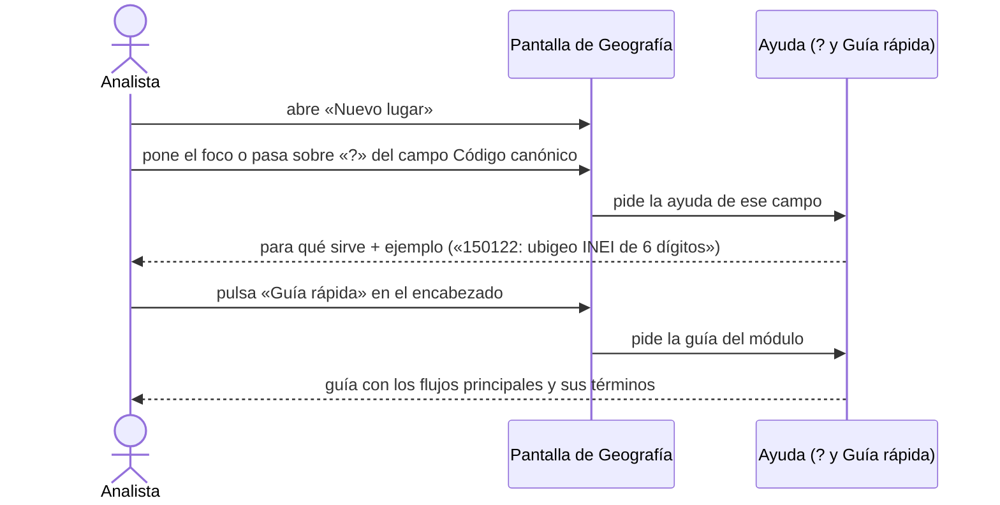

- **Dado** cualquier campo u opción del módulo (filtros, formularios de país, lugar y escalera), **cuando** miro el campo, **entonces** hay un ícono `?` junto a su etiqueta que, al pasar el cursor, al pulsarlo o al darle el foco con teclado, muestra **para qué sirve** y **un ejemplo de formato** (por ejemplo, «ISO alfa-2: dos letras, como PE»).
- **Dado** que uso solo teclado o lector de pantalla, **cuando** doy el foco al `?`, **entonces** la ayuda se anuncia, se puede cerrar con `Esc` sin mover el foco y no tapa el campo que la origina.
- **Dado** que estoy en el encabezado de Geografía, **cuando** busco ayuda general, **entonces** veo un botón visible «Autoayuda / Guía rápida» que abre la guía del módulo sin salir de la pantalla ni perder lo escrito en un formulario abierto.
- **Dado** un campo cuyo formato depende del país (código canónico, código postal), **cuando** abro su ayuda, **entonces** el ejemplo corresponde al país y nivel elegidos.
- **Dado** que la ayuda de un campo no está redactada, **cuando** lo miro, **entonces** no aparece un `?` vacío (se omite el ícono y el campo conserva su etiqueta).
- **Flujo de excepción:** si la guía no carga, se avisa «No pudimos abrir la guía» con «Reintentar» y los `?` siguen funcionando.

**Supuestos.** El texto de §6.5 es el punto de partida; ampliarlo a todos los campos es trabajo de contenido, no decidido ([G-642](../../GAPS.md)). Nombre exacto del botón: el de la historia de origen, a confirmar con diseño. **Dependencias de negocio:** redactor y dueño del contenido de la ayuda. **Cubierto ya:** el texto de apoyo bajo el campo y las 8 ayudas de §6.5 siguen valiendo; esta historia añade el `?` y la guía, no los reemplaza.

**DoR:** ✔ actor y valor · ✔ criterios verificables · ✖ contenido de ayuda de cada campo redactado ([G-642](../../GAPS.md)) · ✖ talla acordada.

Sostén: RNF-GEO-07; [UX-MDM-001](./especificacion-ux-mdm-001.es.md) (ayudas de campo); [§6.5](#65-ayudas-de-campo) y [§7](#7-accesibilidad-wcag-22-aa).

### US-GEO-019 — Dar de alta países y divisiones con menos pasos

- **Actor principal:** analista de datos maestros (divisiones y lugares) y responsable del catálogo (países y escalera). **Secundarios:** consulta (ve el resultado); el servidor (decide las reglas y los permisos, `403`).
- **Prioridad:** Must (dolor 1 del propietario). **Valor:** un alta de distrito pasa de «buscar padre → elegirlo → elegir tipo → escribir» a «elegir el padre donde ya estoy → escribir». **Talla:** M (**SUPUESTO**).
- **Contexto y alcance:** alta de país, de división administrativa en cualquier nivel (departamento, provincia, distrito o el que tenga el país) y de lugar. Fuera: importación masiva ([US-GEO-012](#us-geo-012--importar-un-catálogo-oficial-con-revisión-de-diferencias)), sucesiones y la forma exacta del control (modal, hoja o fila en el árbol: **no se decide aquí**, [G-643](../../GAPS.md)).
- **Reglas de negocio:** se conservan todas las reglas de [US-GEO-005](#us-geo-005--mantener-un-país-y-su-escalera-de-niveles) y [US-GEO-006](#us-geo-006--dar-de-alta-un-lugar-con-validación-de-nivel): un ubigeo empieza por los cuatro dígitos del padre, un alfa-2 retirado no se reutiliza, un padre histórico no admite hijos nuevos, el nivel lo fija la escalera del país. Un solo clic nunca crea sin mostrar lo que se va a crear.

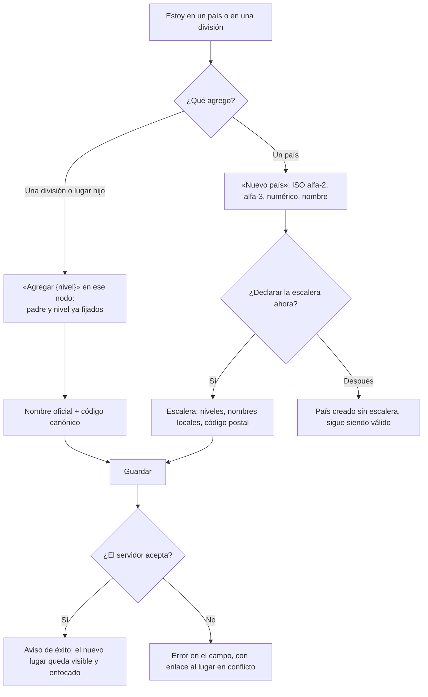

- **Dado** que estoy en la ficha o el nodo de «Huaral» (provincia) y tengo permiso, **cuando** elijo agregar un hijo, **entonces** el formulario ya trae el padre y el nivel («Distrito») y **no** me pide buscar el lugar superior ni elegir el tipo; solo nombre oficial y código canónico.
- **Dado** que agrego sin partir de un nodo (desde el encabezado), **cuando** abro el alta, **entonces** puedo elegir el padre **sin** el paso «escribir dos letras y pulsar Buscar»: el selector ofrece los lugares superiores admisibles con su ruta, filtrables al escribir.
- **Dado** que creo un país, **cuando** guardo, **entonces** se me ofrece continuar con su escalera territorial sin volver a la lista; si elijo «Después», el país queda válido y sin escalera (como [US-GEO-005](#us-geo-005--mantener-un-país-y-su-escalera-de-niveles)).
- **Dado** que guardo un lugar, **cuando** el servidor acepta, **entonces** el lugar nuevo aparece en su jerarquía, con el foco puesto en él, y puedo agregar otro hermano sin reabrir todo («Guardar y agregar otro»).
- **Dado** que no tengo permiso para crear países o declarar escaleras, **cuando** miro el módulo, **entonces** la acción no se ofrece y el aviso existente explica el rol que se necesita (hoy: «crear países y declarar escaleras requiere un rol responsable»).
- **Dado** que el código o el padre son inválidos (ubigeo que no empieza por los cuatro dígitos del padre, padre histórico), **cuando** envío, **entonces** el error va en el campo con la forma de corregirlo, igual que en [US-GEO-006](#us-geo-006--dar-de-alta-un-lugar-con-validación-de-nivel).
- **Flujo de excepción:** un conflicto de versión del padre se resuelve como [US-GEO-017](#us-geo-017--recuperarse-de-un-conflicto-de-versión), sin perder lo escrito.

**Métrica de pasos.** «Menos clics o pasos» necesita un punto de partida y una meta: hoy, desde `GeographyPage`, un alta de distrito exige abrir la hoja, escribir 2+ letras, pulsar Buscar, elegir el padre, elegir tipo, nombre, código y guardar; la meta no está acordada ([G-643](../../GAPS.md)).

**Supuestos.** Que «Guardar y agregar otro» y la oferta de escalera tras crear un país son bienvenidas es **SUPUESTO [SU-GEO-18](#81-supuestos)**. **Dependencias de negocio:** [US-GEO-020](#us-geo-020--recorrer-la-jerarquía-por-país-con-filtros-rápidos-y-buscador) (el explorador de donde parte el alta). **Cubierto ya:** el padre y el nivel fijados desde el explorador ya son criterio de US-GEO-006; esta historia no lo duplica, lo extiende al alta de país y al alta sin contexto.

**DoR:** ✔ actor y valor · ✔ criterios verificables · ✖ forma de control decidida y meta de pasos ([G-643](../../GAPS.md)) · ✖ talla acordada.

Sostén: RF-GEO-002, 003, 004, 007; RN-GEO-01, 07, 10; D2, D3; [D-048](../../DECISIONS.md#decisiones-locales).

### US-GEO-020 — Recorrer la jerarquía por país con filtros rápidos y buscador

- **Actor principal:** analista de datos maestros. **Secundarios:** responsable del catálogo y consulta.
- **Prioridad:** Must (dolor 2 del propietario). **Valor:** ver de un vistazo qué hay en cada país y nivel sin leer una tabla plana de rutas en texto. **Talla:** L (**SUPUESTO**; incluye construir el explorador ya especificado).
- **Contexto y alcance:** la jerarquía **país → divisiones** y su filtrado. Por [G-640](../../GAPS.md) «zona» no se interpreta como entidad: si el propietario la define como zona postal ([US-GEO-011](#us-geo-011--mantener-las-zonas-postales)), una división o un establecimiento, esta historia se reabre. Fuera: la ficha del lugar ([US-GEO-003](#us-geo-003--consultar-la-ficha-de-un-lugar)).
- **Reglas de negocio:** un nivel se llama como lo declara la escalera del país, no con nombres peruanos fijos ([US-GEO-002](#us-geo-002--explorar-la-jerarquía-de-un-país)). El estado y el nivel **no se distinguen solo por color** (WCAG 1.4.1, [§7](#7-accesibilidad-wcag-22-aa)): el color por nivel de la historia de origen solo vale como refuerzo de icono, sangría y texto ([G-644](../../GAPS.md): choca con la regla de color de [UI-MDM-002](./especificacion-ui-geografia-mdm-001.es.md)).

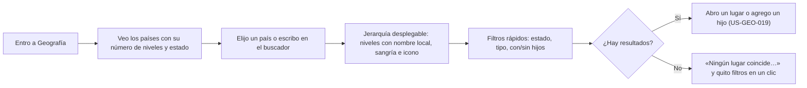

- **Dado** que abro Geografía, **cuando** carga, **entonces** veo la jerarquía de un país como árbol desplegable (cargado por nivel y bajo demanda), con cada nivel distinguible por **nombre del nivel, sangría e icono**, y no una tabla plana de rutas.
- **Dado** que elijo «Perú», **cuando** despliego Lima, **entonces** veo sus provincias y, al abrir una, sus distritos; en «Chile» los niveles se llaman como su escalera dice.
- **Dado** que uso los filtros rápidos (estado: vigente, desactivado, histórico; tipo de ubicación; país), **cuando** activo uno, **entonces** la jerarquía muestra solo lo que cumple, el filtro activo se ve y se quita con un clic, y el total se anuncia («12 lugares»).
- **Dado** que escribo en el buscador un nombre de lugar o de país, **cuando** busco, **entonces** obtengo ambos tipos de resultado, cada uno con su ruta, y los dos distritos «Aco» nunca se ven iguales ([US-GEO-001](#us-geo-001--buscar-un-lugar-por-código-o-por-nombre)); sigo pudiendo buscar por código oficial.
- **Dado** que no hay resultados, **cuando** termina la búsqueda, **entonces** se anuncia y se ofrece «Quitar filtros»; no queda una pantalla en blanco.
- **Dado** que uso solo teclado, **cuando** recorro el árbol, **entonces** se cumple el patrón _treeview_ de [§7](#7-accesibilidad-wcag-22-aa) (flechas, `Inicio`, `Fin`, un solo nodo en el orden de tabulación).
- **Flujo de excepción:** si un nivel no carga, el nodo lo dice y `Intro` reintenta, conservando los niveles ya abiertos ([UI-MDM-002 §3.3](./especificacion-ui-geografia-mdm-001.es.md)).

**Cubierto ya (se pasa por alto, no se duplica).** El comportamiento del árbol, las migas, la adaptación por tamaño y la accesibilidad ya están en [US-GEO-001](#us-geo-001--buscar-un-lugar-por-código-o-por-nombre), [US-GEO-002](#us-geo-002--explorar-la-jerarquía-de-un-país), [§4.3](#43-explorar-el-árbol-país--departamento--provincia--distrito), [§5.3](#53-p-geo-01--lugares-búsqueda-y-explorador) y [UI-MDM-002 §3.3](./especificacion-ui-geografia-mdm-001.es.md); lo que falta es construirlo y añadir **filtros rápidos** (aquí nuevos como _chips_) y un buscador unificado por país o lugar. **Supuestos.** Los filtros rápidos son los de hoy (país, tipo, estado); «con/sin hijos» y «tarjetas» no están decididos ([G-644](../../GAPS.md)). **Dependencias de negocio:** [G-640](../../GAPS.md).

**DoR:** ✔ actor y valor · ✔ criterios verificables · ✖ qué es «zona» ([G-640](../../GAPS.md)) · ✖ color por nivel frente a la regla de color ([G-644](../../GAPS.md)).

Sostén: RF-GEO-001, 003, 004; RN-GEO-06, 07; D2, D3, D11; RNF-GEO-07.

### US-GEO-021 — Disponer de datos de ejemplo completos como referencia

- **Actor principal:** analista de datos maestros (aprende y valida contra el ejemplo). **Secundarios:** quien prueba y quien diseña (usan el ejemplo como referencia visual); responsable del catálogo (valida que el ejemplo respeta lo que él aprobaría).
- **Prioridad:** Should (dolor 4 del propietario). **Valor:** ver en pantalla todas las variantes del catálogo sin cargar un archivo oficial. **Talla:** M (**SUPUESTO**).
- **Contexto y alcance:** un conjunto de ejemplo que cubra las variantes ya descritas en US-GEO-001 a 017. Fuera: la carga de catálogos oficiales completos ([US-GEO-012](#us-geo-012--importar-un-catálogo-oficial-con-revisión-de-diferencias)) y datos de producción. **Seed del mock o dato real:** no decidido ([G-645](../../GAPS.md)); esta historia lo escribe para el **mock** de [API-MDM-003](../03-construccion/contrato-api-geografia-mdm-003.es.md) por ser lo que existe hoy.
- **Reglas de negocio:** el ejemplo respeta las reglas del catálogo (ubigeo coherente con el padre, alfa-2 único, un solo padre) y la marca de **uso interno** de [US-GEO-016](#us-geo-016--reconocer-el-dato-de-uso-interno-por-licencia); no contiene datos personales ni de clientes; es reconocible como ejemplo, no como dato oficial.

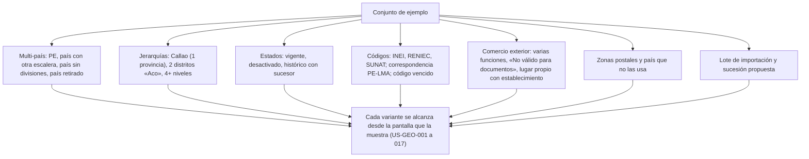

- **Dado** el ejemplo cargado, **cuando** abro la lista de países, **entonces** veo **al menos** cuatro: uno con escalera de tres niveles (Perú), uno con otra escalera y nombres locales distintos (por ejemplo Chile: Región, Provincia, Comuna), uno **sin divisiones registradas** y uno **retirado**.
- **Dado** el ejemplo, **cuando** busco «aco», **entonces** veo dos distritos con rutas distintas; **cuando** abro el Callao, **entonces** veo un departamento con una sola provincia.
- **Dado** el ejemplo, **cuando** activo «Incluir históricos», **entonces** veo al menos un lugar histórico con enlace a su sucesor, uno desactivado y una sucesión propuesta con direcciones afectadas.
- **Dado** el ejemplo, **cuando** abro la ficha de la provincia de Lima, **entonces** veo códigos de más de una autoridad, un código vencido que aún resuelve y la correspondencia con `PE-LMA`.
- **Dado** el ejemplo, **cuando** abro Comercio exterior, **entonces** veo lugares con funciones distintas, uno marcado «No válido para documentos» y un lugar propio dentro de un UN/LOCODE, vinculado a un establecimiento.
- **Dado** el ejemplo, **cuando** abro Zonas postales, **entonces** veo una zona asociada a varios lugares y un país que no usa código postal.
- **Dado** el ejemplo, **cuando** lo uso como referencia visual, **entonces** todo dato de UN/LOCODE o ISO 3166-2 lleva «Uso interno» y ningún dato se presenta como oficial vigente.
- **Dado** que quiero partir de «plantilla», **cuando** pido ver un ejemplo, **entonces** puedo reconocer qué registros son de ejemplo; **si «plantilla» significa copiar el ejemplo para crear datos propios, no está decidido** ([G-645](../../GAPS.md)).
- **Flujo de excepción:** si el ejemplo está incompleto frente a la lista de variantes, la prueba de cobertura falla y nombra la variante faltante.

**Requisitos técnicos asociados** (aislados de la historia, S-04): ver [§3.2](#32-requisitos-técnicos-asociados-aislados-de-las-historias), RT-GEO-04 a RT-GEO-06.

**Supuestos.** «Zonas con subsedes» de la historia de origen se lee aquí como **lugar propio dentro de un UN/LOCODE** ([US-GEO-010](#us-geo-010--registrar-un-lugar-propio-dentro-de-un-unlocode)) o establecimiento con sede; no es una entidad del modelo ([G-640](../../GAPS.md)). **Dependencias de negocio:** que negocio revise y confirme las variantes. **Cubierto ya:** el seed mínimo de hoy (Perú, Lima, Callao, `PECLL`) se conserva dentro del ejemplo.

**DoR:** ✔ actor y valor · ✔ criterios verificables · ✖ seed del mock o dato real y significado de «plantilla» ([G-645](../../GAPS.md)).

Sostén: RF-GEO-001 a 014 (cobertura de variantes); RN-GEO-05; D3, D6, D7, D10.

### 3.2 Requisitos técnicos asociados (aislados de las historias)

Condiciones que acompañan a las historias de §3.1 sin formar parte del criterio de negocio. No fijan la solución; la decisión de implementación va al diseño y, si es arquitectónica, a un ADR (S-06).

| ID | Requisito | Historia |
| :--- | :--- | :--- |
| RT-GEO-01 | La ayuda emergente es operable con teclado y lector de pantalla, se descarta con `Esc`, no oculta el campo y no es la única vía de un dato esencial (WCAG 1.4.13, 2.1.1, 2.5.8) | US-GEO-018 |
| RT-GEO-02 | El texto de la ayuda se mantiene sin tocar la lógica de las pantallas, está solo en español (SD-08) y el ejemplo de formato de un código se deriva del esquema del país cuando existe ([G-642](../../GAPS.md)) | US-GEO-018 |
| RT-GEO-03 | Mejorar el alta y la vista no cambia el contrato [API-MDM-003](../03-construccion/contrato-api-geografia-mdm-003.es.md): las reglas y los permisos siguen en el servidor (`403`, `412`) | US-GEO-019, 020 |
| RT-GEO-04 | El ejemplo es determinista (mismos identificadores en cada carga), sin datos personales y reproducible para pruebas de pantalla | US-GEO-021 |
| RT-GEO-05 | Las pruebas existentes que asumen el seed mínimo (`geo-gateway.test.ts`: 1 país, resultados de «Miraflores») no se rompen al ampliar el ejemplo; cómo se garantiza (perfil adicional o ajuste) no está decidido ([G-645](../../GAPS.md)) | US-GEO-021 |
| RT-GEO-06 | Una prueba comprueba la cobertura de variantes de US-GEO-021 y nombra la que falte | US-GEO-021 |

## 4. Navegación y flujos

### 4.1 Destinos del riel y mapa de navegación

El riel compartido de MDM (`SystemFrame`) ya tiene «Organizaciones» y «Tipos de rol» ([UX-MDM-001 §5.7](./especificacion-ux-mdm-001.es.md#57-p-mdm-04--tipos-de-rol)). La geografía **añade un solo destino, «Geografía»**, con seis secciones en navegación secundaria; así el riel queda en tres destinos, dentro de los tres a siete de M3, y no compite con las tareas de organizaciones. Elegir un destino y no seis es **SUPUESTO [SU-GEO-03](#81-supuestos)**.

| Destino del riel | Sección (navegación secundaria) | Dirección (SUPUESTO [SU-GEO-04](#81-supuestos)) | Pantalla | Visible para |
| :--- | :--- | :--- | :--- | :--- |
| Organizaciones | — (existente) | `/mdm/organizaciones` | P-MDM-01 | Todos |
| Tipos de rol | — (existente) | `/mdm/tipos-de-rol` | P-MDM-04 | Todos |
| **Geografía** (icono de globo) | **Lugares** (por defecto): búsqueda y explorador | `/mdm/geografia/lugares` | P-GEO-01, P-GEO-02 | Todos |
| | **Países** | `/mdm/geografia/paises` | P-GEO-03 | Todos |
| | **Comercio exterior** | `/mdm/geografia/comercio-exterior` | P-GEO-04 | Todos |
| | **Zonas postales** | `/mdm/geografia/zonas-postales` | P-GEO-05 | Todos |
| | **Importaciones** | `/mdm/geografia/importaciones` | P-GEO-06, P-GEO-07 | Responsable y analista |
| | **Sucesiones** | `/mdm/geografia/sucesiones` | P-GEO-08, P-GEO-09 | Todos (escribir: responsable y analista) |

Importaciones y Sucesiones llevan una **insignia** con el número de elementos pendientes de la persona (diferencias por aprobar, direcciones por revisar), con su texto accesible («Sucesiones, 3 pendientes»).

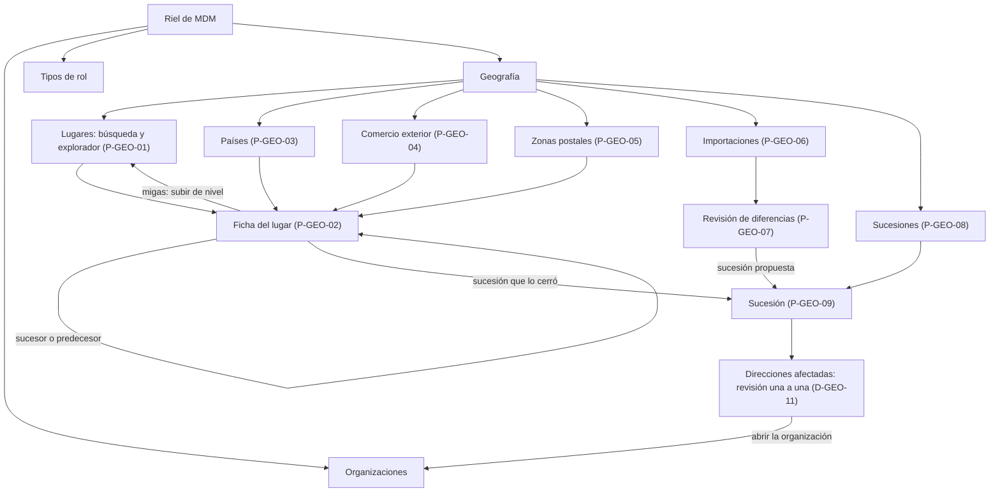

### 4.2 Buscar un lugar por ubigeo, UN/LOCODE o nombre

La búsqueda distingue **código exacto** y **texto**: si lo escrito tiene forma de código conocido (seis dígitos, cinco caracteres alfanuméricos, `XX-…`, dos letras), los resultados por código van primero en un grupo propio. La forma de reconocerlo es ayuda de la UI; el servidor busca en todos los esquemas (D11).

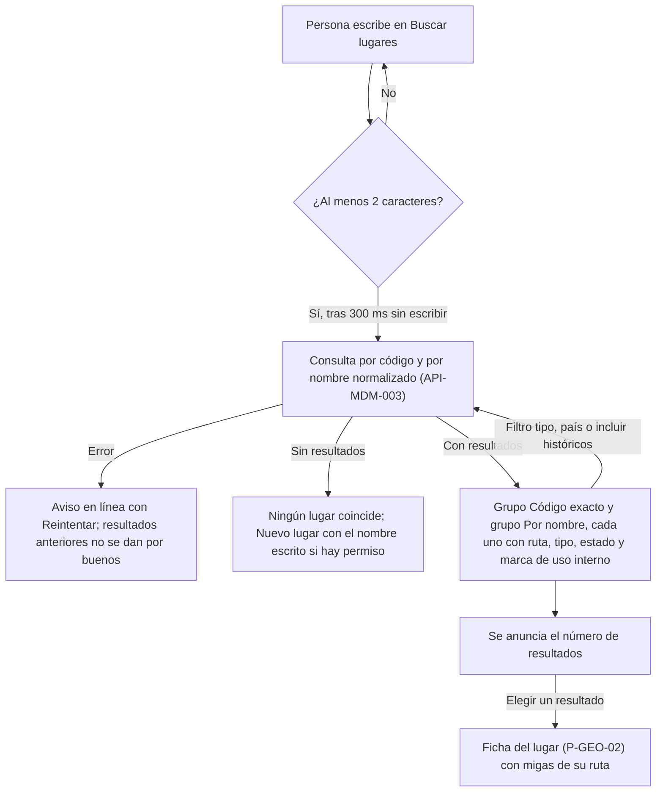

### 4.3 Explorar el árbol País → Departamento → Provincia → Distrito

Los hijos se cargan **por nivel y bajo demanda**: nunca el árbol completo (D11, vista `path` o `minimal`). En `compact` y `medium` cada nivel es una página con migas; desde `expanded` es un árbol (§5.2).

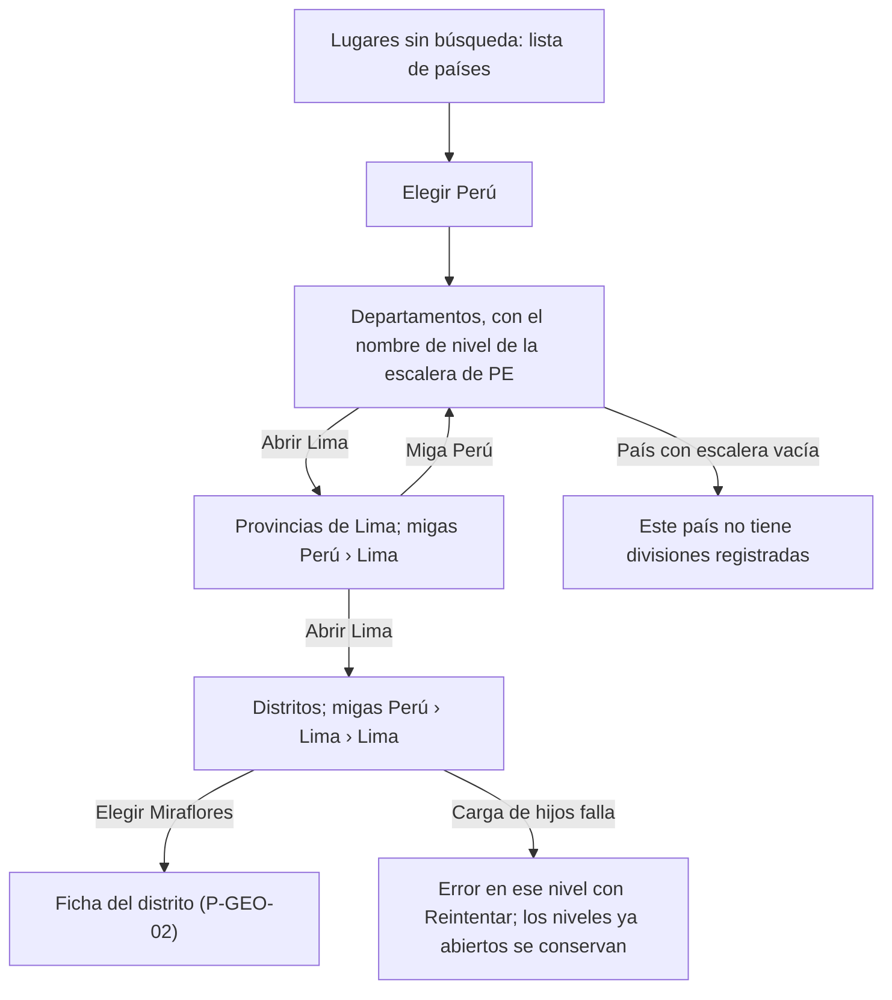

### 4.4 Alta de un lugar con validación de nivel

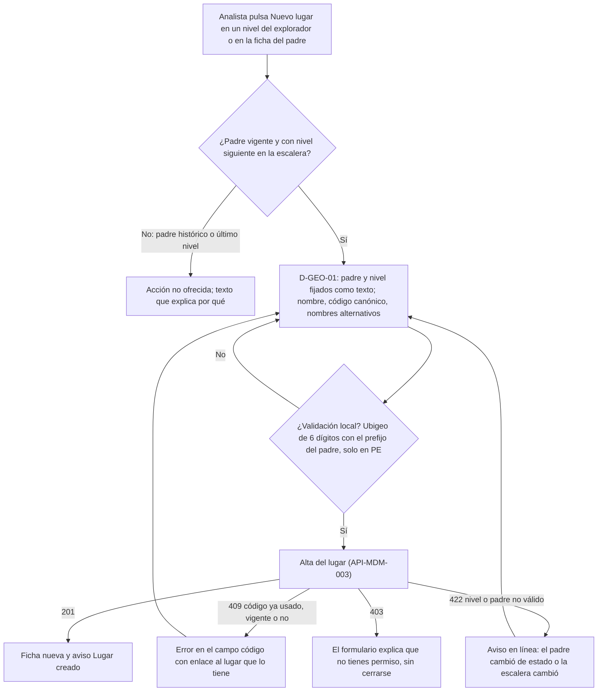

### 4.5 Importar un catálogo con revisión de diferencias

Tres capas de [D10](../../reference/architecture/adrs/MDM-002-modelo-geografico-de-la-suite.es.md#d10): aterrizaje, revisión y canónico. La UI muestra el estado del lote en cada paso.

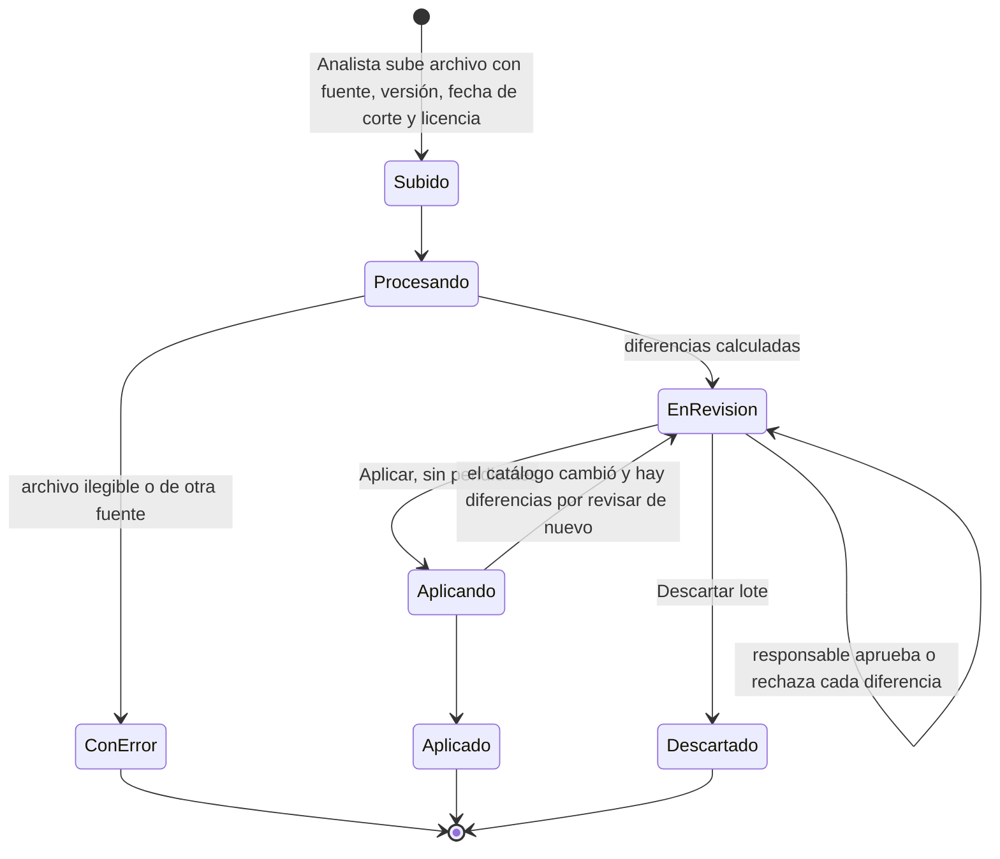

```mermaid
sequenceDiagram
    actor A as Analista
    actor R as Responsable
    participant UI as mdm-app
    participant API as API de geografía
    A->>UI: Nueva importación (D-GEO-07)
    UI->>API: Subir archivo y metadatos
    API-->>UI: Lote Procesando
    UI-->>A: Avisará al terminar; puede salir de la pantalla
    API-->>UI: Lote En revisión con totales
    R->>UI: Abre la revisión (P-GEO-07)
    loop Cada diferencia
        R->>UI: Aprobar o Rechazar con motivo
        UI->>API: Decisión de la diferencia
        API-->>UI: Pendientes restantes
    end
    R->>UI: Aplicar importación (D-GEO-08)
    UI->>API: Aplicar con la versión del lote
    alt Aplicado
        API-->>UI: Aplicadas, rechazadas, sucesiones propuestas creadas
        UI-->>R: Resumen y enlace a Sucesiones
    else 412 o diferencias regeneradas
        API-->>UI: Conflicto
        UI-->>R: Diferencias afectadas vuelven a Pendiente con su motivo
    else 403 preparó el lote
        API-->>UI: Prohibido
        UI-->>R: Otra persona responsable debe aprobarlo
    end
```

### 4.6 Proponer y aprobar una sucesión con revisión de direcciones

Ninguna dirección se reasigna sola ([D-048](../../DECISIONS.md#decisiones-locales) (3), [D6](../../reference/architecture/adrs/MDM-002-modelo-geografico-de-la-suite.es.md#d6)): aprobar produce la lista, y cada dirección se decide por separado.

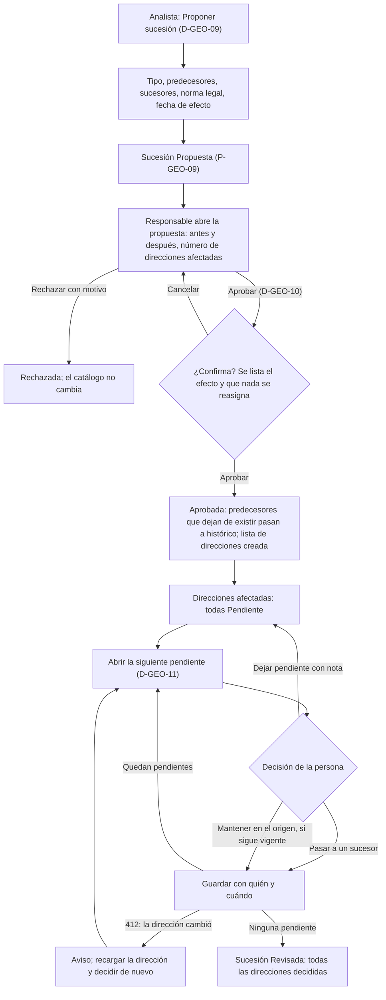

### 4.7 Conflicto `412` por versión y recuperación

Igual que [UX-MDM-001 §4.6](./especificacion-ux-mdm-001.es.md#46-conflicto-412-por-versión-y-recuperación), con la versión **del lugar** (D3), no de todo el árbol. En lotes, sucesiones y direcciones afectadas la versión es la del propio elemento (**SUPUESTO [SU-GEO-11](#81-supuestos)**).

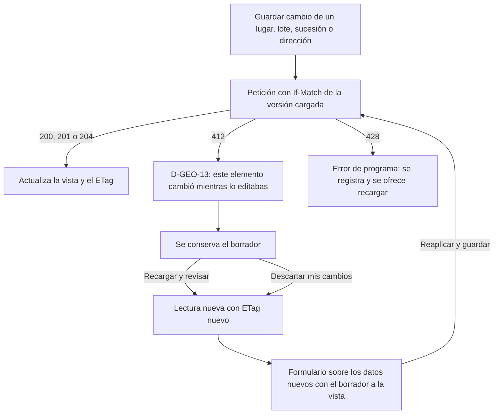

## 5. Pantallas y diálogos

Material Design 3 en los _window size classes_ de [D-021](../../DECISIONS.md#decisiones-locales), con las composiciones y estados comunes que ya usa [UX-MDM-001 §5](./especificacion-ux-mdm-001.es.md#5-pantallas) (tabla de datos, paginación, etiqueta de estado, aviso en línea, marcador de carga). La geografía añade tres composiciones: **migas de ruta**, **árbol de lugares** y **tarjeta de diferencia** (valor vigente frente a propuesto). Los wireframes son de **baja fidelidad en texto** (**SUPUESTO [SU-GEO-12](#81-supuestos)**).

### 5.1 Inventario

| ID | Título | Tipo | Historias |
| :--- | :--- | :--- | :--- |
| P-GEO-01 | Lugares: búsqueda y explorador | Pantalla: búsqueda y navegación jerárquica | US-GEO-001, 002, 004 |
| P-GEO-02 | Ficha del lugar | Pantalla con secciones | US-GEO-003, 007, 008, 016 |
| P-GEO-03 | Países | Pantalla: lista | US-GEO-005 |
| P-GEO-04 | Comercio exterior | Pantalla: lista filtrable | US-GEO-009, 010 |
| P-GEO-05 | Zonas postales | Pantalla: lista por país | US-GEO-011 |
| P-GEO-06 | Importaciones | Pantalla: lista de lotes | US-GEO-012 |
| P-GEO-07 | Revisión de diferencias de una importación | Pantalla de revisión | US-GEO-012 |
| P-GEO-08 | Sucesiones | Pantalla: lista de sucesiones | US-GEO-013 |
| P-GEO-09 | Sucesión y direcciones afectadas | Pantalla de detalle con revisión | US-GEO-013, 014 |
| D-GEO-01 | Nuevo lugar / Nuevo lugar propio | Formulario en diálogo u hoja | US-GEO-006, 010 |
| D-GEO-02 | Corregir lugar | Formulario en diálogo u hoja | US-GEO-007 |
| D-GEO-03 | Agregar o vencer código oficial | Formulario en diálogo u hoja | US-GEO-008 |
| D-GEO-04 | Registrar correspondencia | Formulario en diálogo u hoja | US-GEO-008 |
| D-GEO-05 | Desactivar lugar | Confirmación reversible | US-GEO-007 |
| D-GEO-06 | Escalera de niveles del país | Formulario en diálogo u hoja | US-GEO-005 |
| D-GEO-07 | Nueva importación | Formulario en diálogo u hoja con archivo | US-GEO-012 |
| D-GEO-08 | Aplicar importación | Confirmación terminal | US-GEO-012 |
| D-GEO-09 | Proponer sucesión | Formulario en diálogo a pantalla completa en todos los tamaños | US-GEO-013 |
| D-GEO-10 | Aprobar o rechazar sucesión | Confirmación terminal | US-GEO-013 |
| D-GEO-11 | Revisar dirección afectada | Panel de decisión (hoja lateral o página en `compact`) | US-GEO-014 |
| D-GEO-12 | Selector de lugar | Componente _combobox_ para formularios de dirección | US-GEO-015 |
| D-GEO-13 | El elemento cambió (`412`) | Aviso en línea dentro del formulario abierto | US-GEO-017 |
| D-GEO-14 | Nueva o editar zona postal | Formulario en diálogo u hoja | US-GEO-011 |

Reactivar un lugar es reversible y de un clic: se ejecuta desde el menú y confirma con una _snackbar_. Desactivar abre D-GEO-05 porque retira el lugar del selector de direcciones.

### 5.2 Adaptación por tamaño de ventana

Clases y márgenes de M3 como en UX-MDM-001 §5.2; `extra-large` se comporta como `large` con ancho de lectura acotado. La navegación secundaria de «Geografía» son **pestañas desplazables** bajo la barra superior en todos los tamaños, con el riel o la barra de navegación del shell intactos.

| Clase | P-GEO-01 Lugares | P-GEO-02 Ficha | Listas (P-GEO-03 a 06, 08) | P-GEO-07 y P-GEO-09 (revisión) | Formularios D-GEO |
| :--- | :--- | :--- | :--- | :--- | :--- |
| `compact` (< 600 dp) | **Navegación jerárquica**: un nivel por página, lista de tarjetas con el nombre del nivel como título, migas recortadas («… › Lima › Lima») con menú para los niveles ocultos; búsqueda en barra superior | Página propia; secciones apiladas en acordeón; acciones en menú de desbordamiento | Tarjetas, «Filtros» en hoja inferior, «Cargar más» | Una diferencia o una dirección por pantalla, con «Anterior» y «Siguiente» y el progreso arriba | Diálogo a pantalla completa |
| `medium` (600–839 dp) | Navegación jerárquica con migas completas y tabla reducida de hijos (nombre, código canónico, número de hijos, estado) | Página propia; secciones en pestañas | Tabla reducida | Lista agrupada por tipo de diferencia; la decisión abre hoja lateral | Hoja lateral modal |
| `expanded` (840–1199 dp) | **Árbol** a la izquierda (360 dp) y tabla de hijos del nodo elegido a la derecha, con migas encima | Página propia; pestañas | Tabla completa con _filter chips_ | Lista a la izquierda y tarjeta de diferencia o dirección a la derecha | Hoja lateral modal |
| `large` (1200–1599 dp) y superior | **Lista-detalle**: árbol o resultados a la izquierda (412 dp) y P-GEO-02 como panel de detalle; las migas pertenecen al detalle | Dentro del panel de detalle | Lista-detalle: la fila abre la ficha o el lote en el panel | Igual que `expanded` con columna de contexto (lugar de origen, sucesores) | Hoja lateral modal |

En `large` o superior, elegir un lugar actualiza el panel y la dirección (`/mdm/geografia/lugares/{id}`, **SUPUESTO [SU-GEO-04](#81-supuestos)**), de modo que «Atrás» y un enlace compartido llevan al mismo lugar. Por debajo de `large`, la ficha es una página con «Atrás» que vuelve al nivel, la búsqueda y los filtros donde estaban.

### 5.3 P-GEO-01 — Lugares: búsqueda y explorador

- **Propósito:** encontrar un lugar por código o nombre, o llegar a él recorriendo la jerarquía.
- **Contenido:** _search bar_ «Buscar por ubigeo, UN/LOCODE, código ISO o nombre»; _filter chips_ «Tipo» (país, división, comercio exterior, lugar propio), «País» e «Incluir históricos»; botón «Ver al…» (fecha; US-GEO-004). Sin búsqueda: el explorador empieza en la lista de países (los que tienen divisiones primero, **SUPUESTO [SU-GEO-13](#81-supuestos)**). Con búsqueda: dos grupos, «Código exacto» y «Por nombre», cada resultado con nombre oficial, ruta, tipo, nivel local, código canónico con su esquema, etiqueta de estado y, si aplica, «Uso interno».
- **Acciones:** abrir un lugar; abrir un nivel; «Nuevo lugar» en el nivel actual (solo responsable y analista, y solo si el padre está vigente y la escalera tiene un nivel siguiente).
- **Orden:** por nombre normalizado en el explorador; por relevancia en la búsqueda, con el código exacto primero.

| Estado | Diseño |
| :--- | :--- |
| Vacío (catálogo sin países) | «Aún no hay países en el catálogo.» + «Ir a Importaciones» (responsable y analista) |
| Vacío por búsqueda | «Ningún lugar coincide con «{texto}».» + «Incluir históricos» si estaba apagado y «Nuevo lugar» con el nombre escrito (WCAG 3.3.7) |
| Nivel sin hijos | «{Nombre} no tiene {nombre del nivel siguiente, en plural} registrados.» + «Nuevo lugar» si procede |
| País con escalera vacía | «Este país no tiene divisiones registradas.» |
| Cargando | Indicador lineal en el nivel que carga y marcadores de posición; los niveles ya abiertos siguen visibles y operables |
| Error | Aviso en línea en el nivel que falló: «No pudimos cargar {nivel}.» + «Reintentar»; nunca una lista parcial como completa |
| Sin permiso | Sin «Nuevo lugar»; todo se lee igual. El servidor decide (`403`) |
| Histórico | Fila con etiqueta «Histórico» (icono de reloj) y «Sucedido por {nombre}» como enlace; texto sin atenuar |
| Vista en una fecha | Banda persistente `secondary-container`: «Estás viendo el catálogo al {fecha}.» + «Volver a hoy»; sin acciones de escritura |
| Uso interno por licencia | Etiqueta «Uso interno» (icono de candado) en cada resultado afectado; la ayuda dice «Dato de {fuente} con licencia sin confirmar para compartir fuera de Organización.» |

Wireframe `expanded`:

```text
+--------------------------------------------------------------------------------+
| Geografía                                                                      |
| [Lugares] Países  Comercio exterior  Zonas postales  Importaciones(2) Sucesiones|
+--------------------------------------------------------------------------------+
| [Q Buscar por ubigeo, UN/LOCODE, código ISO o nombre                 ] [Ver al…]|
| [Tipo v] [País: PE x] [ ] Incluir históricos                                   |
+-------------------------------+------------------------------------------------+
| Perú                          | Perú › Lima › Lima                             |
|  > Amazonas                   | Distritos de Lima (43)            (+ Nuevo lugar)|
|  > Áncash                     |------------------------------------------------|
|  v Lima                       | Nombre        | Ubigeo INEI | Estado            |
|     v Lima                    | Ate           | 150103      | (o) Vigente       |
|        Ate                    | Miraflores    | 150122      | (o) Vigente       |
|        Miraflores  <          | ...                                            |
|     > Huaral                  |                                                |
|  > Callao                     |                         1–20 de 43  [<] [>]    |
+-------------------------------+------------------------------------------------+
```

Wireframe `compact` (navegación jerárquica):

```text
+------------------------------+
| <  Provincias de Lima    [Q] |
| … › Perú › Lima              |
+------------------------------+
| Barranca                  >  |
| Ubigeo 1502 · 5 distritos    |
+------------------------------+
| Lima                      >  |
| Ubigeo 1501 · 43 distritos   |
+------------------------------+
| Huaral                    >  |
| Ubigeo 1506 · 12 distritos   |
+------------------------------+
|           [+ Nuevo lugar]    |
+------------------------------+
```

Los recuentos y códigos de los wireframes son ilustrativos, no datos verificados.

### 5.4 P-GEO-02 — Ficha del lugar

- **Propósito:** reunir lo que identifica a un lugar y lo que se puede hacer con él.
- **Cabecera:** migas de la ruta; `h1` con el nombre oficial; tipo y nivel local («Distrito»); etiquetas de estado y, si aplica, «Uso interno»; código canónico con su esquema y botón «Copiar código» (copiar dentro de la empresa no es redistribuir, **SUPUESTO [SU-GEO-14](#81-supuestos)**, [G-631](../../GAPS.md)).
- **Secciones:**
  - **Datos:** nombre oficial, nombres alternativos con idioma y uso (comercio internacional, local, histórico), padre, nivel, hijos (enlace al explorador).
  - **Códigos:** esquema, valor, autoridad, «Canónico» si lo es, vigencia y estado (vigente, vencido).
  - **Correspondencias:** de qué esquema a cuál, tipo dicho en texto y vigencia.
  - **Comercio exterior** (solo `TradeLocation`): funciones, estado UNECE, «Válido para documentos» o «No válido para documentos», lugares propios que contiene.
  - **Zonas postales:** zonas que cubren el lugar.
  - **Punto de referencia:** latitud y longitud en grados decimales con su fuente y precisión, o «Sin punto de referencia»; sin mapa en la primera etapa ([G-634](../../GAPS.md)).
  - **Sucesión:** predecesores y sucesores con la sucesión, la norma legal y la fecha de efecto.
  - **Fuente y licencia:** fuente, versión, fecha de corte, lote de importación y licencia.
  - **Historial:** quién cambió qué, cuándo y desde qué fuente (RNF-GEO-01).
- **Acciones** (responsable y analista; desactivar solo responsable): «Corregir», «Agregar código», «Registrar correspondencia», «Nuevo lugar» hijo, «Nuevo lugar propio» (solo en un UN/LOCODE), «Proponer sucesión», «Desactivar» o «Reactivar». Ninguna acción borra.

| Estado | Diseño |
| :--- | :--- |
| Cargando | Marcadores de posición de cabecera y secciones; migas visibles en cuanto se conoce la ruta |
| Error | «No pudimos cargar este lugar.» + «Reintentar» y «Volver a Lugares» |
| No existe | «Este lugar no existe.» (enlace roto o id mal escrito); nunca se presenta un lugar histórico como inexistente |
| Sin permiso | Ficha completa en lectura, sin acciones |
| Desactivado | Etiqueta «Desactivado» (icono de pausa) y aviso: «No se ofrece para direcciones nuevas; las existentes se conservan.» |
| Histórico | Solo lectura; aviso «Histórico desde el {fecha}. Sucedido por {sucesores}.» con enlaces; sin «Nuevo lugar» hijo |
| Uso interno por licencia | Aviso en «Códigos» y en «Fuente y licencia»: «Uso interno: la licencia de {fuente} no está confirmada para compartir fuera de Organización.» |
| Sección vacía | «Sin códigos de otras autoridades.», «Sin correspondencias registradas.», «Sin punto de referencia.», «Sin sucesiones.» |

Wireframe `expanded`:

```text
+--------------------------------------------------------------------------------+
| Perú › Lima › Lima › Miraflores                                                 |
| Miraflores                                     (Corregir) (Proponer sucesión) [:]|
| Distrito · (o) Vigente · Ubigeo INEI 150122 [Copiar]                            |
+--------------------------------------------------------------------------------+
| [Datos] Códigos  Correspondencias  Zonas postales  Punto de ref.  Sucesión  ... |
+--------------------------------------------------------------------------------+
| Códigos                                                     (+ Agregar código) |
| Esquema        | Valor  | Autoridad | Canónico | Vigencia            | Estado   |
| Ubigeo INEI    | 150122 | INEI      | Sí       | desde 01/01/1990    | Vigente  |
| Ubigeo RENIEC  | ...    | RENIEC    | No       | desde ...           | Vigente  |
+--------------------------------------------------------------------------------+
```

### 5.5 P-GEO-03 — Países

- **Contenido:** tabla con nombre, alfa-2 (canónico), alfa-3, numérico, niveles de su escalera («Departamento › Provincia › Distrito» o «Sin divisiones»), número de lugares y estado; «Incluir retirados». Fila retirada con etiqueta «Retirado» y enlace a su sucesor si existe.
- **Acciones:** abrir la ficha (P-GEO-02, con la sección extra **Escalera de niveles**); «Nuevo país» y «Editar escalera» (D-GEO-06) solo para el responsable.
- **Estados:** vacío «Aún no hay países en el catálogo.» + «Ir a Importaciones»; cargando, error y sin permiso como P-GEO-01; los alfa-2 de uso privado (`AA`, `QM`–`QZ`, `XA`–`XZ`, `ZZ`) no se aceptan en el alta.

### 5.6 P-GEO-04 — Comercio exterior

- **Contenido:** filtros País, Función (puerto marítimo, ferroviario, carretera, aeropuerto, postal, multimodal o depósito interior, zona económica especial, frontera), Estado UNECE y «Solo válidos para documentos» (encendido por defecto). Columnas: UN/LOCODE, nombre (con el nombre sin diacríticos debajo si difiere), funciones como chips con texto, estado UNECE, «Válido para documentos» (Sí · No con icono), división que lo contiene y «Uso interno». Los lugares propios se listan bajo su UN/LOCODE, sangrados, con el esquema `ORG-SITE`.
- **Acciones:** abrir; «Nuevo lugar propio» desde la fila de un UN/LOCODE (responsable y analista). El alta de un UN/LOCODE llega por importación, no a mano (**SUPUESTO [SU-GEO-15](#81-supuestos)**).
- **Estados:** vacío «No hay lugares de comercio exterior para estos filtros.» + «Quitar filtros»; uso interno con banda en la cabecera de la lista mientras [G-616](../../GAPS.md) siga abierto: «Datos de UN/LOCODE para uso interno: no se comparten fuera de Organización.»

Wireframe `expanded`:

```text
+--------------------------------------------------------------------------------+
| (candado) Datos de UN/LOCODE para uso interno: no se comparten fuera de Organización. |
| [País: PE x] [Función: Puerto marítimo x] [Estado v] [x] Solo válidos para doc. |
+--------------------------------------------------------------------------------+
| UN/LOCODE | Nombre   | Funciones                 | Estado   | Docs | Contenido en |
| PECLL     | Callao   | [Puerto] [Ferro.] [Carr.] | Aprobado | Sí   | Callao       |
|   ORG-SITE ...  Terminal ejemplo (lugar propio)                             |
| PEPAI     | Paita    | [Puerto]                  | Aprobado | Sí   | Piura › Paita|
+--------------------------------------------------------------------------------+
```

### 5.7 P-GEO-05 — Zonas postales

- **Contenido:** selector de país obligatorio; tabla con código, lugares que cubre (los tres primeros y «y {n} más») y vigencia.
- **Acciones:** «Nueva zona postal» y «Editar» (D-GEO-14) para responsable y analista.
- **Estados:** país sin zonas: «Este país no usa código postal en el catálogo.»; sin país elegido: «Elige un país para ver sus zonas postales.»

### 5.8 P-GEO-06 — Importaciones

- **Contenido:** lotes con fuente, versión, fecha de corte, licencia, quién lo subió, estado (Procesando, En revisión, Aplicando, Aplicado, Con error, Descartado) y totales de altas, cambios, bajas y sucesiones propuestas; los pendientes del responsable arriba.
- **Acciones:** «Nueva importación» (D-GEO-07); abrir la revisión (P-GEO-07); «Descartar lote» en lotes no aplicados.
- **Estados:** vacío «Aún no hay importaciones.»; lote con error: «No pudimos leer el archivo: {motivo en lenguaje llano}.» + «Subir otro archivo»; sin permiso: la sección no está en las pestañas para la consulta.

### 5.9 P-GEO-07 — Revisión de diferencias de una importación

- **Cabecera:** fuente, versión, fecha de corte, licencia, quién lo subió; progreso «{n} de {total} diferencias revisadas»; filtros por tipo (Altas, Cambios, Bajas, Sucesiones propuestas) y por decisión (Pendiente, Aprobada, Rechazada).
- **Tarjeta de diferencia:** lugar con su ruta; para cambios, tabla de dos columnas «Vigente» y «Propuesto» con solo los campos que difieren, y el cambio dicho también en texto («Nombre: Ancash → Áncash»); para bajas, «Pasará a desactivado» o «Pasará a histórico»; para sucesiones, el efecto en una frase y «Se creará una sucesión propuesta».
- **Acciones por diferencia** (responsable que no preparó el lote): «Aprobar», «Rechazar» (pide motivo). «Aplicar importación» (D-GEO-08) habilitado solo sin pendientes; si está deshabilitado, el texto visible dice cuántas faltan.
- **Estados:** sin diferencias: «Esta publicación no cambia nada del catálogo.» + «Cerrar lote»; diferencias regeneradas: aviso «El catálogo cambió después de calcular estas diferencias; revisa de nuevo las marcadas.»; quien preparó el lote ve todo en lectura con «Otra persona responsable debe aprobar este lote.»

Wireframe `expanded`:

```text
+--------------------------------------------------------------------------------+
| Importación INEI · versión {v} · corte {fecha} · licencia {licencia}            |
| 38 de 52 diferencias revisadas  [==========-----]       (Aplicar importación)   |
| Faltan 14 por revisar.                                                          |
| [Altas 4] [Cambios 45] [Bajas 2] [Sucesiones 1]   [Decisión: Pendiente v]      |
+-------------------------------+------------------------------------------------+
| ! Áncash (cambio)  Pendiente  | Cambio · Perú › Áncash                         |
|   Huaral (cambio)  Aprobada   | Campo   | Vigente  | Propuesto                 |
|   ...                         | Nombre  | Ancash   | Áncash                    |
|                               |                                                |
|                               |               ( Rechazar )  [ Aprobar ]        |
+-------------------------------+------------------------------------------------+
```

### 5.10 P-GEO-08 — Sucesiones

- **Contenido:** sucesiones con tipo, predecesores, sucesores, norma legal, fecha de efecto, estado (Propuesta, Aprobada, Rechazada, Revisada) y progreso de direcciones («12 de 40 revisadas»); filtro por estado, con «Con direcciones pendientes» por defecto para responsable y analista.
- **Acciones:** «Proponer sucesión» (D-GEO-09); abrir (P-GEO-09).
- **Estados:** vacío «No hay sucesiones registradas.»; sin permiso: lectura sin «Proponer sucesión».

### 5.11 P-GEO-09 — Sucesión y direcciones afectadas

- **Cabecera:** tipo y efecto en una frase, norma legal, fecha de efecto, quién la propuso y quién la aprobó, estado.
- **Antes y después:** predecesores y sucesores con su ruta y sus códigos; los que pasan a histórico, marcados.
- **Propuesta:** el responsable que no la propuso ve «Aprobar» y «Rechazar» (D-GEO-10), con el número de direcciones que apuntan a los predecesores.
- **Direcciones afectadas** (tras aprobar): lista con organización o establecimiento, texto de la dirección, lugar de origen, decisión (Pendiente, Pasada a {sucesor}, Mantenida, Pendiente con nota), quién y cuándo. Filtro por decisión; «Revisar la siguiente pendiente» abre D-GEO-11. **No hay selección múltiple ni «Aplicar a todas»** ([D-048](../../DECISIONS.md#decisiones-locales) (3); coste en [G-630](../../GAPS.md)).
- **Estados:** sin direcciones afectadas: «Ninguna dirección apuntaba a los lugares de origen.»; todas revisadas: «Todas las direcciones están revisadas.» y estado Revisada; error de carga de la lista con «Reintentar» sin ocultar la cabecera.

Wireframe `expanded`:

```text
+--------------------------------------------------------------------------------+
| División · {distrito nuevo} nace de {distrito de origen} el {fecha}            |
| Norma legal {ley} · Aprobada por {persona} el {fecha} · (o) Aprobada           |
+--------------------------------------------------------------------------------+
| Direcciones afectadas   12 de 40 revisadas     (Revisar la siguiente pendiente) |
| [Decisión: Pendiente v]                                                        |
| Organización    | Dirección             | Origen        | Decisión  | Por      |
| ACME PERÚ       | Av. ... 123           | {origen}      | Pendiente | —        |
| TRANSLIM · Sede | Jr. ... 45            | {origen}      | → {nuevo} | {persona}|
+--------------------------------------------------------------------------------+
```

### 5.12 Diálogos y hojas

**Reglas comunes**, heredadas de [UX-MDM-001 §5.6](./especificacion-ux-mdm-001.es.md#56-diálogos-y-hojas): formularios a pantalla completa en `compact` y hoja lateral modal desde `medium`; confirmaciones en diálogo básico; envían el `If-Match` del elemento salvo las altas; ante `412` el formulario no se cierra y muestra D-GEO-13; el error va en el campo que lo causa o en un aviso en línea; al cerrar, el foco vuelve al disparador; un formulario no se abre si la acción no está permitida en el estado actual. Los códigos de error concretos los fija [API-MDM-003](../03-construccion/contrato-api-geografia-mdm-003.es.md); aquí se nombra la situación.

| ID | Campos | Validación local | Situaciones del servidor que pinta | Resultado |
| :--- | :--- | :--- | :--- | :--- |
| D-GEO-01 Nuevo lugar | Padre y nivel (texto, fijados por el disparador); nombre oficial; código canónico del esquema que corresponde al país y nivel (ubigeo INEI en `PE`, ISO 3166-2 o local fuera); nombres alternativos opcionales. **Lugar propio:** contenedor UN/LOCODE (texto), nombre, código `ORG-SITE`, tipo (terminal, depósito, planta) y establecimiento vinculado opcional | Nombre obligatorio; ubigeo de seis dígitos con el prefijo del padre; código propio que no tenga forma de UN/LOCODE | Código ya usado (con enlace al lugar), padre histórico, nivel no válido, `403` | _Snackbar_ «Lugar creado.» y apertura de su ficha |
| D-GEO-02 Corregir lugar | Nombre oficial, nombres alternativos (nombre, idioma, uso). Código, padre y nivel como texto, no editables | Nombre obligatorio | Lugar histórico, `412` | _Snackbar_ «Cambios guardados.» |
| D-GEO-03 Agregar o vencer código | Agregar: esquema (catálogo), valor, autoridad (derivada del esquema), desde. Vencer: valor (texto), «Vence el» | Formato por esquema; «Vence el» ≥ «desde»; no se ofrece vencer el canónico sin otro canónico vigente | Código ya usado por otro lugar, `412` | _Snackbar_ «Código agregado.» o «Código vencido; sigue resolviendo en la búsqueda.» |
| D-GEO-04 Registrar correspondencia | Esquema y valor de origen (el lugar actual), esquema y valor de destino con buscador, tipo (Equivalente, Parte de, Se solapa) | Destino distinto del origen | Correspondencia ya registrada, `412` | Frase de vista previa y _snackbar_ «Correspondencia registrada.» |
| D-GEO-06 Escalera de niveles | Lista ordenable de niveles: nombre local; el canónico ADM1…ADM4 se muestra por orden | Al menos un nombre por nivel; no se quita un nivel con lugares (se dice cuántos) | Nivel con lugares, `412` | _Snackbar_ «Escalera guardada.» |
| D-GEO-07 Nueva importación | Fuente (catálogo: INEI, RENIEC, SUNAT, ISO 3166-1, ISO 3166-2, UN/LOCODE, SERPOST), versión, fecha de corte, licencia (texto y «Confirmada para uso comercial» Sí · No · Sin confirmar), archivo | Todos obligatorios; tipo de archivo admitido por fuente | Archivo ilegible o de otra fuente, versión ya importada | Lote en Procesando y aviso «Te avisaremos cuando las diferencias estén listas.» |
| D-GEO-09 Proponer sucesión | Tipo; predecesores (buscador, uno o más); sucesores (existentes con buscador o «Nuevo lugar» en línea); norma legal; fecha de efecto; vista previa en una frase | Al menos un predecesor y un sucesor según el tipo (división: uno a varios; fusión: varios a uno; cambio de nombre y recodificación: uno a uno) | Predecesor ya histórico, sucesión duplicada | _Snackbar_ «Sucesión propuesta. La aprobará otra persona responsable.» |
| D-GEO-11 Revisar dirección afectada | Organización o establecimiento (enlace), dirección en texto, lugar de origen; decisión en botones de opción sin preselección: cada sucesor, «Mantener en {origen}» (solo si sigue vigente), «Dejar pendiente»; nota | Decisión obligatoria | Dirección cambiada (`412`), sucesor desactivado | Guarda y abre la siguiente pendiente; _snackbar_ «Dirección revisada. Quedan {n}.» |
| D-GEO-12 Selector de lugar | _Combobox_ «Lugar» con resultados de nivel admisible y su ruta; país de la dirección como filtro | En `PE`, solo distritos vigentes; fuera, el nivel más fino que tenga el país | Lugar desactivado entre la búsqueda y el guardado | El formulario de dirección muestra la ruta elegida bajo el campo |
| D-GEO-13 El elemento cambió | Aviso en línea `error-container` con «Recargar y revisar» y «Descartar mis cambios» | — | `412` | Flujo de [§4.7](#47-conflicto-412-por-versión-y-recuperación) |
| D-GEO-14 Zona postal | País (texto si se abrió desde P-GEO-05), código, lugares que cubre (buscador múltiple), vigencia | Formato del código por país si el país lo declara | Código ya usado en el país, `412` | _Snackbar_ «Zona postal guardada.» |

**Confirmaciones** (D-GEO-05, D-GEO-08, D-GEO-10). Diálogo básico con título en pregunta, cuerpo con el efecto y si se deshace, foco inicial en «Cancelar» y la acción con el verbo exacto (botón relleno con `error` solo en las terminales).

| ID | Tipo | Lo que el diálogo deja a la vista |
| :--- | :--- | :--- |
| D-GEO-05 Desactivar lugar | Reversible | Cuántas direcciones apuntan al lugar y que se conservan; cuántos hijos tiene y que no se desactivan con él (**SUPUESTO [SU-GEO-16](#81-supuestos)**) |
| D-GEO-08 Aplicar importación | Terminal | Aprobadas y rechazadas por tipo; sucesiones que se crearán como propuestas; que el lote quedará en el historial y no se deshace |
| D-GEO-10 Aprobar sucesión | Terminal | Lugares que pasan a histórico; número de direcciones afectadas y que **ninguna se reasigna**: quedarán pendientes de revisión. «Rechazar» pide motivo |

Wireframe de D-GEO-11 (hoja lateral, `medium` o superior):

```text
+--------------------------------------+
| Revisar dirección 13 de 40       [x] |
+--------------------------------------+
| ACME PERÚ S.A.C. · Sede principal    |
| Av. ... 123                          |
| Lugar de origen: {origen}            |
|   {ruta del origen}                  |
+--------------------------------------+
| ¿A qué lugar pasa esta dirección? *  |
| ( ) {sucesor 1} · {ruta}             |
| ( ) {sucesor 2} · {ruta}             |
| ( ) Mantener en {origen}             |
| ( ) Dejar pendiente                  |
| Nota           [                   ] |
+--------------------------------------+
|  ( Anterior )  [ Guardar y siguiente ]|
+--------------------------------------+
```

## 6. Microcopy

Tuteo, frases cortas, sin códigos técnicos a la vista, como en [UX-MDM-001 §6](./especificacion-ux-mdm-001.es.md#6-microcopy). Fechas `dd/mm/aaaa` en `es-PE`; coordenadas en grados decimales con seis decimales. Nombres oficiales **tal como los publica la autoridad**, con sus tildes (RNF-GEO-03). Los textos son **propuesta sin validar con usuarios** (**SUPUESTO [SU-GEO-12](#81-supuestos)**). `{…}` es un dato que la UI rellena desde lo cargado.

### 6.1 Vocabulario

| Se dice | No se dice | Por qué |
| :--- | :--- | :--- |
| Lugar | Nodo, registro, `GeoPlace` | Término del PRD para cualquier entrada del catálogo |
| Ubigeo INEI, Ubigeo RENIEC, UN/LOCODE, ISO 3166-2 | `UBIGEO-INEI`, `UN-LOCODE` | El nombre del esquema, legible |
| Canónico | Principal, por defecto | Es el código de referencia que fija [D-048](../../DECISIONS.md#decisiones-locales) |
| Desactivar, Pasar a histórico | Eliminar, Borrar, Dar de baja | Nada se borra (RN-GEO-02) |
| Sucesión, sucesor, predecesor | Migración, reemplazo | Lenguaje de RN-GEO-03 |
| Revisar dirección | Reasignar, Migrar dirección | Ninguna dirección se reasigna sola |
| Uso interno | Confidencial, Privado | Es una restricción de licencia, no de seguridad |
| Punto de referencia | Ubicación exacta, GPS | Es el punto del catálogo, no la coordenada de una dirección |

### 6.2 Errores y avisos

| Situación | Mensaje | Dónde |
| :--- | :--- | :--- |
| Código ya usado por otro lugar | Este código ya identifica a {nombre} ({ruta}). Un código no se reutiliza, aunque el lugar esté desactivado o sea histórico. Ver {nombre} | Campo código |
| Ubigeo con prefijo distinto del padre | El ubigeo de un distrito de {provincia} empieza por {prefijo}. | Campo ubigeo |
| Ubigeo fuera del Perú | El ubigeo solo se usa en lugares del Perú. | Campo código |
| Padre histórico | {padre} es histórico desde el {fecha} y no admite lugares nuevos. Revisa su sucesor: {sucesor}. | Aviso en línea |
| Nivel no válido | {padre} es el último nivel de la escalera de {país}. Para agregar otro nivel, el responsable debe editar la escalera. | Aviso en línea |
| Nivel con lugares | No puedes quitar «{nivel}»: tiene {n} lugares. | Junto al nivel en D-GEO-06 |
| Alfa-2 retirado o de uso privado | {código} no puede asignarse: es un código retirado o reservado para uso privado. | Campo alfa-2 |
| Código propio con forma de UN/LOCODE | Este código parece un UN/LOCODE. Los lugares propios usan un código de Organización, no uno de cinco caracteres. | Campo código |
| Versión ya importada | Esta versión de {fuente} ya se importó el {fecha}. Abrir importación | Campo versión |
| Archivo ilegible | No pudimos leer el archivo. Comprueba que sea la publicación de {fuente} y vuelve a subirlo. | Campo archivo |
| Aprobar lo que preparaste | Otra persona responsable debe aprobar {este lote · esta sucesión}. | Aviso en línea |
| Diferencias regeneradas | El catálogo cambió después de calcular estas diferencias. Revisa de nuevo las {n} marcadas. | Aviso en línea en P-GEO-07 |
| Conflicto `412` | {Este lugar · Esta dirección · Este lote} cambió mientras lo editabas. Tus cambios siguen aquí. Recargar y revisar · Descartar mis cambios | Aviso en línea (D-GEO-13) |
| Sin permiso (`403`) | No tienes permiso para {acción}. Si lo necesitas, pídelo al responsable del catálogo geográfico. | Aviso en línea; el formulario no se cierra |
| Error de servidor | No pudimos guardar los cambios. Inténtalo de nuevo; si sigue fallando, avisa a soporte. | Aviso en línea |
| Lugar elegido ya no disponible | {lugar} se desactivó mientras completabas la dirección. Elige otro lugar. | Campo «Lugar» de D-GEO-12 |

### 6.3 Confirmaciones

| Diálogo | Título | Cuerpo | Botones |
| :--- | :--- | :--- | :--- |
| D-GEO-05 | ¿Desactivar {nombre}? | Dejará de ofrecerse para direcciones nuevas. Las {n} direcciones que lo usan se conservan. Puedes reactivarlo cuando quieras. | Cancelar · Desactivar |
| D-GEO-08 | ¿Aplicar la importación de {fuente} {versión}? | Se aplicarán {a} diferencias y se descartarán {r}. Se crearán {s} sucesiones propuestas, que no cambian nada hasta aprobarlas. Esta acción no se deshace. | Cancelar · Aplicar importación |
| D-GEO-10 | ¿Aprobar la sucesión? | {efecto en una frase}. {lugares} pasarán a histórico, con sus códigos intactos. {n} direcciones quedarán pendientes de revisión: ninguna se cambia sola. Esta acción no se deshace. | Cancelar · Rechazar · Aprobar sucesión |

### 6.4 Éxito y progreso

| Momento | Texto |
| :--- | :--- |
| Lugar creado | Lugar creado. |
| Lugar reactivado | {nombre} vuelve a ofrecerse para direcciones nuevas. |
| Lote enviado | Importación recibida. Te avisaremos cuando las diferencias estén listas. |
| Lote listo | Las diferencias de {fuente} {versión} están listas para revisar. Revisar |
| Importación aplicada | Importación aplicada: {a} cambios aplicados, {r} rechazados. |
| Sucesión aprobada | Sucesión aprobada. {n} direcciones esperan revisión. Revisar la primera |
| Dirección revisada | Dirección revisada. Quedan {n}. |
| Todas revisadas | Todas las direcciones de esta sucesión están revisadas. |

### 6.5 Ayudas de campo

| Campo | Ayuda |
| :--- | :--- |
| Buscar lugares | Escribe un ubigeo, un UN/LOCODE, un código ISO o un nombre. Las tildes no importan. |
| Código canónico | Es el código de referencia del lugar. No se puede cambiar después. |
| Código propio | Código de Organización para un terminal o depósito sin UN/LOCODE. No es un UN/LOCODE. |
| Fecha de corte | Día al que corresponde el dato de esta publicación, no el día en que la subes. |
| Licencia | Si no está confirmada para uso comercial, el dato quedará marcado como de uso interno. |
| Tipo de correspondencia | Equivalente: el mismo territorio. Parte de: este lugar está dentro del otro. Se solapa: comparten una parte. |
| Norma legal | La ley u ordenanza que crea o modifica la circunscripción. |
| Ver al… | Muestra los lugares y códigos que estaban vigentes ese día. |

## 7. Accesibilidad (WCAG 2.2 AA)

WCAG 2.2 AA como piso, con los criterios transversales de [UX-MDM-001 §7](./especificacion-ux-mdm-001.es.md#7-accesibilidad) (contraste por construcción, anillo de foco de M3, idioma `es`, objetivos de 48 × 48 dp, movimiento reducido). Aquí se concreta lo propio de la geografía: el árbol, las migas, la búsqueda y la revisión una a una.

| Criterio | Aplicación en la geografía |
| :--- | :--- |
| 1.3.1 Información y relaciones | **Árbol** con el patrón _treeview_ de ARIA APG: `role="tree"` con nombre («Lugares de Perú»), `role="treeitem"` con `aria-level`, `aria-setsize`, `aria-posinset` y `aria-expanded` en los nodos con hijos; los hijos en `role="group"`. **Migas** en `<nav aria-label="Ruta del lugar">` con `<ol>` y `aria-current="location"` en el último elemento. Tablas con `<caption>` («Distritos de Lima, 43») y `th scope="col"`. La tarjeta de diferencia es una tabla «Campo · Vigente · Propuesto», no dos columnas visuales sin relación |
| 1.3.2 Secuencia significativa | En `expanded` y superior el orden del DOM es búsqueda → árbol → migas → detalle; en lista-detalle el detalle es una región con nombre («Ficha de Miraflores») |
| 1.4.1 Uso del color | Estados con icono y texto: vigente (círculo), desactivado (pausa), histórico (reloj), retirado (aspa), uso interno (candado), válido o no válido para documentos (marca o aspa con texto). En la revisión, «Vigente» y «Propuesto» se distinguen por encabezado, no por color de fondo |
| 1.4.10 Reflujo | A 320 px CSS: navegación jerárquica de un nivel por página, migas recortadas con menú, sin tablas ni árbol |
| 2.1.1 Teclado | **Árbol:** `↑` y `↓` entre nodos visibles; `→` abre el nodo o va al primer hijo; `←` cierra o sube al padre; `Inicio` y `Fin`; `*` abre los hermanos; escritura anticipada por nombre; `Intro` abre la ficha del nodo. Un solo nodo en el orden de tabulación (`tabindex` itinerante). **Revisión:** la decisión es un grupo de botones de opción con flechas; «Guardar y siguiente» con `Intro` desde el grupo |
| 2.4.3 Orden del foco | Al cargar hijos bajo demanda, el foco **no se mueve**: queda en el nodo abierto. Tras «Guardar y siguiente», el foco va al título de la siguiente dirección («Revisar dirección 14 de 40»). Al cerrar una hoja, vuelve al disparador; si desapareció (dirección ya revisada con el filtro «Pendiente»), al encabezado de la lista |
| 2.4.5 Múltiples vías | Un lugar se alcanza por búsqueda, por el árbol, por las migas y por enlace directo (§5.2) |
| 2.4.6 Encabezados y etiquetas | Un `h1` por pantalla (nombre oficial del lugar en P-GEO-02, «Sucesión: {efecto}» en P-GEO-09); `h2` por sección; los nodos del árbol se leen con su nivel local: «Lima, departamento, 3 de 25, contraído» |
| 2.4.11 Foco no oculto | La barra de pestañas de Geografía y la banda «Estás viendo el catálogo al…» no tapan el elemento enfocado (`scroll-padding`) |
| 2.5.8 Tamaño del objetivo | Nodos del árbol, migas, chips de función y botones de opción de D-GEO-11 a 48 dp de alto como mínimo |
| 3.2.2 Al introducir datos | Elegir país en D-GEO-12 filtra el nivel admisible sin enviar ni navegar; escribir en la búsqueda no mueve el foco |
| 3.3.1 y 3.3.3 Errores | Resumen de errores enfocado al enviar, con enlaces a cada campo; cada mensaje dice cómo corregir (§6.2) |
| 3.3.4 Prevención de errores | Aplicar importación y aprobar sucesión son confirmaciones con su efecto y foco en «Cancelar»; la revisión de direcciones no tiene preselección ni acción masiva |
| 3.3.7 Entrada redundante | La búsqueda sin resultado lleva el nombre a «Nuevo lugar»; el padre y el nivel llegan fijados desde el explorador; tras `412` se conserva el borrador |
| 4.1.2 Nombre, función, valor | D-GEO-12 sigue el patrón _combobox_ de ARIA 1.2 (`aria-expanded`, `aria-controls`, `aria-activedescendant`); cada opción se lee con su ruta: «Aco, distrito, Concepción, Junín» |
| 4.1.3 Mensajes de estado | Región `role="status"` (`aria-live="polite"`) para: número de resultados de la búsqueda («12 lugares; 1 por código exacto»), sin resultados, carga de un nivel («Cargando provincias de Lima», luego «43 distritos»), progreso de la revisión («Dirección revisada. Quedan 27.») y _snackbar_ de éxito. Errores de servidor, `412` y «el catálogo cambió» con `role="alert"`. La búsqueda espera 300 ms sin escribir antes de anunciar, para no hablar a cada tecla |

**Verificación.** La herramienta automática no acredita conformidad. El árbol y la revisión una a una se prueban con teclado y con lector de pantalla (NVDA y VoiceOver en escritorio; TalkBack y VoiceOver en móvil) en `compact` y `expanded`; esas pruebas no están planificadas ([G-633](../../GAPS.md), que amplía [G-569](../../GAPS.md)).

## 8. Supuestos y gaps propuestos

### 8.1 Supuestos

| ID | Supuesto | Dónde se usa | Gap |
| :--- | :--- | :--- | :--- |
| SU-GEO-01 | Las tres personas (responsable del catálogo, analista, consulta) y su frecuencia; D-048 fija que habrá responsable, no quién es | §2.1 | [G-619](../../GAPS.md), [G-560](../../GAPS.md) |
| SU-GEO-02 | La matriz rol × acción: desactivar, mantener la escalera y aprobar solo el responsable; revisar direcciones, analista y responsable; quien prepara o propone no aprueba | §2.2, US-GEO-012 a 014 | [G-629](../../GAPS.md) |
| SU-GEO-03 | La geografía entra en el riel de MDM como un solo destino «Geografía» con seis secciones en pestañas, no como seis destinos | §4.1 | — |
| SU-GEO-04 | Rutas `/mdm/geografia/...` y lugar en la dirección; el shell aún no fija las rutas de `mdm-app` (como SU-MDM-13) | §4.1, §5.2 | — |
| SU-GEO-05 | El contrato [API-MDM-003](../03-construccion/contrato-api-geografia-mdm-003.es.md) permite consultar lugares y códigos vigentes en una fecha pasada | US-GEO-004, P-GEO-01 | — |
| SU-GEO-06 | No se puede quitar de la escalera un nivel que ya tiene lugares | US-GEO-005, D-GEO-06 | — |
| SU-GEO-07 | El código canónico de un lugar no se vence sin otro canónico vigente del mismo esquema | US-GEO-008, D-GEO-03 | — |
| SU-GEO-08 | El código propio `ORG-SITE` es distinguible de un UN/LOCODE por su forma | US-GEO-010, D-GEO-01 | — |
| SU-GEO-09 | En la primera etapa el punto de referencia se muestra como texto (latitud, longitud, fuente), sin mapa | §1, P-GEO-02 | [G-634](../../GAPS.md) |
| SU-GEO-10 | La revisión de una importación se decide **por diferencia**, y si el catálogo cambia antes de aplicar, las diferencias afectadas vuelven a pendiente | US-GEO-012, §4.5 | — |
| SU-GEO-11 | Lotes de importación, sucesiones y direcciones afectadas tienen su propia versión (`ETag`) además de la del lugar (D3) | US-GEO-017, §4.7 | — |
| SU-GEO-12 | Los wireframes son de texto y el microcopy es propuesta, sin prueba con usuarios | §5, §6 | [G-560](../../GAPS.md) |
| SU-GEO-13 | El explorador ordena primero los países con divisiones registradas | P-GEO-01 | — |
| SU-GEO-14 | Copiar un código al portapapeles dentro de la empresa no es redistribuir un dato de uso interno | P-GEO-02 | [G-631](../../GAPS.md) |
| SU-GEO-15 | Los UN/LOCODE llegan solo por importación; a mano solo se registran lugares propios | P-GEO-04 | — |
| SU-GEO-16 | Desactivar un lugar no desactiva sus hijos | D-GEO-05 | — |
| SU-GEO-17 | La ayuda contextual y la guía rápida (US-GEO-018) no tienen requisito funcional propio en PRD-MDM-002: se sostienen en RNF-GEO-07 y en los campos de RF-GEO-002 a 007 | US-GEO-018 | [G-642](../../GAPS.md) |
| SU-GEO-18 | «Guardar y agregar otro» y ofrecer la escalera al crear un país mejoran el alta sin contradecir D-048 | US-GEO-019 | [G-643](../../GAPS.md) |
| SU-GEO-19 | El conjunto de ejemplo (US-GEO-021) es del mock de API-MDM-003 y cubre las variantes de US-GEO-001 a 017; «zona con subsedes» se lee como lugar propio o establecimiento | US-GEO-021 | [G-640](../../GAPS.md), [G-645](../../GAPS.md) |

### 8.2 Gaps propuestos

Propuestos para [GAPS.md](../../GAPS.md), G-629 a G-634. Esta especificación no edita `GAPS.md`: las filas las registra quien integre el cambio.

| Gap | Resumen |
| :--- | :--- |
| [G-629](../../GAPS.md) | Sin regla de separación de funciones en el catálogo geográfico: no consta si quien prepara una importación o propone una sucesión puede aprobarla; la UI la impide por defecto (SU-GEO-02) |
| [G-630](../../GAPS.md) | La revisión una a una de las direcciones afectadas por una sucesión no tiene volumen estimado ni criterio de ayuda (agrupar por sucesor probable, prioridad) cuando una división afecta a cientos de direcciones; D-048 prohíbe la reasignación automática |
| [G-631](../../GAPS.md) | El uso interno por licencia no fija qué cuenta como redistribuir en la interfaz (copiar, imprimir, captura, exportar); la primera etapa no ofrece exportar |
| [G-632](../../GAPS.md) | D-MDM-05 de UX-MDM-001 sigue con ubigeo, departamento, provincia y distrito en texto; falta especificar su cambio al selector de lugar (D-GEO-12) y la bandeja de conciliación de direcciones sin conciliar (RF-GEO-017) |
| [G-633](../../GAPS.md) | No están planificadas las pruebas con teclado y lector de pantalla del árbol de lugares, del _combobox_ de lugar y de la revisión una a una; amplía G-569 |
| [G-634](../../GAPS.md) | Mostrar el punto de referencia en un mapa exige un proveedor de teselas (decisión de stack y de licencia, S-07); la primera etapa lo muestra como texto |

Filas propuestas para [GAPS.md](../../GAPS.md) (enlaces desde la raíz):

```text
| G-629 | Sin regla de separación de funciones en el catálogo geográfico: no consta si quien prepara una importación o propone una sucesión puede aprobarla ([UX-MDM-002](./docs/02-diseno/especificacion-ux-geografia-mdm-001.es.md) §2.2, SU-GEO-02; [D-048](./DECISIONS.md#decisiones-locales) (5)) | Alta | Baja | Pendiente | SDLC-Concepcion | — | 2026-10-24 |
| G-630 | La revisión una a una de las direcciones afectadas por una sucesión no tiene volumen estimado ni ayudas de priorización; con cientos de direcciones el coste es alto y D-048 prohíbe reasignar solo ([UX-MDM-002](./docs/02-diseno/especificacion-ux-geografia-mdm-001.es.md) US-GEO-014; [PRD-MDM-002](./docs/01-concepcion/prd-mdm-002.es.md) RF-GEO-010) | Media | Media | Pendiente | SDLC-Diseno | — | 2026-10-24 |
| G-631 | El uso interno por licencia no fija qué cuenta como redistribuir desde la interfaz (copiar, imprimir, captura, exportar) ([UX-MDM-002](./docs/02-diseno/especificacion-ux-geografia-mdm-001.es.md) US-GEO-016, SU-GEO-14; [G-616](./GAPS.md)) | Media | Baja | Pendiente | Arq-Seguridad | — | 2026-10-24 |
| G-632 | D-MDM-05 de [UX-MDM-001](./docs/02-diseno/especificacion-ux-mdm-001.es.md) sigue con ubigeo y divisiones en texto; falta especificar el selector de lugar y la bandeja de direcciones sin conciliar ([UX-MDM-002](./docs/02-diseno/especificacion-ux-geografia-mdm-001.es.md) US-GEO-015, D-GEO-12; RF-GEO-017; [G-615](./GAPS.md)) | Media | Media | Pendiente | SDLC-Diseno | — | 2026-10-24 |
| G-633 | Sin pruebas planificadas con teclado y lector de pantalla del árbol de lugares, del selector de lugar y de la revisión una a una ([UX-MDM-002](./docs/02-diseno/especificacion-ux-geografia-mdm-001.es.md) §7; amplía [G-569](./GAPS.md)) | Media | Baja | Pendiente | SDLC-Validacion | — | 2026-10-24 |
| G-634 | Mostrar el punto de referencia en un mapa exige elegir proveedor de teselas (stack y licencia, S-07); la primera etapa lo muestra como texto ([UX-MDM-002](./docs/02-diseno/especificacion-ux-geografia-mdm-001.es.md) §1, SU-GEO-09; [ADR-MDM-002](./reference/architecture/adrs/MDM-002-modelo-geografico-de-la-suite.es.md) D9) | Baja | Media | Pendiente | SDLC-Diseno | — | 2026-10-24 |
```

## 9. Historial de cambios

| Versión | Fecha | Autor | Cambio |
| :--- | :--- | :--- | :--- |
| 0.1.0 | 2026-10-24 | aarroyo, con el agente `organizacion-ux` | Versión inicial derivada de PRD-MDM-002: alcance de la primera etapa, personas y matriz rol × acción, historias US-GEO-001 a US-GEO-017, destino «Geografía» del riel de MDM con seis secciones, siete flujos en Mermaid (búsqueda, explorador, alta con validación de nivel, importación con revisión de diferencias, sucesión con revisión una a una de direcciones, `412`), pantallas P-GEO-01 a P-GEO-09 y diálogos D-GEO-01 a D-GEO-14 con estados y adaptación por tamaño de ventana, microcopy, accesibilidad WCAG 2.2 AA, supuestos SU-GEO-01 a 16 y gaps propuestos G-629 a G-634 |
| 0.1.1 | 2026-10-26 | aarroyo, con el agente `organizacion-analyst` | §3.1 y §3.2: historias US-GEO-018 a 021 (ayuda contextual y guía rápida, alta ágil, vista de jerarquía por país con filtros y buscador, datos de ejemplo completos), derivadas de la historia del propietario «Rediseño de UX, asistencia en pantalla y datos de prueba»; anclaje de cada dolor a lo que existe en `geography/` y `geo-seed.ts`; requisitos técnicos RT-GEO-01 a 06; supuestos SU-GEO-17 a 19; gaps G-640 a G-645. No altera US-GEO-001 a 017 |

---

<p align="center">
  <strong>© Organización S.A.</strong> · RUC 20100412447 · Operador Logístico Aduanero desde 1978
</p>
