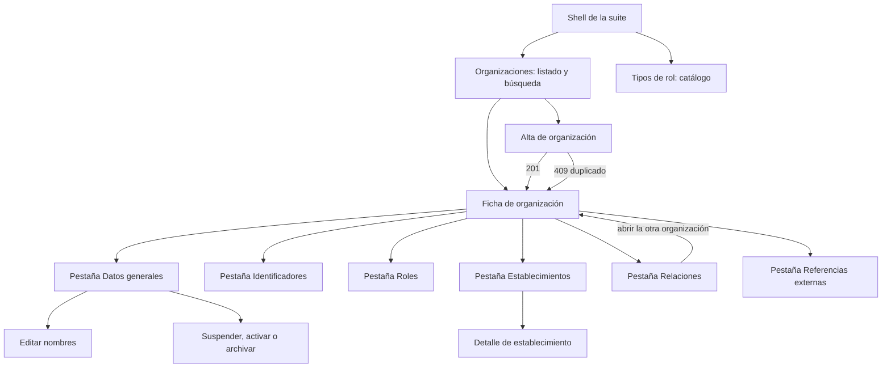
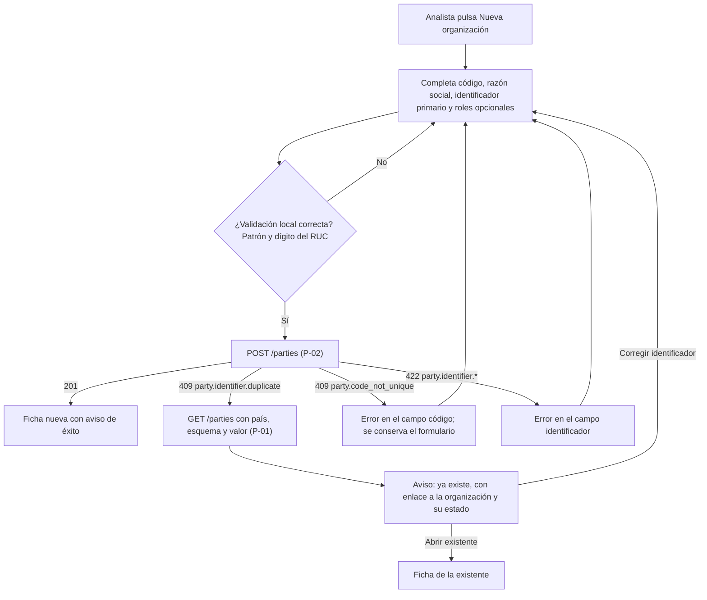
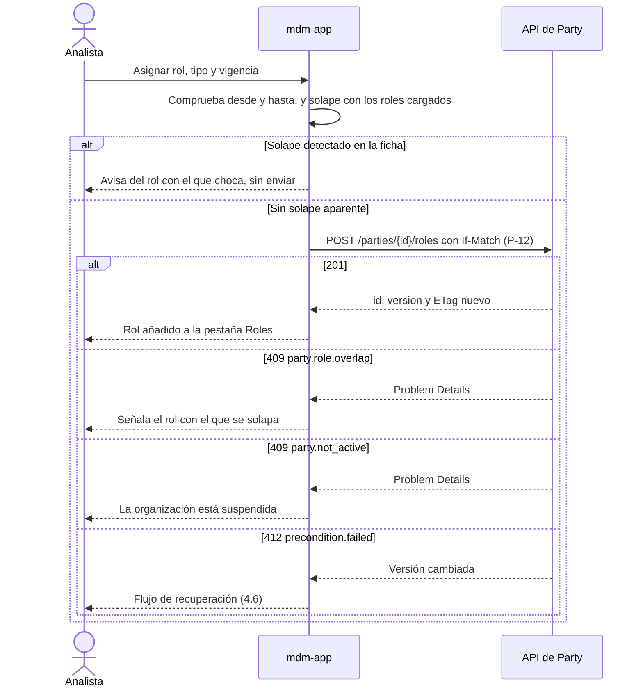
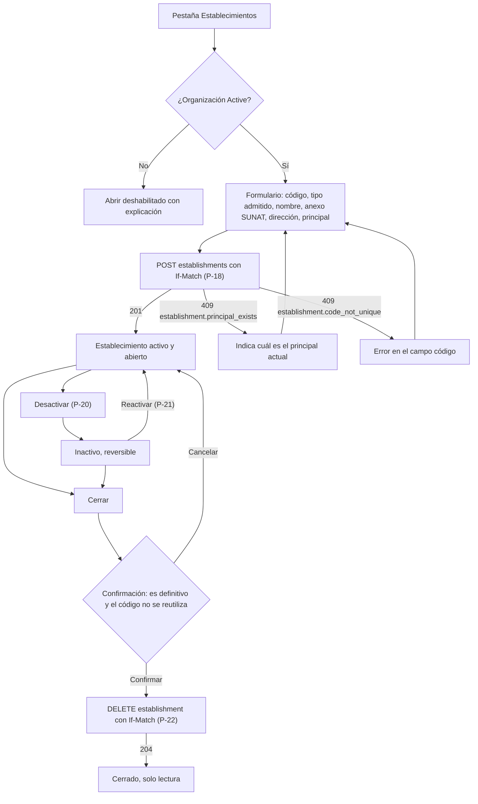
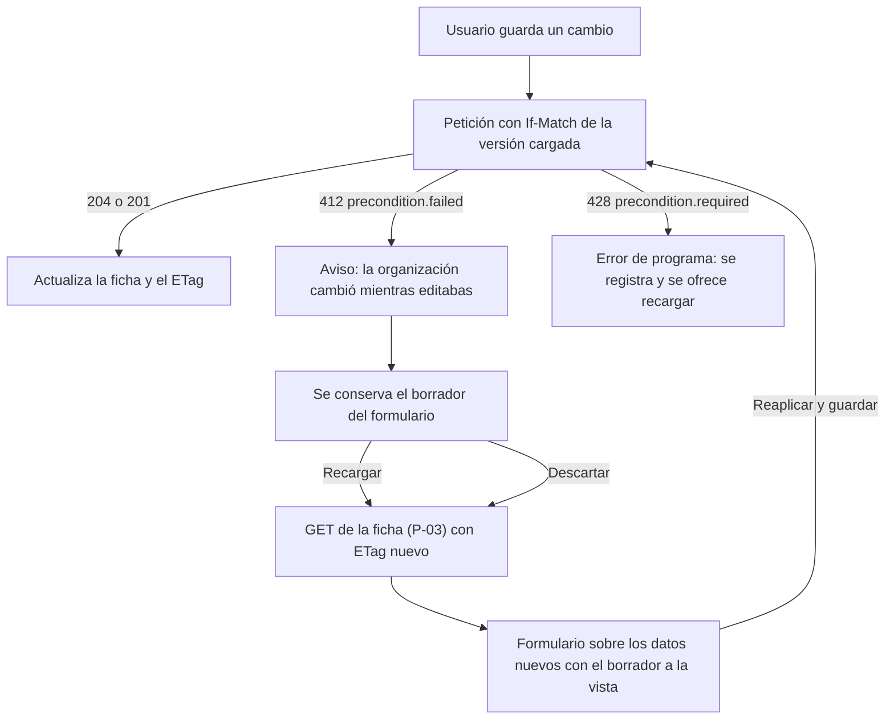

# Especificación UX — MDM: organizaciones, roles, establecimientos, relaciones y referencias externas

<p align="right">
  
  
  
</p>

> **Código:** `UX-MDM-001`
> **Fase:** 2 — Diseño
> **Deriva de:** [PRD-MDM-001](../01-concepcion/prd-mdm-001.es.md), elaborado a posteriori como referencia de negocio de MDM
> **Estado:** Borrador. Parte A (alcance, personas, historias y flujos) y parte B (pantallas, microcopy y accesibilidad).
> **Base funcional:** [PRD-MDM-001](../01-concepcion/prd-mdm-001.es.md), elaborado a posteriori el 2026-10-24. Antes de existir, esta especificación hizo de base funcional con sus supuestos marcados (§8), según [D-044](../../DECISIONS.md#decisiones-locales).
> **Fuentes:** [modelo de dominio DOM-MDM-002](./modelo-dominio-organizacion-erp-mdm-002.es.md) y [contrato de la API de Party](../03-construccion/contrato-api-party-mdm-002.es.md).
> **Hub del área:** [MDM — Datos Maestros](./hub-mdm.es.md)

---

**Evidencia y supuestos.** Cada historia cita la invariante (`INV-PTY-xx`) o el endpoint (`P-xx`, `R-xx`, `X-xx`) que la sostiene. Lo que no tiene respaldo en esas fuentes está marcado **SUPUESTO** y figura en §8 con su identificador `SU-MDM-xx`.

## 1. Propósito y alcance

Describe **qué hace cada persona de uso** en la interfaz web de MDM (`mdm-app`, montada en el shell de la suite según [D-044](../../DECISIONS.md#decisiones-locales)) y **cómo recorre** las tareas de mantenimiento del maestro de organizaciones. Es la entrada de la especificación UI (paso 3 del orden de D-044) y del mock del contrato.

| Dentro (primera entrega, D-044) | Fuera |
| :--- | :--- |
| Organizaciones: listado, búsqueda (por texto y por identificador exacto), ficha, alta y edición de nombres | Personas naturales: la UI no ofrece el alta de `PERSON`; el contrato la rechaza con `422` `party.person_not_supported` hasta cerrar [G-534](../../GAPS.md) |
| Ciclo de vida de la organización: suspender, activar y archivar ([DOM-MDM-002 §4.4](./modelo-dominio-organizacion-erp-mdm-002.es.md#44-ciclo-de-vida)) | Fusión de duplicados y estado `Merged`: se muestra, no se produce ([G-537](../../GAPS.md)) |
| Identificadores `(país, esquema, valor)` con vigencia y uno primario | Administración de los catálogos de esquemas, de tipos de establecimiento y de relación: solo lectura ([G-555](../../GAPS.md)) |
| Roles con vigencia: asignar, suspender, reactivar y terminar | Establecimientos de tipo almacén (`WAREHOUSE`) ([G-547](../../GAPS.md)) |
| Establecimientos sede, sucursal y planta: abrir, editar, desactivar, reactivar y cerrar | Datos comerciales del rol (crédito, tarifario): son de CMS o del ERP ([DOM-MDM-002 §4.2](./modelo-dominio-organizacion-erp-mdm-002.es.md#42-datos-del-rol-lo-mínimo)) |
| Relaciones entre organizaciones con vigencia (matriz-filial, grupo, agente de) | Tenant y sucursal de autorización: son de UMS ([DOM-MDM-002 §6](./modelo-dominio-organizacion-erp-mdm-002.es.md#6-relación-con-ums-tenant-y-sucursal)) |
| Referencias externas del ERP: vincular, consultar y desvincular | Acuse de sincronización desde XMS y publicación de eventos ([contrato §1](../03-construccion/contrato-api-party-mdm-002.es.md#1-alcance)) |
| Catálogo de tipos de rol: alta, edición, desactivar y reactivar ([D-046](../../DECISIONS.md#decisiones-locales)) | — |

## 2. Personas y permisos

### 2.1 Personas de uso

**SUPUESTO ([SU-MDM-01](#8-supuestos-y-gaps)).** No hay PRD ni entrevistas que identifiquen quién mantiene el maestro ([G-543](../../GAPS.md)). Las personas se infieren de los verbos del contrato y del reparto de responsabilidades de DOM-MDM-002.

| Persona | Objetivo | Frecuencia (SUPUESTO) | Tareas principales |
| :--- | :--- | :--- | :--- |
| **Analista de datos maestros** | Que cada organización exista una sola vez, bien identificada y con sus roles y sedes al día | Diaria | Buscar, dar de alta, editar, asignar roles, abrir establecimientos, relacionar |
| **Responsable de MDM** | Gobernar el ciclo de vida y corregir errores con trazabilidad | Semanal | Lo del analista, más suspender, archivar, cerrar establecimientos y vencer identificadores |
| **Integrador del ERP (TI)** | Que cada organización y establecimiento tenga su clave del ERP | Puntual, en cargas y altas | Vincular y desvincular referencias externas, revisar `syncStatus` |
| **Consultor** (operaciones, comercial) | Confirmar datos de una organización antes de usarla en otro sistema | Diaria | Buscar y leer la ficha |

### 2.2 Matriz rol × acción

**SUPUESTO ([SU-MDM-02](#8-supuestos-y-gaps)).** Hoy el contrato **no tiene autorización**: basta un portador válido para escribir ([contrato §8](../03-construccion/contrato-api-party-mdm-002.es.md#8-seguridad)). Faltan el permiso por operación ([G-314](../../GAPS.md)) y la regla por organización y establecimiento con permiso aparte para vincular el ERP ([G-536](../../GAPS.md)). La matriz expresa la **intención de diseño**; ocultar o deshabilitar un control en la UI **no es control de acceso**: la autorización la decide el servidor y la UI solo refleja su respuesta (`403` `auth.forbidden`, reservado).

| Acción (endpoint) | Analista | Responsable | Integrador ERP | Consultor |
| :--- | :---: | :---: | :---: | :---: |
| Buscar y ver ficha (P-01, P-03) | Sí | Sí | Sí | Sí |
| Alta y edición de nombres (P-02, P-04) | Sí | Sí | No | No |
| Suspender y activar (P-05, P-06) | No | Sí | No | No |
| Archivar (P-07) | No | Sí | No | No |
| Añadir identificador (P-09) | Sí | Sí | No | No |
| Vencer identificador (P-10) | No | Sí | No | No |
| Asignar, suspender y reactivar rol (P-12 a P-14) | Sí | Sí | No | No |
| Terminar rol (P-15) | No | Sí | No | No |
| Abrir, editar, desactivar y reactivar establecimiento (P-18 a P-21) | Sí | Sí | No | No |
| Cerrar establecimiento (P-22) | No | Sí | No | No |
| Iniciar y terminar relación (R-02, R-04) | Sí | Sí | No | No |
| Vincular y desvincular referencia externa (X-02, X-04) | No | No | Sí | No |
| Consultar tipos de rol (C-02) | Sí | Sí | Sí | Sí |
| Alta, edición, desactivar y reactivar tipo de rol (C-05 a C-08, [D-046](../../DECISIONS.md#decisiones-locales)) | Sí | Sí | No | No |

## 3. Historias de usuario

Cada criterio es verificable contra el mock del contrato. «Sostén» cita lo que hace cumplir la regla en el servidor; la UI la anticipa cuando puede, pero nunca la sustituye.

### US-MDM-001 — Buscar organizaciones

Como **analista de datos maestros**, quiero buscar organizaciones por texto o por identificador exacto, para comprobar si ya existe antes de darla de alta.

- **Dado** que escribo un texto en la búsqueda, **cuando** la lanzo, **entonces** veo las organizaciones cuyo código, razón social o nombre comercial lo contienen, paginadas de 20 en 20, sin las archivadas ni las fusionadas.
- **Dado** que indico país, esquema y valor, **cuando** busco, **entonces** encuentro la organización aunque el identificador esté vencido o la organización archivada, y su estado se ve en la fila.
- **Dado** que indico solo uno o dos de los tres datos del identificador, **cuando** intento buscar, **entonces** la UI no envía la petición y me indica cuál falta.
- **Dado** que filtro por un tipo de rol, **cuando** busco, **entonces** solo veo organizaciones con ese rol vigente.

Sostén: P-01 ([contrato §4](../03-construccion/contrato-api-party-mdm-002.es.md#4-listado-y-búsqueda-de-parties-p-01)); `INV-PTY-02`; `400` `validation.identifier_filter_incomplete`.

### US-MDM-002 — Consultar la ficha de una organización

Como **consultor**, quiero ver en una sola ficha los identificadores, roles, establecimientos, relaciones y referencias externas de una organización, para usarla con confianza en otro sistema.

- **Dado** que abro una organización, **cuando** carga, **entonces** veo su código, razón social, nombre comercial, estado, identificador primario vigente y sus roles y establecimientos con su vigencia y estado.
- **Dado** que un rol está `Active` pero su vigencia venció, **cuando** veo la ficha, **entonces** el rol se muestra como no vigente (`isCurrent` falso).
- **Dado** que la organización está `Archived` o `Merged`, **cuando** abro la ficha, **entonces** la veo en solo lectura, sin acciones de escritura, con su estado destacado.

Sostén: P-03, R-01 (filtro `partyId`), X-01 (filtro `partyId`); `INV-PTY-11`; [DOM-MDM-002 §4.4](./modelo-dominio-organizacion-erp-mdm-002.es.md#44-ciclo-de-vida).

### US-MDM-003 — Registrar una organización

Como **analista de datos maestros**, quiero registrar una organización con su identificador primario y, si corresponde, sus roles iniciales, para que exista una sola vez en toda la suite.

- **Dado** un RUC con dígito verificador incorrecto, **cuando** lo escribo, **entonces** veo el error junto al campo antes de enviar, y si llegara al servidor el `422` `party.identifier.check_digit_invalid` se muestra en el mismo campo.
- **Dado** un identificador que ya pertenece a otra organización (aunque esté vencido o archivada), **cuando** envío, **entonces** recibo `409` `party.identifier.duplicate`, no se crea nada y la UI me ofrece abrir la organización existente (§4.2).
- **Dado** un código ya usado, aunque sea de una archivada, **cuando** envío, **entonces** veo `409` `party.code_not_unique` en el campo código y conservo el resto del formulario.
- **Dado** un alta correcta, **cuando** se confirma (`201`), **entonces** llego a la ficha nueva con un aviso de éxito.

Sostén: P-02; `INV-PTY-02`, `03`, `04` y `07`.

### US-MDM-004 — Corregir los nombres de una organización

Como **analista de datos maestros**, quiero corregir la razón social y el nombre comercial, para que coincidan con el registro fiscal.

- **Dado** una organización `Active` o `Suspended`, **cuando** guardo los nombres, **entonces** recibo `204` y la ficha muestra los valores nuevos.
- **Dado** que otro usuario cambió la organización mientras editaba, **cuando** guardo, **entonces** recibo `412` y sigo el flujo de recuperación (§4.6, US-MDM-013).
- **Dado** el formulario de edición, **cuando** lo abro, **entonces** el código, el tipo y los identificadores no son editables.

Sostén: P-04; `INV-PTY-01`, `INV-PTY-07`; [contrato §2.1](../03-construccion/contrato-api-party-mdm-002.es.md#21-concurrencia-optimista-qué-versión-protege-cada-escritura).

### US-MDM-005 — Suspender, activar y archivar una organización

Como **responsable de MDM**, quiero suspender, reactivar o archivar una organización, para reflejar que deja de operar temporal o definitivamente.

- **Dado** una organización `Active`, **cuando** la suspendo con un motivo opcional, **entonces** pasa a `Suspended` y la ficha deshabilita asignar roles y abrir establecimientos.
- **Dado** que intento archivar, **cuando** pulso «Archivar», **entonces** se me pide confirmación explícita que advierte que es definitivo y que no termina roles ni cierra establecimientos.
- **Dado** una organización `Archived`, **cuando** la abro, **entonces** no hay acción para reactivarla.

Sostén: P-05, P-06, P-07; `INV-PTY-11`; [contrato §6.2](../03-construccion/contrato-api-party-mdm-002.es.md#62-política-de-estado-de-la-party-sobre-sus-partes).

### US-MDM-006 — Mantener los identificadores

Como **responsable de MDM**, quiero añadir un identificador, reemplazar el primario o vencer uno, para corregir errores sin perder el historial.

- **Dado** que añado un primario nuevo, **cuando** marco «reemplaza al primario actual», **entonces** el anterior queda vencido el día previo y el nuevo es el primario vigente.
- **Dado** que añado un primario sin marcar el reemplazo, **cuando** envío, **entonces** recibo `409` `party.identifier.primary_exists` y la UI me propone marcarlo.
- **Dado** el último identificador fiscal vigente de una organización con rol `INTERNAL_COMPANY`, **cuando** intento vencerlo, **entonces** recibo `409` `party.identifier.fiscal_required`.
- **Dado** un identificador, **cuando** lo veo, **entonces** no hay acción de editar ni borrar: solo vencer.

Sostén: P-09, P-10; `INV-PTY-03`, `04`, `06`.

### US-MDM-007 — Asignar un rol con vigencia

Como **analista de datos maestros**, quiero asignar un rol (cliente, proveedor, transportista…) con fechas de vigencia, para que la misma organización tenga varios roles sin duplicarse.

- **Dado** una organización `Active`, **cuando** asigno un rol con «desde» y «hasta» opcional, **entonces** el rol aparece en la ficha con su vigencia.
- **Dado** otro rol del mismo tipo no terminado cuyas fechas se cruzan, **cuando** envío, **entonces** recibo `409` `party.role.overlap` y la UI señala el rol con el que choca.
- **Dado** el rol `INTERNAL_COMPANY` sin identificador fiscal vigente, **cuando** envío, **entonces** recibo `409` `party.role.fiscal_identifier_required`.
- **Dado** una organización `Suspended`, **cuando** abro la ficha, **entonces** la acción «Asignar rol» está deshabilitada con su explicación.

Sostén: P-12; `INV-PTY-05`, `06`; `party.not_active` ([contrato §6.2](../03-construccion/contrato-api-party-mdm-002.es.md#62-política-de-estado-de-la-party-sobre-sus-partes)).

### US-MDM-008 — Suspender, reactivar y terminar un rol

Como **responsable de MDM**, quiero suspender, reactivar o terminar un rol, para cortar la relación comercial sin borrar su historia.

- **Dado** un rol `Active`, **cuando** lo suspendo, **entonces** pasa a `Suspended` y puedo reactivarlo.
- **Dado** que termino un rol, **cuando** confirmo, **entonces** se fija su «hasta» (por defecto hoy) y queda `Terminated`, sin acciones posteriores.
- **Dado** una fecha de término anterior al «desde» del rol, **cuando** la escribo, **entonces** la UI la rechaza antes de enviar.

Sostén: P-13, P-14, P-15; [DOM-MDM-002 §4.4](./modelo-dominio-organizacion-erp-mdm-002.es.md#44-ciclo-de-vida).

### US-MDM-009 — Abrir y editar un establecimiento

Como **analista de datos maestros**, quiero abrir una sede, sucursal o planta de una organización, con su código SUNAT de anexo y dirección, para saber dónde opera.

- **Dado** una organización `Active`, **cuando** abro un establecimiento con código, tipo, nombre y dirección (línea 1 y país obligatorios), **entonces** aparece en la lista de establecimientos activos.
- **Dado** que marco «principal» y ya hay otro principal activo, **cuando** envío, **entonces** recibo `409` `establishment.principal_exists` y la UI nombra el principal actual.
- **Dado** un código ya usado en esta organización, aunque el establecimiento esté cerrado, **cuando** envío, **entonces** recibo `409` `establishment.code_not_unique`.
- **Dado** el selector de tipo, **cuando** lo abro, **entonces** solo ofrece los tipos con `isSupported` verdadero (sin almacén).

Sostén: P-18, P-19, C-03; `INV-PTY-08`, `09`.

### US-MDM-010 — Desactivar, reactivar y cerrar un establecimiento

Como **responsable de MDM**, quiero desactivar temporalmente o cerrar definitivamente un establecimiento, para que no se use donde ya no se opera.

- **Dado** un establecimiento activo, **cuando** lo desactivo, **entonces** queda inactivo y puedo reactivarlo si la organización está `Active`.
- **Dado** que cierro un establecimiento, **cuando** confirmo la advertencia de que es definitivo, **entonces** queda cerrado, sin acciones y con su código reservado.
- **Dado** el listado de establecimientos, **cuando** filtro por activos, inactivos o cerrados, **entonces** veo solo los de ese estado.

Sostén: P-16, P-20, P-21, P-22; `INV-PTY-10`.

### US-MDM-011 — Relacionar dos organizaciones

Como **analista de datos maestros**, quiero registrar que una organización es matriz, miembro de grupo o agente de otra, con vigencia, para reflejar la estructura del grupo económico.

- **Dado** que inicio una relación, **cuando** elijo la otra organización, **entonces** la busco por texto o identificador, nunca escribiendo su id ([SU-MDM-08](#8-supuestos-y-gaps)).
- **Dado** que elijo la misma organización en ambos extremos, **cuando** intento enviar, **entonces** la UI lo impide; si llegara al servidor, `422` `party_relationship.self_reference`.
- **Dado** una relación del mismo tipo y sentido con vigencia solapada, **cuando** envío, **entonces** recibo `409` `party_relationship.overlap`.
- **Dado** una relación vigente, **cuando** la termino, **entonces** queda `Ended` con su «hasta» y sin cambiar la versión de ninguna de las dos organizaciones.

Sostén: R-01 a R-04, C-04; `INV-PTY-12`.

### US-MDM-012 — Vincular una organización o establecimiento con el ERP

Como **integrador del ERP**, quiero registrar la clave del ERP de una organización o de un establecimiento, para que la correspondencia viva fuera del maestro y sea consultable.

- **Dado** una organización o establecimiento no terminal, **cuando** vinculo sistema, instancia, tipo de objeto y clave, **entonces** la referencia aparece en la ficha con `syncStatus` `Linked`.
- **Dado** una clave externa que ya apunta a otro objeto, aunque esté desvinculada, **cuando** envío, **entonces** recibo `409` `external_reference.key_duplicate`.
- **Dado** un establecimiento cerrado o una organización archivada, **cuando** intento vincular, **entonces** la acción no se ofrece; si llegara al servidor, `409` `external_reference.target_not_active`.
- **Dado** que desvinculo, **cuando** confirmo, **entonces** la referencia queda `Unlinked`, visible en el historial y sin acciones.

Sostén: X-01 a X-04; `INV-PTY-13`; [G-551](../../GAPS.md).

### US-MDM-013 — Recuperarse de un conflicto de versión

Como **analista de datos maestros**, quiero saber que otro usuario cambió la organización mientras yo editaba, para no sobrescribir su trabajo.

- **Dado** que guardo con una versión antigua, **cuando** el servidor responde `412` `precondition.failed`, **entonces** no se pierde lo que escribí y veo un aviso que explica que la organización cambió.
- **Dado** el aviso, **cuando** elijo «Recargar», **entonces** veo la ficha actualizada y mi cambio sigue disponible para reaplicarlo.
- **Dado** que cambio un establecimiento, **cuando** después guardo un rol abierto antes en otra pestaña, **entonces** también recibo `412`, porque la versión es la de toda la organización.

Sostén: [contrato §2.1](../03-construccion/contrato-api-party-mdm-002.es.md#21-concurrencia-optimista-qué-versión-protege-cada-escritura); `ETag` e `If-Match`.

### US-MDM-014 — Mantener los tipos de rol

Como **analista de datos maestros**, quiero dar de alta, editar, desactivar y reactivar los tipos de rol, para que el catálogo recoja los papeles del sector logístico (consignatario, embarcador, depositario…) sin esperar a un cambio de la aplicación ([D-046](../../DECISIONS.md#decisiones-locales)).

- **Dado** que abro «Tipos de rol» en el riel de MDM, **cuando** carga, **entonces** veo cada tipo con su código, nombre, código UN/EDIFACT 3035, tipos de parte admitidos, si exige identificador fiscal y su estado con icono y texto; por defecto solo los activos, y «Mostrar inactivos» incluye los desactivados.
- **Dado** que doy de alta un tipo, **cuando** escribo el código, **entonces** se normaliza a MAYÚSCULAS_CON_GUION_BAJO y, al crear, el tipo aparece activo y se ofrece en «Asignar rol» y en el alta de organizaciones.
- **Dado** un código que ya existe, aunque el tipo esté desactivado, **cuando** envío, **entonces** la UI lo señala en el campo código; si llegara al servidor, `409` `party_role_type.code_duplicate` en el mismo campo.
- **Dado** un código UN/EDIFACT 3035 que no son dos letras o un código que no empieza por letra, **cuando** envío, **entonces** la UI lo rechaza antes de enviar; si llegara al servidor, `422` `party_role_type.edifact_invalid` o `party_role_type.code_invalid` en su campo.
- **Dado** que edito un tipo, **cuando** abro el formulario, **entonces** el código se muestra como texto y no se puede cambiar.
- **Dado** que desactivo un tipo, **cuando** confirmo el aviso de que los roles existentes se conservan, **entonces** deja de ofrecerse en «Asignar rol» y en el alta, los roles que ya lo usan siguen con su estado y su vigencia, y puedo reactivarlo.
- **Dado** que otra persona cambió el tipo mientras lo editaba, **cuando** guardo, **entonces** recibo `412`, mis cambios se conservan y puedo recargar y revisar.
- **Dado** que soy consultor o integrador del ERP, **cuando** abro «Tipos de rol», **entonces** lo consulto sin «Nuevo tipo de rol» ni menús por fila; si el servidor rechaza una escritura con `403`, el formulario lo explica sin cerrarse.

Sostén: C-02, C-05 a C-08; código no reutilizable y `party_role_type.inactive` en P-02 y P-12 ([contrato §3.6](../03-construccion/contrato-api-party-mdm-002.es.md#36-catálogo-de-tipos-de-rol-d-046)); quién administra es SUPUESTO ([SU-MDM-02](#8-supuestos-y-gaps), [G-555](../../GAPS.md), [G-560](../../GAPS.md)).

## 4. Navegación y flujos

### 4.1 Mapa de navegación

MDM entra como un `SystemModule` más del shell de la suite ([D-044](../../DECISIONS.md#decisiones-locales)). La estructura en una lista de organizaciones y una ficha con pestañas es **SUPUESTO ([SU-MDM-09](#8-supuestos-y-gaps))**; sus variantes por tamaño de ventana se fijan en [§5.2](#52-adaptación-por-tamaño-de-ventana), conforme a [D-021](../../DECISIONS.md#decisiones-locales).



### 4.2 Alta de organización con detección de duplicado por identificador

La UI **no** consulta el identificador antes de enviar: lo resuelve el `409` del alta, que es la única garantía (`INV-PTY-02`). El contrato no devuelve el id de la organización existente, así que la UI la localiza con una búsqueda exacta por identificador (**SUPUESTO [SU-MDM-05](#8-supuestos-y-gaps)**, [G-562](../../GAPS.md)).



### 4.3 Asignar un rol con vigencia y solape



La comprobación local de solape es una ayuda: la decide el servidor (`INV-PTY-05`), porque otro usuario puede haber asignado un rol después de cargar la ficha.

### 4.4 Abrir y cerrar un establecimiento



### 4.5 Vincular una referencia externa

```mermaid
sequenceDiagram
    actor I as Integrador ERP
    participant UI as mdm-app
    participant API as API de Party
    I->>UI: Pestaña Referencias externas, Vincular
    UI-->>I: Elegir objeto: la organización o uno de sus establecimientos no cerrados
    I->>UI: Sistema, instancia, tipo de objeto y clave
    UI->>API: POST /external-references (X-02), sin If-Match
    alt 201
        API-->>UI: id, partyId y syncStatus Linked
        UI-->>I: Referencia en la lista
    else 409 external_reference.key_duplicate
        API-->>UI: Problem Details
        UI-->>I: La clave ya está vinculada; ofrece buscarla (X-01 con externalKey)
    else 409 external_reference.target_not_active
        API-->>UI: Problem Details
        UI-->>I: El objeto está archivado o cerrado
    end
```

Los campos de sistema, instancia y tipo de objeto no tienen catálogo en el contrato: son texto libre (**SUPUESTO [SU-MDM-07](#8-supuestos-y-gaps)**, [G-564](../../GAPS.md)).

### 4.6 Conflicto `412` por versión y recuperación



La recuperación es **manual**: la UI no fusiona cambios automáticamente (**SUPUESTO [SU-MDM-06](#8-supuestos-y-gaps)**, [G-563](../../GAPS.md)).

## 5. Pantallas

Material Design 3 en los cinco _window size classes_ ([D-021](../../DECISIONS.md#decisiones-locales)), con el color de [D-023](../../DECISIONS.md#decisiones-locales) y el módulo montado en el shell según [D-026](../../DECISIONS.md#decisiones-locales) y [D-044](../../DECISIONS.md#decisiones-locales). Se reutilizan las **composiciones** que la [especificación UX de SIL §7.3](./especificacion-ux-sil-001.es.md#73-composiciones-declaradas) ya declara (tabla de datos, paginación, etiqueta de estado, aviso en línea, marcador de carga) y sus estados comunes ([§3.7](./especificacion-ux-sil-001.es.md#37-estados-de-pantalla-comunes)); MDM no declara composiciones nuevas. Los wireframes son de **baja fidelidad en texto**: no hay SVG de MDM (**SUPUESTO [SU-MDM-12](#8-supuestos-y-gaps)**).

### 5.1 Inventario

| ID | Título | Tipo | Historias | Endpoints |
| :--- | :--- | :--- | :--- | :--- |
| P-MDM-01 | Organizaciones | Pantalla: listado y búsqueda | US-MDM-001 | P-01, C-02 |
| P-MDM-02 | Ficha de la organización | Pantalla con siete secciones en pestañas | US-MDM-002, 004 a 013 | P-03, P-08, P-11, P-16, R-01, X-01 |
| P-MDM-03 | Nueva organización | Pantalla de formulario | US-MDM-003 | P-02, C-01, C-02 |
| P-MDM-04 | Tipos de rol | Pantalla: catálogo con alta, edición, desactivar y reactivar en diálogos | US-MDM-014 | C-02, C-05 a C-08 |
| D-MDM-01 | Editar nombres | Formulario en diálogo u hoja | US-MDM-004, 013 | P-04 |
| D-MDM-02 | Agregar identificador | Formulario en diálogo u hoja | US-MDM-006 | P-09, C-01 |
| D-MDM-03 | Vencer identificador | Confirmación con fecha | US-MDM-006 | P-10 |
| D-MDM-04 | Asignar rol | Formulario en diálogo u hoja | US-MDM-007 | P-12, C-02 |
| D-MDM-05 | Abrir o editar establecimiento | Formulario en diálogo u hoja | US-MDM-009 | P-18, P-19, C-03 |
| D-MDM-06 | Nueva relación | Formulario en diálogo u hoja con buscador | US-MDM-011 | R-02, P-01, C-04 |
| D-MDM-07 | Vincular referencia externa | Formulario en diálogo u hoja | US-MDM-012 | X-02 |
| D-MDM-08 | Archivar organización | Confirmación terminal | US-MDM-005 | P-07 |
| D-MDM-09 | Cerrar establecimiento | Confirmación terminal | US-MDM-010 | P-22 |
| D-MDM-10 | Terminar rol | Confirmación terminal con fecha | US-MDM-008 | P-15 |
| D-MDM-11 | Terminar relación | Confirmación terminal con fecha | US-MDM-011 | R-04 |
| D-MDM-12 | Desvincular referencia externa | Confirmación terminal | US-MDM-012 | X-04 |
| D-MDM-13 | Suspender organización | Confirmación reversible | US-MDM-005 | P-05 |
| D-MDM-14 | La organización cambió (`412`) | Aviso en línea dentro del formulario abierto | US-MDM-013 | P-03 |

Las acciones reversibles de un clic (activar organización, suspender y reactivar rol, desactivar y reactivar establecimiento) no abren diálogo: se ejecutan desde el menú de la fila y confirman con una _snackbar_; la suspensión de la organización sí lo abre porque deshabilita acciones en toda la ficha.

### 5.2 Adaptación por tamaño de ventana

Clases y márgenes de M3 como en [SIL §7.2](./especificacion-ux-sil-001.es.md#72-tamaños-de-ventana-y-navegación-adaptativa); la navegación del shell es la de la suite y no se repite aquí.

| Clase | P-MDM-01 | P-MDM-02 | P-MDM-03 | Formularios D-MDM | Confirmaciones D-MDM |
| :--- | :--- | :--- | :--- | :--- | :--- |
| `compact` (< 600 dp) | Lista de tarjetas, chip «Filtros» con hoja inferior, «Cargar más», FAB extendido «Nueva organización» | Cabecera apilada, pestañas desplazables, secciones como listas de tarjetas, acciones en menú de desbordamiento | Página a una columna, botón «Registrar» en barra inferior | Diálogo a pantalla completa | Diálogo básico |
| `medium` (600–839 dp) | Tabla reducida (código con razón social debajo, identificador primario, estado) y paginación | Cabecera en dos columnas, pestañas fijas desplazables, tablas reducidas por sección | Página a una columna | Hoja lateral modal | Diálogo básico |
| `expanded` (840–1199 dp) | Tabla completa con filtros en _filter chips_ | Pestañas; la sección Establecimientos es lista-detalle (lista de 360 dp y detalle) | Página a dos columnas: datos e identificador; roles | Hoja lateral modal | Diálogo básico |
| `large` (1200–1599 dp) | Lista-detalle: lista de organizaciones a la izquierda (412 dp) y P-MDM-02 como panel de detalle | Igual que `expanded`, dentro del panel de detalle | Igual que `expanded` | Hoja lateral modal | Diálogo básico |
| `extra-large` (≥ 1600 dp) | Igual que `large`, con ancho de lectura acotado | Igual que `large`; Relaciones y Referencias externas muestran las columnas ocultables | Igual que `expanded` | Hoja lateral modal | Diálogo básico |

En `large` o superior, elegir una organización actualiza el panel de detalle y la dirección (`/mdm/organizaciones/{id}`, **SUPUESTO [SU-MDM-13](#8-supuestos-y-gaps)**), de modo que el botón «Atrás» y el enlace compartido llevan a la misma ficha. Por debajo de `large`, P-MDM-02 es una página propia con «Atrás» a P-MDM-01 conservando búsqueda, filtros y página.

### 5.3 P-MDM-01 — Organizaciones

- **Propósito:** encontrar una organización por texto o por identificador exacto y comprobar que no existe antes del alta.
- **Historias:** US-MDM-001; entrada a US-MDM-002 y US-MDM-003.
- **Contenido:** _search bar_ «Buscar por código, razón social o nombre comercial»; botón de texto «Buscar por identificador», que despliega tres campos (país, esquema, valor) en línea en `expanded` o superior y en hoja inferior en `compact`; _filter chips_ «Rol vigente» (C-02) y «Estado» (`Active`, `Suspended`; «Incluir archivadas» como opción aparte, porque P-01 las excluye por defecto). Columnas: código (enlace real), razón social, nombre comercial, identificador primario (esquema y valor), roles vigentes, estado (etiqueta de estado) y última actualización. Orden por defecto: código ascendente, como P-01.
- **Acciones:** primaria «Nueva organización» (FAB; solo analista y responsable, [SU-MDM-02](#8-supuestos-y-gaps)). Secundarias: abrir, buscar, filtrar, ordenar por código, razón social o actualización, «Limpiar filtros».
- **Validación:** la búsqueda por identificador no se envía si falta alguno de los tres campos; el campo vacío muestra su error (§6.3).
- **Filtros en la dirección** de la página, para guardar o compartir una búsqueda (**SUPUESTO [SU-MDM-13](#8-supuestos-y-gaps)**).

| Estado | Diseño |
| :--- | :--- |
| Vacío inicial (maestro sin organizaciones) | «Aún no hay organizaciones registradas.» + «Nueva organización» |
| Vacío por búsqueda de texto | «Ninguna organización coincide con «{texto}».» + «Buscar por identificador» y «Nueva organización» |
| Vacío por identificador | «No hay ninguna organización con {esquema} {valor}, ni vigente ni vencido.» + «Nueva organización» con el identificador ya escrito (WCAG 3.3.7) |
| Cargando | Indicador lineal indeterminado y marcadores de posición de filas; la búsqueda sigue activa |
| Error | Aviso en línea: «No pudimos cargar las organizaciones.» + «Reintentar»; nunca una lista parcial como completa |
| Sin permiso | Sin FAB ni «Nueva organización» para consultor e integrador; la lista se lee igual. El servidor decide ([SU-MDM-02](#8-supuestos-y-gaps)) |
| Fila archivada o fusionada | Visible solo con «Incluir archivadas» o en la búsqueda por identificador; etiqueta de estado con icono y texto, fila sin atenuar el texto (contraste) |
| Fila suspendida | Etiqueta «Suspendida» con icono de pausa |

- **Por tamaño:** ver §5.2. En `compact` cada tarjeta muestra código y razón social en `body-large`, identificador primario y roles en `body-medium` y la etiqueta de estado; toda la tarjeta es el objetivo táctil.

Wireframe `expanded`:

```text
+--------------------------------------------------------------------------------+
| Organizaciones                                              [Actualizar] [?]    |
+--------------------------------------------------------------------------------+
| [Q Buscar por código, razón social o nombre comercial          ]               |
| (Buscar por identificador)   País [PE v]  Esquema [PE-RUC v]  Valor [________]  |
| [Rol vigente v] [Estado v] [ ] Incluir archivadas          (Limpiar filtros)   |
+--------------------------------------------------------------------------------+
| Código ^   | Razón social        | Nombre com. | Identificador     | Roles    | Estado      | Actualizada |
|------------|---------------------|-------------|-------------------|----------|-------------|-------------|
| _ACME_     | ACME PERÚ S.A.C.    | Acme        | PE-RUC 2060...    | CUSTOMER | (o) Activa  | 23/10/2026  |
| _TRANSLIM_ | TRANSPORTES LIMA SA | Translima   | PE-RUC 2051...    | CARRIER  | (||) Susp.  | 20/10/2026  |
|            |                     |             |                   |          |             |             |
+--------------------------------------------------------------------------------+
| Filas por página [20 v]                        1–20 de 134    [<]  [>]         |
+--------------------------------------------------------------------------------+
|                                                    [+ Nueva organización] FAB  |
+--------------------------------------------------------------------------------+
```

Wireframe `compact`:

```text
+------------------------------+
| = Organizaciones         [?] |
| [Q Buscar...               ] |
| [Filtros (1)] [Rol: CUSTOMER x]
+------------------------------+
| ACME                         |
| ACME PERÚ S.A.C.             |
| PE-RUC 20601234567 · CUSTOMER|
| (o) Activa                   |
+------------------------------+
| TRANSLIM                     |
| TRANSPORTES LIMA S.A.        |
| PE-RUC 20512345678 · CARRIER |
| (||) Suspendida              |
+------------------------------+
|        [ Cargar más ]        |
|          [+ Nueva organización]
+------------------------------+
```

### 5.4 P-MDM-02 — Ficha de la organización

- **Propósito:** ver en un solo lugar todo lo que MDM sabe de una organización y mantenerlo con trazabilidad.
- **Historias:** US-MDM-002 (lectura), 004 a 012 (acciones por sección) y 013 (conflicto de versión).
- **Cabecera (siempre visible):** código, razón social, nombre comercial, etiqueta de estado, identificador primario vigente y roles vigentes como texto. Acciones de la organización en un botón «Acciones» con menú: «Editar nombres» (D-MDM-01), «Suspender» (D-MDM-13) o «Activar», «Archivar» (D-MDM-08), según estado y persona.
- **Secciones** (pestañas primarias; siete, no seis como en §4.1, **SUPUESTO [SU-MDM-09](#8-supuestos-y-gaps)** y [SU-MDM-11](#8-supuestos-y-gaps)):

| Sección | Contenido | Acciones | Fuente |
| :--- | :--- | :--- | :--- |
| Datos generales | Tipo, código, razón social, nombre comercial, estado; creada y actualizada (fecha, hora y usuario) | Editar nombres; ciclo de vida | P-03 |
| Identificadores | Tabla: país, esquema, valor, primario, desde, hasta, vigente. Interruptor «Mostrar vencidos» (apagado) | «Agregar identificador» (D-MDM-02); «Vencer» por fila (D-MDM-03). Sin editar ni borrar | P-03, P-08 |
| Roles | Tabla: tipo (nombre del catálogo y código), estado, desde, hasta, vigente. Un rol `Active` no vigente se marca «Fuera de vigencia» | «Asignar rol» (D-MDM-04); por fila: suspender, reactivar, «Terminar» (D-MDM-10) | P-03, P-11, C-02 |
| Establecimientos | Filtro segmentado por pestañas secundarias «Activos», «Inactivos», «Cerrados», «Todos»; código, nombre, tipo, anexo SUNAT, principal, distrito. Detalle con dirección completa y sus referencias externas | «Abrir establecimiento» (D-MDM-05); por elemento: editar, desactivar, reactivar, «Cerrar» (D-MDM-09) | P-03, P-16, P-17, C-03 |
| Relaciones | Tabla: sentido en texto («Es matriz de», «Es filial de»), otra organización (enlace a su ficha), tipo, desde, hasta, estado. Interruptor «Solo vigentes» (encendido) | «Nueva relación» (D-MDM-06); «Terminar» por fila (D-MDM-11) | R-01 (`partyId`, `currentOnly`), C-04 |
| Referencias externas | Tabla: objeto (la organización o el establecimiento por código), sistema, instancia, tipo de objeto, clave, estado de sincronización (`Linked`, `PendingSync`, `SyncFailed`, `Unlinked`), última versión sincronizada. `SyncFailed` se muestra con etiqueta de error, pero sin causa ni reintento: el contrato no los expone (**SUPUESTO [SU-MDM-17](#8-supuestos-y-gaps)**, [G-568](../../GAPS.md)) | «Vincular» (D-MDM-07); «Desvincular» por fila (D-MDM-12) | X-01 (`partyId`) |
| Historial | Línea de tiempo derivada: alta y última actualización de la organización; identificadores vencidos, roles terminados, establecimientos cerrados (`closedAt`, `closedBy`), relaciones terminadas y referencias desvinculadas, cada uno con su fecha | Solo lectura | Derivado de las anteriores; no hay endpoint de historial ([G-565](../../GAPS.md)) |

- **Orden de carga:** P-03 trae cabecera, identificadores, roles y establecimientos; Relaciones y Referencias externas se cargan al abrir su pestaña y fallan por región sin dejar en blanco la ficha. El nombre de la otra organización de cada relación se resuelve con P-03 por id (**SUPUESTO [SU-MDM-14](#8-supuestos-y-gaps)**, [G-566](../../GAPS.md)).
- **Versión:** la ficha guarda el `ETag` de P-03 y todo formulario envía ese `If-Match`; tras cada escritura correcta se recarga P-03 (el `204` trae el `ETag` nuevo, pero no los datos derivados, como `isCurrent`).

| Estado | Diseño |
| :--- | :--- |
| Cargando | Cabecera y pestaña activa con marcadores de posición; indicador lineal indeterminado bajo la barra superior |
| Error al cargar la ficha | «No pudimos cargar esta organización.» + «Reintentar» y «Volver a Organizaciones» |
| No existe (`404`) | «No encontramos esta organización. Puede que el enlace esté mal.» + «Volver a Organizaciones» |
| Error de una sección | Aviso en línea solo en esa pestaña: «No pudimos cargar las relaciones.» + «Reintentar» |
| Sección vacía | Texto por sección (§6.4) y, si la persona puede, su acción primaria |
| Sin permiso | Acciones no concedidas ocultas (no deshabilitadas) para no sugerir que existen; si el servidor responde `403`, mensaje de §6.1. Ocultar no es control de acceso ([§2.2](#22-matriz-rol--acción)) |
| Suspendida | Aviso en línea `warning-container` bajo la cabecera: «Organización suspendida. No se pueden asignar ni reactivar roles, ni abrir ni reactivar establecimientos.» + «Activar» si la persona puede. Esas cuatro acciones quedan **deshabilitadas con su explicación** visible como texto de apoyo (no solo _tooltip_); el resto sigue disponible (contrato §6.2) |
| Archivada o fusionada (solo lectura) | Aviso en línea `surface-container-highest` con icono de archivo: «Organización archivada el {fecha}. Se muestra en solo lectura.» (fusionada: «… fusionada. Se muestra en solo lectura.»). Sin botón «Acciones» ni acciones por fila; las pestañas siguen navegables |
| Elemento terminal en una sección | Rol terminado, establecimiento cerrado, relación terminada o referencia desvinculada: fila sin menú de acciones, con su etiqueta de estado |

- **Por tamaño:** ver §5.2. En `compact`, cada sección es una lista de tarjetas con el estado como etiqueta y un botón de icono «Más acciones» (48 dp) por tarjeta; la acción primaria de la sección es un botón tonal al principio de la lista, no un FAB, para no tapar la última tarjeta.

Wireframe `expanded`:

```text
+--------------------------------------------------------------------------------+
| <- Organizaciones                                                    [?]       |
| ACME                                                     [ Acciones v ]        |
| ACME PERÚ S.A.C. · Acme                                                        |
| (o) Activa   PE-RUC 20601234567 (primario)   Roles: Cliente, Proveedor         |
+--------------------------------------------------------------------------------+
| Datos generales | Identificadores | Roles | _Establecimientos_ | Relaciones |  |
| Referencias externas | Historial                                               |
+--------------------------------------------------------------------------------+
| [Activos] Inactivos  Cerrados  Todos                [+ Abrir establecimiento]  |
+---------------------------+----------------------------------------------------+
| > SEDE  Sede central      | Sede central                       [ Más v ]       |
|   Sede · 0000 · Principal | Código SEDE · Tipo Sede · Anexo SUNAT 0000         |
|                           | (o) Activo · Principal                             |
|   PLA1  Planta Lurín      | Dirección: Av. Ejemplo 123, Lurín, Lima, PE        |
|   Planta · 0002           | Ubigeo 150119                                      |
|                           | Referencias externas: SAP / PRD / KNA1 / 100234    |
+---------------------------+----------------------------------------------------+
```

Wireframe `compact`:

```text
+------------------------------+
| <- ACME              [:] [?] |
| ACME PERÚ S.A.C.             |
| (o) Activa                   |
| PE-RUC 20601234567           |
+------------------------------+
| Datos | Identif. | _Roles_ > |
+------------------------------+
| [ + Asignar rol ]            |
+------------------------------+
| Cliente (CUSTOMER)      [:]  |
| (o) Activo · Vigente         |
| Desde 01/01/2024             |
+------------------------------+
| Proveedor (SUPPLIER)    [:]  |
| (o) Activo · Fuera de        |
| vigencia                     |
| 01/01/2020 – 31/12/2023      |
+------------------------------+
| Agente (AGENT)               |
| (x) Terminado                |
| 01/03/2021 – 30/06/2022      |
+------------------------------+
```

`[:]` es el botón de icono «Más acciones»; en la cabecera agrupa las acciones de la organización.

### 5.5 P-MDM-03 — Nueva organización

- **Propósito:** registrar una organización una sola vez, con su identificador primario y, si corresponde, sus roles iniciales.
- **Historias:** US-MDM-003; flujo de §4.2.
- **Contenido:** texto de apoyo al inicio: «Antes de registrar, busca la organización por su identificador.» con enlace a P-MDM-01. Grupo «Datos» (`fieldset`): código, razón social, nombre comercial (opcional). Grupo «Identificador primario»: país (por defecto `PE`), esquema (C-01 filtrado por país y por `ORGANIZATION`), valor y «Vigente desde» (opcional, propuesto con la fecha de hoy, como P-02). Grupo «Roles iniciales» (opcional): filas con tipo (C-02 filtrado por `ORGANIZATION`), desde y hasta, y botón «Agregar otro rol». El tipo de Party no se pregunta: es `ORGANIZATION` ([§1](#1-propósito-y-alcance), [G-534](../../GAPS.md)).
- **Acciones:** primaria «Registrar»; secundaria «Cancelar», que pide confirmación si hay datos escritos («¿Descartar la organización sin registrar?»).
- **Validación local** antes de enviar: obligatorios, patrón del esquema, dígito verificador del RUC al salir del campo, fechas (§6.3). El servidor decide igualmente: todo `422` o `409` se pinta en su campo y el formulario se conserva.
- **Si viene de una búsqueda sin resultado** por identificador, país, esquema y valor llegan ya escritos (WCAG 3.3.7).

| Estado | Diseño |
| :--- | :--- |
| Cargando catálogos | Selectores de esquema y tipo de rol con indicador lineal; «Registrar» deshabilitado hasta tenerlos |
| Error de catálogos | Aviso en línea: «No pudimos cargar los esquemas de identificador.» + «Reintentar» |
| Enviando | «Registrar» muestra progreso y queda deshabilitado; campos de solo lectura |
| Error de campo | Resumen de errores al inicio, enlazado a cada campo, y error junto al campo (§6.3) |
| Duplicado (`409` `party.identifier.duplicate`) | Aviso en línea sobre el grupo identificador con la organización encontrada por P-01 (código, razón social y estado) + «Abrir organización existente» y «Corregir identificador» ([§4.2](#42-alta-de-organización-con-detección-de-duplicado-por-identificador)) |
| Sin permiso | P-MDM-03 no se ofrece; si se llega por dirección, «No tienes permiso para registrar organizaciones.» + «Volver a Organizaciones» |

- **Por tamaño:** `compact` y `medium`, una columna; «Registrar» en barra inferior fija en `compact`. `expanded` o superior, dos columnas (Datos e Identificador primario a la izquierda; Roles iniciales a la derecha) y botones al final del formulario.

Wireframe `expanded`:

```text
+--------------------------------------------------------------------------------+
| <- Organizaciones      Nueva organización                              [?]     |
+--------------------------------------------------------------------------------+
| Antes de registrar, busca la organización por su identificador. (Buscar)       |
|                                                                                |
| Datos                                 | Roles iniciales (opcional)             |
| Código *          [ACME          ]    | Tipo [Cliente v] Desde [01/11/2026]    |
| Razón social *    [ACME PERÚ S.A.C.]  |                  Hasta [__/__/____]    |
| Nombre comercial  [Acme          ]    | (+ Agregar otro rol)                   |
|                                       |                                        |
| Identificador primario                |                                        |
| País *     [PE v]                     |                                        |
| Esquema *  [RUC (PE-RUC) v]           |                                        |
| Valor *    [20601234568   ]           |                                        |
| (!) El RUC no es válido: revisa el    |                                        |
|     último dígito.                    |                                        |
| Vigente desde   [24/10/2026]          |                                        |
+--------------------------------------------------------------------------------+
|                                            ( Cancelar )   [ Registrar ]        |
+--------------------------------------------------------------------------------+
```

### 5.6 Diálogos y hojas

**Reglas comunes.** Los formularios son diálogo a pantalla completa en `compact` (con «Cerrar» a la izquierda y la acción de guardar en la barra superior) y hoja lateral modal desde `medium`; las confirmaciones son diálogo básico en todos los tamaños. Todos envían el `If-Match` de la ficha salvo R-02 y X-02, que no lo exigen. Ante `412` el formulario no se cierra y muestra D-MDM-14. Ante un error de negocio, el mensaje va en el campo que lo causa o, si no tiene campo, en un aviso en línea al inicio del formulario (§6.1). Al cerrar, el foco vuelve al control que lo abrió (§7). Un formulario nunca se abre si la acción no está permitida en el estado actual: el disparador está oculto o deshabilitado con su explicación (§5.4).

| ID | Campos | Validación local | Errores del servidor que pinta | Resultado |
| :--- | :--- | :--- | :--- | :--- |
| D-MDM-01 Editar nombres | Razón social, nombre comercial. Código, tipo e identificadores visibles como texto, no editables | Razón social obligatoria, 1 a 200; nombre comercial hasta 200 | `412`, `party.archived` | _Snackbar_ «Nombres actualizados.» |
| D-MDM-02 Agregar identificador | País, esquema (C-01), valor, desde, «Es primario», «Reemplaza al primario actual» (visible solo si «Es primario» está marcado y hay un primario vigente, con su valor a la vista) | Patrón, dígito del RUC, obligatorios | `party.identifier.*` en su campo; `primary_exists` propone marcar el reemplazo | _Snackbar_ «Identificador agregado.»; si reemplazó, «… El anterior quedó vencido el {fecha}.» |
| D-MDM-03 Vencer identificador | Valor del identificador (texto), «Vence el» (por defecto hoy), motivo | «Vence el» ≥ «desde» del identificador | `primary_required`, `fiscal_required`, `already_expired` | _Snackbar_ «Identificador vencido.» |
| D-MDM-04 Asignar rol | Tipo (C-02, solo `ORGANIZATION`), desde (por defecto hoy), hasta (opcional) | Hasta ≥ desde; aviso de solape con los roles cargados del mismo tipo, sin enviar (§4.3) | `party.role.*`, `party.not_active` | _Snackbar_ «Rol asignado.» |
| D-MDM-05 Abrir o editar establecimiento | Código (solo al abrir; inmutable al editar), tipo (C-03 con `isSupported`), nombre, anexo SUNAT, principal, dirección: línea 1, línea 2, ubigeo, departamento, provincia, distrito, código postal, país, referencia | Código, tipo, nombre, línea 1 y país obligatorios; anexo de cuatro dígitos ([G-576](../../GAPS.md)); al marcar «Principal» con otro principal activo, aviso que lo nombra | `establishment.*`, `party.not_active` | _Snackbar_ «Establecimiento abierto.» o «Cambios guardados.» |
| D-MDM-06 Nueva relación | Tipo (C-04), sentido expresado en texto según el tipo («ACME es matriz de…»), otra organización con buscador sobre P-01 ([SU-MDM-08](#8-supuestos-y-gaps)), desde, hasta | Otra organización obligatoria y distinta de la actual; hasta ≥ desde | `party_relationship.*` | _Snackbar_ «Relación registrada.» |
| D-MDM-07 Vincular referencia externa | Objeto (la organización o un establecimiento no cerrado), sistema, instancia, tipo de objeto, clave (texto libre, [SU-MDM-07](#8-supuestos-y-gaps)) | Todos obligatorios | `external_reference.*`; `key_duplicate` ofrece «Ver a qué está vinculada» (X-01 con `externalKey`) | _Snackbar_ «Referencia vinculada.» |
| D-MDM-13 Suspender organización | Sin campos: diálogo básico que enumera lo que queda deshabilitado | — | `party.already_suspended`, `412` | Aviso de suspendida en la ficha (§5.4) |
| D-MDM-14 La organización cambió | Aviso en línea `error-container` dentro del formulario abierto, con «Recargar y revisar» y «Descartar mis cambios» | — | `412` `precondition.failed` | Flujo de [§4.6](#46-conflicto-412-por-versión-y-recuperación): el borrador se conserva sobre los datos nuevos |

**Confirmaciones terminales** (D-MDM-08 a D-MDM-12). Diálogo básico con título en forma de pregunta, cuerpo que dice el efecto y que **no se deshace**, campo de motivo (opcional) **solo donde el contrato lo recibe** —P-10, P-15 y R-04 llevan `reason`; P-05, P-07, P-22 y X-04 no tienen cuerpo—, de modo que archivar, cerrar, suspender y desvincular no piden motivo hasta que el contrato lo admita (precisa [SU-MDM-04](#8-supuestos-y-gaps); [G-331](../../GAPS.md)), fecha cuando el endpoint la admite y dos botones: «Cancelar» (botón de texto, con el foco inicial) y la acción con el verbo exacto (botón relleno con `error`). No se pide escribir el nombre para confirmar: la acción no borra datos y queda en el historial. Textos en §6.2.

| ID | Fecha | Prerrequisito visible en el diálogo |
| :--- | :--- | :--- |
| D-MDM-08 Archivar organización | — | Cuántos roles vigentes y establecimientos activos tiene, porque archivar no los termina ni los cierra ([G-572](../../GAPS.md)) |
| D-MDM-09 Cerrar establecimiento | — | Si es el principal, lo dice; si tiene referencias externas vinculadas, cuántas |
| D-MDM-10 Terminar rol | «Termina el» (por defecto hoy; entre «desde» y el «hasta» vigente) | Vigencia actual del rol |
| D-MDM-11 Terminar relación | «Termina el» (por defecto hoy) | Las dos organizaciones y el tipo |
| D-MDM-12 Desvincular referencia | — | Sistema, instancia y clave; aviso de que la clave no podrá vincularse a otro objeto ([G-574](../../GAPS.md)) |

### 5.7 P-MDM-04 — Tipos de rol

- **Propósito:** mantener el catálogo `PartyRoleType` desde MDM ([D-046](../../DECISIONS.md#decisiones-locales)) y consultarlo.
- **Historias:** US-MDM-014.
- **Entrada:** destino «Tipos de rol» del riel de MDM, visible para todos los roles; dirección `/mdm/tipos-de-rol`.
- **Contenido:** título, texto de apoyo («Un tipo desactivado ya no se asigna a roles nuevos; los roles que ya lo usan se conservan.»), interruptor «Mostrar inactivos» (apagado), recuento y la lista. Columnas: código, nombre (con la descripción debajo), código UN/EDIFACT 3035 («—» si no tiene, leído como «Sin código»), tipos de parte, «Exige identificador fiscal» (Sí · No) y estado (etiqueta «Activo» · «Inactivo» con icono y texto). Orden por código.
- **Acciones:** primaria «Nuevo tipo de rol» (botón tonal de la barra; solo analista y responsable, [SU-MDM-02](#8-supuestos-y-gaps)); el FAB del riel sigue siendo «Nueva organización». Por fila, menú «Más acciones del tipo de rol {nombre}» con «Editar» y «Desactivar» o «Reactivar», solo para quien administra.
- **Diálogos:** «Nuevo tipo de rol» y «Editar el tipo de rol {nombre}» son formularios con las reglas comunes de §5.6: código (solo en el alta; se normaliza al salir del campo y la ayuda dice cómo se guardará), nombre, descripción (opcional), código UN/EDIFACT 3035 (opcional, dos letras), «Tipos de parte admitidos» (organización, persona; al menos uno) y «Exige identificador fiscal vigente». Desactivar y reactivar son confirmaciones reversibles (§6.2). Todos envían el `If-Match` del tipo, salvo el alta; ante `412`, el aviso de D-MDM-14 con el texto del tipo de rol.

| Estado | Diseño |
| :--- | :--- |
| Cargando | Indicador lineal y marcadores de posición de filas |
| Error | Aviso en línea: «No pudimos cargar los tipos de rol.» + «Reintentar» |
| Vacío (todos inactivos) | «No hay tipos de rol activos.»; con «Mostrar inactivos» se ven los desactivados |
| Sin permiso | Sin «Nuevo tipo de rol» ni menús por fila para consultor e integrador; la lista se lee igual. El servidor decide (`403`) |
| Tipo inactivo | Fila visible solo con «Mostrar inactivos»; etiqueta «Inactivo» con icono de pausa, sin atenuar el texto |

- **Por tamaño:** `compact`, lista de tarjetas (nombre, código, descripción, UN/EDIFACT, tipos de parte, identificador fiscal y estado) con el menú en la tarjeta; `medium`, tabla reducida (código con el nombre debajo, tipos de parte y estado); `expanded` o superior, tabla completa. Los formularios son a pantalla completa en `compact` y hoja lateral desde `medium`.

Wireframe `expanded`:

```text
+--------------------------------------------------------------------------------+
| Tipos de rol                                                                   |
| Un tipo desactivado ya no se asigna a roles nuevos; los roles que ya lo usan   |
| se conservan.                                                                  |
| Mostrar inactivos [  o]                               ( Nuevo tipo de rol )    |
| 13 tipos de rol                                                                |
+--------------------------------------------------------------------------------+
| Código        | Nombre             | UN/EDIFACT | Tipos de parte        | Fiscal | Estado     |    |
|---------------|--------------------|------------|-----------------------|--------|------------|----|
| CONSIGNEE     | Consignatario      | CN         | Organización, persona | No     | (v) Activo | [:]|
|               | Recibe la carga... |            |                       |        |            |    |
| INTERNAL_COMP | Empresa del grupo  | —          | Organización          | Sí     | (v) Activo | [:]|
| WAREHOUSE_KEE | Depositario        | WH         | Organización          | No     | (v) Activo | [:]|
+--------------------------------------------------------------------------------+
```

Wireframe `compact`:

```text
+------------------------------+
| = Tipos de rol           [?] |
| Mostrar inactivos     [  o]  |
|        ( Nuevo tipo de rol ) |
+------------------------------+
| Consignatario            [:] |
| CONSIGNEE                    |
| Recibe la carga en destino.  |
| UN/EDIFACT 3035  CN          |
| Tipos de parte  Org., persona|
| Exige id. fiscal  No         |
| (v) Activo                   |
+------------------------------+
```

Wireframe del formulario (hoja lateral, `medium` o superior):

```text
+--------------------------------------+
| Nuevo tipo de rol                [x] |
+--------------------------------------+
| Código *         [operador portuario]|
|   Se guardará como                   |
|   OPERADOR_PORTUARIO.                |
| Nombre *         [Operador portuario]|
| Descripción      [                  ]|
| UN/EDIFACT 3035  [PW]                |
| Tipos de parte admitidos *           |
|   [x] Organización   [ ] Persona     |
| [ ] Exige identificador fiscal       |
+--------------------------------------+
|              ( Cancelar )  [ Crear ] |
+--------------------------------------+
```

## 6. Microcopy

Tuteo, frases cortas, sin códigos técnicos a la vista: el `code` y el `instance` de Problem Details se registran, no se muestran. Fechas `dd/mm/aaaa` en `es-PE` ([SU-MDM-03](#8-supuestos-y-gaps)). Los textos son **propuesta sin validar con usuarios** (**SUPUESTO [SU-MDM-15](#8-supuestos-y-gaps)**). `{…}` es un dato que la UI rellena desde lo cargado, no desde el `detail` del servidor.

### 6.1 Errores del contrato

Fuente: [contrato §6.1](../03-construccion/contrato-api-party-mdm-002.es.md#61-catálogo-de-code). «Dónde» indica si el mensaje va junto a un campo o en un aviso en línea del formulario o de la ficha.

| `code` | Mensaje | Acción sugerida | Dónde |
| :--- | :--- | :--- | :--- |
| `party.person_not_supported` | Por ahora solo se pueden registrar organizaciones. | — (la UI no ofrece el alta de personas) | Aviso |
| `party.code_not_unique` | Ya existe una organización con este código, aunque esté archivada. | Usa otro código. | Campo código |
| `party.archived` | Esta organización está archivada y ya no se puede modificar. | «Recargar» para verla en solo lectura. | Aviso |
| `party.merged` | Esta organización se fusionó con otra y ya no se puede modificar. | «Recargar». | Aviso |
| `party.already_active` · `party.already_suspended` | La organización ya estaba {activa · suspendida}. Otra persona la cambió hace poco. | «Recargar». | Aviso |
| `party.not_active` | La organización está suspendida: no se pueden asignar ni reactivar roles, ni abrir ni reactivar establecimientos. | Actívala primero, si tienes permiso. | Aviso |
| `party.identifier.scheme_unknown` | Este esquema no existe o no es de {país}. | Elige un esquema de la lista. | Campo esquema |
| `party.identifier.scheme_not_allowed` | Este esquema no se admite para organizaciones. | Elige otro esquema, por ejemplo RUC. | Campo esquema |
| `party.identifier.invalid_format` | El valor no tiene el formato de {esquema}. {Pista del formato}. | Corrige el valor. | Campo valor |
| `party.identifier.check_digit_invalid` | El RUC no es válido: revisa el último dígito. | Corrige el valor. | Campo valor |
| `party.identifier.duplicate` | Este identificador ya pertenece a otra organización: {código} · {razón social} ({estado}). | «Abrir organización existente» o «Corregir identificador». | Aviso sobre el grupo identificador |
| `party.identifier.primary_exists` | Ya hay un identificador primario vigente ({esquema} {valor}). | Marca «Reemplaza al primario actual» o desmarca «Es primario». | Campo «Es primario» |
| `party.identifier.primary_required` | No puedes vencer el identificador primario sin otro que lo reemplace. | Agrega antes un primario nuevo con «Reemplaza al primario actual». | Aviso |
| `party.identifier.fiscal_required` | Es el último identificador fiscal vigente y la organización es empresa del grupo. | Agrega otro identificador fiscal antes de vencer este. | Aviso |
| `party_role_type.code_duplicate` | Ya existe un tipo de rol con este código, aunque esté desactivado. | Usa otro código. | Campo código (P-MDM-04) |
| `party_role_type.code_invalid` | El código empieza por una letra y lleva solo letras, números y guion bajo, de 2 a 50 caracteres. | Corrige el código. | Campo código (P-MDM-04) |
| `party_role_type.edifact_invalid` | El código UN/EDIFACT 3035 son dos letras. | Corrige el código, por ejemplo CN. | Campo UN/EDIFACT (P-MDM-04) |
| `party_role_type.already_active` · `party_role_type.already_inactive` | Este tipo de rol ya estaba {activo · desactivado}. Otra persona lo cambió hace poco. | «Recargar». | Aviso (P-MDM-04) |
| `party_role_type.inactive` | Este tipo de rol está desactivado: ya no se asigna a roles nuevos. | Elige otro tipo. | Campo tipo de rol (D-MDM-04) o aviso (P-MDM-03) |
| `party.identifier.already_expired` | Este identificador ya estaba vencido. | «Recargar». | Aviso |
| `party.role.type_unknown` | Este tipo de rol ya no está disponible. | Elige otro tipo. | Campo tipo |
| `party.role.type_not_allowed` | Este rol no se admite para organizaciones. | Elige otro tipo. | Campo tipo |
| `party.role.fiscal_identifier_required` | Para ser empresa del grupo, la organización necesita un identificador fiscal vigente. | Agrega un identificador fiscal y vuelve a asignar el rol. | Aviso |
| `party.role.overlap` | Ya tiene el rol {tipo} entre {desde} y {hasta}, y las fechas se cruzan. | Cambia las fechas o termina el otro rol. | Campos de vigencia |
| `party.role.already_active` · `party.role.already_suspended` · `party.role.terminated` | Este rol cambió de estado mientras lo veías. | «Recargar». | Aviso |
| `establishment.kind_unknown` | Este tipo de establecimiento ya no está disponible. | Elige otro tipo. | Campo tipo |
| `establishment.kind_not_supported` | Los almacenes aún no se pueden registrar aquí. | Elige sede, sucursal o planta. | Campo tipo |
| `establishment.code_not_unique` | Ya hay un establecimiento con este código en la organización, aunque esté cerrado. | Usa otro código. | Campo código |
| `establishment.principal_exists` | El principal actual es {código} · {nombre}. Solo puede haber uno activo. | Desmarca «Principal» o quita la marca al actual primero. | Campo «Principal» |
| `establishment.already_active` · `establishment.already_inactive` | El establecimiento ya estaba {activo · inactivo}. | «Recargar». | Aviso |
| `establishment.closed` | Este establecimiento está cerrado y ya no se puede modificar. | «Recargar». | Aviso |
| `party_relationship.self_reference` | Una organización no puede relacionarse consigo misma. | Elige otra organización. | Campo otra organización |
| `party_relationship.kind_unknown` | Este tipo de relación ya no está disponible. | Elige otro tipo. | Campo tipo |
| `party_relationship.party_not_found` | No encontramos la otra organización. | Búscala de nuevo. | Campo otra organización |
| `party_relationship.party_not_active` | Una de las dos organizaciones está archivada o fusionada. | Elige una organización activa o suspendida. | Campo otra organización |
| `party_relationship.overlap` | Ya existe una relación {tipo} entre estas organizaciones en esas fechas. | Cambia las fechas o termina la relación existente. | Campos de vigencia |
| `party_relationship.already_ended` | Esta relación ya estaba terminada. | «Recargar». | Aviso |
| `external_reference.target_not_found` | No encontramos el objeto que quieres vincular. | «Recargar». | Aviso |
| `external_reference.target_not_active` | No se puede vincular: {la organización está archivada · el establecimiento está cerrado}. | — | Aviso |
| `external_reference.key_duplicate` | La clave {clave} de {sistema} ya está vinculada a otro objeto, aunque esté desvinculada. | «Ver a qué está vinculada». | Campo clave |
| `external_reference.already_unlinked` | Esta referencia ya estaba desvinculada. | «Recargar». | Aviso |
| `validation.failed` | Revisa los campos marcados. | Corrige cada campo del resumen de errores. | Resumen + campos (si `errors` los nombra) |
| `validation.identifier_filter_incomplete` | Para buscar por identificador indica país, esquema y valor. | Completa el que falta. | Campo vacío de la búsqueda |
| `request.malformed` · `request.method_not_allowed` · `request.unsupported_media_type` · `precondition.required` | Algo falló al enviar los datos. No se guardó nada. | «Recargar»; si se repite, avisa a soporte con la hora. | Aviso (error de programa, se registra) |
| `auth.unauthenticated` · `auth.user_required` | Tu sesión terminó. | «Iniciar sesión»; el borrador se conserva en la pestaña. | Aviso de página (lo resuelve el shell) |
| `auth.forbidden` | No tienes permiso para esta acción. | Pide el permiso a tu responsable. | Aviso |
| `common.not_found` | No encontramos {la organización · el establecimiento · la relación · la referencia}. Puede que el enlace esté mal. | «Volver a Organizaciones». | Pantalla o aviso |
| `precondition.failed` | Otra persona cambió esta organización mientras editabas. Tus cambios siguen aquí. | «Recargar y revisar» o «Descartar mis cambios» (D-MDM-14). | Aviso en el formulario |
| `server.unexpected_error` | No pudimos completar la acción. No se guardó nada. | «Reintentar»; si se repite, avisa a soporte con la hora. | Aviso |
| Sin respuesta (red) | No hay conexión con el servidor. No se guardó nada. | «Reintentar». | Aviso |

Los datos entre llaves de `overlap` y `principal_exists` salen de la ficha cargada, porque el Problem Details no identifica el rol, la relación ni el establecimiento con el que choca (**SUPUESTO [SU-MDM-16](#8-supuestos-y-gaps)**, [G-567](../../GAPS.md)); si la ficha está desactualizada, el mensaje cae a su forma genérica sin datos («Ya tiene ese rol en fechas que se cruzan.») y se ofrece «Recargar».

### 6.2 Confirmaciones

| Diálogo | Título | Cuerpo | Botón de acción | Al terminar |
| :--- | :--- | :--- | :--- | :--- |
| D-MDM-08 | ¿Archivar {código}? | La organización quedará en solo lectura y no se podrá reactivar. Sus {n} roles vigentes y {m} establecimientos activos **no** se terminan ni se cierran. Su código y sus identificadores no podrán usarse en otra organización. | Archivar | _Snackbar_ «{código} archivada.» |
| D-MDM-09 | ¿Cerrar el establecimiento {código}? | El cierre es definitivo: no se puede reabrir y el código {código} no podrá volver a usarse en esta organización. {Si es principal: «Es el establecimiento principal; la organización quedará sin principal.»} {Si tiene referencias: «Tiene {n} referencias externas vinculadas.»} | Cerrar establecimiento | _Snackbar_ «Establecimiento {código} cerrado.» |
| D-MDM-10 | ¿Terminar el rol {tipo}? | El rol dejará de estar vigente desde el día siguiente a la fecha de término y no se podrá reactivar. Para volver a tenerlo habrá que asignarlo de nuevo. | Terminar rol | _Snackbar_ «Rol {tipo} terminado el {fecha}.» |
| D-MDM-11 | ¿Terminar la relación? | {Organización A} dejará de ser {tipo} de {Organización B} desde el día siguiente a la fecha de término. No se puede deshacer. | Terminar relación | _Snackbar_ «Relación terminada.» |
| D-MDM-12 | ¿Desvincular la clave {clave}? | {Sistema} {instancia} dejará de corresponder a {objeto}. La clave no podrá vincularse a otro objeto. | Desvincular | _Snackbar_ «Referencia desvinculada.» |
| D-MDM-03 | ¿Vencer el identificador {esquema} {valor}? | Dejará de estar vigente desde el día siguiente a la fecha indicada. No se edita ni se borra: si estaba mal, agrega uno nuevo. | Vencer | _Snackbar_ «Identificador vencido.» |
| D-MDM-13 | ¿Suspender {código}? | Mientras esté suspendida no se podrán asignar ni reactivar roles, ni abrir ni reactivar establecimientos. Podrás activarla de nuevo. | Suspender | Aviso de suspendida en la ficha |
| Descartar alta | ¿Descartar la organización sin registrar? | Se perderá lo que escribiste. | Descartar | Vuelve a P-MDM-01 |
| Desactivar tipo de rol (P-MDM-04) | ¿Desactivar el tipo de rol {nombre}? | Ya no se podrá asignar a roles nuevos ni elegir en el alta de organizaciones. Los roles que ya lo usan se conservan con su vigencia. Podrás reactivarlo. | Desactivar | _Snackbar_ «Tipo de rol {nombre} desactivado.» |
| Reactivar tipo de rol (P-MDM-04) | ¿Reactivar el tipo de rol {nombre}? | Se podrá asignar de nuevo a roles nuevos y elegir en el alta de organizaciones. | Reactivar | _Snackbar_ «Tipo de rol {nombre} reactivado.» |

«Desde el día siguiente» refleja que «hasta» es inclusivo ([SU-MDM-03](#8-supuestos-y-gaps)). Las _snackbar_ de éxito no se cierran solas antes de 6 s y no llevan «Deshacer», porque ninguna de estas acciones lo tiene en el contrato.

### 6.3 Validación por campo

Se valida al salir del campo y al enviar; nunca mientras se escribe el primer carácter. El error va como texto de apoyo del campo, con icono, y se repite en el resumen de errores al enviar.

| Campo | Regla (fuente) | Mensaje |
| :--- | :--- | :--- |
| Código de organización | Obligatorio, 1 a 100 (P-02) | «Escribe un código.» · «El código admite hasta 100 caracteres.» |
| Razón social | Obligatoria, 1 a 200 tras recortar (P-02, P-04) | «Escribe la razón social.» · «La razón social admite hasta 200 caracteres.» |
| Nombre comercial | Hasta 200 (P-02) | «El nombre comercial admite hasta 200 caracteres.» |
| País del identificador | Obligatorio, ISO 3166-1 alfa-2 (P-09) | «Elige el país del identificador.» |
| Esquema | Obligatorio, del país elegido (C-01) | «Elige el tipo de identificador.» |
| Valor del identificador | Obligatorio, hasta 50, patrón del esquema (`INV-PTY-04`) | «Escribe el número del identificador.» · «El RUC tiene 11 dígitos.» (pista según esquema) |
| Valor con esquema RUC | Dígito verificador (`INV-PTY-04`) | «El RUC no es válido: revisa el último dígito.» |
| Búsqueda por identificador | Los tres o ninguno (P-01) | «Indica también el {país · esquema · valor} para buscar por identificador.» |
| Vigencia (rol, relación, identificador) | «Hasta» ≥ «desde» (P-12, R-02) | «La fecha de fin no puede ser anterior a la de inicio ({desde}).» |
| Fecha de término de un rol | ≥ «desde» y ≤ «hasta» vigente (P-15) | «La fecha de término debe estar entre el {desde} y el {hasta}.» (sin «hasta» vigente: «… no puede ser anterior al {desde}.») |
| Fecha de vencimiento de identificador | ≥ «desde» (P-10) | «La fecha de vencimiento no puede ser anterior al {desde}.» |
| Fecha con formato inválido | `dd/mm/aaaa` | «Escribe la fecha como dd/mm/aaaa, por ejemplo 24/10/2026.» |
| Solape local de rol | Mismo tipo no terminado con fechas cruzadas (`INV-PTY-05`) | «Se cruza con el rol {tipo} del {desde} al {hasta \| sin fin}.» |
| Código de establecimiento | Obligatorio, como el de la Party; no repetido en la organización (`INV-PTY-08`) | «Escribe un código.» · «Ya usaste este código en esta organización.» (si está en la ficha cargada) |
| Nombre de establecimiento | Obligatorio, 1 a 200 (P-18) | «Escribe el nombre del establecimiento.» |
| Anexo SUNAT | Cuatro dígitos (P-18, [G-576](../../GAPS.md)) | «El anexo tiene 4 dígitos, por ejemplo 0001.» |
| Dirección: línea 1 y país | Obligatorios (P-18) | «Escribe la dirección.» · «Elige el país.» |
| Principal | Uno activo (`INV-PTY-09`) | Aviso, no error: «El principal actual es {código}. Si guardas, el servidor lo rechazará; quita antes su marca.» |
| Otra organización (relación) | Obligatoria y distinta de la actual (`INV-PTY-12`) | «Elige la otra organización.» · «Elige una organización distinta de {código}.» |
| Campos de referencia externa | Obligatorios (X-02) | «Escribe el {sistema · instancia · tipo de objeto · clave}.» |
| Código de tipo de rol | Obligatorio; normalizado, empieza por letra, de 2 a 50; no reutilizable (C-05) | «Escribe un código.» · «El código empieza por una letra y lleva solo letras, números y guion bajo, de 2 a 50 caracteres. Por ejemplo, AGENTE_DE_CARGA.» · «Ya existe un tipo de rol con este código, aunque esté desactivado. Usa otro código.» |
| Nombre de tipo de rol | Obligatorio, 1 a 200 (C-05, C-06) | «Escribe el nombre.» · «El nombre admite hasta 200 caracteres.» |
| Código UN/EDIFACT 3035 | Opcional, dos letras (C-05, C-06) | «El código UN/EDIFACT 3035 son dos letras, por ejemplo CN.» |
| Tipos de parte admitidos | Al menos uno (C-05, C-06) | «Elige al menos un tipo de parte.» |

### 6.4 Estados vacíos

| Lugar | Texto | Acción (si la persona puede) |
| :--- | :--- | :--- |
| P-MDM-01 sin organizaciones | Aún no hay organizaciones registradas. | Nueva organización |
| P-MDM-01 sin resultados de texto | Ninguna organización coincide con «{texto}». Prueba con el identificador: es la búsqueda más segura. | Buscar por identificador · Nueva organización |
| P-MDM-01 sin resultados por identificador | No hay ninguna organización con {esquema} {valor}, ni vigente ni vencido. | Nueva organización |
| P-MDM-01 con filtros | Ninguna organización coincide con estos filtros. | Limpiar filtros |
| Identificadores con «Mostrar vencidos» encendido y sin vencidos | Esta organización no tiene identificadores vencidos. | — |
| Roles | Esta organización no tiene roles. Asigna uno para indicar si es cliente, proveedor, transportista u otro. | Asignar rol |
| Establecimientos (pestaña Activos) | No hay establecimientos activos. | Abrir establecimiento |
| Establecimientos (Inactivos · Cerrados) | No hay establecimientos {inactivos · cerrados}. | — |
| Relaciones | No hay relaciones vigentes con otras organizaciones. | Nueva relación · Mostrar también las terminadas |
| Referencias externas | Esta organización aún no tiene claves del ERP. | Vincular |
| Historial | Solo consta el alta del {fecha} por {usuario}. | — |
| Buscador de D-MDM-06 | Ninguna organización coincide. Solo se pueden elegir organizaciones activas o suspendidas. | — |
| P-MDM-04 sin tipos activos | No hay tipos de rol activos. | Mostrar inactivos · Nuevo tipo de rol |

## 7. Accesibilidad

WCAG 2.2 AA como piso, con los mismos criterios transversales que [SIL §3.8](./especificacion-ux-sil-001.es.md#38-accesibilidad-wcag-22-aa-como-piso) (contraste por construcción con los roles `on-*`, anillo de foco de M3, idioma `es`). Aquí solo se concreta cómo se aplican a P-MDM-01 a P-MDM-03 y a los diálogos.

| Criterio | Aplicación en MDM |
| :--- | :--- |
| 1.3.1 Información y relaciones | Tablas de P-MDM-01 y de las secciones de P-MDM-02 con `<table>`, `<caption>` («Organizaciones, 134 resultados», «Roles de ACME») y `<th scope="col">`; la columna ordenada lleva `aria-sort`. En `compact`, las tarjetas son una lista (`<ul>`) y cada tarjeta un elemento con su título como enlace. Formularios con `fieldset` y `legend` por grupo (Datos, Identificador primario, Roles iniciales, Dirección) |
| 1.3.2 Secuencia significativa | El orden del DOM es el visual: cabecera de la ficha → pestañas → panel. En lista-detalle (`large`), la lista precede al detalle y el detalle es una región con nombre («Ficha de ACME») |
| 1.3.5 Propósito de la entrada | Dirección del establecimiento con `autocomplete` (`address-line1`, `address-line2`, `postal-code`, `country`) |
| 1.4.1 Uso del color | Estados con etiqueta de texto e icono: activa (círculo), suspendida (pausa), archivada (caja), fusionada (flechas que se unen), cerrado y terminado (aspa), fuera de vigencia (reloj). Los errores llevan icono y texto; el aviso de suspendida dice qué está bloqueado |
| 1.4.10 Reflujo | A 320 px CSS sin desplazamiento horizontal: en `compact` no hay tablas; los wireframes de texto de §5 no son la maqueta final |
| 1.4.13 Contenido al pasar el cursor | La explicación de una acción deshabilitada es texto visible, no _tooltip_; los _tooltips_ de botones de icono aparecen también con foco y se cierran con `Escape` |
| 2.1.1 Teclado | Todo operable con teclado. Pestañas con flechas, `Inicio` y `Fin`, activación automática; menús de fila con flechas; la fila de la tabla no es un objetivo aparte: el enlace del código lo es |
| 2.4.3 Orden del foco | Al abrir un diálogo u hoja el foco va al primer campo (formularios) o a «Cancelar» (confirmaciones terminales); queda atrapado; `Escape` cierra sin guardar (con confirmación si hay cambios) y el foco **vuelve al disparador**. Si el disparador desapareció (fila de un elemento ya cerrado), el foco va al encabezado de la sección |
| 2.4.6 Encabezados y etiquetas | Un `h1` por pantalla (nombre de la organización en P-MDM-02), `h2` por sección; títulos de diálogo enlazados con `aria-labelledby` |
| 2.4.11 Foco no oculto | La barra superior fija, la barra inferior de «Registrar» en `compact` y el FAB no tapan el control enfocado: el contenido reserva su espacio (`scroll-padding`) |
| 2.5.3 Etiqueta en el nombre | El nombre accesible de cada botón contiene su texto visible; los botones de icono por fila añaden el objeto: «Más acciones del rol Cliente» |
| 2.5.7 Movimientos de arrastre | Las hojas inferiores se cierran con botón y con `Escape`, no solo arrastrando el asa; el divisor de lista-detalle no es redimensionable por arrastre |
| 2.5.8 Tamaño del objetivo | 48 × 48 dp con 8 dp de separación (ADR-0110 §2.3, como en SIL): botones de icono por fila, _filter chips_, casillas, interruptores, enlaces de código en la tabla y tarjetas en `compact` |
| 3.2.2 Al introducir datos | Elegir país filtra los esquemas sin enviar nada; marcar «Es primario» muestra «Reemplaza al primario actual» y lo anuncia; ningún cambio de campo navega |
| 3.3.1 y 3.3.3 Errores | Resumen de errores al inicio del formulario, enfocado al enviar, con enlaces a cada campo; error junto al campo con `aria-describedby` y `aria-invalid`; cada mensaje sugiere la corrección (§6) |
| 3.3.4 Prevención de errores | Archivar, cerrar, terminar, vencer y desvincular piden confirmación con su efecto (§6.2); el foco inicial está en «Cancelar» |
| 3.3.7 Entrada redundante | La búsqueda por identificador sin resultado lleva sus datos al alta; tras `412`, el borrador se conserva (§4.6) |
| 4.1.3 Mensajes de estado | Región `role="status"` (`aria-live="polite"`) para el número de resultados de P-MDM-01 («134 organizaciones») y de cada filtro de sección, el fin de la carga y las _snackbar_ de éxito; los avisos de error de servidor, `412` y sesión van con `role="alert"`. El resumen de errores recibe el foco en lugar de anunciarse dos veces |
| 2.3.3 y movimiento reducido | Con `prefers-reduced-motion: reduce`, las hojas y diálogos aparecen con fundido corto sin desplazamiento, el cambio de pestaña no anima el indicador y los marcadores de carga no laten |

**Verificación.** La herramienta automática no acredita conformidad: cada pantalla se prueba con teclado y con lector de pantalla (NVDA o VoiceOver en escritorio; TalkBack y VoiceOver en móvil) en `compact` y `expanded` antes de darla por accesible; esas pruebas no están planificadas para `mdm-app` ([G-569](../../GAPS.md)).

## 8. Supuestos y gaps

### 8.1 Supuestos

| ID | Supuesto | Dónde se usa | Gap |
| :--- | :--- | :--- | :--- |
| SU-MDM-01 | Las cuatro personas de uso (analista, responsable de MDM, integrador del ERP, consultor) y su frecuencia | §2.1 | [G-560](../../GAPS.md), [G-543](../../GAPS.md) |
| SU-MDM-02 | La matriz rol × acción: acciones terminales (archivar, cerrar, terminar, vencer) solo para el responsable; referencias externas solo para el integrador | §2.2 | [G-560](../../GAPS.md), [G-314](../../GAPS.md), [G-536](../../GAPS.md) |
| SU-MDM-03 | Las fechas de vigencia se muestran y se escriben como fecha local de `America/Lima`, sin hora, y «hasta» es inclusivo | US-MDM-007, 008, 011 | [G-575](../../GAPS.md) |
| SU-MDM-04 | El motivo es opcional en toda acción y la UI lo pide en las terminales (archivar, terminar, cerrar, desvincular) | US-MDM-005, 008, 010, 012 | [G-331](../../GAPS.md) |
| SU-MDM-05 | Tras `409` `party.identifier.duplicate`, la UI localiza la existente con una búsqueda exacta por identificador (P-01) | §4.2, US-MDM-003 | [G-562](../../GAPS.md) |
| SU-MDM-06 | La recuperación del `412` es manual: se conserva el borrador, se recarga y el usuario reaplica | §4.6, US-MDM-013 | [G-563](../../GAPS.md) |
| SU-MDM-07 | Sistema, instancia y tipo de objeto externo se escriben como texto libre, sin catálogo | §4.5, US-MDM-012 | [G-564](../../GAPS.md) |
| SU-MDM-08 | La otra organización de una relación se elige con un buscador sobre P-01, no escribiendo su id | US-MDM-011 | — |
| SU-MDM-09 | Navegación en lista de organizaciones y ficha con pestañas: seis en §4.1, siete con Historial en §5.4 | §4.1, §5.4 | — |
| SU-MDM-10 | Antes del alta, la búsqueda por texto basta para que el analista detecte duplicados con identificador distinto | US-MDM-001, 003 | [G-561](../../GAPS.md) |
| SU-MDM-11 | La sección Historial se deriva de la auditoría de P-03 y de los elementos terminales (vencidos, terminados, cerrados, desvinculados); no muestra cambios de nombre ni suspensiones intermedias | §5.4 | [G-565](../../GAPS.md) |
| SU-MDM-12 | La adaptación por tamaño sigue el precedente de SIL (lista en `compact`, hoja lateral desde `medium`, lista-detalle desde `large`) y los wireframes son de texto, sin SVG ni prueba con usuarios | §5.1, §5.2 | — |
| SU-MDM-13 | Ruta `/mdm/organizaciones/{id}` y filtros en la dirección; el shell de la suite no fija aún las rutas de `mdm-app` | §5.2, §5.3 | — |
| SU-MDM-14 | El nombre de la otra organización de cada relación se obtiene con un P-03 por relación | §5.4 | [G-566](../../GAPS.md) |
| SU-MDM-15 | El microcopy de §6 es propuesta del diseño, sin validar con las personas de uso | §6 | [G-560](../../GAPS.md) |
| SU-MDM-16 | El rol, la relación o el establecimiento con el que choca un `409` se identifica con los datos de la ficha cargada | §5.6, §6.1 | [G-567](../../GAPS.md) |
| SU-MDM-17 | `SyncFailed` se muestra sin causa ni acción de reintento | §5.4 | [G-568](../../GAPS.md) |

**Precisión de SU-MDM-04 (parte B).** El contrato solo recibe `reason` en P-10, P-15 y R-04; archivar, cerrar, suspender y desvincular no tienen cuerpo, así que la UI no pide motivo en ellos hasta que el contrato lo admita ([G-331](../../GAPS.md)).

### 8.2 Gaps propuestos

Propuestos para [GAPS.md](../../GAPS.md): G-560 a G-564 en la parte A; G-565 a G-569 con pantallas, microcopy y accesibilidad (parte B).

| Gap | Resumen |
| :--- | :--- |
| [G-560](../../GAPS.md) | Personas de uso y matriz rol × acción de MDM sin respaldo (no hay PRD ni entrevistas); la UI depende de ellas para habilitar acciones |
| [G-561](../../GAPS.md) | No hay detección de posibles duplicados por nombre antes del alta: el `409` solo cubre el identificador exacto, y una organización con RUC y otra con identificador extranjero pueden coexistir |
| [G-562](../../GAPS.md) | El `409` `party.identifier.duplicate` no devuelve el id de la organización existente; la UI necesita una segunda búsqueda, que además choca con la enumeración de [G-577](../../GAPS.md) |
| [G-563](../../GAPS.md) | El `ETag` es de toda la Party: cualquier cambio en una pestaña invalida los formularios abiertos en otra; falta decidir la estrategia de recuperación y medir la frecuencia de `412` |
| [G-564](../../GAPS.md) | Sistema, instancia y tipo de objeto de las referencias externas no tienen catálogo; el texto libre permite variantes del mismo sistema (`SAP`, `sap-ecc`) |
| [G-565](../../GAPS.md) | No hay endpoint de historial de una Party: la sección Historial de P-MDM-02 solo puede derivar la auditoría de alta y última actualización y las fechas de los elementos terminales; los cambios de nombre, suspensiones y reactivaciones se pierden para el usuario |
| [G-566](../../GAPS.md) | La lectura de relaciones (R-01) devuelve solo los ids de las dos organizaciones; mostrar el nombre de la otra exige un P-03 por relación (N + 1 peticiones) |
| [G-567](../../GAPS.md) | Los `409` `party.role.overlap`, `party_relationship.overlap` y `establishment.principal_exists` no identifican el elemento con el que chocan; la UI lo infiere de la ficha cargada, que puede estar desactualizada |
| [G-568](../../GAPS.md) | Una referencia externa en `SyncFailed` no expone causa ni acción de reintento; el integrador ve el fallo pero no puede actuar desde MDM |
| [G-569](../../GAPS.md) | No están planificadas las pruebas manuales de accesibilidad (teclado y lector de pantalla en `compact` y `expanded`) de `mdm-app`; la herramienta automática no acredita WCAG 2.2 AA |

## 9. Historial de cambios

| Versión | Fecha | Autor | Cambio |
| :--- | :--- | :--- | :--- |
| 0.2.0 | 2026-10-24 | Agente `organizacion-dev-frontend` | Mantenimiento del catálogo de tipos de rol ([D-046](../../DECISIONS.md#decisiones-locales)): historia US-MDM-014, filas de la matriz rol × acción (§2.2), destino en el mapa de navegación, pantalla P-MDM-04 con estados y wireframes (§5.7), microcopy de errores `party_role_type.*`, confirmaciones de desactivar y reactivar, validación por campo y estado vacío |
| 0.1.1 | 2026-10-24 | aarroyo | Aprobada por el propietario como base de la implementación de `mdm-app` contra el mock ([D-044](../../DECISIONS.md#decisiones-locales), paso 4) |
| 0.1.0 | 2026-10-24 | aarroyo, con el agente `organizacion-ux` | Parte A: alcance, personas y permisos, historias US-MDM-001 a US-MDM-013, mapa de navegación y cinco flujos, supuestos SU-MDM-01 a 10 y gaps G-560 a G-564. Parte B: inventario de pantallas P-MDM-01 a P-MDM-03 y diálogos D-MDM-01 a D-MDM-14 con estados y adaptación a los cinco tamaños de ventana (D-021), wireframes de texto, microcopy (errores del contrato, confirmaciones, validación por campo y estados vacíos), accesibilidad WCAG 2.2 AA, supuestos SU-MDM-11 a 17 y gaps G-565 a G-569 |

---

<p align="center">
  <strong>© Organización S.A.</strong> · RUC 20100412447 · Operador Logístico Aduanero desde 1978
</p>
