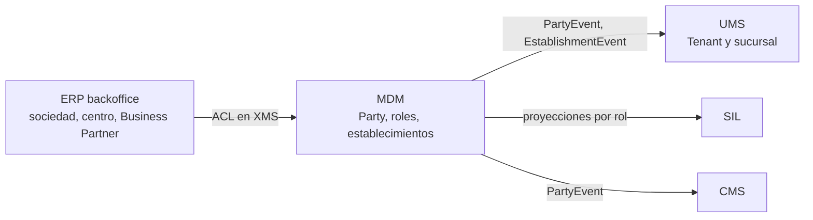

# MDM — Datos Maestros: hub del área

  
  

> **Hub de área.** Punto de entrada único a todo lo que este repositorio documenta sobre MDM, de lo general a lo específico.
> **Deriva de:** [PRD-MDM-001](../01-concepcion/prd-mdm-001.es.md), elaborado a posteriori como referencia de negocio de MDM
> **Sistema:** MDM (Datos Maestros) de la suite. Su backend, `mdm-api`, vive **provisionalmente** en este satélite ([D-027](../../DECISIONS.md#decisiones-locales)); su domicilio definitivo está por decidir ([G-257](../../GAPS.md)).
>
> **Pendiente de revisión por el propietario:** el [cuestionario para TI sobre el ERP y su estructura organizativa](./cuestionario-erp-estructura-organizativa-mdm.es.md) (23 preguntas, sin enviar). Sus respuestas confirman o corrigen la correspondencia del modelo con el ERP ([G-545](../../GAPS.md)).

## 1. Qué es MDM, en una frase

MDM es el sistema de registro de **quién es quién** en la suite —personas y organizaciones, con sus roles— y de **dónde opera** cada una —sus establecimientos—, alineado con el ERP de backoffice sin copiar su modelo.

**No es dueño de:** quién entra a la suite ni con qué permisos (UMS), la relación comercial (CMS) ni la contabilidad (ERP).

## 2. Estado actual

| Tema | Estado |
| :--- | :--- |
| Modelo base | **Party con roles, establecimientos y relaciones** ([D-043](../../DECISIONS.md#decisiones-locales), 2026-10-24). Diseño en `Borrador` |
| Código | `src/apps/mdm-api` tiene el CRUD de Tenant y Branch de [D-031](../../DECISIONS.md#decisiones-locales), **en revisión**: se rehace sobre Party ([G-552](../../GAPS.md)) |
| Respaldo | [ADR-0264](https://github.com/organizacion-peru/organizacion-arch/blob/develop/reference/architecture/adrs/core/0264-el-maestro-de-partes-es-party-con-roles-y-sigue-los-dos-ejes-del-erp.es.md) (modelo Party) y [ADR-0265](https://github.com/organizacion-peru/organizacion-arch/blob/develop/reference/architecture/adrs/core/0265-mdm-es-dueno-de-la-organizacion-y-ums-del-tenant.es.md) (dueños MDM/UMS), **aceptados el 2026-10-24** y fusionados en `develop` de `organizacion_arch`; promoción a `main` pendiente de revisión ([PR 565](https://github.com/organizacion-peru/organizacion-arch/pull/565)). El código del nuevo modelo espera a que el plugin los publique ([G-552](../../GAPS.md)) |
| Interfaz web | `mdm-app` construida contra el mock (`mdm-contracts`, `mdm-mock`) y montada en el anfitrión `sil-web` ([D-044](../../DECISIONS.md#decisiones-locales)): las 14 historias de UX-MDM-001, incluido el mantenimiento del catálogo de tipos de rol ([D-046](../../DECISIONS.md#decisiones-locales)), con 257 pruebas unitarias y de componente en sus tres librerías y 26 casos E2E con axe en tres tamaños de ventana. Sin backend real hasta vincular ADR-0264/0265 ([G-552](../../GAPS.md)) |
| Integración | Nada se publica todavía: falta el outbox ([G-312](../../GAPS.md)) y el contrato con UMS ([G-553](../../GAPS.md)) |
| ERP | Sin confirmar cuál es ni su estructura ([G-532](../../GAPS.md), [G-545](../../GAPS.md)) |

## 3. Ruta de lectura

Lee en este orden: cada nivel supone el anterior.

| # | Documento | Para qué | Estado |
| :--- | :--- | :--- | :--- |
| 1 | [PRD-MDM-001 — Maestro de organizaciones y partes](../01-concepcion/prd-mdm-001.es.md) | **La referencia de negocio**: problema, objetivos, alcance, requisitos y reglas de MDM, en lenguaje de negocio. Elaborado a posteriori; no cambia ninguna decisión | `Borrador`; en el núcleo, [ADR-0266](https://github.com/organizacion-peru/organizacion-arch/blob/main/reference/architecture/adrs/core/0266-la-geografia-de-la-suite-es-un-maestro-de-mdm-con-codigos-oficiales.es.md) `Aceptado` |
| 1a | [PRD-MDM-002 — Geografía de la suite](../01-concepcion/prd-mdm-002.es.md) | Deriva de PRD-MDM-001: países, niveles por país con ubigeo, lugares de comercio exterior UN/LOCODE, códigos postales y coordenadas por etapas, en lenguaje de negocio. Base: el [análisis de fuentes](../01-concepcion/fuentes/analisis-geografia-mdm.es.md) | `Borrador` |
| 1b | [ADR-MDM-002 — modelo geográfico](../../reference/architecture/adrs/MDM-002-modelo-geografico-de-la-suite.es.md) | Geografía de la suite: niveles por país, ubigeo, UN/LOCODE, códigos postales y coordenadas ([D-047](../../DECISIONS.md#decisiones-locales)) | `Borrador` |
| 1c | [UX-MDM-002 — geografía](./especificacion-ux-geografia-mdm-001.es.md) · [UI-MDM-002](./especificacion-ui-geografia-mdm-001.es.md) · [modelo de datos MD-MDM-003](./modelo-datos-geografia-mdm-003.es.md) | Pantallas, componentes y tablas de la geografía ([D-049](../../DECISIONS.md#decisiones-locales)) | `Borrador`, aprobadas como base |
| 1d | [API-MDM-003 — contrato de geografía](../03-construccion/contrato-api-geografia-mdm-003.es.md) · [OpenAPI](../03-construccion/openapi-geografia-mdm-003.yaml) | 61 operaciones bajo `/api/v1/geo`; fuente del mock | `Borrador`, aprobado como base |
| 2 | [DECISIONS.md — D-027, D-031 y D-043](../../DECISIONS.md#decisiones-locales) | Por qué MDM vive aquí, qué se construyó primero y por qué cambió la base | Decidido |
| 3 | [Modelo de dominio base — DOM-MDM-002](./modelo-dominio-organizacion-erp-mdm-002.es.md) | **El modelo de MDM**: Party, roles, establecimientos, relaciones, correspondencia con el ERP, relación con UMS | `Borrador` |
| 4 | [ADR-0264 — el maestro de partes es Party](https://github.com/organizacion-peru/organizacion-arch/blob/develop/reference/architecture/adrs/core/0264-el-maestro-de-partes-es-party-con-roles-y-sigue-los-dos-ejes-del-erp.es.md) | La forma del maestro, norma del núcleo ([borrador de origen](../../reference/architecture/propuestas-upstream/adr-modelo-party-y-estructura-organizativa.es.md)) | `Aceptado` |
| 5 | [ADR-0265 — MDM dueño de la organización; UMS del Tenant](https://github.com/organizacion-peru/organizacion-arch/blob/develop/reference/architecture/adrs/core/0265-mdm-es-dueno-de-la-organizacion-y-ums-del-tenant.es.md) | Quién es dueño de qué entre MDM y UMS ([borrador de origen](../../reference/architecture/propuestas-upstream/adr-mdm-dueno-maestro-organizacion-sede.es.md)) | `Aceptado` |
| 5a | [Propuesta de contrato MDM → UMS](./propuesta-contrato-eventos-mdm-ums.es.md) | Eventos de organización, establecimiento y relación con el mismo `Guid`; consulta abierta a `organizacion-ums` ([G-553](../../GAPS.md)) | En consulta |
| 5b | [Cuestionario para TI sobre el ERP](./cuestionario-erp-estructura-organizativa-mdm.es.md) | Qué ERP es y cómo está organizado ([G-545](../../GAPS.md)) | Sin enviar |
| 5c | [Especificación UX — UX-MDM-001](./especificacion-ux-mdm-001.es.md) | Historias US-MDM-001..014, flujos, pantallas P-MDM-01..04 y diálogos de la interfaz web de MDM ([D-044](../../DECISIONS.md#decisiones-locales), [D-046](../../DECISIONS.md#decisiones-locales)) | `Borrador`, **aprobada por el propietario el 2026-10-24** (0.1.1); la 0.2.0 (D-046) pendiente de aprobación |
| 5d | [Especificación UI — UI-MDM-001](./especificacion-ui-mdm-001.es.md) | Tokens, anatomía, estados y componentes Material 3 de `mdm-app` | `Borrador`, **aprobada por el propietario el 2026-10-24** (0.1.1); la 0.2.0 (P-MDM-04, D-046) pendiente de aprobación |
| 5e | [Contrato de la API de Party — API-MDM-002](../03-construccion/contrato-api-party-mdm-002.es.md) · [OpenAPI](../03-construccion/openapi-party-mdm-002.yaml) | 38 operaciones, con el mantenimiento de tipos de rol (C-05 a C-08, [D-046](../../DECISIONS.md#decisiones-locales)); fuente del mock `mdm-mock` | `Borrador`, **aprobada por el propietario el 2026-10-24** (0.1.1); la 0.2.0 pendiente de aprobación |
| 6 | [Modelo de dominio del rol Cliente — DOM-MDM-001](./modelo-dominio-cliente-mdm-001.es.md) | Reglas del rol `CUSTOMER`, identificación y datos personales. Su §0 dice qué sigue vigente tras D-043 | `Borrador`, en realineación |
| 7 | [Especificación técnica de organización y sede](../03-construccion/especificacion-tecnica-organizacion-sede-mdm-001.es.md) | El código construido bajo D-031 | En revisión |
| 8 | [Contrato de la API de organización y sede](../03-construccion/contrato-api-organizacion-sede-mdm-001.es.md) | Endpoints vigentes de `mdm-api` | En revisión |
| 9 | [ADR-MDM-001 — modelo físico](../../reference/architecture/adrs/MDM-001-nomenclatura-y-conceptos-no-portables-de-mdm.es.md) | Esquema `mdm`, nomenclatura y conceptos no portables de SQL Server | `Borrador`, en revisión |

**Vista de referencia:** la [vista SIL Fase 1](./vistas-referencia-arquitectura-suite-sil.es.md#2-vista-2--sil-fase-1-embarques) muestra a MDM publicando en Kafka hacia UMS y SIL; su convención de topics difiere de la propuesta de contrato ([G-557](../../GAPS.md)).

**Lo que todavía no existe:** historia funcional y modelo de datos de MDM ([G-323](../../GAPS.md), [G-543](../../GAPS.md)). El PRD existe desde [PRD-MDM-001](../01-concepcion/prd-mdm-001.es.md), elaborado a posteriori.

## 4. Fuente histórica

El MDM original de `organizacion-scm` (modelo Party, geografía, _golden record_, 19 ADR) se borró de GitHub. Lo que se adopta de él está **absorbido en DOM-MDM-002** (§10), que es el modelo oficial. El propietario decidió el 2026-10-24 no mantener el clon como fuente ([G-549](../../GAPS.md), cerrado).

## 5. Gaps del área

Todos viven en [GAPS.md](../../GAPS.md) (SD-07). Agrupados por tema:

| Tema | Gaps |
| :--- | :--- |
| Gobierno y ADR | [G-257](../../GAPS.md) (domicilio), [G-311](../../GAPS.md), [G-554](../../GAPS.md), [G-535](../../GAPS.md), [G-537](../../GAPS.md) |
| Interfaz web y contrato de Party | [G-560](../../GAPS.md) a [G-595](../../GAPS.md) |
| Modelo y retrabajo | [G-552](../../GAPS.md), [G-531](../../GAPS.md), [G-551](../../GAPS.md), [G-555](../../GAPS.md), [G-550](../../GAPS.md), [G-547](../../GAPS.md), [G-548](../../GAPS.md) |
| ERP | [G-532](../../GAPS.md), [G-533](../../GAPS.md), [G-545](../../GAPS.md), [G-546](../../GAPS.md) |
| UMS e integración | [G-553](../../GAPS.md), [G-557](../../GAPS.md), [G-312](../../GAPS.md), [G-313](../../GAPS.md), [G-317](../../GAPS.md) |
| Seguridad y datos personales | [G-314](../../GAPS.md), [G-315](../../GAPS.md), [G-534](../../GAPS.md), [G-536](../../GAPS.md) |
| Cliente | [G-530](../../GAPS.md), [G-538](../../GAPS.md) a [G-544](../../GAPS.md) |
| Validación y operación | [G-328](../../GAPS.md), [G-329](../../GAPS.md), [G-322](../../GAPS.md), [G-330](../../GAPS.md) |
| Concepción | [G-323](../../GAPS.md), [G-543](../../GAPS.md) |
| Fuente histórica | [G-549](../../GAPS.md) |

## 6. Próximos pasos

1. Que el PR 565 lleve ADR-0264 y ADR-0265 a `main` de `organizacion_arch` y que la siguiente versión del plugin los publique; vincularla aquí (S-28).
2. Enviar el cuestionario a TI (G-545) y obtener la respuesta de `organizacion-ums` a la consulta 324 (G-553).
3. Con los ADR aceptados: rehacer `mdm-api` sobre Party (G-552) y llevar DOM-MDM-001 a la v0.3.0.

---

  <strong>© Organización S.A.</strong> · RUC 20100412447 · Operador Logístico Aduanero desde 1978

