# Modelo de Datos — MDM: geografía de la suite

  
  
  

> **Artefacto:** Modelo de Datos (lógico y físico)
> **Identificador:** `MD-MDM-003`
> **Fase:** 2 — Diseño y Arquitectura
> **Alcance:** local
> **Estado:** Borrador — modelo lógico y físico redactados; falta la migración de EF Core (Fase 3), la medición de índices y la aprobación del gate
> **Deriva de:** [PRD-MDM-002](../01-concepcion/prd-mdm-002.es.md) · [ADR-MDM-002](../../reference/architecture/adrs/MDM-002-modelo-geografico-de-la-suite.es.md) (`Borrador`, detalle local) · [ADR-0266](https://github.com/organizacion-peru/organizacion-arch/blob/main/reference/architecture/adrs/core/0266-la-geografia-de-la-suite-es-un-maestro-de-mdm-con-codigos-oficiales.es.md) (`Aceptado`, núcleo)
> **Contrato que lo usa:** [API-MDM-003](../03-construccion/contrato-api-geografia-mdm-003.es.md) · [OpenAPI](../03-construccion/openapi-geografia-mdm-003.yaml)
> **Normas que aplica:** [ADR-0229](https://github.com/organizacion-peru/organizacion_arch/blob/main/reference/architecture/adrs/core/0229-modelo-datos-logico-fisico-fase-diseno.es.md) (`Aceptado`; un modelo por PRD, §3.6; conceptos no portables, §3.5) · [ADR-0031](https://github.com/organizacion-peru/organizacion_arch/blob/main/reference/architecture/adrs/core/0031-esquema-por-contexto-catalogo-eventos-dominio.es.md) (`Aceptado`; esquema por contexto) · [ADR-0054](https://github.com/organizacion-peru/organizacion_arch/blob/main/reference/architecture/adrs/core/0054-estandares-diseno-normalizacion-base-datos.es.md) (`Aceptado`; `PascalCase`, `Id`) · [ADR-0051](https://github.com/organizacion-peru/organizacion_arch/blob/main/reference/architecture/adrs/core/0051-estrategia-motor-base-datos-empresarial.es.md) (`Aceptado`; SQL Server en .NET) · [ADR-0098](https://github.com/organizacion-peru/organizacion_arch/blob/main/reference/architecture/adrs/core/0098-comunicacion-entre-agregados-intra-servicio.es.md) (`Aceptado`; un agregado por transacción)
> **Convenciones locales que sigue:** [ADR-MDM-001](../../reference/architecture/adrs/MDM-001-nomenclatura-y-conceptos-no-portables-de-mdm.es.md) (`Borrador`): inglés, `PascalCase`, tablas en plural, `UX_`/`IX_`/`CK_`, `datetimeoffset(3)`, `Guid` asignado por la aplicación y `Version bigint` como token
> **Hub del área:** [MDM — Datos Maestros](./hub-mdm.es.md)

---

Este modelo describe **lo que el contexto `Geography` de MDM persiste** para servir el contrato [API-MDM-003](../03-construccion/contrato-api-geografia-mdm-003.es.md). Es el modelo de datos de PRD-MDM-002 (un modelo por PRD, ADR-0229 §3.6). **Solo diseño:** la autoridad del esquema físico serán las migraciones versionadas de EF Core cuando se construya, y no se construye mientras ADR-MDM-002 siga en `Borrador` ([D-047](../../DECISIONS.md#decisiones-locales)).

## 1. Metadatos

| Campo | Valor |
| :--- | :--- |
| Identificador | `MD-MDM-003` |
| Versión | 0.1.0 |
| Estado | Borrador |
| PRD | [PRD-MDM-002](../01-concepcion/prd-mdm-002.es.md) |
| Motor | SQL Server ([D-008](../../DECISIONS.md#decisiones-locales), ADR-0051); versión e instancia de MDM sin decidir ([G-321](../../GAPS.md)) |
| Esquema | `mdm_geo` (MDM-002 D1; ADR-0031), separado de `mdm` (partes) |
| Autor | Agente `organizacion-dev-backend-dotnet` |
| Aprobadores | Arquitectura MDM y responsable del catálogo geográfico ([D-048](../../DECISIONS.md#decisiones-locales) punto 5) |

## 2. Alcance

### 2.1 Qué modela

| Agregado (ADR-0098) | Tablas | Raíz y token |
| :--- | :--- | :--- |
| `GeoPlace` | `GeoPlaces`, `GeoPlaceNames`, `OfficialCodes`, `TradeLocationFunctions`, `GeoPlaceHistoryEntries` | `GeoPlaces.Version` |
| `CountryTerritorialSchema` | `Countries`, `CountryTerritorialLevels` | `Countries.Version` |
| `CodeScheme` | `CodeSchemes` | `CodeSchemes.Version` |
| `CodeCorrespondence` | `CodeCorrespondences` | `CodeCorrespondences.Version` |
| `Succession` | `Successions`, `SuccessionParticipants`, `SuccessionAddressReviews` | `Successions.Version` |
| `PostalZone` | `PostalZones`, `PostalZonePlaces` | `PostalZones.Version` |
| `ImportBatch` | `ImportBatches`, `ImportDiffs` | `ImportBatches.Version` |
| `SourceLicense` | `SourceLicenses` | `SourceLicenses.Version` |

`GeoPlaceHistoryEntries` (bitácora, RNF-GEO-01) y `SuccessionAddressReviews` (lista de direcciones afectadas, RF-GEO-010) no estaban en la lista inicial del encargo; se añaden porque el contrato las necesita.

### 2.2 Qué no modela

- **La dirección** (calle, número): es del maestro de partes, esquema `mdm` ([DOM-MDM-002](./modelo-dominio-organizacion-erp-mdm-002.es.md)). Su columna `GeoPlaceId` llegará con [G-615](../../GAPS.md); aquí solo se guarda la **decisión** de revisión.
- **Coordenadas de cada dirección y geocodificación** (RF-GEO-015, RF-GEO-016): etapa posterior ([G-614](../../GAPS.md)).
- **El archivo de aterrizaje**: se guarda fuera de la base (ubicación por decidir, [G-627](../../GAPS.md)); la tabla conserva su huella, tamaño y referencia.
- **Outbox de eventos**: pendiente para todo MDM ([G-312](../../GAPS.md)).

### 2.3 Principios

1. **Nada se borra** (RN-GEO-02): no hay `DELETE` desde la aplicación; las claves foráneas son `NO ACTION`.
2. **Un código, un lugar, para siempre** (RN-GEO-01): la unicidad de `(SchemeId, Value)` **no** es filtrada.
3. **Vigencia por fechas**, con los únicos filtrados sobre «abierto» (`ValidTo IS NULL`): un predicado de índice filtrado no puede depender de la fecha de hoy.
4. **La ruta es derivada y estable**: segmento fijado al alta; solo se reescribe al reubicar una hoja (PL-12).
5. **Fuente y licencia en cada dato importado** (ADR-0266 D7): códigos, nombres, puntos, correspondencias y zonas llevan `SourceLicenseId` y `SourceVersion`.
6. **Enumeraciones como `tinyint` con `CK_`** y su significado en el dominio (ADR-0229, Anexo A: lista cerrada); la API expone el nombre en inglés.

## 3. Diagrama entidad-relación

```mermaid
erDiagram
    GeoPlaces ||--o| Countries : "política del país"
    Countries ||--o{ CountryTerritorialLevels : "escalera"
    CodeSchemes ||--o{ CountryTerritorialLevels : "esquema canónico del nivel"
    GeoPlaces ||--o{ GeoPlaces : "padre de"
    GeoPlaces ||--o{ GeoPlaceNames : "nombres"
    GeoPlaces ||--o{ OfficialCodes : "códigos"
    CodeSchemes ||--o{ OfficialCodes : "esquema"
    GeoPlaces ||--o{ TradeLocationFunctions : "funciones UNECE"
    GeoPlaces ||--o{ GeoPlaceHistoryEntries : "bitácora"
    CodeSchemes ||--o{ CodeCorrespondences : "origen y destino"
    Successions ||--|{ SuccessionParticipants : "participantes"
    GeoPlaces ||--o{ SuccessionParticipants : "participa en"
    Successions ||--o{ SuccessionAddressReviews : "direcciones afectadas"
    PostalZones ||--o{ PostalZonePlaces : "cubre"
    GeoPlaces ||--o{ PostalZonePlaces : "está en"
    ImportBatches ||--o{ ImportDiffs : "diferencias"
    ImportBatches o|--o{ Successions : "propuesta por"
    SourceLicenses ||--o{ OfficialCodes : "fuente"
    SourceLicenses ||--o{ GeoPlaceNames : "fuente"
    SourceLicenses ||--o{ ImportBatches : "fuente"
    SourceLicenses ||--o{ CodeSchemes : "fuente por defecto"

    GeoPlaces {
        uniqueidentifier Id PK
        tinyint PlaceType
        uniqueidentifier CountryPlaceId FK
        uniqueidentifier ParentId FK
        tinyint LevelOrder
        varchar PathSegment
        varchar Path
        nvarchar OfficialName
        nvarchar NormalizedName
        tinyint Status
        date ValidFrom
        date ValidTo
        decimal Latitude
        decimal Longitude
        geography Point
        bigint Version
    }
    Countries {
        uniqueidentifier Id PK
        char Alpha2
        bit UsesPostalCode
        nvarchar PostalCodePattern
        bigint Version
    }
    CountryTerritorialLevels {
        uniqueidentifier Id PK
        uniqueidentifier CountryId FK
        tinyint LevelOrder
        char CanonicalLabel
        nvarchar LocalLabel
        uniqueidentifier CanonicalSchemeId FK
        bit IsAddressLevel
    }
    OfficialCodes {
        uniqueidentifier Id PK
        uniqueidentifier GeoPlaceId FK
        uniqueidentifier SchemeId FK
        varchar Value
        date ValidFrom
        date ValidTo
        uniqueidentifier SourceLicenseId FK
    }
    GeoPlaceNames {
        uniqueidentifier Id PK
        uniqueidentifier GeoPlaceId FK
        nvarchar Name
        nvarchar NormalizedName
        varchar LanguageCode
        tinyint Kind
        date ValidTo
    }
    CodeSchemes {
        uniqueidentifier Id PK
        varchar Code
        varchar ValuePattern
        tinyint PrefixRule
        bit IsCanonical
        bigint Version
    }
    CodeCorrespondences {
        uniqueidentifier Id PK
        uniqueidentifier FromSchemeId FK
        varchar FromValue
        uniqueidentifier ToSchemeId FK
        varchar ToValue
        tinyint Kind
        bigint Version
    }
    Successions {
        uniqueidentifier Id PK
        tinyint SuccessionType
        tinyint Status
        nvarchar LegalAct
        date EffectiveOn
        bigint Version
    }
    SuccessionParticipants {
        uniqueidentifier Id PK
        uniqueidentifier SuccessionId FK
        uniqueidentifier GeoPlaceId FK
        tinyint Role
        bit ContinuesAfter
    }
    SuccessionAddressReviews {
        uniqueidentifier Id PK
        uniqueidentifier SuccessionId FK
        uniqueidentifier PartyId
        uniqueidentifier EstablishmentId
        tinyint ReviewStatus
    }
    TradeLocationFunctions {
        uniqueidentifier GeoPlaceId PK
        char FunctionCode PK
    }
    PostalZones {
        uniqueidentifier Id PK
        uniqueidentifier CountryPlaceId FK
        varchar Code
        date ValidTo
        bigint Version
    }
    PostalZonePlaces {
        uniqueidentifier PostalZoneId PK
        uniqueidentifier GeoPlaceId PK
    }
    ImportBatches {
        uniqueidentifier Id PK
        uniqueidentifier SourceLicenseId FK
        binary FileSha256
        tinyint Status
        bigint Version
    }
    ImportDiffs {
        uniqueidentifier Id PK
        uniqueidentifier ImportBatchId FK
        tinyint DiffKind
        nvarchar PayloadJson
        tinyint Decision
    }
    SourceLicenses {
        uniqueidentifier Id PK
        varchar Code
        tinyint Redistribution
        bigint Version
    }
    GeoPlaceHistoryEntries {
        uniqueidentifier Id PK
        uniqueidentifier GeoPlaceId FK
        datetimeoffset OccurredAt
        tinyint Action
    }
```

`SuccessionAddressReviews.PartyId` y `EstablishmentId` **no** son claves foráneas: apuntan al esquema `mdm` de otro contexto, que se referencia solo por identificador (MDM-002 D1, ADR-0098). `CodeCorrespondences` referencia valores, no filas de `OfficialCodes` (MDM-002 D5): la existencia del código se comprueba al escribir.

## 4. Catálogo de entidades

| Tabla | Propósito | Clave de negocio | Clave técnica |
| :--- | :--- | :--- | :--- |
| `GeoPlaces` | Un lugar por unidad territorial: país, división, localidad o lugar de comercio (MDM-002 D3, D7) | Código canónico vigente; `Path` | `Id` |
| `Countries` | Política territorial del país: raíz del agregado `CountryTerritorialSchema` (MDM-002 D2, D8) | `Alpha2` | `Id` = `GeoPlaces.Id` del país (1:1) |
| `CountryTerritorialLevels` | Niveles de la escalera del país | (`CountryId`, `LevelOrder`) | `Id` |
| `GeoPlaceNames` | Nombres oficiales, alternativos, transliterados e históricos por idioma (RF-GEO-018) | (`GeoPlaceId`, `LanguageCode`, `Kind`, `NormalizedName`) vigente | `Id` |
| `CodeSchemes` | Catálogo de esquemas de código (MDM-002 D4) | `Code` | `Id` |
| `OfficialCodes` | Códigos oficiales con esquema, vigencia, fuente y licencia (MDM-002 D4) | (`SchemeId`, `Value`) | `Id` |
| `CodeCorrespondences` | Correspondencias entre códigos de esquemas distintos (MDM-002 D5) | (`FromSchemeId`, `FromValue`, `ToSchemeId`, `ToValue`) vigente | `Id` |
| `Successions` | Sucesión territorial con norma legal, fecha de efecto y decisión (MDM-002 D6) | — | `Id` |
| `SuccessionParticipants` | Predecesores, sucesores y sujeto de una sucesión | (`SuccessionId`, `GeoPlaceId`, `Role`) | `Id` |
| `SuccessionAddressReviews` | Lista de direcciones afectadas y su decisión (RF-GEO-010) | (`SuccessionId`, `PartyId`, `EstablishmentId`) | `Id` |
| `TradeLocationFunctions` | Funciones UNECE de un lugar de comercio (MDM-002 D7) | (`GeoPlaceId`, `FunctionCode`) | Compuesta |
| `PostalZones` | Zona postal de un país (MDM-002 D8) | (`CountryPlaceId`, `Code`) vigente | `Id` |
| `PostalZonePlaces` | Relación M:N zona ↔ lugar | (`PostalZoneId`, `GeoPlaceId`) | Compuesta |
| `ImportBatches` | Lote de importación: aterrizaje y estado (MDM-002 D10) | (`SourceLicenseId`, `FileSha256`) | `Id` |
| `ImportDiffs` | Diferencias de un lote frente al canónico | (`ImportBatchId`, `LineNumber`, `DiffKind`) | `Id` |
| `SourceLicenses` | Fuente con su licencia, atribución y evidencia (ADR-0266 D7) | `Code` | `Id` |
| `GeoPlaceHistoryEntries` | Bitácora append-only de cada cambio del lugar (RNF-GEO-01) | — | `Id` |

## 5. Modelo físico por tabla

Todas las tablas en `mdm_geo`. **Columnas transversales** (se omiten en cada tabla): `CreatedAt datetimeoffset(3) NOT NULL`, `CreatedBy nvarchar(200) NOT NULL`, `UpdatedAt datetimeoffset(3) NOT NULL`, `UpdatedBy nvarchar(200) NOT NULL` en todas salvo `GeoPlaceHistoryEntries`, `TradeLocationFunctions` y `PostalZonePlaces`; y `Version bigint NOT NULL` con `CK_<Tabla>_Version` (`Version >= 1`) en las raíces de agregado (§2.1). `Id` es `uniqueidentifier` asignado por la aplicación (ADR-MDM-001 D3, `Borrador`).

**Intercalaciones.** Nombres para mostrar: `Latin1_General_100_CI_AS`, como MDM-001 D1. Columnas de código, ruta y nombre normalizado: `Latin1_General_100_BIN2`, porque la aplicación ya las normaliza (mayúsculas, sin tildes) y la comparación binaria hace exacta la unicidad y eficiente el `LIKE 'prefijo%'`.

### 5.1 `GeoPlaces`

| Columna | Tipo | Nulo | Regla |
| :--- | :--- | :--- | :--- |
| `Id` | `uniqueidentifier` | No | PK |
| `PlaceType` | `tinyint` | No | 1 `Country`, 2 `AdministrativeDivision`, 3 `Locality`, 4 `TradeLocation` (`CK_GeoPlaces_PlaceType`) |
| `CountryPlaceId` | `uniqueidentifier` | No | FK a `GeoPlaces(Id)`; en el país, su propio `Id` (`CK_GeoPlaces_CountrySelf`: `PlaceType <> 1 OR CountryPlaceId = Id`) |
| `ParentId` | `uniqueidentifier` | Sí | FK a `GeoPlaces(Id)`; nulo solo en el país (`CK_GeoPlaces_ParentRoot`: `(PlaceType = 1) = (ParentId IS NULL)`, expresado con `CASE`) |
| `LevelOrder` | `tinyint` | Sí | 0 en el país; 1 a 6 en divisiones; nulo en localidades y lugares de comercio (`CK_GeoPlaces_LevelOrder`) |
| `PathSegment` | `varchar(40)` BIN2 | No | Código canónico al dar de alta; inmutable |
| `Path` | `varchar(400)` BIN2 | No | Ruta del padre + `/` + `PathSegment`; derivada por la aplicación |
| `Depth` | `tinyint` | No | Número de segmentos menos uno |
| `OfficialName` | `nvarchar(200)` CI_AS | No | Copia del nombre oficial vigente en `es` (o el idioma principal) para listar y ordenar sin unir |
| `NormalizedName` | `nvarchar(200)` BIN2 | No | Normalización de `OfficialName` (§2 del contrato) |
| `Status` | `tinyint` | No | 1 `Active`, 2 `Inactive`, 3 `Historical` (`CK_GeoPlaces_Status`) |
| `ValidFrom` | `date` | No | Existencia legal del lugar |
| `ValidTo` | `date` | Sí | Obligatorio si `Historical` (`CK_GeoPlaces_HistoricalValidTo`); `ValidTo >= ValidFrom` (`CK_GeoPlaces_Validity`) |
| `Latitude` · `Longitude` | `decimal(9,6)` | Sí | WGS 84; ambos o ninguno (`CK_GeoPlaces_LatLon`); rangos ±90 y ±180 |
| `Point` | `geography` | Sí | `geography::Point(Latitude, Longitude, 4326)`, escrito por la aplicación en la misma transacción; concepto no portable (§7) |
| `PointPrecision` | `tinyint` | Sí | 1 `Exact`, 2 `Address`, 3 `Locality`, 4 `Area` |
| `PointSourceLicenseId` · `PointSourceVersion` | `uniqueidentifier` · `nvarchar(50)` | Sí | Fuente del punto; obligatoria si hay punto |
| `UneceStatus` | `char(2)` | Sí | Solo `TradeLocation` con UN/LOCODE (`CK_GeoPlaces_UneceStatus`: lista de estados y `PlaceType = 4`) |
| `UneceStatusDate` | `date` | Sí | — |
| `IataCode` | `char(3)` | Sí | — |
| `SiteKind` | `tinyint` | Sí | Solo lugares propios `ORG-SITE`: 1 `Terminal` … 5 `Other` |
| `Version` | `bigint` | No | Token de concurrencia, `ETag` y `sequence` del `GeoPlaceEvent` |

`UsableInTradeDocuments` **no** se guarda: se deriva de `Status`, `UneceStatus` y las funciones (contrato §3.6), para que no diverja.

### 5.2 `Countries` y `CountryTerritorialLevels`

| Tabla | Columna | Tipo | Nulo | Regla |
| :--- | :--- | :--- | :--- | :--- |
| `Countries` | `Id` | `uniqueidentifier` | No | PK y FK a `GeoPlaces(Id)` de tipo `Country` |
| | `Alpha2` | `char(2)` BIN2 | No | Copia del código `ISO-3166-1-A2` canónico, para la ruta `/countries/{countryCode}` |
| | `UsesPostalCode` | `bit` | No | — |
| | `PostalCodePattern` | `nvarchar(200)` | Sí | Obligatorio si `UsesPostalCode = 1` (`CK_Countries_PostalPattern`) |
| | `Version` | `bigint` | No | Token del agregado `CountryTerritorialSchema` |
| `CountryTerritorialLevels` | `Id` | `uniqueidentifier` | No | PK |
| | `CountryId` | `uniqueidentifier` | No | FK a `Countries(Id)` |
| | `LevelOrder` | `tinyint` | No | 1 a 6 (`CK_CountryTerritorialLevels_LevelOrder`) |
| | `CanonicalLabel` | `char(4)` | No | `ADM1` … `ADM6`; coherente con `LevelOrder` (`CK_..._CanonicalLabel`) |
| | `LocalLabel` | `nvarchar(100)` | No | `Departamento`, `Provincia`, `Distrito` |
| | `CanonicalSchemeId` | `uniqueidentifier` | No | FK a `CodeSchemes(Id)` |
| | `IsAddressLevel` | `bit` | No | A lo sumo uno por país (índice único filtrado, §6) |

Una fila en `Countries` existe solo cuando la escalera se declaró (CO-06 con `If-None-Match: *`); su ausencia es `geo.country.schema_not_declared`.

### 5.3 `GeoPlaceNames`

| Columna | Tipo | Nulo | Regla |
| :--- | :--- | :--- | :--- |
| `Id` | `uniqueidentifier` | No | PK |
| `GeoPlaceId` | `uniqueidentifier` | No | FK a `GeoPlaces(Id)` |
| `Name` | `nvarchar(200)` CI_AS | No | Tal como lo publica la fuente, con tildes |
| `NormalizedName` | `nvarchar(200)` BIN2 | No | Mayúsculas, sin diacríticos, espacios colapsados |
| `LanguageCode` | `varchar(8)` | No | BCP 47 |
| `Kind` | `tinyint` | No | 1 `Official`, 2 `Alternative`, 3 `InternationalTrade`, 4 `Transliterated`, 5 `Short`, 6 `Historical` |
| `IsPreferred` | `bit` | No | — |
| `ValidFrom` · `ValidTo` | `date` | No · Sí | `CK_GeoPlaceNames_Validity` |
| `SourceLicenseId` · `SourceVersion` | `uniqueidentifier` · `nvarchar(50)` | No · Sí | FK a `SourceLicenses(Id)` |

### 5.4 `CodeSchemes` y `OfficialCodes`

| Tabla | Columna | Tipo | Nulo | Regla |
| :--- | :--- | :--- | :--- | :--- |
| `CodeSchemes` | `Id` | `uniqueidentifier` | No | PK |
| | `Code` | `varchar(30)` BIN2 | No | Inmutable |
| | `Name` · `Authority` · `Description` | `nvarchar(200)` · `nvarchar(100)` · `nvarchar(500)` | No · No · Sí | — |
| | `CountryPlaceId` | `uniqueidentifier` | Sí | FK a `GeoPlaces(Id)`; nulo = global |
| | `AppliesToCountry` · `AppliesToAdministrativeDivision` · `AppliesToLocality` · `AppliesToTradeLocation` | `bit` | No | Al menos uno (`CK_CodeSchemes_AppliesTo`) |
| | `ValuePattern` | `nvarchar(200)` | No | Expresión regular .NET; inmutable con códigos (`geo.scheme.in_use`) |
| | `MaxLength` | `tinyint` | No | 1 a 35 |
| | `PrefixRule` | `tinyint` | No | 0 `None`, 1 `CountryAlpha2`, 2 `ParentValue` |
| | `IsCanonical` | `bit` | No | — |
| | `DefaultSourceLicenseId` | `uniqueidentifier` | No | FK a `SourceLicenses(Id)` |
| | `IsActive` · `Version` | `bit` · `bigint` | No | — |
| `OfficialCodes` | `Id` | `uniqueidentifier` | No | PK |
| | `GeoPlaceId` | `uniqueidentifier` | No | FK a `GeoPlaces(Id)` |
| | `SchemeId` | `uniqueidentifier` | No | FK a `CodeSchemes(Id)` |
| | `Value` | `varchar(35)` BIN2 | No | Normalizado |
| | `ValidFrom` · `ValidTo` | `date` | No · Sí | `CK_OfficialCodes_Validity` |
| | `SourceLicenseId` · `SourceVersion` | `uniqueidentifier` · `nvarchar(50)` | No · Sí | FK a `SourceLicenses(Id)` |
| | `ImportBatchId` | `uniqueidentifier` | Sí | FK a `ImportBatches(Id)`; lote que lo trajo |

### 5.5 `CodeCorrespondences`

| Columna | Tipo | Nulo | Regla |
| :--- | :--- | :--- | :--- |
| `Id` | `uniqueidentifier` | No | PK |
| `FromSchemeId` · `ToSchemeId` | `uniqueidentifier` | No | FK a `CodeSchemes(Id)` |
| `FromValue` · `ToValue` | `varchar(35)` BIN2 | No | `CK_CodeCorrespondences_NotSelf`: los dos extremos no son iguales |
| `Kind` | `tinyint` | No | 1 `Equivalent`, 2 `PartOf`, 3 `Overlaps` |
| `ValidFrom` · `ValidTo` | `date` | No · Sí | — |
| `Note` | `nvarchar(500)` | Sí | — |
| `SourceLicenseId` | `uniqueidentifier` | No | FK |
| `Version` | `bigint` | No | — |

### 5.6 `Successions`, `SuccessionParticipants` y `SuccessionAddressReviews`

| Tabla | Columna | Tipo | Nulo | Regla |
| :--- | :--- | :--- | :--- | :--- |
| `Successions` | `Id` | `uniqueidentifier` | No | PK |
| | `SuccessionType` | `tinyint` | No | 1 `Creation`, 2 `Split`, 3 `Merge`, 4 `Rename`, 5 `Recoding`, 6 `Reassignment` |
| | `Status` | `tinyint` | No | 1 `Proposed`, 2 `Approved`, 3 `Applied`, 4 `Rejected` |
| | `LegalAct` | `nvarchar(300)` | No | — |
| | `EffectiveOn` | `date` | No | — |
| | `Note` | `nvarchar(500)` | Sí | — |
| | `ProposedAt` · `ProposedBy` | `datetimeoffset(3)` · `nvarchar(200)` | No | — |
| | `DecidedAt` · `DecidedBy` · `DecisionReason` | `datetimeoffset(3)` · `nvarchar(200)` · `nvarchar(500)` | Sí | Obligatorios salvo en `Proposed` (`CK_Successions_Decision`); motivo obligatorio en `Rejected` |
| | `ImportBatchId` | `uniqueidentifier` | Sí | FK; lote que la propuso |
| | `Version` | `bigint` | No | — |
| `SuccessionParticipants` | `Id` | `uniqueidentifier` | No | PK |
| | `SuccessionId` · `GeoPlaceId` | `uniqueidentifier` | No | FK |
| | `Role` | `tinyint` | No | 1 `Predecessor`, 2 `Successor`, 3 `Subject` |
| | `ContinuesAfter` | `bit` | Sí | Solo `Predecessor` (`CK_SuccessionParticipants_Continues`) |
| | `NewParentId` · `NewSchemeId` · `NewCodeValue` · `NewOfficialName` | `uniqueidentifier` · `uniqueidentifier` · `varchar(35)` · `nvarchar(200)` | Sí | Solo `Subject` según el tipo |
| | `AppliedAt` | `datetimeoffset(3)` | Sí | Marca la aplicación idempotente al lugar |
| `SuccessionAddressReviews` | `Id` | `uniqueidentifier` | No | PK |
| | `SuccessionId` | `uniqueidentifier` | No | FK |
| | `OwnerType` | `tinyint` | No | 1 `Establishment`, 2 `PartyAddress` |
| | `PartyId` · `EstablishmentId` | `uniqueidentifier` | No · Sí | Sin FK (otro contexto) |
| | `CurrentPlaceId` | `uniqueidentifier` | No | FK a `GeoPlaces(Id)` |
| | `CandidatePlaceIds` | `nvarchar(1000)` | No | Lista JSON de `Guid` (`CK_..._CandidatesJson`: `ISJSON = 1`) |
| | `ReviewStatus` | `tinyint` | No | 1 `Pending`, 2 `Reassigned`, 3 `Kept` |
| | `TargetPlaceId` | `uniqueidentifier` | Sí | Obligatorio si `Reassigned` |
| | `ResolvedAt` · `ResolvedBy` · `Reason` | `datetimeoffset(3)` · `nvarchar(200)` · `nvarchar(500)` | Sí | — |

### 5.7 `TradeLocationFunctions`, `PostalZones` y `PostalZonePlaces`

| Tabla | Columna | Tipo | Nulo | Regla |
| :--- | :--- | :--- | :--- | :--- |
| `TradeLocationFunctions` | `GeoPlaceId` | `uniqueidentifier` | No | PK compuesta; FK a `GeoPlaces(Id)` |
| | `FunctionCode` | `char(1)` | No | PK compuesta; `0`–`8`, `A`, `B` (`CK_TradeLocationFunctions_Code`) |
| `PostalZones` | `Id` | `uniqueidentifier` | No | PK |
| | `CountryPlaceId` | `uniqueidentifier` | No | FK a `Countries(Id)`: exige escalera declarada |
| | `Code` | `varchar(20)` BIN2 | No | Validado contra `Countries.PostalCodePattern` |
| | `ValidFrom` · `ValidTo` | `date` | No · Sí | — |
| | `SourceLicenseId` · `SourceVersion` | `uniqueidentifier` · `nvarchar(50)` | No · Sí | — |
| | `Version` | `bigint` | No | — |
| `PostalZonePlaces` | `PostalZoneId` · `GeoPlaceId` | `uniqueidentifier` | No | PK compuesta; FK a sus tablas |

### 5.8 `ImportBatches`, `ImportDiffs` y `SourceLicenses`

| Tabla | Columna | Tipo | Nulo | Regla |
| :--- | :--- | :--- | :--- | :--- |
| `ImportBatches` | `Id` | `uniqueidentifier` | No | PK |
| | `SourceLicenseId` | `uniqueidentifier` | No | FK |
| | `SourceVersion` | `nvarchar(50)` | No | `UN/LOCODE 2025-1` |
| | `DataCutoffDate` | `date` | No | Fecha de corte del dato (RF-GEO-008) |
| | `Format` | `tinyint` | No | Formatos del contrato §5.7 |
| | `CountryPlaceId` | `uniqueidentifier` | Sí | Alcance opcional |
| | `FileName` · `FileSha256` · `FileSizeBytes` · `LandingRef` | `nvarchar(260)` · `binary(32)` · `bigint` · `nvarchar(400)` | No | `LandingRef` apunta al archivo fuera de la base ([G-627](../../GAPS.md)) |
| | `Status` | `tinyint` | No | 1 `Received` … 9 `Rejected` |
| | `CatalogWatermark` | `bigint` | No | Marca del canónico al calcular las diferencias; si cambió al aprobar → `geo.import.stale` |
| | `AddedCount` · `ChangedCount` · `RemovedCount` · `SuccessionCount` · `ErrorCount` · `PendingDecisionCount` · `AppliedCount` · `FailedCount` | `int` | No | Recuentos mantenidos por el lote |
| | `UploadedAt` · `UploadedBy` | `datetimeoffset(3)` · `nvarchar(200)` | No | — |
| | `DecidedAt` · `DecidedBy` · `DecisionReason` | `datetimeoffset(3)` · `nvarchar(200)` · `nvarchar(500)` | Sí | — |
| | `Version` | `bigint` | No | — |
| `ImportDiffs` | `Id` | `uniqueidentifier` | No | PK |
| | `ImportBatchId` | `uniqueidentifier` | No | FK |
| | `LineNumber` | `int` | No | — |
| | `DiffKind` | `tinyint` | No | 1 `Added`, 2 `Changed`, 3 `Removed`, 4 `SuccessionProposed`, 5 `Error` |
| | `TargetGeoPlaceId` | `uniqueidentifier` | Sí | FK a `GeoPlaces(Id)` |
| | `SchemeId` · `CodeValue` | `uniqueidentifier` · `varchar(35)` | Sí | — |
| | `PayloadJson` | `nvarchar(max)` | No | `before` y `after`; `CK_ImportDiffs_PayloadJson`: `ISJSON(PayloadJson) = 1` |
| | `RequiresDecision` | `bit` | No | — |
| | `Decision` · `DecidedBy` · `DecidedAt` | `tinyint` · `nvarchar(200)` · `datetimeoffset(3)` | Sí | 1 `Accept`, 2 `Exclude` |
| | `ApplyStatus` · `ApplyError` | `tinyint` · `nvarchar(500)` | No · Sí | 1 `Pending`, 2 `Applied`, 3 `Failed`, 4 `Skipped` |
| `SourceLicenses` | `Id` | `uniqueidentifier` | No | PK |
| | `Code` | `varchar(20)` BIN2 | No | `ISO`, `UNECE`, `INEI`, `RENIEC`, `SUNAT`, `SERPOST`, `GEONAMES`, `ORG` |
| | `Authority` · `LicenseName` · `LicenseUrl` · `AttributionText` | `nvarchar(100)` · `nvarchar(200)` · `nvarchar(400)` · `nvarchar(500)` | No · No · Sí · Sí | — |
| | `Redistribution` | `tinyint` | No | 1 `InternalOnly` (defecto, D-048), 2 `Redistributable`, 3 `RedistributableWithAttribution` |
| | `ConfirmedOn` · `EvidenceRef` | `date` · `nvarchar(400)` | Sí | Obligatorios si `Redistribution <> 1` (`CK_SourceLicenses_Evidence`) |
| | `Version` | `bigint` | No | — |

### 5.9 `GeoPlaceHistoryEntries`

| Columna | Tipo | Nulo | Regla |
| :--- | :--- | :--- | :--- |
| `Id` | `uniqueidentifier` | No | PK |
| `GeoPlaceId` | `uniqueidentifier` | No | FK |
| `OccurredAt` · `Actor` | `datetimeoffset(3)` · `nvarchar(200)` | No | — |
| `Action` | `tinyint` | No | `Created`, `Renamed`, `NamesChanged`, `CodesChanged`, `Deactivated`, `Reactivated`, `Moved`, `GeoReferenceChanged`, `TradeAttributesChanged`, `Succeeded` |
| `PlaceVersion` | `bigint` | No | Versión del lugar tras el cambio |
| `Reason` | `nvarchar(500)` | Sí | — |
| `SourceLicenseId` · `ImportBatchId` · `ImportDiffId` · `SuccessionId` | `uniqueidentifier` | Sí | Linaje del cambio (MDM-002 D10) |
| `ChangesJson` | `nvarchar(max)` | Sí | Campos antes y después; `ISJSON` |

Solo recibe `INSERT` desde el agregado; como en MDM-001 D6, la garantía es de la aplicación en esta versión.

## 6. Índices

Las PK son `PK_<Tabla>`, agrupadas sobre el `Guid` como acepta MDM-001 D3 a esta escala, salvo `GeoPlaces`, `OfficialCodes`, `GeoPlaceNames` e `ImportDiffs`, que superan las 10 000 filas con UN/LOCODE: ahí la PK es **no agrupada** y el índice agrupado va sobre la ruta de lectura (concepto no portable, §7). Todo choque con un `UX_` lo traduce la infraestructura (errores 2601 y 2627) al `code` del contrato.

### 6.1 Únicos

| Índice | Columnas | Filtro | Regla y `code` |
| :--- | :--- | :--- | :--- |
| `UX_OfficialCodes_SchemeId_Value` | `SchemeId`, `Value` | **Ninguno** | Un código pertenece a un lugar para siempre (RN-GEO-01): `geo.code.duplicate` |
| `UX_OfficialCodes_GeoPlaceId_SchemeId_Open` | `GeoPlaceId`, `SchemeId` | `WHERE ValidTo IS NULL` | Un código abierto por esquema y lugar: `geo.code.current_exists` |
| `UX_GeoPlaces_Path` | `Path` | — | Ruta única; es además el índice **agrupado** de `GeoPlaces` |
| `UX_GeoPlaces_ParentId_PathSegment` | `ParentId`, `PathSegment` | `WHERE ParentId IS NOT NULL` | Segmento único entre hermanos |
| `UX_Countries_Alpha2` | `Alpha2` | — | — |
| `UX_CountryTerritorialLevels_CountryId_LevelOrder` | `CountryId`, `LevelOrder` | — | `geo.country.level_order_invalid` |
| `UX_CountryTerritorialLevels_CountryId_AddressLevel` | `CountryId` | `WHERE IsAddressLevel = 1` | Un nivel de dirección por país |
| `UX_GeoPlaceNames_GeoPlaceId_Language_Official_Open` | `GeoPlaceId`, `LanguageCode` | `WHERE Kind = 1 AND ValidTo IS NULL` | Un nombre oficial vigente por idioma |
| `UX_GeoPlaceNames_Place_Lang_Kind_Name_Open` | `GeoPlaceId`, `LanguageCode`, `Kind`, `NormalizedName` | `WHERE ValidTo IS NULL` | `geo.name.duplicate` |
| `UX_CodeSchemes_Code` | `Code` | — | `geo.scheme.code_duplicate` |
| `UX_CodeCorrespondences_Ends_Open` | `FromSchemeId`, `FromValue`, `ToSchemeId`, `ToValue` | `WHERE ValidTo IS NULL` | `geo.correspondence.duplicate` |
| `UX_SuccessionParticipants_Succession_Place_Role` | `SuccessionId`, `GeoPlaceId`, `Role` | — | `geo.succession.participants_invalid` |
| `UX_PostalZones_Country_Code_Open` | `CountryPlaceId`, `Code` | `WHERE ValidTo IS NULL` | `geo.postal_zone.code_duplicate` |
| `UX_ImportBatches_Source_FileSha256_NotRejected` | `SourceLicenseId`, `FileSha256` | `WHERE Status <> 9` | `geo.import.duplicate_file` (un lote rechazado puede volver a subirse) |
| `UX_SourceLicenses_Code` | `Code` | — | `geo.source.code_duplicate` |

Los únicos filtrados usan «abierto» (`ValidTo IS NULL`) y no «vigente hoy»: SQL Server no admite en el filtro funciones no deterministas como la fecha actual. Vencer con fecha futura cierra el código para la unicidad desde ese momento; la aplicación comprueba que la vigencia del nuevo no se solape.

### 6.2 Lectura

| Índice | Columnas (y `INCLUDE`) | Ruta del contrato |
| :--- | :--- | :--- |
| `IX_GeoPlaceNames_NormalizedName` (agrupado de la tabla: `NormalizedName`, `Id`) | `NormalizedName` `INCLUDE (GeoPlaceId, LanguageCode, Kind, ValidFrom, ValidTo)` | PL-01 `name` por prefijo (`LIKE 'ACO%'`), «Cuzco» → «Cusco» |
| `IX_GeoPlaces_NormalizedName` | `NormalizedName` `INCLUDE (Status, CountryPlaceId, PlaceType)` | Orden por nombre en PL-01 |
| `IX_GeoPlaces_ParentId_Status` | `ParentId`, `Status` `INCLUDE (NormalizedName, LevelOrder)` | PL-01 `parentId`, `childCount`, `geo.place.has_children` |
| `IX_GeoPlaces_Country_Type_Level_Status` | `CountryPlaceId`, `PlaceType`, `LevelOrder`, `Status` | PL-01 `countryCode` + `type` + `level`; `usableForAddresses`; `geo.country.level_in_use` |
| `IX_GeoPlaces_TradeLocations` | `CountryPlaceId`, `UneceStatus` `WHERE PlaceType = 4` | TL-01 |
| `IX_OfficialCodes_Value` | `Value` `INCLUDE (SchemeId, GeoPlaceId, ValidTo)` | PL-02 sin `scheme` (`geo.code.ambiguous`) |
| `IX_OfficialCodes_GeoPlaceId` (agrupado de la tabla: `GeoPlaceId`, `Id`) | — | CD-01 y vista `full` |
| `IX_CodeCorrespondences_To` | `ToSchemeId`, `ToValue` | CR-01 por el extremo destino |
| `IX_SuccessionParticipants_GeoPlaceId` | `GeoPlaceId` `INCLUDE (SuccessionId, Role)` | `geo.succession.pending_review`, PL-11 |
| `IX_Successions_Status_EffectiveOn` | `Status`, `EffectiveOn` | SU-01 |
| `IX_SuccessionAddressReviews_Succession_Status` | `SuccessionId`, `ReviewStatus` | SU-06 |
| `IX_PostalZonePlaces_GeoPlaceId` | `GeoPlaceId` | PZ-01 `placeId` |
| `IX_ImportDiffs_Batch_Kind_Decision` (agrupado de la tabla: `ImportBatchId`, `Id`) | `ImportBatchId`, `DiffKind`, `RequiresDecision`, `Decision` | IM-04; `geo.import.not_reviewed` |
| `IX_GeoPlaceHistoryEntries_Place_OccurredAt` | `GeoPlaceId`, `OccurredAt` | PL-11 |
| `SIX_GeoPlaces_Point` | Espacial sobre `Point` | Proximidad, **etapa posterior**; se crea cuando exista esa consulta (§7) |

**Prefijo de ruta.** `UX_GeoPlaces_Path` en BIN2 resuelve `WHERE Path LIKE 'PE/15/%'` con una búsqueda por rango; el parámetro se escapa (`%`, `_`, `[`) en la aplicación. **Búsqueda `contains`.** `LIKE '%ACO%'` no usa índice: el contrato la exige acotada por país o padre (`validation.search_too_broad`), lo que limita el recorrido a unos 2 100 lugares peruanos o a los UN/LOCODE de un país. El rendimiento sobre el catálogo completo está sin medir ([G-626](../../GAPS.md)).

## 7. Conceptos no portables

ADR-0229 §3.5 (`Aceptado`) exige declarar en un ADR local qué garantiza cada concepto no portable. Los de este modelo:

| Concepto | Uso aquí | Garantía que se da | ADR local que lo declara |
| :--- | :--- | :--- | :--- |
| **Tipo `geography` e índice espacial** | `GeoPlaces.Point` (SRID 4326) y `SIX_GeoPlaces_Point` (MDM-002 D9; ADR-0266 D8) | La verdad portable son `Latitude` y `Longitude` en `decimal(9,6)`; `Point` es una copia que la aplicación escribe en la misma transacción para servir la proximidad de la etapa posterior. Ninguna regla de negocio de la primera etapa lo lee | **Ninguno.** MDM-002 D9 lo anuncia pero está en `Borrador` y MDM-001 no lo cubre: [G-624](../../GAPS.md) |
| Fecha con zona | `datetimeoffset(3)` en UTC en todos los instantes | Como MDM-001 D2 | [ADR-MDM-001](../../reference/architecture/adrs/MDM-001-nomenclatura-y-conceptos-no-portables-de-mdm.es.md) D2 (`Borrador`) |
| Bloqueo optimista | `Version bigint` incrementado por la aplicación; no `rowversion` | Como MDM-001 D4; es también la `sequence` del evento | ADR-MDM-001 D4 (`Borrador`) |
| Estrategia de índice primario | PK no agrupada y agrupado sobre la ruta de lectura en cuatro tablas (§6) | Decisión exclusiva de SQL Server | ADR-MDM-001 D3 la cubre solo para PK agrupada: [G-624](../../GAPS.md) |
| Documento JSON | `ImportDiffs.PayloadJson`, `GeoPlaceHistoryEntries.ChangesJson`, `SuccessionAddressReviews.CandidatePlaceIds` con `ISJSON` | Se almacena y valida; **no** se consulta por su contenido (ADR-0229, Anexo A: no equivalente en capacidad) | [G-624](../../GAPS.md) |
| Intercalación binaria `Latin1_General_100_BIN2` | Códigos, rutas y nombres normalizados | La normalización la hace la aplicación; la base compara bytes | MDM-001 D1 declara solo `CI_AS`: [G-624](../../GAPS.md) |

## 8. Volúmenes orientativos

Estimaciones del [análisis de fuentes](../01-concepcion/fuentes/analisis-geografia-mdm.es.md) §6, **no requisitos** (RNF-GEO-05). «Primera carga» es el núcleo que la suite usa (países, Perú completo y los UN/LOCODE de los destinos que opera Organización, P-GEO-03); «techo» es con UN/LOCODE completo.

| Tabla | Primera carga | Techo | Crecimiento |
| :--- | ---: | ---: | :--- |
| `GeoPlaces` | ~2 400 (≈250 países, 25 departamentos, ~196 provincias, ~1 891 distritos, decenas de UN/LOCODE) | ~110 000 (más de 100 000 UN/LOCODE y unas 5 000 subdivisiones ISO 3166-2) | Con cada publicación oficial; escritura rara |
| `Countries` · `CountryTerritorialLevels` | ~250 · ~10 | ~250 · ~800 | Casi nulo |
| `GeoPlaceNames` | ~6 000 | ~250 000 | ×2 a ×3 los lugares |
| `OfficialCodes` | ~8 000 (INEI, RENIEC, SUNAT, ISO por lugar peruano) | ~300 000 | ×2 a ×4 los lugares |
| `CodeSchemes` · `SourceLicenses` | 9 · 8 | Decenas | Casi nulo |
| `CodeCorrespondences` | ~2 000 (RENIEC ↔ INEI, ISO 3166-2 ↔ INEI) | ~10 000 | Con cada divergencia registrada |
| `Successions` · `SuccessionParticipants` | Decenas | Cientos | Con cada ley territorial |
| `SuccessionAddressReviews` | Proporcional a las direcciones del lugar afectado | Miles por sucesión grande | Con cada sucesión |
| `TradeLocationFunctions` | ~100 | ~250 000 | Con UN/LOCODE |
| `PostalZones` · `PostalZonePlaces` | POR VERIFICAR con SERPOST (GeoNames lista ~97 000 entradas postales del Perú) | Igual | Con SERPOST |
| `ImportBatches` | Decenas por año | — | Con cada publicación (UN/LOCODE semestral) |
| `ImportDiffs` | Hasta ~2 000 por lote del Perú | Más de 100 000 por lote de UN/LOCODE completo | Retención por decidir ([G-626](../../GAPS.md)) |
| `GeoPlaceHistoryEntries` | ~1 por lugar en la carga | Cientos de miles | Append-only |

El tamaño total del techo cabe holgadamente en una instancia de SQL Server; lo que pesa es **la latencia de la búsqueda por nombre** para quien registra una dirección y **el volumen de diferencias** que una persona puede revisar, no el almacenamiento.

## 9. Decisiones abiertas

| Tema | Propuesta de este modelo | Gap |
| :--- | :--- | :--- |
| Estado `Inactive`, `Historical` solo por sucesión, `Locality` sin alta, reubicar solo hojas | Columnas y `CK_` ya lo admiten; la regla está en el contrato | [G-621](../../GAPS.md) |
| Nivel de un país sin esquema oficial | Todo nivel exige `CanonicalSchemeId`; si un país no tiene código oficial en un nivel, el responsable registra un esquema (p. ej., `GEONAMES-ID` o uno propio) | [G-621](../../GAPS.md) |
| Re-añadir un código vencido por error al mismo lugar | `UX_OfficialCodes_SchemeId_Value` sin filtro lo impide; se corrige con un nuevo valor o una operación de soporte | [G-621](../../GAPS.md) |
| Conceptos no portables sin ADR local | §7 | [G-624](../../GAPS.md) |
| Medición de índices y retención de `ImportDiffs` | §6, §8 | [G-626](../../GAPS.md) |
| Ubicación del archivo de aterrizaje | `LandingRef` | [G-627](../../GAPS.md) |

## 10. Historial de cambios

| Versión | Fecha | Autor | Cambios |
| :--- | :--- | :--- | :--- |
| 0.1.0 | 2026-10-25 | Agente `organizacion-dev-backend-dotnet` | Versión inicial en `Borrador`: esquema `mdm_geo` con 17 tablas en ocho agregados, ruta materializada por segmento inmutable, unicidad no filtrada de `(esquema, valor)` y únicos filtrados por «abierto», nombre normalizado en BIN2 para buscar sin tildes, `geography` como copia no portable de latitud y longitud, diagrama ER y volúmenes orientativos. Deriva de PRD-MDM-002, ADR-MDM-002 y ADR-0266; sirve a API-MDM-003 |

---

  <strong>© Organización S.A.</strong> · RUC 20100412447 · Operador Logístico Aduanero desde 1978

