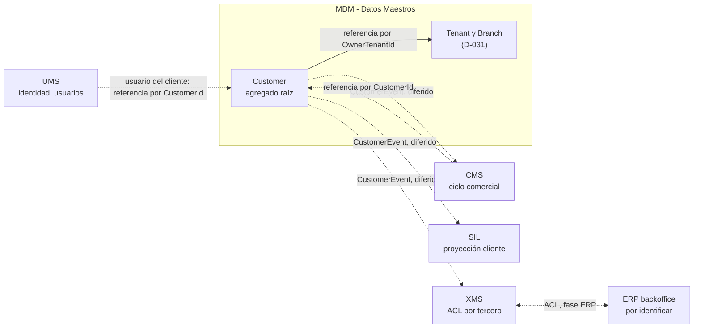
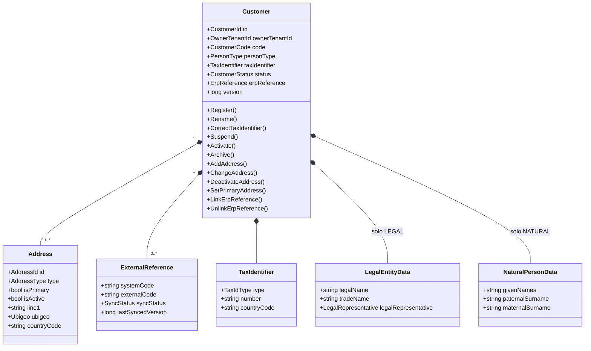
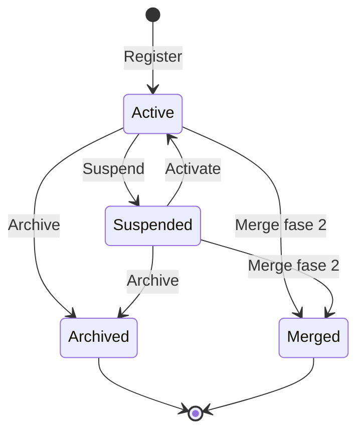
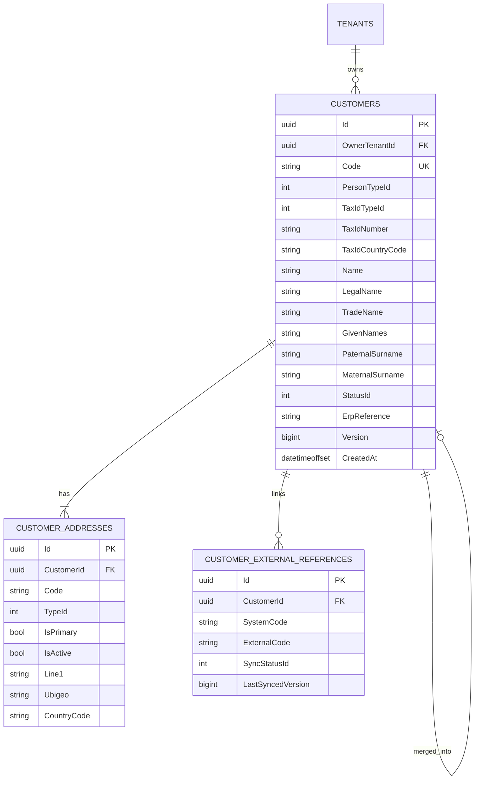

# Modelo de dominio — maestro de Cliente (`Customer`) en MDM

<p align="right">
  
  
  
</p>

> **Código:** `DOM-MDM-001`
> **Fase:** 2 — Diseño
> **Sistema:** MDM (Datos Maestros), alojado provisionalmente en este satélite ([D-027](../../DECISIONS.md#decisiones-locales), [G-257](../../GAPS.md))
> **Estado:** Borrador **en realineación por [D-043](../../DECISIONS.md#decisiones-locales)**. Es un diseño: **no hay código ni migración**. Lee primero la sección 0: qué sigue vigente y qué pasa al [modelo base de MDM (DOM-MDM-002)](./modelo-dominio-organizacion-erp-mdm-002.es.md).
> **Depende de:** [DOM-MDM-002](./modelo-dominio-organizacion-erp-mdm-002.es.md) (Party, roles y establecimientos). Las referencias a Tenant y Branch de [D-031](../../DECISIONS.md#decisiones-locales) en el resto del documento son históricas.
> **Hub del área:** [MDM — Datos Maestros](./hub-mdm.es.md)

---

**Convención de idioma.** La prosa, los títulos y las glosas están en español (SD-08). **Todo lo que es contrato o código va en inglés**: entidades, objetos de valor, eventos, enumeraciones, campos JSON, DTO, rutas, códigos de error, tablas y columnas del DDL. El lenguaje ubicuo (§2) fija el término inglés como canónico y el español de negocio como glosa.

**Qué es y qué no es.** Diseña el maestro de Cliente por simetría con el de Tenant y Branch ([D-031](../../DECISIONS.md#decisiones-locales)), pensado para personas naturales y jurídicas y para una integración futura con un ERP de backoffice. **Qué es evidencia y qué es supuesto está separado**: lo primero lleva su enlace; lo segundo está en el [registro de supuestos (§11)](#11-supuestos-y-decisiones-pendientes) con su gap (SD-05, SD-07). Donde dice «decisión propuesta», nadie la ha aceptado todavía.

## 0. Alineación con D-043: Cliente es un rol de Party

[D-043](../../DECISIONS.md#decisiones-locales) (2026-10-24) cambia la base de MDM: **`Customer` deja de ser agregado y pasa a ser el rol `CUSTOMER` de una `Party`** ([DOM-MDM-002](./modelo-dominio-organizacion-erp-mdm-002.es.md)). La v0.1.0 de este documento se escribió antes, por simetría con Tenant y Branch. Esta tabla dice dónde queda cada parte; **donde el resto del documento la contradiga, manda esta tabla**.

| Parte de la v0.1.0 | Qué pasa | Dónde queda |
| :--- | :--- | :--- |
| Agregado `Customer` con `CustomerId` y `CustomerCode` | **Se retira** como agregado. La identidad es la de la Party (`PartyId`, `Code`) | DOM-MDM-002 §4.1 |
| `PersonType` y bloques `LegalEntityData` / `NaturalPersonData` (§3.2) | **Se conserva el diseño**, trasladado a la Party (`PartyType`, `OrganizationData`, `PersonData`) | DOM-MDM-002 §4.1 |
| `TaxIdentifier` y su validación, incluido el dígito verificador del RUC (§3.3) | **Se conserva el algoritmo**; el tipo pasa a ser un esquema del catálogo `IdentifierScheme`, con clave `(país, esquema, valor)` | Aquí §3.3 y DOM-MDM-002 `INV-PTY-02` a `04` |
| Unicidad del documento **por organización dueña** (`INV-CUS-04`) | **Cambia**: el identificador es único **en toda la suite**; una empresa es una sola Party aunque la atiendan varias organizaciones | DOM-MDM-002 `INV-PTY-02` |
| `OwnerTenantId` y la ruta `/tenants/{tenantId}/customers` | **Se retira**. Qué organización atiende a qué cliente es una `PartyRelationship` o un dato de CMS, por decidir ([G-531](../../GAPS.md)) | DOM-MDM-002 §4.1 |
| `Address` (§3.1) | **Se conserva** como dirección de la Party; la dirección de un lugar donde opera es un `Establishment` ([G-540](../../GAPS.md)) | DOM-MDM-002 §4.1 |
| `ErpReference` y `ExternalReference` dentro del agregado (§9.2) | **Se retira** del agregado: la correspondencia es un agregado aparte ([G-551](../../GAPS.md)) | DOM-MDM-002 §4.1 y §9 |
| Estados `Active`, `Suspended`, `Archived`, `Merged` (§4) | Pasan a la Party. El rol `CUSTOMER` tiene los suyos (`Active`, `Suspended`, `Terminated`) con vigencia | DOM-MDM-002 §4.4 |
| `CustomerEvent` (§5) | **Se sustituye** por `PartyEvent` con los roles vigentes; la proyección `cliente` de SIL filtra por rol `CUSTOMER` ([G-544](../../GAPS.md)) | DOM-MDM-002 §7 |
| Reparto MDM (identidad) / CMS (ciclo comercial) (§2.1) | **Se conserva**: los datos comerciales del rol son de CMS ([G-530](../../GAPS.md)) | DOM-MDM-002 §4.2 |
| Contratos de API y DDL (§7 y §8) | **Históricos**: se rehacen sobre Party cuando exista el ADR ([G-552](../../GAPS.md), [G-554](../../GAPS.md)) | — |
| §9.3 a §9.8 (dueño por atributo, sincronización, conflictos, versionado, fusión, datos personales) | **Siguen vigentes** como criterio; aplican a la Party | — |

**Qué queda propio de este documento:** las reglas del rol `CUSTOMER` (cuándo se asigna, qué exige, qué ve SIL) y el criterio de identificación y datos personales del cliente. La v0.3.0 lo reducirá a eso cuando el ADR del modelo Party esté aceptado.

## 1. Resumen ejecutivo

| Tema | Propuesta |
| :--- | :--- |
| Contexto | **MDM**, subdominio «partes» (clientes). Es el **maestro de identidad y referencia** del cliente. El ciclo comercial (acuerdo, tarifa, crédito) sigue en **CMS** y SIL lo consume por proyección de solo lectura |
| Agregado | `Customer` es la raíz; contiene `Address` (0..N) y, en la fase ERP, `ExternalReference` (0..N). Una transacción = un `Customer` |
| Natural / jurídica | **Un solo agregado** con `PersonType` explícito e inmutable y dos bloques opcionales mutuamente excluyentes (`legalEntity` o `naturalPerson`); no una jerarquía de clases |
| Identificadores | `Id` (`Guid`, lo asigna la aplicación), `Code` (negocio, inmutable, no se reutiliza, hasta 30 caracteres), `TaxIdentifier` (tipo + número + país, único por organización dueña) |
| Estado | `Active` ⇄ `Suspended`; `Archived` terminal; `Merged` terminal (fase 2) |
| Concurrencia y auditoría | Igual que Tenant: `Version` `bigint` como único token, `ETag`/`If-Match`, `428`/`412`, auditoría `CreatedAt/By`, `UpdatedAt/By` |
| Multi-tenancy | `OwnerTenantId` inmutable; ruta anidada `/api/v1/tenants/{tenantId}/customers`, como las sedes |
| ERP | Campo simple `erpReference` hoy (requisito mínimo); tabla `ExternalReference` cuando el ERP exista, por expand/contract. Integración por ACL en XMS y eventos con Outbox/Inbox, **sin diseñarla aquí** |

## 2. Contexto delimitado y lenguaje ubicuo

### 2.1 A qué contexto pertenece Cliente

**Decisión propuesta: MDM.** La evidencia:

| Evidencia | Qué dice | Enlace |
| :--- | :--- | :--- |
| ADR-SIL-002 D3 (`Borrador`) | «Data maestra transversal (**clientes y proveedores de referencia**, ubicaciones, puertos…) → **MDM**, para toda la suite»; SIL conserva solo «proyección de solo lectura; nunca crea ni edita maestros» | [ADR-SIL-002](../../reference/architecture/adrs/SIL-002-frontera-contexto-sil-en-la-suite.es.md#d3) |
| Descomposición de SIL, fila «Datos maestros» | MDM: «Clientes y proveedores (**identidad y datos de referencia**)… Las altas y cambios pasan por el flujo de aprobación de MDM» | [descomposición](../../reference/architecture/descomposicion-sil-en-la-suite.es.md) |
| Misma fuente, fila «Clientes y Comercial» | CMS: «CMS íntegro: RF-CLI-001, 006, 007 y 008… RF-CLI-002 (**empresa en CMS**, cuenta en UMS)» y «Ciclo comercial… acuerdo, tarifario, crédito» | [ADR-SIL-002 D3](../../reference/architecture/adrs/SIL-002-frontera-contexto-sil-en-la-suite.es.md#d3) |
| MD-SIL-001, proyección `cliente` | «Cliente de referencia. **Fuente: MDM**». Campos que SIL ya espera: `id`, `codigo` (texto 30), `nombre` (200), `version_origen` (entero largo monótono), `vigente`, `ruc` (11), `sistema_origen` | [`cliente`](./modelo-datos-sil-001.es.md#ent-cliente) |
| Modelo de dominio de SIL | «Los maestros no son del dominio de SIL: cliente, producto, depósito… llegan como referencias de solo lectura» (INV-SOL-17) | [DOM-SIL-001](./modelo-dominio-sil-001.es.md) |

**La evidencia no es unánime, y eso es un supuesto.** La descomposición dice a la vez que «clientes y proveedores pertenecen al CMS» (tabla de capacidades) y que MDM es dueño de su «identidad y datos de referencia». Este diseño toma la lectura más fina: **MDM es dueño de quién es el cliente** (identidad, documento, nombre, direcciones, referencias externas) y **CMS de la relación comercial** (oportunidad, acuerdo, tarifario, crédito, documentos de cumplimiento; cf. [G-134](../../GAPS.md)). Mientras no haya un ADR que lo declare, el reparto es hipótesis ([G-017](../../GAPS.md), [G-530](../../GAPS.md)): si el ADR da el maestro a CMS, este modelo se traslada tal cual al repositorio de CMS, porque no depende de ningún otro agregado de MDM salvo la referencia a `Tenant`.

Atributos que **no** son de `Customer` (para que no se cuelen): crédito y semáforo, tarifario y acuerdos, vigencia documental y habilitación BASC (CMS y Cumplimiento), contactos y preferencias de notificación (UMS y NMS; datos personales, [G-032](../../GAPS.md)), cuentas de usuario del portal (UMS).

### 2.2 Diagrama de contexto



Relaciones entre contextos ([ADR-0097](https://github.com/organizacion-peru/organizacion_arch/blob/main/reference/architecture/adrs/core/0097-integracion-entre-sistemas-suite-eventos-xms.es.md), `Aceptado`: integración entre sistemas por eventos sobre XMS): MDM es **upstream** y publica; SIL, CMS y UMS son **conformistas** que proyectan y referencian por `CustomerId`; el ERP queda **detrás de un ACL en XMS** (§9). Las flechas punteadas están **diferidas** hasta cerrar [G-312](../../GAPS.md) (outbox) y la sincronización ([G-313](../../GAPS.md)), igual que para `TenantEvent`.

### 2.3 Lenguaje ubicuo

| Término canónico (código y contrato) | Glosa de negocio | Definición |
| :--- | :--- | :--- |
| `Customer` | Cliente | Persona natural o jurídica que contrata servicios a la organización dueña. Una sola identidad maestra por organización |
| `CustomerId` | ID interno | `Guid` global, lo asigna la aplicación; estable aunque cambie la fuente |
| `CustomerCode` | Código de cliente | Identificador de negocio, normalizado, inmutable, único por organización y nunca reutilizado |
| `PersonType` | Tipo de persona | `NATURAL` o `LEGAL`; explícito e inmutable |
| `TaxIdentifier` | Número de identificación | Tipo de documento + número + país: RUC, DNI, CE, pasaporte, identificador tributario extranjero |
| `LegalName` | Razón social | Nombre registrado de la persona jurídica |
| `TradeName` | Nombre comercial | Nombre de uso comercial, opcional |
| `NaturalPersonName` | Nombres y apellidos | `givenNames`, `paternalSurname`, `maternalSurname` (apellido paterno y materno) |
| `LegalRepresentative` | Representante legal | Datos del representante de una persona jurídica, opcional |
| `DisplayName` (`name` en JSON) | Nombre / razón social | **Derivado**: `LegalName` o el nombre completo de la persona natural; es lo que ven listados, búsqueda y la proyección de SIL |
| `Address` | Dirección | Dirección con tipo (`FISCAL`, `BILLING`, `DELIVERY`, `CORRESPONDENCE`) |
| `Ubigeo` | Ubigeo | Código INEI de seis dígitos de departamento, provincia y distrito; opcional |
| `ErpReference` | Código de referencia ERP | Código que el sistema de backoffice asigna al cliente; cadena opcional |
| `ExternalReference` | Referencia externa | Generalización de `ErpReference`: sistema + código + estado de sincronización (fase ERP) |
| `OwnerTenant` | Organización dueña | `Tenant` (maestro de organización de D-031) cuyo libro de clientes contiene este cliente |

## 3. Modelo de dominio

### 3.1 Agregado, entidades y objetos de valor

| Elemento | Tipo | Cardinalidad | Responsabilidad |
| :--- | :--- | :--- | :--- |
| `Customer` | Aggregate Root | 1 | Identidad, estado, invariantes entre sus partes, versión |
| `Address` | Entity (dentro del agregado) | 1..N (≥ 1 `FISCAL` activa mientras el cliente está `Active`) | Una dirección con su tipo; nunca se borra, se desactiva |
| `ExternalReference` | Entity (fase ERP) | 0..N | Vínculo con un sistema externo y su estado de sincronización |
| `CustomerId`, `OwnerTenantId` | Value Object (`Guid`) | 1 | Identidad tipada; `OwnerTenantId` solo referencia al otro agregado (ADR-0098) |
| `CustomerCode` | Value Object | 1 | Normaliza como `Code` de Tenant (recorte, mayúsculas, espacios por `_`); 1 a 30 caracteres |
| `TaxIdentifier` | Value Object | 1 | `{ type, number, countryCode }`; normaliza y valida según el tipo (§3.3) |
| `PersonType` | Enumeración | 1 | `NATURAL`, `LEGAL` |
| `LegalEntityData` | Value Object | 0..1 | `legalName`, `tradeName?`, `legalRepresentative?`; presente si y solo si `LEGAL` |
| `NaturalPersonData` | Value Object | 0..1 | `givenNames`, `paternalSurname`, `maternalSurname?`; presente si y solo si `NATURAL` |
| `LegalRepresentative` | Value Object | 0..1 | `fullName`, `documentType`, `documentNumber`, `position?` |
| `ErpReference` | Value Object | 0..1 | Cadena de 1 a 50 caracteres tras recortar; única por organización dueña |
| `AddressType`, `CustomerStatus`, `TaxIdType` | Enumeraciones | 1 | Valores en §3.2 y §4 |
| `AuditValueObject` | Value Object de la shell | 1 | `CreatedAt/By`, `UpdatedAt/By`, como Tenant |



### 3.2 Natural y jurídica: un agregado, dos bloques

**Decisión propuesta:** un único agregado `Customer` con `PersonType` explícito y un bloque de datos específico por tipo (`LegalEntityData` o `NaturalPersonData`), exactamente uno presente.

| Criterio | Un agregado con bloques por tipo (propuesto) | Jerarquía `LegalCustomer` / `NaturalCustomer` |
| :--- | :--- | :--- |
| Lo que comparten (código, documento, estado, direcciones, ERP, eventos, versión) | Se escribe una vez | Se hereda, y la herencia solo reutiliza código (y la sustitución entre subtipos falla si cada uno rechaza operaciones del otro) |
| Un consumidor que solo quiere `code`, `name`, `status` | Lee un solo tipo y una sola tabla | Debe resolver el tipo concreto (`is`/`instanceof`) |
| Una persona natural con negocio y RUC `10…` | Es `NATURAL` con `TaxIdentifier.type = RUC`; sin caso especial | Obliga a elegir una clase aunque tenga ambas facetas |
| Persistencia en SQL Server | Una tabla con columnas anulables y `CHECK` por tipo | Tabla por jerarquía (mismas columnas anulables) o por tipo (joins) |
| Coste | Columnas anulables; el `CHECK` y el dominio deben vigilar la exclusión mutua; añadir un tercer tipo (p. ej. sucesión indivisa) toca el enumerado y los `CHECK` | Más clases y más joins; ninguna ventaja con solo dos variantes estables |

**Coste asumido:** columnas anulables y reglas de exclusión mutua en dos sitios (dominio y `CHECK`). Se compensa con que `name` se **persiste derivado** (una columna indexable) y con que el tipo no cambia nunca: convertir de natural a jurídica no existe; se registra un cliente nuevo y, si procede, se fusiona (§9.7). **Cuándo revisar:** si aparece un tercer tipo con reglas propias o si los bloques crecen a más de ~10 atributos cada uno, evaluar la herencia.

El nombre a mostrar se deriva en el dominio, no en el consumidor: `LEGAL` → `legalName`; `NATURAL` → `paternalSurname maternalSurname, givenNames` (apellidos primero, que es el orden de los listados peruanos). Se guarda en `Customers.Name` (hasta 200 caracteres, el tamaño de `nombre` en la proyección `cliente` de SIL).

### 3.3 Validación de `TaxIdentifier`

| `type` | Formato (tras normalizar: recorte, mayúsculas, sin espacios ni guiones) | Regla adicional | Compatible con |
| :--- | :--- | :--- | :--- |
| `RUC` | 11 dígitos, `countryCode = PE` | Dígito verificador (módulo 11, abajo); el prefijo `10` indica persona natural con negocio y `20` persona jurídica | `NATURAL` y `LEGAL` |
| `DNI` | 8 dígitos, `PE` | Solo formato (el dígito de control del DNI no se valida aquí) | `NATURAL` |
| `CE` | 8 a 12 caracteres alfanuméricos (supuesto) | Solo formato | `NATURAL` |
| `PASSPORT` | 5 a 12 caracteres alfanuméricos (supuesto); `countryCode` del emisor | Solo formato | `NATURAL` |
| `FOREIGN_TAX_ID` | 3 a 20 caracteres alfanuméricos (supuesto); `countryCode ≠ PE` | Solo formato | `LEGAL` y `NATURAL` extranjeros |

**Dígito verificador del RUC.** Pesos `5 4 3 2 7 6 5 4 3 2` sobre los diez primeros dígitos; `suma = Σ dígito × peso`; `r = 11 − (suma mod 11)`; si `r ≥ 10`, `r = r − 10`; el undécimo dígito debe ser `r`. Comprobado con el RUC de Organización (`20100412447`): `2·5 + 0·4 + 1·3 + 0·2 + 0·7 + 4·6 + 1·5 + 2·4 + 4·3 + 4·2 = 70`; `70 mod 11 = 4`; `r = 7` → undécimo dígito `7`. ✓. Es una validación **estructural**: no prueba que el RUC exista ni que su condición sea «habida»; consultar el padrón de SUNAT queda fuera de alcance ([G-538](../../GAPS.md)).

### 3.4 Invariantes

| ID | Invariante | Dónde se hace cumplir |
| :--- | :--- | :--- |
| `INV-CUS-01` | `PersonType` no cambia nunca | Dominio (no hay verbo) |
| `INV-CUS-02` | `LEGAL` ⇒ `TaxIdentifier.type ∈ {RUC, FOREIGN_TAX_ID}` y existe `LegalEntityData` con `legalName`; `NATURAL` ⇒ existe `NaturalPersonData` con `givenNames` y `paternalSurname`; nunca ambos bloques | Dominio y `CK_Customers_NameByPersonType` |
| `INV-CUS-03` | El `TaxIdentifier` es válido para su tipo (§3.3) | Dominio (el `CHECK` solo cubre el formato del RUC) |
| `INV-CUS-04` | `(OwnerTenantId, TaxIdentifier.type, TaxIdentifier.number)` es único, **incluidos archivados y fusionados** | Índice único `UX_Customers_OwnerTenantId_TaxId` |
| `INV-CUS-05` | `(OwnerTenantId, Code)` es único, inmutable y no se reutiliza, ni tras archivar | `UX_Customers_OwnerTenantId_Code` |
| `INV-CUS-06` | Un cliente `Active` tiene al menos una `Address` `FISCAL` activa | Dominio, protegido por `Version`: toda mutación de una dirección escribe la fila del cliente |
| `INV-CUS-07` | Por cada `AddressType` con alguna dirección activa existe **exactamente una** principal; la primera de un tipo nace principal | Dominio y `UX_CustomerAddresses_CustomerId_TypeId_Primary` (filtrado) |
| `INV-CUS-08` | Una dirección principal está activa; una dirección desactivada no es principal | Dominio y `CK_CustomerAddresses_PrimaryIsActive` |
| `INV-CUS-09` | `countryCode` es ISO 3166-1 alfa-2; con `countryCode = PE`, el `ubigeo`, si viene, son seis dígitos | Dominio y `CK_CustomerAddresses_Ubigeo` |
| `INV-CUS-10` | `ErpReference`, si existe, es única por organización dueña (como `CompanyReference` de Tenant) | `UX_Customers_OwnerTenantId_ErpReference` filtrado |
| `INV-CUS-11` | Un cliente `Archived` o `Merged` no se modifica ni se reactiva | Dominio |
| `INV-CUS-12` | `OwnerTenantId` existe y está `Active` **al registrar**; después puede archivarse sin tocar al cliente | Aplicación (lectura de `Tenant`); no es una invariante transaccional (ADR-0098) |

`INV-CUS-06` no puede expresarse como restricción en SQL Server. Lo protege la versión: quitar o desactivar una dirección es una mutación del agregado, así que dos peticiones concurrentes que desactivan las dos direcciones fiscales chocan en `Version` y la segunda recibe `412`.

## 4. Ciclo de vida



| Estado | Significado | Se puede modificar |
| :--- | :--- | :--- |
| `Active` | Utilizable en operaciones nuevas | Sí |
| `Suspended` | Datos conservados; no se debe usar en operaciones nuevas (la decisión comercial de crédito no es de MDM) | Sí, salvo `Archive` previo |
| `Archived` | Borrado lógico, terminal; `Code` y `TaxIdentifier` siguen ocupados ([D-031](../../DECISIONS.md#decisiones-locales) regla 1 y 2; [ADR-0164](https://github.com/organizacion-peru/organizacion_arch/blob/main/reference/architecture/adrs/core/0164-el-borrado-es-logico-y-la-clave-natural-no-se-reutiliza.es.md) sigue en `Borrador`, [G-324](../../GAPS.md)) | No |
| `Merged` | Duplicado absorbido por otro cliente; guarda `MergedIntoCustomerId`; terminal. **Fase 2** | No |

La descomposición de SIL dice que «las altas y cambios pasan por el flujo de aprobación de MDM». No hay flujo de aprobación en Tenant; este diseño **no** lo incluye y deja un estado `PendingApproval` como candidato ([G-542](../../GAPS.md)).

## 5. Eventos de dominio

Siguen la forma de los de Tenant: un `record` por hecho que lleva el identificador del agregado y su **`Version` posterior al cambio**, que será la `Sequence` del evento de integración. Hoy no se publicarían (outbox diferido, [G-312](../../GAPS.md)).

| Evento de dominio | Cuándo | Carga (además de `CustomerId`, `Version`) |
| :--- | :--- | :--- |
| `CustomerRegistered` | Alta | `OwnerTenantId`, `Code`, `PersonType`, `TaxIdentifier`, `Name` |
| `CustomerRenamed` | Cambia el bloque de nombre | `Name` |
| `CustomerTaxIdentifierCorrected` | Corrección del documento | `OldTaxIdentifier`, `NewTaxIdentifier` |
| `CustomerSuspended`, `CustomerActivated`, `CustomerArchived` | Transiciones | — |
| `CustomerMerged` (fase 2) | Absorción | `SurvivorCustomerId` |
| `AddressAdded` | Alta de dirección | `AddressId`, `Type`, `IsPrimary` |
| `AddressChanged` | Cambia datos de una dirección | `AddressId` |
| `AddressDeactivated`, `AddressReactivated` | Estado de una dirección | `AddressId` |
| `PrimaryAddressChanged` | Cambia la principal de un tipo | `Type`, `OldAddressId`, `NewAddressId` |
| `ErpReferenceLinked`, `ErpReferenceUnlinked` | Vínculo con el ERP | `ErpReference` |

**Contrato de integración candidato: `CustomerEvent`.** Como `TenantEvent` (D-006 de `organizacion-ums`: `Subject`, `Data`, `Sequence`), es un evento de **transferencia de estado**: lleva el estado completo del cliente tras el cambio, no el delta, y el consumidor aplica solo secuencias estrictamente mayores. Eso lo hace idempotente y tolera desorden y reentregas. Cubre lo que la proyección `cliente` de SIL ya espera (`id`, `codigo`, `nombre`, `version_origen`, `vigente`, `ruc`).

```json
{
  "eventId": "7c0f9a5e-31f4-4c2b-8d0a-5b1d2e8f6a10",
  "eventType": "customer.changed",
  "schemaVersion": 1,
  "source": "mdm",
  "occurredAt": "2026-10-22T14:05:09.120+00:00",
  "subject": "3f1b6c0a-9d2e-4a7b-8c11-2e5d7f9a0b34",
  "sequence": 7,
  "data": {
    "ownerTenantId": "0b9c7e0e-2f4a-4c39-9a51-1f0d7a3e9c11",
    "code": "CLI-000123",
    "personType": "LEGAL",
    "name": "TRANSPORTES ANDINOS S.A.C.",
    "taxIdentifier": { "type": "RUC", "number": "20512345671", "countryCode": "PE" },
    "status": "Active",
    "erpReference": null
  }
}
```

`eventId` es la clave de deduplicación del consumidor (Inbox); `sequence` es `Customer.Version`. Las direcciones **no** viajan en el evento base: quien las necesite las pide por API o por un evento propio (`customer.addresses.changed`), para que un cambio de dirección no obligue a todos los consumidores a reprocesar. Un documento de persona natural es dato personal: la proyección de SIL solo necesita `ruc`, así que el contrato debe decidir qué consumidores reciben el número completo ([G-534](../../GAPS.md)). El contrato definitivo vive en el repositorio de su emisor y los consumidores lo citan por versión ([ADR-0097](https://github.com/organizacion-peru/organizacion_arch/blob/main/reference/architecture/adrs/core/0097-integracion-entre-sistemas-suite-eventos-xms.es.md) D6, `Aceptado`).

## 6. Frontera transaccional

- **Una transacción, un `Customer`**, con sus direcciones y referencias externas dentro. Toda mutación incrementa `Version` en `Customers` (incluidas las de direcciones), igual que Branch con Tenant: contención aceptable, porque las direcciones de un cliente las edita poca gente a la vez, y a cambio se obtiene un solo `ETag` y la protección de `INV-CUS-06`.
- **Fuera de la transacción:** que `OwnerTenantId` exista y esté activo (`INV-CUS-12`, lectura previa) y toda proyección en otro contexto (SIL, CMS, UMS, ERP), que es consistencia eventual.
- **Unicidad entre agregados** (código, documento, referencia ERP): índices únicos; el choque se traduce a `409` con su código, como en Tenant (errores 2601 y 2627 de SQL Server).
- **Publicación:** el evento de integración se escribe en la tabla de Outbox **en la misma transacción** que el cambio y un relé lo publica; no hay publicación dentro del request (`consistencia-distribuida`: nunca dual write). Diseño de la tabla y del relé: fuera de alcance ([G-312](../../GAPS.md), [G-535](../../GAPS.md)).

## 7. Contratos de API

Reglas comunes **idénticas a las de Tenant** ([contrato de Tenant y Branch](../03-construccion/contrato-api-organizacion-sede-mdm-001.es.md), §1): prefijo `/api/v1`; `application/json` UTF-8; **camelCase**; instantes ISO 8601 con milisegundos y desfase (`2026-10-22T14:05:09.120+00:00`); portador JWT RS256; errores **Problem Details** ([RFC 9457](https://www.rfc-editor.org/rfc/rfc9457)) con la extensión `code` y, en validación, `errors` con un solo campo; `ETag` fuerte con la `version`; `If-Match` obligatorio en toda escritura sobre un recurso existente (`428` si falta, `400` si está mal formado, `412` si no coincide); `If-None-Match` con `304` en lecturas; `DELETE` archiva. Un `code` publicado no cambia de significado.

### 7.1 Endpoints

La ruta cuelga de la organización dueña, como las sedes: `OwnerTenantId` sale de la ruta y es inmutable.

| # | Método y ruta | Propósito | `If-Match` | Éxito | Errores |
| :--- | :--- | :--- | :--- | :--- | :--- |
| C-01 | `GET /tenants/{tenantId}/customers` | Lista con filtros y cursor (§7.5) | — | `200` | `400`, `404` |
| C-02 | `GET /tenants/{tenantId}/customers/{id}` | Consulta | — | `200` + `ETag`; `304` | `404` |
| C-03 | `POST /tenants/{tenantId}/customers` | Alta (con al menos una dirección `FISCAL`) | No | `201` + `Location` + `ETag` | `400`, `404`, `409` |
| C-04 | `PUT /tenants/{tenantId}/customers/{id}` | Cambia el bloque de nombre (`legalEntity` o `naturalPerson`) | Sí | `204` + `ETag` | `400`, `404`, `409`, `412`, `428` |
| C-05 | `PUT …/{id}/tax-identifier` | Corrige el documento | Sí | `204` + `ETag` | `400`, `404`, `409`, `412`, `428` |
| C-06 | `POST …/{id}/suspend` · `POST …/{id}/activate` | Suspende · reactiva | Sí | `204` + `ETag` | `404`, `409`, `412`, `428` |
| C-07 | `DELETE …/{id}` | **Archiva** (terminal) | Sí | `204` + `ETag` | `404`, `409`, `412`, `428` |
| C-08 | `GET …/{id}/addresses` · `GET …/{id}/addresses/{addressId}` | Direcciones | — | `200` + `ETag`; `304` | `404` |
| C-09 | `POST …/{id}/addresses` | Alta de dirección | Sí | `201` + `Location` + `ETag` | `400`, `404`, `409`, `412`, `428` |
| C-10 | `PUT …/{id}/addresses/{addressId}` | Cambia datos de la dirección (no su `type`) | Sí | `204` + `ETag` | `400`, `404`, `409`, `412`, `428` |
| C-11 | `POST …/addresses/{addressId}/deactivate` · `…/reactivate` · `…/set-primary` | Estado y principal | Sí | `204` + `ETag` | `404`, `409`, `412`, `428` |
| C-12 | `PUT …/{id}/erp-reference` · `DELETE …/{id}/erp-reference` | Vincula · desvincula el código ERP | Sí | `204` + `ETag` | `400`, `404`, `409`, `412`, `428` |

El `ETag` de una dirección es el del cliente (como Branch). Los `PUT` no llevan `code`, `ownerTenantId` ni `personType`: son inmutables. El `erpReference` se fija con un verbo propio y no con el `PUT` general para que pueda autorizarse aparte (lo asigna el proceso de integración, no el operador) y porque nace después del alta.

### 7.2 DTO de alta

`POST /api/v1/tenants/{tenantId}/customers`

| Campo | Tipo | Oblig. | Regla |
| :--- | :--- | :--- | :--- |
| `code` | `string` | Sí | Se normaliza; 1 a 30 caracteres; único por organización, incluidos archivados |
| `personType` | `string` | Sí | `NATURAL` o `LEGAL`, sin distinguir mayúsculas en la entrada |
| `taxIdentifier.type` | `string` | Sí | `RUC`, `DNI`, `CE`, `PASSPORT`, `FOREIGN_TAX_ID` |
| `taxIdentifier.number` | `string` | Sí | Según §3.3; se normaliza |
| `taxIdentifier.countryCode` | `string` | Sí | ISO 3166-1 alfa-2 |
| `legalEntity` | objeto | Si `LEGAL` | Prohibido si `NATURAL` |
| `legalEntity.legalName` | `string` | Sí | 1 a 200 caracteres tras recortar |
| `legalEntity.tradeName` | `string?` | No | Hasta 200 |
| `legalEntity.legalRepresentative` | objeto? | No | `fullName` (≤ 200), `documentType`, `documentNumber` (≤ 20), `position?` (≤ 100) |
| `naturalPerson` | objeto | Si `NATURAL` | Prohibido si `LEGAL` |
| `naturalPerson.givenNames` | `string` | Sí | 1 a 100 |
| `naturalPerson.paternalSurname` | `string` | Sí | 1 a 100 |
| `naturalPerson.maternalSurname` | `string?` | No | Hasta 100 (hay personas sin segundo apellido) |
| `addresses` | lista | Sí | Al menos un elemento de tipo `FISCAL` |
| `addresses[].type` | `string` | Sí | `FISCAL`, `BILLING`, `DELIVERY`, `CORRESPONDENCE` |
| `addresses[].isPrimary` | `bool?` | No | Se ignora para el primero de su tipo (nace principal); dos principales del mismo tipo es `400` |
| `addresses[].code` | `string?` | No | Hasta 30; único por cliente si viene |
| `addresses[].label` | `string?` | No | Hasta 100 (p. ej. «Planta Callao») |
| `addresses[].line1` | `string` | Sí | 1 a 200 |
| `addresses[].line2` | `string?` | No | Hasta 200 |
| `addresses[].ubigeo` | `string?` | No | Seis dígitos; solo con `countryCode = PE` |
| `addresses[].department`, `province`, `district` | `string?` | No | Hasta 100 cada uno; texto informativo mientras no haya catálogo de ubigeo |
| `addresses[].postalCode` | `string?` | No | Hasta 20 |
| `addresses[].countryCode` | `string` | Sí | ISO 3166-1 alfa-2 |
| `addresses[].reference` | `string?` | No | Hasta 200 (punto de referencia) |
| `erpReference` | `string?` | No | 1 a 50 caracteres si viene; para importaciones (§9.1). Un cambio posterior usa C-12 |

La respuesta es `201` con `{ "id": "…", "version": 1 }` y `Location` al recurso, como el alta de Tenant. El alta de dirección (C-09) usa el mismo objeto `addresses[]` y responde `{ "id": "<addressId>", "version": n }`.

### 7.3 DTO de lectura

```json
{
  "id": "3f1b6c0a-9d2e-4a7b-8c11-2e5d7f9a0b34",
  "code": "CLI-000123",
  "ownerTenantId": "0b9c7e0e-2f4a-4c39-9a51-1f0d7a3e9c11",
  "personType": "LEGAL",
  "name": "TRANSPORTES ANDINOS S.A.C.",
  "taxIdentifier": { "type": "RUC", "number": "20512345671", "countryCode": "PE" },
  "legalEntity": {
    "legalName": "TRANSPORTES ANDINOS S.A.C.",
    "tradeName": "Andinos Cargo",
    "legalRepresentative": {
      "fullName": "ROSA MARIA QUISPE DIAZ",
      "documentType": "DNI",
      "documentNumber": "45678912",
      "position": "Gerente General"
    }
  },
  "status": "Active",
  "addresses": [
    {
      "id": "a6d0c3f2-1b7e-4f58-9a30-6c2d8e1b4f70",
      "code": "FISCAL-1",
      "type": "FISCAL",
      "isPrimary": true,
      "isActive": true,
      "label": "Domicilio fiscal",
      "line1": "AV. ARGENTINA 1234",
      "line2": null,
      "ubigeo": "070101",
      "department": "LIMA",
      "province": "LIMA",
      "district": "LIMA",
      "postalCode": null,
      "countryCode": "PE",
      "reference": "FRENTE AL PARQUE"
    },
    {
      "id": "b2e4d7a1-5c39-4b0f-8e62-9d1a3c7f5e08",
      "code": "PLANTA-CALLAO",
      "type": "DELIVERY",
      "isPrimary": true,
      "isActive": true,
      "label": "Planta Callao",
      "line1": "CALLE LOS ROBLES 560, ZONA INDUSTRIAL",
      "line2": null,
      "ubigeo": "070101",
      "department": "CALLAO",
      "province": "CALLAO",
      "district": "CALLAO",
      "postalCode": "07001",
      "countryCode": "PE",
      "reference": null
    }
  ],
  "erpReference": null,
  "version": 7,
  "createdAt": "2026-10-22T14:05:09.120+00:00",
  "createdBy": "5d8e2b4a-7c01-4f93-b6a8-0e3f1d9c2a57",
  "updatedAt": "2026-10-22T16:40:31.502+00:00",
  "updatedBy": "5d8e2b4a-7c01-4f93-b6a8-0e3f1d9c2a57"
}
```

Persona natural (alta y lectura comparten la forma; aquí, el cuerpo de alta):

```json
{
  "code": "CLI-000124",
  "personType": "NATURAL",
  "taxIdentifier": { "type": "DNI", "number": "45678912", "countryCode": "PE" },
  "naturalPerson": {
    "givenNames": "JUAN CARLOS",
    "paternalSurname": "PEREZ",
    "maternalSurname": "GARCIA"
  },
  "addresses": [
    {
      "type": "FISCAL",
      "line1": "JR. LAS FLORES 45, DPTO 302",
      "ubigeo": "150122",
      "district": "MIRAFLORES",
      "province": "LIMA",
      "department": "LIMA",
      "countryCode": "PE"
    }
  ],
  "erpReference": "0000123456"
}
```

Su lectura devuelve `"name": "PEREZ GARCIA, JUAN CARLOS"` y **omite** `legalEntity` (el bloque que no aplica no se serializa). El `erpReference` del ejemplo es el código que importa un proceso de migración; en un alta normal llega `null` y se vincula después (C-12).

### 7.4 Reglas de validación y códigos de error

Los `validation.*` van en `errors` con `code` `validation.failed`; los demás son `code` de negocio. Estados HTTP igual que Tenant: `400` forma, `404` existencia, `412` versión, `409` regla de dominio, en ese orden.

| `code` | HTTP | Cuándo |
| :--- | :--- | :--- |
| `validation.failed` | `400` | Cuerpo o parámetros inválidos, o `If-Match` mal formado |
| `validation.code_required`, `validation.code_too_long` | `400` | `code` vacío o de más de 30 caracteres |
| `validation.person_type_invalid` | `400` | `personType` fuera de `NATURAL`, `LEGAL` |
| `validation.legal_name_required`, `validation.given_names_required`, `validation.paternal_surname_required` | `400` | Faltan los datos obligatorios del tipo |
| `validation.person_type_mismatch` | `400` | Viene el bloque que no corresponde (`legalEntity` con `NATURAL`, o los dos) |
| `validation.tax_identifier_type_invalid`, `validation.tax_identifier_invalid` | `400` | Tipo desconocido, o número con formato inválido para su tipo |
| `validation.ruc_check_digit_invalid` | `400` | El RUC no pasa el dígito verificador |
| `validation.ruc_required_for_legal_person` | `400` | `LEGAL` sin `RUC` ni `FOREIGN_TAX_ID` |
| `validation.address_type_invalid`, `validation.address_line_required` | `400` | Tipo desconocido o falta la línea de dirección |
| `validation.ubigeo_invalid`, `validation.country_code_invalid` | `400` | Ubigeo que no son seis dígitos o país no ISO |
| `validation.fiscal_address_required` | `400` | Alta sin dirección `FISCAL` |
| `validation.multiple_primary_addresses` | `400` | Dos principales del mismo tipo en el alta |
| `validation.erp_reference_invalid` | `400` | `erpReference` vacío o de más de 50 caracteres |
| `customer.owner_tenant_not_active` | `409` | Alta en una organización suspendida o archivada |
| `customer.code_not_unique` | `409` | El `code` ya lo usa otro cliente de la organización, aunque esté archivado |
| `customer.tax_identifier_not_unique` | `409` | Ya existe un cliente con ese tipo y número de documento en la organización |
| `customer.erp_reference_not_unique` | `409` | Otro cliente de la organización ya tiene ese `erpReference` |
| `customer.already_suspended`, `customer.already_active`, `customer.archived`, `customer.merged` | `409` | Transición no permitida desde el estado actual (mismo esquema que `tenant.*`) |
| `customer.not_active` | `409` | Operación que exige `Active` (alta o reactivación de dirección) sobre un cliente suspendido |
| `address.code_not_unique` | `409` | El `code` de dirección ya existe en el cliente |
| `address.already_inactive`, `address.already_active` | `409` | Transición de dirección no permitida |
| `address.last_fiscal_address` | `409` | La operación dejaría al cliente `Active` sin dirección `FISCAL` activa |
| `address.inactive` | `409` | Se intenta fijar como principal una dirección inactiva |
| `common.not_found` | `404` | Cliente o dirección inexistentes en esa organización |
| `precondition.required`, `precondition.failed` | `428`, `412` | Como Tenant |
| `auth.unauthenticated`, `auth.forbidden` | `401`, `403` | Como Tenant; la autorización por organización y sucursal es [G-314](../../GAPS.md) y [G-536](../../GAPS.md) |

### 7.5 Listado y paginación

Se propone **paginación por conjunto de claves (_keyset_)**, **no** la de desplazamiento que usa Tenant: los clientes son una colección sin cota —crece con el negocio y el ERP la recorrerá completa en las cargas— y el desplazamiento recorre y descarta filas. Es una divergencia deliberada del contrato de Tenant, cuyo propio contrato prevé pasar a keyset pasadas unas 10 000 organizaciones ([G-327](../../GAPS.md)).

- Parámetros: `limit` (1 a 100, defecto 20), `cursor` (opaco; ausente en la primera página), `status`, `personType`, `code` (exacto), `taxIdType` + `taxIdNumber` (exacto), `search` (prefijo de `name`, hasta 200 caracteres).
- Orden fijo: `(code, id)`; el cursor codifica el último par. No hay `sortBy` ni salto a página arbitraria ni `totalCount` (cuesta un `COUNT` por petición).
- Respuesta: `{ "items": [], "limit": 20, "nextCursor": null }`; `nextCursor` es `null` en la última página.

La búsqueda por texto contenido (`LIKE '%x%'`) no usa índice: no se ofrece. Si negocio la pide, va a un índice de texto completo o a una proyección de lectura ([G-541](../../GAPS.md)).

## 8. Modelo relacional objetivo (SQL Server)

Conceptual, **sin migración ejecutable**. Motor y convenciones de [ADR-0051](https://github.com/organizacion-peru/organizacion_arch/blob/main/reference/architecture/adrs/core/0051-estrategia-motor-base-datos-empresarial.es.md) §3.1 (SQL Server para .NET), [ADR-0054](https://github.com/organizacion-peru/organizacion_arch/blob/main/reference/architecture/adrs/core/0054-estandares-diseno-normalizacion-base-datos.es.md) §3.3 (`PascalCase`, `Id`), [ADR-0031](https://github.com/organizacion-peru/organizacion_arch/blob/main/reference/architecture/adrs/core/0031-esquema-por-contexto-catalogo-eventos-dominio.es.md) (esquema por contexto) y [ADR-0229](https://github.com/organizacion-peru/organizacion_arch/blob/main/reference/architecture/adrs/core/0229-modelo-datos-logico-fisico-fase-diseno.es.md) §3.5 (conceptos no portables), todos `Aceptado`, y las decisiones físicas de [ADR-MDM-001](../../reference/architecture/adrs/MDM-001-nomenclatura-y-conceptos-no-portables-de-mdm.es.md) (`Borrador`) D1 a D5: esquema `mdm`, tablas en plural, `Guid` asignado por la aplicación, `datetimeoffset(3)`, `Version bigint` como token, índices `UX_`.



```sql
-- Conceptual DDL. Target engine: SQL Server. Not an executable migration.
-- Schema, naming and non-portable concepts follow ADR-MDM-001 (Draft).

CREATE TABLE mdm.Customers (
    Id                 uniqueidentifier NOT NULL,          -- assigned by the application
    OwnerTenantId      uniqueidentifier NOT NULL,
    Code               nvarchar(30)  COLLATE Latin1_General_100_CI_AS NOT NULL,  -- normalized, immutable
    PersonTypeId       int           NOT NULL,             -- 1 = LEGAL, 2 = NATURAL
    TaxIdTypeId        int           NOT NULL,             -- 1 = RUC, 2 = DNI, 3 = CE, 4 = PASSPORT, 5 = FOREIGN_TAX_ID
    TaxIdNumber        nvarchar(20)  NOT NULL,             -- normalized
    TaxIdCountryCode   char(2)       NOT NULL,
    Name               nvarchar(200) COLLATE Latin1_General_100_CI_AS NOT NULL,  -- derived display name
    LegalName          nvarchar(200) NULL,
    TradeName          nvarchar(200) NULL,
    LegalRepName       nvarchar(200) NULL,
    LegalRepDocTypeId  int           NULL,
    LegalRepDocNumber  nvarchar(20)  NULL,
    LegalRepPosition   nvarchar(100) NULL,
    GivenNames         nvarchar(100) NULL,
    PaternalSurname    nvarchar(100) NULL,
    MaternalSurname    nvarchar(100) NULL,
    StatusId           int           NOT NULL,             -- 1 = Active, 2 = Suspended, 3 = Archived, 4 = Merged
    ErpReference       nvarchar(50)  NULL,                 -- minimal ERP requirement (see CustomerExternalReferences)
    MergedIntoCustomerId uniqueidentifier NULL,            -- phase 2
    Version            bigint        NOT NULL,             -- sole concurrency token = ETag = event Sequence
    CreatedAt          datetimeoffset(3) NOT NULL,
    CreatedBy          nvarchar(100) NOT NULL,
    UpdatedAt          datetimeoffset(3) NULL,
    UpdatedBy          nvarchar(100) NULL,
    AuditTimeSpan      nvarchar(32)  NOT NULL,             -- same audit columns as Tenants
    CONSTRAINT PK_Customers PRIMARY KEY (Id),
    CONSTRAINT FK_Customers_OwnerTenantId FOREIGN KEY (OwnerTenantId) REFERENCES mdm.Tenants (Id),  -- NO ACTION
    CONSTRAINT FK_Customers_MergedIntoCustomerId FOREIGN KEY (MergedIntoCustomerId) REFERENCES mdm.Customers (Id),
    CONSTRAINT CK_Customers_PersonTypeId CHECK (PersonTypeId IN (1, 2)),
    CONSTRAINT CK_Customers_TaxIdTypeId  CHECK (TaxIdTypeId IN (1, 2, 3, 4, 5)),
    CONSTRAINT CK_Customers_StatusId     CHECK (StatusId IN (1, 2, 3, 4)),
    CONSTRAINT CK_Customers_Version      CHECK (Version >= 1),
    CONSTRAINT CK_Customers_NameByPersonType CHECK (
        (PersonTypeId = 1 AND LegalName IS NOT NULL AND GivenNames IS NULL AND PaternalSurname IS NULL AND MaternalSurname IS NULL)
     OR (PersonTypeId = 2 AND LegalName IS NULL AND TradeName IS NULL AND LegalRepName IS NULL
         AND GivenNames IS NOT NULL AND PaternalSurname IS NOT NULL)),
    CONSTRAINT CK_Customers_LegalNeedsTaxId CHECK (PersonTypeId <> 1 OR TaxIdTypeId IN (1, 5)),
    CONSTRAINT CK_Customers_RucFormat CHECK (TaxIdTypeId <> 1 OR (LEN(TaxIdNumber) = 11 AND TaxIdNumber NOT LIKE '%[^0-9]%'))
    -- The RUC check digit and the per-type formats of DNI, CE and passport live in the domain, not in SQL.
);
CREATE UNIQUE INDEX UX_Customers_OwnerTenantId_Code  ON mdm.Customers (OwnerTenantId, Code);          -- no filter: the code is never reused
CREATE UNIQUE INDEX UX_Customers_OwnerTenantId_TaxId ON mdm.Customers (OwnerTenantId, TaxIdTypeId, TaxIdNumber);  -- no filter: archived and merged keep the identity
CREATE UNIQUE INDEX UX_Customers_OwnerTenantId_ErpReference ON mdm.Customers (OwnerTenantId, ErpReference) WHERE ErpReference IS NOT NULL;
CREATE INDEX IX_Customers_OwnerTenantId_StatusId_Code ON mdm.Customers (OwnerTenantId, StatusId, Code) INCLUDE (Name);  -- keyset listing (code, id)
CREATE INDEX IX_Customers_OwnerTenantId_Name ON mdm.Customers (OwnerTenantId, Name);                  -- prefix search

CREATE TABLE mdm.CustomerAddresses (
    Id           uniqueidentifier NOT NULL,
    CustomerId   uniqueidentifier NOT NULL,
    Code         nvarchar(30)  NULL,
    TypeId       int           NOT NULL,                   -- 1 = FISCAL, 2 = BILLING, 3 = DELIVERY, 4 = CORRESPONDENCE
    IsPrimary    bit           NOT NULL,
    IsActive     bit           NOT NULL,
    Label        nvarchar(100) NULL,
    Line1        nvarchar(200) NOT NULL,
    Line2        nvarchar(200) NULL,
    Ubigeo       char(6)       NULL,
    Department   nvarchar(100) NULL,
    Province     nvarchar(100) NULL,
    District     nvarchar(100) NULL,
    PostalCode   nvarchar(20)  NULL,
    CountryCode  char(2)       NOT NULL,
    Reference    nvarchar(200) NULL,
    CreatedAt    datetimeoffset(3) NOT NULL,
    CreatedBy    nvarchar(100) NOT NULL,
    UpdatedAt    datetimeoffset(3) NULL,
    UpdatedBy    nvarchar(100) NULL,
    CONSTRAINT PK_CustomerAddresses PRIMARY KEY (Id),
    CONSTRAINT FK_CustomerAddresses_CustomerId FOREIGN KEY (CustomerId) REFERENCES mdm.Customers (Id),  -- NO ACTION: never deleted
    CONSTRAINT CK_CustomerAddresses_TypeId CHECK (TypeId IN (1, 2, 3, 4)),
    CONSTRAINT CK_CustomerAddresses_PrimaryIsActive CHECK (IsPrimary = 0 OR IsActive = 1),
    CONSTRAINT CK_CustomerAddresses_Ubigeo CHECK (Ubigeo IS NULL OR (CountryCode = 'PE' AND Ubigeo NOT LIKE '%[^0-9]%'))
);
CREATE UNIQUE INDEX UX_CustomerAddresses_CustomerId_TypeId_Primary ON mdm.CustomerAddresses (CustomerId, TypeId) WHERE IsPrimary = 1;  -- one primary per type
CREATE UNIQUE INDEX UX_CustomerAddresses_CustomerId_Code ON mdm.CustomerAddresses (CustomerId, Code) WHERE Code IS NOT NULL;
CREATE INDEX IX_CustomerAddresses_CustomerId ON mdm.CustomerAddresses (CustomerId);

-- ERP phase only: do not create until the ERP is identified (G-532).
CREATE TABLE mdm.CustomerExternalReferences (
    Id                 uniqueidentifier NOT NULL,
    CustomerId         uniqueidentifier NOT NULL,
    SystemCode         nvarchar(30)  NOT NULL,             -- includes the instance, e.g. ERP-PE01
    ExternalCode       nvarchar(100) NOT NULL,
    SyncStatusId       int           NOT NULL,             -- 1 = Linked, 2 = PendingSync, 3 = SyncFailed, 4 = Unlinked
    LastSyncedVersion  bigint        NULL,                 -- Customers.Version last acknowledged by the system
    LastSyncedAt       datetimeoffset(3) NULL,
    ExternalVersion    nvarchar(100) NULL,                 -- the ERP's own ETag or timestamp, if it has one
    LinkedAt           datetimeoffset(3) NOT NULL,
    CONSTRAINT PK_CustomerExternalReferences PRIMARY KEY (Id),
    CONSTRAINT FK_CustomerExternalReferences_CustomerId FOREIGN KEY (CustomerId) REFERENCES mdm.Customers (Id),
    CONSTRAINT CK_CustomerExternalReferences_SyncStatusId CHECK (SyncStatusId IN (1, 2, 3, 4))
);
CREATE UNIQUE INDEX UX_CustomerExternalReferences_System_Code ON mdm.CustomerExternalReferences (SystemCode, ExternalCode) WHERE SyncStatusId <> 4;
CREATE UNIQUE INDEX UX_CustomerExternalReferences_CustomerId_System ON mdm.CustomerExternalReferences (CustomerId, SystemCode) WHERE SyncStatusId <> 4;
```

**Decisiones de esquema.**

- **Identificador.** `Guid` clave agrupada, como Tenant (ADR-MDM-001 D3). Con decenas de miles de clientes la fragmentación aún pesa poco; el plan de revisión de [G-327](../../GAPS.md) (más de 10 000 filas) se aplica a esta tabla antes que a Tenants. Si se vuelve un problema, la alternativa es un `Guid` secuencial generado por la aplicación o una clave agrupada aparte; **un `Guid` v7 en una columna `uniqueidentifier` de SQL Server no queda secuencial** (el motor compara por los últimos bytes).
- **Unicidad.** `Code` y `TaxId` **sin filtro** (la clave natural no se reutiliza, D-031); `ErpReference` **filtrada** (opcional). La principal por tipo es un índice filtrado: lo único que hace imposible el estado de dos principales por tipo, aunque falle la aplicación.
- **Búsqueda.** `Name` usa la intercalación del resto de MDM (`Latin1_General_100_CI_AS`, insensible a mayúsculas y sensible a acentos); la búsqueda de prefijo usa `IX_Customers_OwnerTenantId_Name`.
- **Temporalidad.** La auditoría de columnas responde «quién y cuándo lo cambió», no «qué valor tenía el martes». Para lo segundo la opción es **tabla temporal con versionado de sistema** (`SYSTEM_VERSIONING = ON`) sobre `Customers` y `CustomerAddresses`. Es un concepto **no portable** que exigiría declararse en el ADR local ([ADR-0229](https://github.com/organizacion-peru/organizacion_arch/blob/main/reference/architecture/adrs/core/0229-modelo-datos-logico-fisico-fase-diseno.es.md) §3.5), tiene un efecto sobre el derecho de cancelación de datos personales (el historial conserva el valor borrado) y depende de la versión de SQL Server ([G-321](../../GAPS.md)); por eso **no se incluye** en el DDL y se decide en [G-534](../../GAPS.md).
- **Outbox.** La tabla de Outbox es transversal a MDM y se diseña con [G-312](../../GAPS.md); no se repite aquí.
- **Migración desde el campo simple.** `ErpReference` ya es columna de `Customers`; el paso a `CustomerExternalReferences` es _expand/contract_ (§9.4).

## 9. Consideraciones para escalar a la integración con el ERP

No se diseña la integración; se deja el modelo preparado y se nombran las decisiones. Todo lo que sigue es **diseño propuesto**.

### 9.1 ERP desconocido: ACL y modelo canónico propio

Qué ERP es no está confirmado. La descomposición de SIL declara «la contabilidad la lleva el ERP (SAP), vía XMS» (decisión 18) y SIL-002 D3 sitúa la facturación y los acreedores en SAP, **pero no afirma que SAP sea el backoffice del maestro de clientes**: es un supuesto ([G-532](../../GAPS.md)). Por tanto:

- **`Customer` no adopta el modelo del ERP.** Es el modelo canónico de la suite. Cualquier SAP, Dynamics u otro se adapta a él mediante un **ACL por tercero en XMS** ([ADR-SIL-002](../../reference/architecture/adrs/SIL-002-frontera-contexto-sil-en-la-suite.es.md#d3): «frontera con cualquier externo: XMS, con un ACL por tercero»; [ADR-0097](https://github.com/organizacion-peru/organizacion_arch/blob/main/reference/architecture/adrs/core/0097-integracion-entre-sistemas-suite-eventos-xms.es.md), `Aceptado`). Ningún nombre de campo, enumeración ni longitud del ERP entra al dominio.
- El ACL traduce en ambos sentidos: `PersonType` ↔ el clasificador del ERP, `TaxIdType` ↔ su catálogo de documentos, `AddressType` ↔ los roles de dirección del ERP, y las longitudes (si el ERP limita el nombre a 35 caracteres, trunca el ACL, nunca el maestro).

### 9.2 `ErpReference` simple hoy, `ExternalReference` mañana

| Fase | Modelo | Cuándo basta |
| :--- | :--- | :--- |
| 0 (ahora) | Columna `Customers.ErpReference`, campo `erpReference` | Un solo ERP, un solo código por cliente |
| 1 | Se añade `CustomerExternalReferences`; `erpReference` pasa a derivarse del vínculo de `SystemCode` = ERP; la columna se conserva y se llena por doble escritura | Varios sistemas externos (ERP, CRM, TMS) o necesidad de saber el estado de sincronización por sistema |
| 2 | La API publica `externalReferences[]`; `erpReference` queda **deprecado** (`Deprecation` y `Sunset`, [RFC 9745](https://www.rfc-editor.org/rfc/rfc9745) y [RFC 8594](https://www.rfc-editor.org/rfc/rfc8594)) y se retira cuando su uso medido llegue a cero | Retiro del campo simple |

Cada paso es _expand/contract_: el campo nuevo convive con el viejo, se mide el uso por consumidor y solo entonces se retira. `ExternalReference` añade el estado de sincronización (`Linked`, `PendingSync`, `SyncFailed`, `Unlinked`), la última `Version` confirmada y el identificador de versión propio del ERP si lo tiene.

### 9.3 Fuente de verdad y propiedad de cada atributo

Hay que decidir **quién manda en cada atributo** antes de sincronizar; si no, dos ediciones concurrentes terminan en «gana el último que escribió». Propuesta inicial, por ratificar ([G-533](../../GAPS.md)):

| Atributo | Manda | Razón |
| :--- | :--- | :--- |
| `code`, `id`, `personType`, `status` | **MDM** | Identidad de la suite; el ERP los recibe |
| `taxIdentifier`, `name`/razón social, direcciones | **MDM** (alta y edición con aprobación) | Maestro de identidad; el ERP los consume |
| `erpReference` | **ERP** (lo asigna) | Es su código; MDM solo lo guarda |
| Datos contables (cuentas, condiciones de pago, impuestos, bancos) | **ERP** | No pertenecen al maestro de identidad; **no entran en `Customer`** |
| Crédito, tarifas | **CMS** | Ciclo comercial |

Mientras el ERP sea el sistema donde hoy se crean clientes (en la migración), **se invierte** para la carga inicial: el ERP siembra y MDM adopta su código en `erpReference` ([G-313](../../GAPS.md) plantea el mismo problema para Tenant).

### 9.4 Sincronización: eventos, Outbox e Inbox, idempotencia

- **Salida (MDM → ERP).** `CustomerEvent` por Outbox (§6) → XMS → ACL → ERP. Es _al menos una vez_: el ACL deduplica por `eventId` y aplica solo si `sequence` es mayor que la última confirmada (`LastSyncedVersion`).
- **Entrada (ERP → MDM).** Respuestas y cambios del ERP llegan a XMS, que los entrega a MDM; MDM los registra en una **tabla Inbox** con `UNIQUE(eventId)` **en la misma transacción** que el efecto (vincular `erpReference`, marcar `Linked` o `SyncFailed`). Un `SELECT` previo para «ver si existe» no protege nada: la restricción única sí.
- **Idempotencia de la creación en el ERP.** La clave de idempotencia nace en el origen del intento lógico: aquí, `CustomerId` + `Version`, no un identificador generado por reintento. Un alta repetida en el ERP debe devolver el código ya asignado.
- **Reintentos y fallos.** Backoff con _jitter_ y techo; cola de mensajes fallidos con alerta mayor que cero y procedimiento de reproceso; métricas: edad del mensaje más antiguo del Outbox, retraso por consumidor, profundidad de la cola de fallidos. Sin esa operación, el patrón es deuda.
- **Reconciliación.** Un barrido periódico compara MDM con el ERP por `erpReference` como red de seguridad ante eventos perdidos ([G-313](../../GAPS.md) lo pide igual para Tenant).
- **Orden.** Se garantiza solo por `sequence` por cliente, no entre clientes; el ERP no debe suponer orden global.

### 9.5 Conflictos y consistencia eventual

- Por la matriz de §9.3 un atributo tiene **un solo escritor**; el conflicto real queda reducido a la edición del mismo atributo de MDM desde dos lugares.
- El **`ETag` de MDM manda** para los atributos de MDM: un cambio originado en el ERP sobre un atributo propiedad de MDM no se aplica; se rechaza y se registra como `SyncFailed` con el motivo, para resolución humana.
- La consistencia entre MDM y el ERP es **eventual y declarada**: se mide el retraso por consumidor y se expone la frescura (`LastSyncedAt`) en lugar de prometer lo contrario. Operaciones que no toleren el retraso (p. ej. una factura emitida a un cliente recién creado) deben esperar a `Linked`, o rechazar y reintentar, **según una política por operación que negocio todavía no ha fijado**.

### 9.6 Versionado de contrato

- La API se versiona en la ruta (`/api/v1`) y se evoluciona por **cambios aditivos**: campo nuevo en lectura, enumerados abiertos (los consumidores tratan un valor desconocido de `AddressType` o `status` con una rama por defecto), campo opcional en escritura.
- `CustomerEvent` lleva `schemaVersion`; un cambio incompatible (renombrar, cambiar unidad o semántica) usa _expand/contract_: se publican ambos esquemas, se mide quién consume cada uno y se retira el viejo con `Deprecation` y `Sunset`. El diff de OpenAPI en CI ([G-258](../../GAPS.md)) debe bloquear lo no declarado.
- Un cambio de **significado** con la misma forma (p. ej. que `name` pase a incluir el nombre comercial) es el peor, porque ningún validador lo detecta: requiere un campo nuevo, no una reinterpretación.

### 9.7 Alta, baja y fusión de duplicados

- **Alta:** MDM crea; el ERP se vincula después (`erpReference`) o, en la carga inicial, antes.
- **Baja:** `Archive` en MDM es la baja lógica; el ACL la traduce a «bloqueado» o «inactivo» del ERP, **nunca a un borrado** (la historia contable lo impide).
- **Fusión (fase 2):** el duplicado pasa a `Merged` con `MergedIntoCustomerId`; sus direcciones se trasladan al superviviente según reglas de supervivencia; se publica `CustomerMerged` para que SIL, CMS y el ERP reapunten sus referencias. La fusión **no es un `DELETE`**: los identificadores del absorbido siguen resolviendo (un `GET` devuelve `Merged` con el destino) y el índice de documento sigue ocupado. Las reglas de coincidencia y de supervivencia son un ADR propio ([G-537](../../GAPS.md)).

### 9.8 Datos personales y seguridad

- **Ley 29733.** Un cliente `NATURAL` hace de `Customer` un **banco de datos personales** (documento de identidad, nombre, domicilio). Hay que decidir la base legal, la minimización, la retención y los derechos de acceso, rectificación y cancelación **antes** de almacenar personas naturales con datos reales ([G-534](../../GAPS.md), que amplía [G-032](../../GAPS.md)). Decisiones de diseño ya tomadas en este documento: no se pide fecha de nacimiento ni teléfono ni correo; el contacto no es parte del agregado; el documento de una persona natural no llega a registros de log ([ADR-0193](https://github.com/organizacion-peru/organizacion_arch/blob/main/reference/architecture/adrs/core/0193-el-dato-personal-no-llega-al-log.es.md), `Aceptado`; [ADR-0065](https://github.com/organizacion-peru/organizacion_arch/blob/main/reference/architecture/adrs/dotnet/0065-pipeline-serilog-seguro-pii-dotnet.es.md), `Aceptado`); el evento a quien solo necesita el RUC no debería llevar el DNI. La **cancelación** colisiona con la clave natural que no se reutiliza (`Archived`) y con las tablas temporales: se resuelve con anonimización de los campos personales conservando `Id` y `Code` — **decisión pendiente**.
- **Autorización.** Hoy `mdm-api` solo exige estar autenticado ([G-314](../../GAPS.md)). Para Cliente, la ruta ya cuelga de `tenantId`, de modo que el control mínimo es «el portador pertenece a esa organización o a una ancestra» ([ADR-0071](https://github.com/organizacion-peru/organizacion_arch/blob/main/reference/architecture/adrs/core/0071-identidad-tenant-raiz-admin-root-tenant-owner.es.md), `Aceptado`: aislamiento por organización) y, aparte, un permiso para vincular el ERP (verbo C-12). La sucursal es **dimensión de negocio y de autorización**, no un discriminador de tenant ([ADR-0010](https://github.com/organizacion-peru/organizacion_arch/blob/main/reference/architecture/adrs/core/0010-estrategia-arquitectura-multitenant.es.md), `Aceptado`): restringir clientes por sucursal es una regla ABAC por definir. [ADR-0012](https://github.com/organizacion-peru/organizacion_arch/blob/main/reference/architecture/adrs/nodejs/0012-autorizacion-avanzada-rbac-abac.es.md) (RBAC/ABAC) es `Aceptado` pero de ámbito Node.js: **no vincula a `mdm-api`** y falta el equivalente .NET ([G-536](../../GAPS.md)).
- **Identificadores públicos.** `Id` es un `Guid` no adivinable, pero la autorización por objeto sigue siendo obligatoria en cada endpoint (no basta con que el identificador sea opaco).

## 10. Trazabilidad a ADR

Solo **`Aceptado`** vincula (SD-03). Los `Borrador` se citan como contexto y el diseño no se apoya en ellos como norma.

| ADR | Estado | Qué sostiene aquí |
| :--- | :--- | :--- |
| [ADR-0041](https://github.com/organizacion-peru/organizacion_arch/blob/main/reference/architecture/adrs/dotnet/0041-arquitectura-backend-canonica-dotnet.es.md) | `Aceptado` | Clean Architecture, Minimal API y EF Core del servicio |
| [ADR-0051](https://github.com/organizacion-peru/organizacion_arch/blob/main/reference/architecture/adrs/core/0051-estrategia-motor-base-datos-empresarial.es.md) §3.1 | `Aceptado` | SQL Server como motor del perfil .NET |
| [ADR-0054](https://github.com/organizacion-peru/organizacion_arch/blob/main/reference/architecture/adrs/core/0054-estandares-diseno-normalizacion-base-datos.es.md) · [ADR-0031](https://github.com/organizacion-peru/organizacion_arch/blob/main/reference/architecture/adrs/core/0031-esquema-por-contexto-catalogo-eventos-dominio.es.md) · [ADR-0229](https://github.com/organizacion-peru/organizacion_arch/blob/main/reference/architecture/adrs/core/0229-modelo-datos-logico-fisico-fase-diseno.es.md) | `Aceptado` | Nomenclatura, esquema por contexto, conceptos no portables |
| [ADR-0098](https://github.com/organizacion-peru/organizacion_arch/blob/main/reference/architecture/adrs/core/0098-comunicacion-entre-agregados-intra-servicio.es.md) | `Aceptado` | `Customer` referencia a `Tenant` solo por identificador |
| [ADR-0097](https://github.com/organizacion-peru/organizacion_arch/blob/main/reference/architecture/adrs/core/0097-integracion-entre-sistemas-suite-eventos-xms.es.md) | `Aceptado` | Integración entre sistemas por eventos sobre XMS; dueño del contrato = emisor |
| [ADR-0033](https://github.com/organizacion-peru/organizacion_arch/blob/main/reference/architecture/adrs/core/0033-patron-transactional-outbox.es.md) | `Aceptado` (catálogo, no mandato) | Definición y condiciones del Outbox transaccional |
| [ADR-0016](https://github.com/organizacion-peru/organizacion_arch/blob/main/reference/architecture/adrs/core/0016-pista-auditoria-inmutable-negocio.es.md) | `Aceptado` | `Version` entera y auditoría |
| [ADR-0010](https://github.com/organizacion-peru/organizacion_arch/blob/main/reference/architecture/adrs/core/0010-estrategia-arquitectura-multitenant.es.md) · [ADR-0071](https://github.com/organizacion-peru/organizacion_arch/blob/main/reference/architecture/adrs/core/0071-identidad-tenant-raiz-admin-root-tenant-owner.es.md) | `Aceptado` | Sucursal como dimensión; aislamiento por organización |
| [ADR-0157](https://github.com/organizacion-peru/organizacion_arch/blob/main/reference/architecture/adrs/core/0157-firma-asimetrica-portador-ums-jwks.es.md) | `Aceptado` | Portador RS256 |
| [ADR-0193](https://github.com/organizacion-peru/organizacion_arch/blob/main/reference/architecture/adrs/core/0193-el-dato-personal-no-llega-al-log.es.md) · [ADR-0065](https://github.com/organizacion-peru/organizacion_arch/blob/main/reference/architecture/adrs/dotnet/0065-pipeline-serilog-seguro-pii-dotnet.es.md) | `Aceptado` | El dato personal no llega al log |
| [ADR-MDM-001](../../reference/architecture/adrs/MDM-001-nomenclatura-y-conceptos-no-portables-de-mdm.es.md) · [ADR-SIL-002](../../reference/architecture/adrs/SIL-002-frontera-contexto-sil-en-la-suite.es.md) | `Borrador` (locales) | Convenciones físicas y frontera MDM/CMS/SIL **como contexto, no como norma** |
| [ADR-0164](https://github.com/organizacion-peru/organizacion_arch/blob/main/reference/architecture/adrs/core/0164-el-borrado-es-logico-y-la-clave-natural-no-se-reutiliza.es.md) · [ADR-0225](https://github.com/organizacion-peru/organizacion_arch/blob/main/reference/architecture/adrs/core/0225-el-sistema-de-data-maestra-se-llama-mdm.es.md) · [ADR-0212](https://github.com/organizacion-peru/organizacion_arch/blob/main/reference/architecture/adrs/core/0212-el-contrato-de-integracion-vive-en-el-repositorio-de-su-emisor.es.md) | `Borrador` | **No vinculan**: borrado lógico y clave natural ([G-324](../../GAPS.md)), nombre MDM, contrato en el repositorio del emisor |

**ADR que faltan en `organizacion_arch`** (no se crean aquí, S-06; cada uno tiene su gap):

| Propuesta de título | Alcance | Gap |
| :--- | :--- | :--- |
| «MDM es el dueño del maestro de Cliente; CMS conserva el ciclo comercial» | Reparto de dueños de la identidad del cliente frente al ciclo comercial; relación con `Tenant` de tipo `CLIENT` | [G-530](../../GAPS.md), [G-531](../../GAPS.md) |
| «Integración con el ERP de backoffice por ACL en XMS y modelo canónico de la suite» | Un ACL por ERP, propiedad de atributos, sincronización, conflictos y reconciliación | [G-532](../../GAPS.md), [G-533](../../GAPS.md) |
| «Datos personales en los maestros: base legal, minimización, retención y cancelación (Ley 29733)» | Qué se guarda de una persona natural, retención con tablas temporales, anonimización, datos en eventos | [G-534](../../GAPS.md) |
| «Contrato de eventos de maestros (`CustomerEvent`) y Outbox/Inbox en .NET sobre SQL Server» | Transferencia de estado con `Sequence`, deduplicación, relé, cola de fallidos | [G-535](../../GAPS.md) |
| «Autorización RBAC/ABAC por organización y sucursal en servicios .NET» | Equivalente .NET de ADR-0012 | [G-536](../../GAPS.md) |
| «Coincidencia, supervivencia y fusión de duplicados en los maestros» | Reglas de _match & merge_, estado `Merged`, reapuntado de referencias | [G-537](../../GAPS.md) |

## 11. Supuestos y decisiones pendientes

| # | Supuesto o decisión pendiente | Gap |
| :--- | :--- | :--- |
| S1 | MDM es dueño de la identidad del cliente y CMS de la relación comercial | [G-530](../../GAPS.md) |
| S2 | ~~`OwnerTenantId` es la organización (`Tenant`) que opera la relación~~ Retirado por D-043 (§0): el cliente es una Party con rol `CUSTOMER`, única en la suite; falta decidir cómo se expresa qué organización lo atiende | [G-531](../../GAPS.md) |
| S3 | El ERP de backoffice es desconocido (SAP es solo el ERP contable según la descomposición) | [G-532](../../GAPS.md) |
| S4 | Matriz de quién manda en cada atributo (§9.3) y política ante conflictos | [G-533](../../GAPS.md) |
| S5 | Tratamiento de datos personales de clientes naturales | [G-534](../../GAPS.md) |
| S6 | Formato de `CE`, pasaporte e identificador extranjero; prefijos del RUC (`10`, `15`, `17`, `20`); padrón SUNAT; catálogo de ubigeo | [G-538](../../GAPS.md) |
| S7 | Formato y generación del `Code` (hasta 30 caracteres por SIL; aquí lo aporta quien da el alta) | [G-539](../../GAPS.md) |
| S8 | `Address` frente a la proyección `ubicacion` de SIL («planta del cliente», [G-079](../../GAPS.md)); contactos fuera del agregado | [G-540](../../GAPS.md) |
| S9 | Paginación por conjunto de claves en vez de desplazamiento; sin búsqueda por texto contenido | [G-541](../../GAPS.md) |
| S10 | Flujo de aprobación de altas y cambios, y estado `PendingApproval` | [G-542](../../GAPS.md) |
| S11 | Sin PRD ni historia funcional de Cliente (amplía [G-323](../../GAPS.md)); no hay cifras de volumen | [G-543](../../GAPS.md) |
| S12 | Mapeo de `CustomerEvent` a la proyección `cliente` de SIL (`ruc` solo si el tipo es `RUC`; `vigente` = `status` `Active`) y vigencia documental ([G-134](../../GAPS.md)) | [G-544](../../GAPS.md) |

**Preguntas abiertas que bloquean la implementación:** S1 y S2 (¿dónde vive el maestro y qué es «por organización» para un cliente?), S5 (¿se pueden guardar personas naturales con datos reales?), S7 (¿quién asigna el código?), el volumen esperado de clientes y si `PersonType = LEGAL` admite identificador extranjero. Sin S1 y S2 no debería escribirse código: un cambio de dueño mueve el modelo de repositorio.

## 12. Historial de cambios (bitácora)

| Versión | Fecha | Autor | Cambios |
| :--- | :--- | :--- | :--- |
| 0.1.0 | 2026-10-22 | aarroyo, con el agente `organizacion-architect` | Versión inicial en `Borrador`: contexto MDM para Cliente por simetría con Tenant y Branch ([D-031](../../DECISIONS.md#decisiones-locales)), agregado `Customer` con bloques por tipo de persona, invariantes, eventos, contratos DTO y JSON, DDL conceptual para SQL Server y consideraciones de la integración con el ERP. Supuestos y ADR faltantes registrados en [G-530](../../GAPS.md) a [G-544](../../GAPS.md) |
| 0.2.0 | 2026-10-24 | aarroyo, con el agente `organizacion-architect` | Realineación por [D-043](../../DECISIONS.md#decisiones-locales): nueva §0 que retira `Customer` como agregado (pasa a rol `CUSTOMER` de una Party, [DOM-MDM-002](./modelo-dominio-organizacion-erp-mdm-002.es.md)), retira `OwnerTenantId` y la correspondencia externa del agregado ([G-551](../../GAPS.md)) y conserva la validación de identificadores, los bloques por tipo de persona y los criterios de §9; el resto del documento queda como histórico hasta la v0.3.0 |

---

<p align="center">
  <strong>© Organización S.A.</strong> · RUC 20100412447 · Operador Logístico Aduanero desde 1978
</p>
