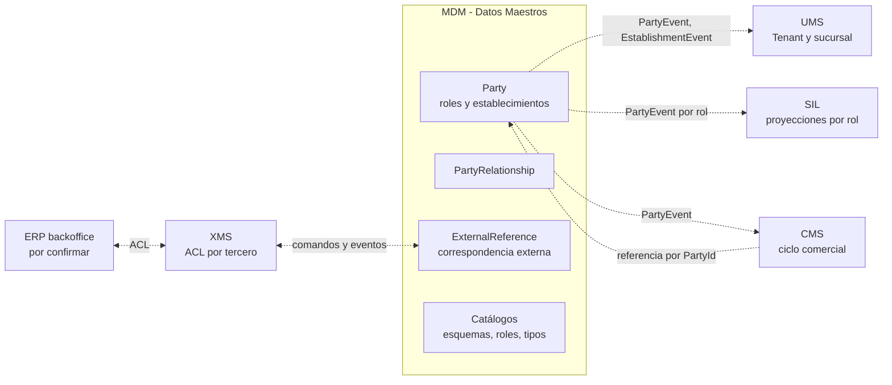
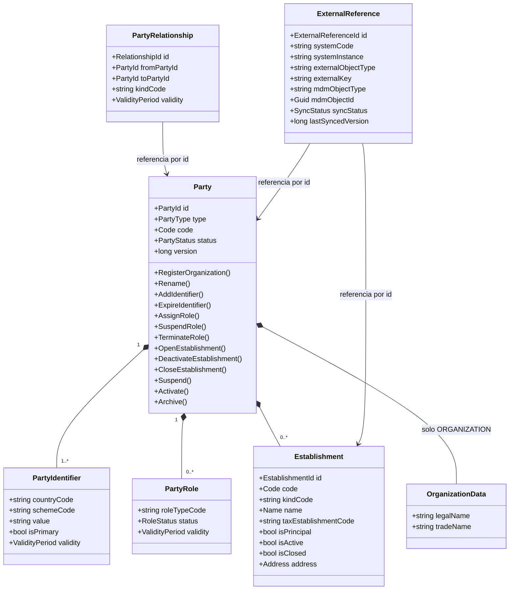
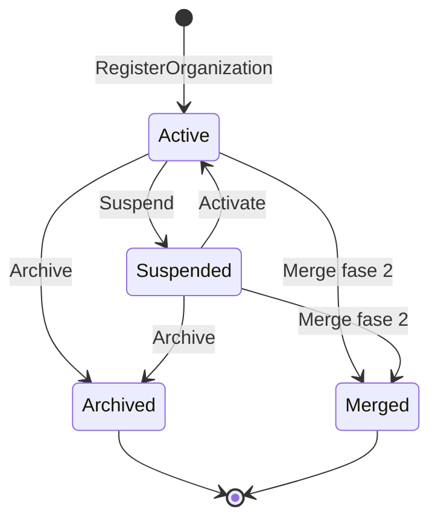
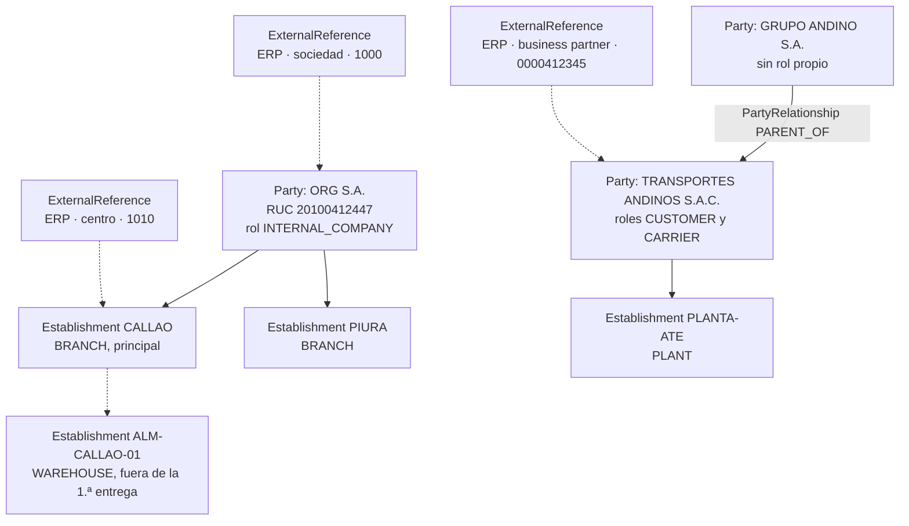

# Modelo de dominio — Party, establecimientos y estructura organizativa alineada al ERP en MDM

<p align="right">
  
  
  
</p>

> **Código:** `DOM-MDM-002`
> **Fase:** 2 — Diseño
> **Deriva de:** [PRD-MDM-001](../01-concepcion/prd-mdm-001.es.md), elaborado a posteriori como referencia de negocio de MDM
> **Sistema:** MDM (Datos Maestros), alojado provisionalmente en este satélite ([D-027](../../DECISIONS.md#decisiones-locales), [G-257](../../GAPS.md))
> **Estado:** Borrador. Es el **modelo base y oficial de MDM** que fija [D-043](../../DECISIONS.md#decisiones-locales), respaldado por [ADR-0264](https://github.com/organizacion-peru/organizacion-arch/blob/develop/reference/architecture/adrs/core/0264-el-maestro-de-partes-es-party-con-roles-y-sigue-los-dos-ejes-del-erp.es.md) y [ADR-0265](https://github.com/organizacion-peru/organizacion-arch/blob/develop/reference/architecture/adrs/core/0265-mdm-es-dueno-de-la-organizacion-y-ums-del-tenant.es.md), aceptados el 2026-10-24. No hay código del nuevo agregado: se construye cuando el satélite vincule la versión del estándar que los incluya ([G-552](../../GAPS.md), [G-554](../../GAPS.md)).
> **Sustituye como base a:** el agregado `Tenant`/`Branch` de [D-031](../../DECISIONS.md#decisiones-locales) (en revisión, [G-552](../../GAPS.md)). **Realinea a:** [DOM-MDM-001](./modelo-dominio-cliente-mdm-001.es.md), cuyo `Customer` pasa a ser el rol `CUSTOMER` de una Party.
> **Hub del área:** [MDM — Datos Maestros](./hub-mdm.es.md)

---

**Convención de idioma.** La prosa está en español (SD-08). Todo lo que es contrato o código va en inglés: agregados, entidades, objetos de valor, eventos, enumeraciones, campos JSON y tablas. El lenguaje ubicuo (§3.2) da el término inglés como canónico y el español de negocio como glosa.

**Evidencia y supuestos.** Lo que tiene evidencia lleva su enlace. Lo que es supuesto está en §13 con su gap (SD-05, SD-07). Donde dice «propuesta», nadie la ha aceptado todavía; lo único decidido es D-043.

## 1. Resumen ejecutivo

| Tema | Diseño |
| :--- | :--- |
| Idea central | MDM es dueño de **quién es quién** —personas y organizaciones— y de **dónde opera** —sus establecimientos—. No es dueño de quién entra a la suite (UMS) ni de la contabilidad (ERP) |
| Raíz del modelo | `Party`: persona u organización, con identificadores `(país, esquema, valor)` con vigencia |
| Roles | `PartyRole` con vigencia, no subtipo: `INTERNAL_COMPANY`, `CUSTOMER`, `SUPPLIER`, `CARRIER`, `CUSTOMS_AGENT`, `CONSIGNEE`… La misma empresa es cliente y proveedor **sin duplicarse** |
| Establecimientos | `Establishment` dentro de la Party: sede, planta y, documentado pero fuera de la primera entrega, almacén ([G-547](../../GAPS.md)) |
| Relaciones | `PartyRelationship`, agregado aparte con vigencia: matriz-filial, grupo económico, agente de |
| ERP y otros sistemas | Agregado aparte `ExternalReference`: `(sistema, instancia, tipo de objeto, clave)` → objeto de MDM. Ningún nombre del ERP entra al dominio |
| Estructura del ERP | Sociedad → Party con rol `INTERNAL_COMPANY`; centro o sede → `Establishment`; Business Partner → Party con su rol. Organización de ventas, centros de costo y beneficio **se quedan en el ERP** ([G-548](../../GAPS.md)) |
| Tenant y sucursal | Son de **UMS**: el Tenant es una extensión de identidad sobre una Party organización (mismo `Guid`); la sucursal es un ámbito de autorización que referencia un establecimiento (mismo `Guid`) |
| Catálogos | Esquemas de identificador, tipos de rol (con código UN/EDIFACT 3035), tipos de establecimiento y de relación: **dato, no código**. Los tipos de rol se administran desde MDM ([D-046](../../DECISIONS.md#decisiones-locales)) |
| Personas naturales | Previstas en el modelo y **bloqueadas** hasta resolver la Ley 29733 ([G-534](../../GAPS.md)) |

## 2. Por qué Party (D-043)

El ERP tiene **dos ejes** y MDM los sigue:

| Eje | En el ERP (ej. SAP S/4HANA) | En MDM |
| :--- | :--- | :--- |
| Terceros y entidades legales | Business Partner con roles (deudor, acreedor) | `Party` + `PartyRole` |
| Estructura empresarial propia | Sociedad → centro → almacén; áreas de ventas y compras; centros de costo y beneficio | Party con rol `INTERNAL_COMPANY` + `Establishment`; el resto se queda en el ERP |

Las equivalencias de SAP son **ilustrativas**: qué ERP es y cómo está configurado no está confirmado ([G-532](../../GAPS.md), [G-545](../../GAPS.md)). El modelo no depende de ellas: el ACL traduce cualquier ERP al modelo canónico.

Las razones de la decisión, en corto:

1. **Elimina el duplicado por construcción.** Un RUC que es cliente, proveedor y agente de aduanas es **una** Party con tres roles. Con agregados por rol el duplicado es inevitable: ya asomaba en el solape entre `OrganizationType = CLIENT` y `Customer` ([G-531](../../GAPS.md)).
2. **«Tenant» no es dato maestro.** Es seguridad: quién accede, con qué IdP, con qué aislamiento. [ADR-0071](https://github.com/organizacion-peru/organizacion_arch/blob/main/reference/architecture/adrs/core/0071-identidad-tenant-raiz-admin-root-tenant-owner.es.md) (`Aceptado`) lo deja en UMS, y por eso D-031 chocaba con él ([G-311](../../GAPS.md)).
3. **La sede es un establecimiento de una entidad legal.** Emite con un RUC concreto y tiene su código de establecimiento anexo ante SUNAT. Como ámbito de autorización ([ADR-0010](https://github.com/organizacion-peru/organizacion_arch/blob/main/reference/architecture/adrs/core/0010-estrategia-arquitectura-multitenant.es.md), `Aceptado`) sigue siendo de UMS.
4. **Es el momento barato.** Nada consume `mdm-api` ([G-312](../../GAPS.md)), no hay datos productivos y sus pruebas contra el motor no se han ejecutado ([G-328](../../GAPS.md)).

## 3. Contexto y lenguaje ubicuo

### 3.1 Diagrama de contexto



MDM es **upstream** y publica; UMS, SIL y CMS son **conformistas** que proyectan y referencian por identificador; el ERP queda detrás de un **ACL en XMS** ([ADR-0097](https://github.com/organizacion-peru/organizacion_arch/blob/main/reference/architecture/adrs/core/0097-integracion-entre-sistemas-suite-eventos-xms.es.md), `Aceptado`). Las flechas punteadas están **diferidas** hasta que exista el outbox ([G-312](../../GAPS.md), [G-535](../../GAPS.md)) y el contrato con UMS ([G-553](../../GAPS.md)).

### 3.2 Lenguaje ubicuo

| Término canónico | Glosa de negocio | Definición |
| :--- | :--- | :--- |
| `Party` | Parte | Persona u organización con identidad propia ante la ley o el comercio. Una sola vez en toda la suite |
| `PartyType` | Tipo de parte | `ORGANIZATION` o `PERSON`; inmutable |
| `PartyIdentifier` | Identificador | `(countryCode, schemeCode, value)` con vigencia: RUC, DNI, CE, pasaporte, RUT chileno, EORI… Uno primario vigente a la vez |
| `IdentifierScheme` | Esquema de identificador | Fila de catálogo: país, autoridad emisora, patrón, si es fiscal, código ISO 6523 si existe |
| `PartyRole` | Rol | Asignación con vigencia de un `PartyRoleType` a una Party |
| `PartyRoleType` | Tipo de rol | Fila de catálogo **administrable** ([D-046](../../DECISIONS.md#decisiones-locales)) con código canónico inmutable y no reutilizable, nombre, descripción, código UN/EDIFACT 3035 opcional (`BY`, `SU`, `CA`, `CN`, `CZ`…), tipos de parte admitidos y si exige identificador fiscal; se desactiva, no se borra |
| `INTERNAL_COMPANY` | Empresa del grupo | Rol de una entidad legal propia de Organización. En el ERP, una sociedad |
| `Establishment` | Establecimiento | Lugar donde opera **la misma** Party: sede, planta, almacén. Lleva su código SUNAT de establecimiento anexo si es peruano |
| `EstablishmentKind` | Tipo de establecimiento | Fila de catálogo: `HEAD_OFFICE`, `BRANCH`, `PLANT`, `WAREHOUSE`… |
| `PartyRelationship` | Relación | Vínculo con vigencia entre **dos Parties distintas**: matriz-filial, grupo económico, agente de |
| `ExternalReference` | Referencia externa | Correspondencia entre un objeto de MDM y su clave en un sistema externo |
| `Tenant` (UMS) | Inquilino | **No es de MDM.** Una Party organización a la que UMS da acceso a la suite |
| Sucursal (UMS, ADR-0010) | Sucursal | **No es de MDM.** Ámbito de autorización que referencia un `Establishment` |

## 4. Modelo de dominio

### 4.1 Agregados

| Agregado | Contiene | Por qué es un agregado aparte |
| :--- | :--- | :--- |
| `Party` | `PartyIdentifier` (1..N), `PartyRole` (0..N), `Establishment` (0..N), datos de organización o de persona | Sus invariantes cruzan esas partes: un solo identificador primario vigente, roles sin solape del mismo tipo, establecimiento principal único |
| `PartyRelationship` | Una relación entre dos Parties | Une dos agregados; meterla en uno haría que editar una relación bloquee a la otra Party ([ADR-0098](https://github.com/organizacion-peru/organizacion_arch/blob/main/reference/architecture/adrs/core/0098-comunicacion-entre-agregados-intra-servicio.es.md), `Aceptado`) |
| `ExternalReference` | Una correspondencia con su estado de sincronización | Cada acuse del ERP no debe subir la `Version` de la Party, que es su `ETag` y la `Sequence` de sus eventos ([G-551](../../GAPS.md)) |
| Catálogos | `IdentifierScheme`, `PartyRoleType`, `EstablishmentKind`, `RelationshipKind` | Datos de referencia con su propio ciclo; los usa todo el resto. `PartyRoleType` es administrable desde MDM ([D-046](../../DECISIONS.md#decisiones-locales)): cada tipo es su propio agregado con versión propia, y escribirlo no sube la versión de ninguna Party |



`PersonData` (nombres y apellidos) existe en el diseño de [DOM-MDM-001](./modelo-dominio-cliente-mdm-001.es.md) y **no se habilita** hasta cerrar [G-534](../../GAPS.md).

### 4.2 Datos del rol: lo mínimo

Un rol **no** es un saco de atributos libres: ese es el camino a un Party genérico que nadie entiende. La regla:

- El rol lleva **vigencia y estado**. Nada más, salvo atributos declarados en su `PartyRoleType` con dueño en MDM.
- Los datos **comerciales** del cliente o del proveedor (acuerdo, tarifario, crédito, condiciones de pago) son de **CMS** o del **ERP**, que referencian la Party por `PartyId`.
- Si un rol necesita reglas propias ricas, se modela como **agregado propio** que referencia la Party (`CustomerProfile`, por ejemplo), no como atributos del rol.

**El catálogo de tipos de rol es administrable ([D-046](../../DECISIONS.md#decisiones-locales)).** MDM da de alta, edita, desactiva y reactiva los `PartyRoleType`. El código es inmutable y no se reutiliza; un tipo desactivado no se asigna a roles nuevos y los roles existentes de ese tipo se conservan con su estado y su vigencia. La carga inicial suma los papeles logísticos que faltaban: consignatario (`CONSIGNEE`, `CN`), embarcador (`CONSIGNOR`, `CZ`), parte a notificar (`NOTIFY_PARTY`, `NI`), exportador (`EXPORTER`, `EX`), importador (`IMPORTER`, `IM`), depositario (`WAREHOUSE_KEEPER`, `WH`) y agente de carga internacional (`FREIGHT_FORWARDER`, `FW`); sus códigos UN/EDIFACT 3035 se verifican contra el directorio oficial antes de producción. Quién administra (analista y responsable de datos maestros) es un supuesto hasta que UMS conceda el permiso. El contrato está en [API-MDM-002 §3.6](../03-construccion/contrato-api-party-mdm-002.es.md#36-catálogo-de-tipos-de-rol-d-046).

### 4.3 Invariantes

| ID | Invariante | Dónde se hace cumplir |
| :--- | :--- | :--- |
| `INV-PTY-01` | `PartyType` no cambia nunca | Dominio (no hay verbo) |
| `INV-PTY-02` | `(countryCode, schemeCode, value)` identifica a una sola Party en toda la suite, **incluidas archivadas y fusionadas** | Índice único sobre `PartyIdentifiers` |
| `INV-PTY-03` | Una Party tiene exactamente un identificador primario vigente | Dominio e índice único filtrado |
| `INV-PTY-04` | El valor cumple el patrón de su esquema; para el RUC, además, el dígito verificador ([DOM-MDM-001 §3.3](./modelo-dominio-cliente-mdm-001.es.md#33-validación-de-taxidentifier)) | Dominio, con el esquema del catálogo |
| `INV-PTY-05` | Dos roles del mismo tipo de una Party no se solapan en vigencia | Dominio |
| `INV-PTY-06` | `INTERNAL_COMPANY` solo en Parties `ORGANIZATION` con un identificador fiscal vigente | Dominio |
| `INV-PTY-07` | `Code` de la Party es único, inmutable y no se reutiliza (regla de D-031 que se conserva) | Índice único sin filtro |
| `INV-PTY-08` | `Code` del establecimiento es único dentro de su Party, inmutable y no se reutiliza, ni tras cerrar | Índice único `(PartyId, Code)` sin filtro |
| `INV-PTY-09` | Como mucho un establecimiento principal activo por Party | Dominio e índice único filtrado |
| `INV-PTY-10` | Activo y cerrado son ejes independientes en el establecimiento: cerrado es terminal, inactivo es reversible (regla de `Branch` que se conserva) | Dominio |
| `INV-PTY-11` | Una Party `Archived` o `Merged` no se modifica ni se reactiva | Dominio |
| `INV-PTY-12` | Una relación no une una Party consigo misma, y no hay dos relaciones del mismo tipo y sentido con vigencias solapadas | Dominio e índice |
| `INV-PTY-13` | `(systemCode, systemInstance, externalObjectType, externalKey)` apunta a un solo objeto de MDM | Índice único sobre `ExternalReferences` |

### 4.4 Ciclo de vida



| Elemento | Estados | Nota |
| :--- | :--- | :--- |
| `Party` | `Active` ⇄ `Suspended`; `Archived` y `Merged` terminales | `Merged` espera el ADR de coincidencia y fusión ([G-537](../../GAPS.md)) |
| `PartyRole` | `Active` ⇄ `Suspended`; `Terminated` terminal | La vigencia manda sobre el estado: un rol vencido no es vigente aunque esté `Active` |
| `Establishment` | Activo/inactivo y abierto/cerrado, ejes independientes | Igual que `Branch` hoy |

## 5. La estructura organizativa interna alineada al ERP

### 5.1 Correspondencia

| Nivel del ERP (ej. SAP) | En MDM | Dueño propuesto | Nota |
| :--- | :--- | :--- | :--- |
| Mandante / instancia | `systemInstance` de `ExternalReference` | — | Las claves del ERP solo son únicas dentro de su mandante |
| Sociedad (`BUKRS`) | Party `ORGANIZATION` con rol `INTERNAL_COMPANY` | Por decidir ([G-546](../../GAPS.md)) | Una sociedad por RUC |
| Centro (`WERKS`) | `Establishment` de tipo `BRANCH` o `PLANT` | Por decidir ([G-546](../../GAPS.md)) | La relación sede ↔ centro (1:1, 1:N, N:1) no está medida ([G-545](../../GAPS.md)) |
| Almacén (`LGORT`) | `Establishment` de tipo `WAREHOUSE` o sublugar del centro | — | **Solo documentado**, fuera de la primera entrega ([G-547](../../GAPS.md)) |
| Business Partner | Party con su rol (`CUSTOMER`, `SUPPLIER`, `CARRIER`…) | MDM la identidad; ERP los datos contables | Matriz por atributo en [G-533](../../GAPS.md) |
| Organización de ventas, canal, sector; organización de compras | No se modelan | ERP | Sin consumidor en la suite |
| Área de control, centro de costo, centro de beneficio | No se modelan | ERP | Sin consumidor en la suite ([G-548](../../GAPS.md)) |

### 5.2 Ejemplo ilustrativo

Los datos son **de ejemplo**, salvo el RUC de Organización; la estructura real se confirma con TI ([G-545](../../GAPS.md)).



## 6. Relación con UMS: Tenant y sucursal

| Concepto | Dueño | Cómo se relaciona con MDM |
| :--- | :--- | :--- |
| Organización (nombre, identificadores, jerarquía) | **MDM** | Es la Party |
| Tenant (IdP, visible en el inicio de sesión, Tenant Raíz, parámetros) | **UMS** | Extensión sobre una Party `ORGANIZATION`, **con el mismo `Guid`**. UMS decide qué Parties son Tenant |
| Jerarquía entre Tenants (`ParentTenantId`) | **MDM** como dato | UMS la proyecta desde `PartyRelationship` `PARENT_OF` |
| Sucursal como ámbito de autorización (ADR-0010) | **UMS** | Referencia un `Establishment` **con el mismo `Guid`**; los permisos son de UMS |
| Tenant Raíz (ADR-0071 D1) | **UMS** | Es la extensión sobre la Party de Organización |

Usar el mismo `Guid` evita una tabla de correspondencia entre MDM y UMS y hace imposible el doble nacimiento que describía la propuesta de [G-311](../../GAPS.md). La carga inicial debe conservar los `Guid` y `Code` que UMS ya tiene ([G-313](../../GAPS.md)).

## 7. Eventos de dominio y contrato de integración

Eventos de dominio (cada uno lleva el identificador y la `Version` posterior al cambio): `PartyRegistered`, `PartyRenamed`, `PartyIdentifierAdded`, `PartyIdentifierExpired`, `PartyRoleAssigned`, `PartyRoleSuspended`, `PartyRoleTerminated`, `EstablishmentOpened`, `EstablishmentChanged`, `EstablishmentDeactivated`, `EstablishmentReactivated`, `EstablishmentClosed`, `PartySuspended`, `PartyActivated`, `PartyArchived`; `PartyRelationshipStarted` y `PartyRelationshipEnded` en su agregado.

**Contratos de integración candidatos**, por transferencia de estado como el `TenantEvent` actual: llevan el estado completo y el consumidor aplica solo secuencias estrictamente mayores.

| Contrato | Lleva | Lo consumen |
| :--- | :--- | :--- |
| `PartyEvent` | Party, identificador primario, roles vigentes | UMS (organizaciones), SIL (proyecciones `cliente`, `proveedor`), CMS, ERP por XMS |
| `EstablishmentEvent` | Establecimiento con su `PartyId` | UMS (sucursales), SIL (`deposito`, `ubicacion`, por decidir con [G-540](../../GAPS.md)) |
| `PartyRelationshipEvent` | Relación con su vigencia | UMS (jerarquía de Tenants) |

```json
{
  "eventId": "2a7d1c40-5b8e-4f3a-9c21-7e0f4b6d8a13",
  "eventType": "party.changed",
  "schemaVersion": 1,
  "source": "mdm",
  "occurredAt": "2026-10-24T15:02:11.400+00:00",
  "subject": "0b9c7e0e-2f4a-4c39-9a51-1f0d7a3e9c11",
  "sequence": 3,
  "data": {
    "type": "ORGANIZATION",
    "code": "ORG",
    "name": "ORG S.A.",
    "status": "Active",
    "primaryIdentifier": { "countryCode": "PE", "schemeCode": "PE-RUC", "value": "20100412447" },
    "roles": [ { "roleTypeCode": "INTERNAL_COMPANY", "validFrom": "1978-01-01", "validTo": null } ]
  }
}
```

El paso de `TenantEvent` a `PartyEvent` se acuerda con `organizacion-ums` antes de publicar nada ([G-553](../../GAPS.md)). El contrato vive con su emisor ([ADR-0097](https://github.com/organizacion-peru/organizacion_arch/blob/main/reference/architecture/adrs/core/0097-integracion-entre-sistemas-suite-eventos-xms.es.md) D6).

## 8. Frontera transaccional

- **Una transacción, una Party**, con sus identificadores, roles y establecimientos. Toda mutación sube su `Version`, que es el `ETag` y la `Sequence`.
- **Fuera:** las relaciones (su propio agregado), las referencias externas (su propio agregado) y toda proyección en otro sistema, que es consistencia eventual.
- **Tamaño.** Organización y sus clientes tienen pocos establecimientos; con almacenes podría crecer. El umbral de revisión de [G-550](../../GAPS.md) aplica ahora a la Party: si una supera unos 50 establecimientos, el establecimiento pasa a agregado propio.
- **Publicación** por outbox en la misma transacción, nunca escritura doble ([G-312](../../GAPS.md), [G-535](../../GAPS.md)).

## 9. Correspondencia con el ERP

- **El modelo no adopta el del ERP.** El ACL de XMS traduce en los dos sentidos: roles ↔ roles del Business Partner, esquemas ↔ tipos de documento, establecimientos ↔ centros. Si el ERP limita longitudes, trunca el ACL, nunca el maestro.
- **`ExternalReference` es agregado propio** (§4.1) con estado `Linked`, `PendingSync`, `SyncFailed` o `Unlinked` y la última `Version` confirmada. Sustituye al `CompanyReference` de texto de D-031 y al `erpReference` de DOM-MDM-001.
- **Quién origina, por nivel** (propuesta para [G-546](../../GAPS.md)):

| Nivel | Origen propuesto | Por qué |
| :--- | :--- | :--- |
| Sociedad y centro | **ERP** origina, MDM adopta | En un ERP nacen en su configuración; son pocos y cambian poco |
| Establecimiento operativo sin centro en el ERP | **MDM** | El ERP no lo necesita |
| Clientes, proveedores, transportistas | **MDM** origina la identidad; el ERP se vincula | Es lo que MDM existe para resolver |
| Datos contables del Business Partner | **ERP** | No son dato maestro de identidad |

- **Carga inicial:** primero el ERP siembra sociedades y centros; luego se concilia con las organizaciones y sedes de UMS conservando sus `Guid` y `Code` ([G-313](../../GAPS.md)).

## 10. Qué se adopta del MDM original

El MDM de `organizacion-scm` se borró de GitHub. Su diseño se adopta **como fuente**, sin copiar código, y **queda absorbido en este documento**, que es autosuficiente: el propietario decidió el 2026-10-24 no mantener el clon local como fuente ([G-549](../../GAPS.md), cerrado). Las rutas de abajo son la procedencia, no una dependencia. No se copia código porque ese código es PostgreSQL (`organizacion-scm#ADR-MMS-006`) y aquí el motor es SQL Server ([D-008](../../DECISIONS.md#decisiones-locales)).

| Se adopta | Fuente en el clon |
| :--- | :--- |
| Party y rol distintos; rol con vigencia | `organizacion-scm#ADR-MMS-017` (`reference/architecture/adrs/MMS-017-modelo-party-y-roles.md`), D2 |
| Clave `(país, esquema, valor)` | Mismo ADR, D3 |
| Ningún nombre de proveedor; correspondencia como colección de datos | Mismo ADR, D4 (aquí, agregado aparte) |
| Catálogos como dato y códigos UN/EDIFACT 3035 | Mismo ADR, D5 y D6 |
| Establecimiento distinto de relación | Mismo ADR, D7 |
| Supervivencia por campo y por sistema | Mismo ADR, D8 (pendiente con [G-533](../../GAPS.md)) |
| Más adelante: geografía de niveles independiente del país, _golden record_ con linaje | `organizacion-scm#ADR-MMS-008`, `organizacion-scm#ADR-MMS-010` y `organizacion-scm#ADR-MMS-004` |

**No se adopta:** la plataforma genérica de registros con atributos en diccionario (`MasterDataRecord`), por complejidad sin consumidor, ni el código.

**Lo que el original dejó sin decidir y aquí se decide:** su punto D-4, si Party y la organización son el mismo agregado. Respuesta: **no**; la organización es la Party, el Tenant es de UMS (§6).

## 11. Qué cambia en lo construido

| Pieza de `mdm-api` (D-031) | Qué pasa |
| :--- | :--- |
| Kernel (`Code`, `Name`, `Result`, guardas, auditoría), Clean Architecture, Minimal API, Problem Details, JWT | **Se conserva** |
| `If-Match` sobre versión entera, `ETag` = `Sequence`, borrado lógico, `Code` no reutilizable | **Se conserva** como regla |
| Agregado `Tenant` (`OrganizationType`, `ParentTenantId`, `CompanyReference`) | **Se rehace** como `Party` + `PartyRelationship` + `ExternalReference` |
| Entidad `Branch` y su bitácora | **Se rehace** como `Establishment`; la bitácora se conserva |
| Especificación técnica, contrato de la API, ADR-MDM-001, migración `InitialCreate` | **En revisión** ([G-552](../../GAPS.md)) |
| Atributos de identidad en UMS ([G-317](../../GAPS.md)) | Sin cambio: siguen en UMS |

## 12. Trazabilidad a ADR

Solo `Aceptado` vincula (SD-03).

| ADR | Estado | Qué sostiene aquí |
| :--- | :--- | :--- |
| [ADR-0071](https://github.com/organizacion-peru/organizacion_arch/blob/main/reference/architecture/adrs/core/0071-identidad-tenant-raiz-admin-root-tenant-owner.es.md) | `Aceptado` | El Tenant y el Tenant Raíz son de UMS |
| [ADR-0010](https://github.com/organizacion-peru/organizacion_arch/blob/main/reference/architecture/adrs/core/0010-estrategia-arquitectura-multitenant.es.md) | `Aceptado` | La sucursal es dimensión de negocio y de autorización |
| [ADR-0097](https://github.com/organizacion-peru/organizacion_arch/blob/main/reference/architecture/adrs/core/0097-integracion-entre-sistemas-suite-eventos-xms.es.md) | `Aceptado` | ACL en XMS; el contrato es del emisor |
| [ADR-0098](https://github.com/organizacion-peru/organizacion_arch/blob/main/reference/architecture/adrs/core/0098-comunicacion-entre-agregados-intra-servicio.es.md) | `Aceptado` | Una transacción, un agregado; referencias por identificador |
| [ADR-0041](https://github.com/organizacion-peru/organizacion_arch/blob/main/reference/architecture/adrs/dotnet/0041-arquitectura-backend-canonica-dotnet.es.md) · [ADR-0051](https://github.com/organizacion-peru/organizacion_arch/blob/main/reference/architecture/adrs/core/0051-estrategia-motor-base-datos-empresarial.es.md) | `Aceptado` | Backend .NET y SQL Server |
| [ADR-0193](https://github.com/organizacion-peru/organizacion_arch/blob/main/reference/architecture/adrs/core/0193-el-dato-personal-no-llega-al-log.es.md) | `Aceptado` | El dato personal no llega al log |
| [ADR-MDM-001](../../reference/architecture/adrs/MDM-001-nomenclatura-y-conceptos-no-portables-de-mdm.es.md) | `Borrador` (local) | Convenciones físicas; en revisión |
| [ADR-0164](https://github.com/organizacion-peru/organizacion_arch/blob/main/reference/architecture/adrs/core/0164-el-borrado-es-logico-y-la-clave-natural-no-se-reutiliza.es.md) · [ADR-0225](https://github.com/organizacion-peru/organizacion_arch/blob/main/reference/architecture/adrs/core/0225-el-sistema-de-data-maestra-se-llama-mdm.es.md) | `Borrador` | No vinculan |

**ADR del núcleo que respaldan este modelo**, aceptados el 2026-10-24 desde las propuestas redactadas aquí:

| ADR | Propuesta de origen | Gap |
| :--- | :--- | :--- |
| [ADR-0264](https://github.com/organizacion-peru/organizacion-arch/blob/develop/reference/architecture/adrs/core/0264-el-maestro-de-partes-es-party-con-roles-y-sigue-los-dos-ejes-del-erp.es.md): el maestro de partes es Party y sigue los dos ejes del ERP | [borrador](../../reference/architecture/propuestas-upstream/adr-modelo-party-y-estructura-organizativa.es.md) | [G-554](../../GAPS.md) |
| [ADR-0265](https://github.com/organizacion-peru/organizacion-arch/blob/develop/reference/architecture/adrs/core/0265-mdm-es-dueno-de-la-organizacion-y-ums-del-tenant.es.md): MDM dueño de la organización y sus establecimientos; UMS del Tenant | [borrador](../../reference/architecture/propuestas-upstream/adr-mdm-dueno-maestro-organizacion-sede.es.md) | [G-311](../../GAPS.md) |

## 13. Supuestos y decisiones pendientes

| # | Supuesto o pendiente | Gap |
| :--- | :--- | :--- |
| S1 | Qué ERP es, su estructura real y la relación sede ↔ centro | [G-532](../../GAPS.md), [G-545](../../GAPS.md) |
| S2 | Quién origina cada nivel (propuesta en §9) | [G-546](../../GAPS.md) |
| S3 | Matriz de dueño por atributo y supervivencia | [G-533](../../GAPS.md) |
| S4 | Personas naturales y Ley 29733 | [G-534](../../GAPS.md) |
| S5 | Almacén fuera de la primera entrega | [G-547](../../GAPS.md) |
| S6 | Centros de costo y beneficio fuera del modelo | [G-548](../../GAPS.md) |
| S7 | Contrato con UMS (`PartyEvent`, `EstablishmentEvent`) | [G-553](../../GAPS.md) |
| S8 | Quién administra los catálogos y su carga inicial; para los tipos de rol, MDM con analista y responsable como supuesto ([D-046](../../DECISIONS.md#decisiones-locales)) | [G-555](../../GAPS.md), [G-560](../../GAPS.md) |
| S9 | Coincidencia y fusión de duplicados | [G-537](../../GAPS.md) |
| S10 | Autorización por organización y establecimiento en `mdm-api` | [G-314](../../GAPS.md), [G-536](../../GAPS.md) |
| S11 | Sin historia funcional de MDM; el PRD es [PRD-MDM-001](../01-concepcion/prd-mdm-001.es.md) (2026-10-24) | [G-323](../../GAPS.md) |

## 14. Historial de cambios (bitácora)

| Versión | Fecha | Autor | Cambios |
| :--- | :--- | :--- | :--- |
| 0.1.2 | 2026-10-24 | Agente `organizacion-dev-frontend` | `PartyRoleType` pasa a ser administrable desde MDM ([D-046](../../DECISIONS.md#decisiones-locales)): §1, §3.2, §4.1 y §4.2 con el código inmutable y no reutilizable, la desactivación que conserva los roles existentes, la versión propia por tipo y la carga inicial de papeles logísticos; S8 acotado |
| 0.1.1 | 2026-10-24 | aarroyo, con el agente `organizacion-architect` | Respaldado por ADR-0264 y ADR-0265 (aceptados); el diseño del MDM original queda absorbido aquí y el clon deja de ser fuente (G-549 cerrado) |
| 0.1.0 | 2026-10-24 | aarroyo, con el agente `organizacion-architect` | Versión inicial en `Borrador` tras [D-043](../../DECISIONS.md#decisiones-locales): Party con roles, establecimientos y relaciones; correspondencia externa en agregado aparte; estructura organizativa alineada a los dos ejes del ERP; Tenant y sucursal en UMS con el mismo `Guid`; qué se adopta del MDM original y qué cambia en `mdm-api` |

---

<p align="center">
  <strong>© Organización S.A.</strong> · RUC 20100412447 · Operador Logístico Aduanero desde 1978
</p>
