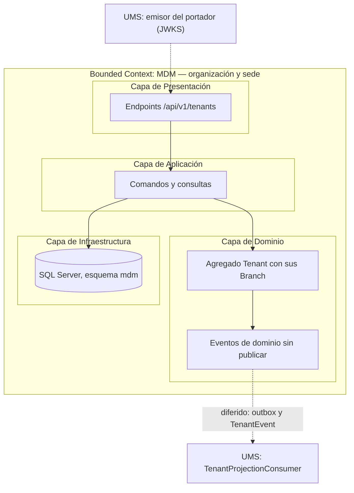
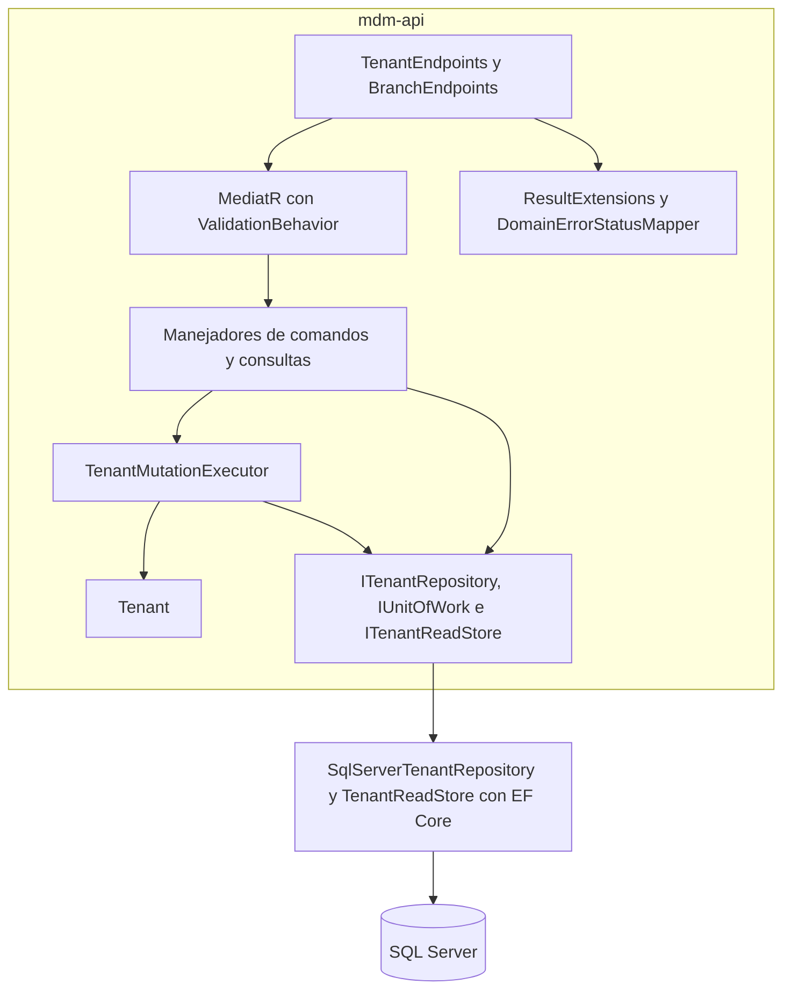
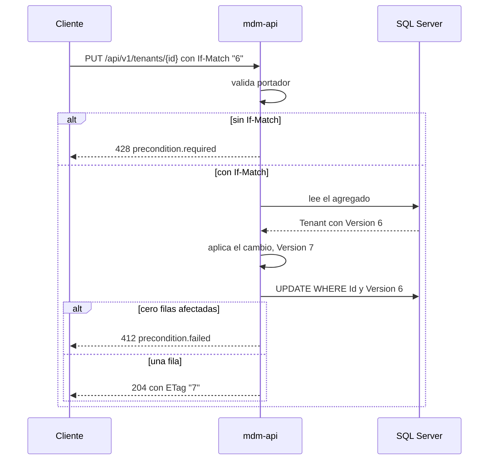
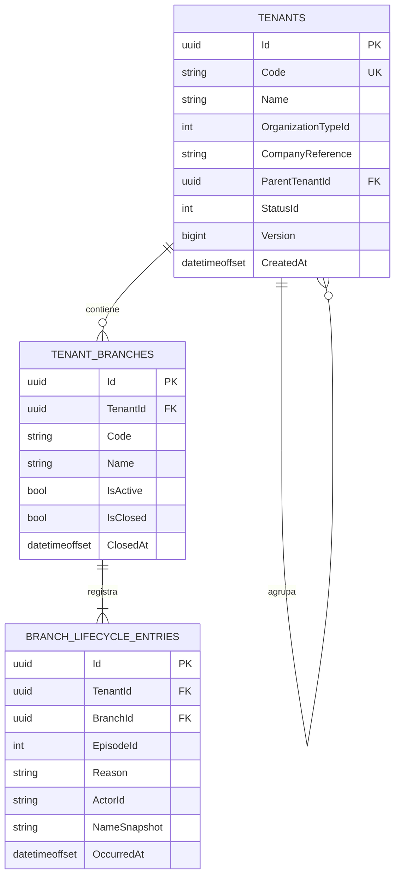
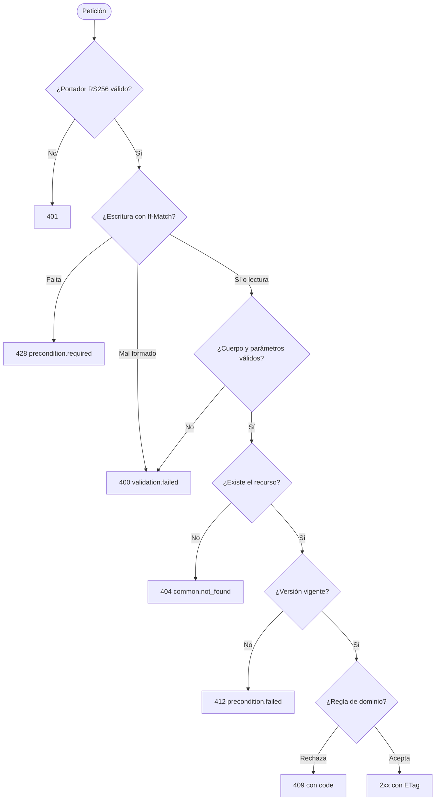
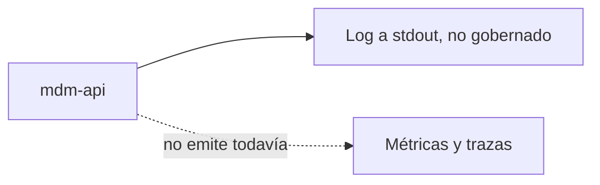
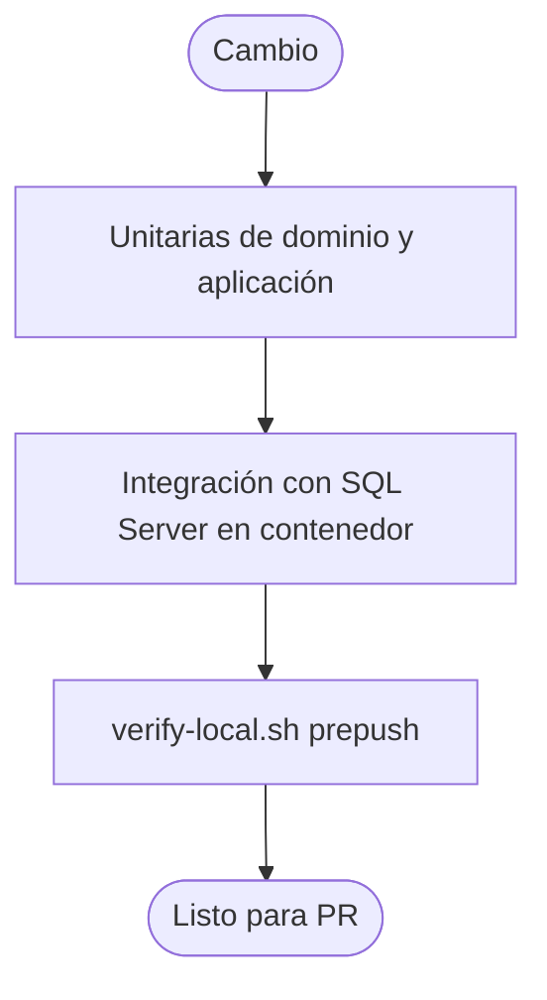
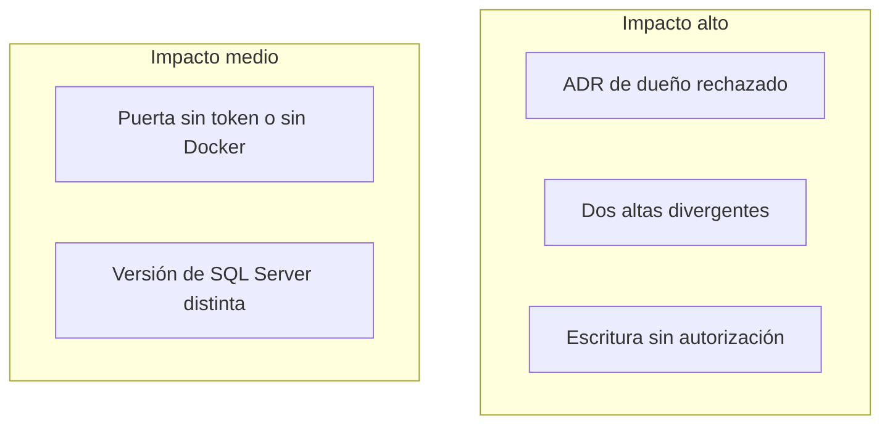
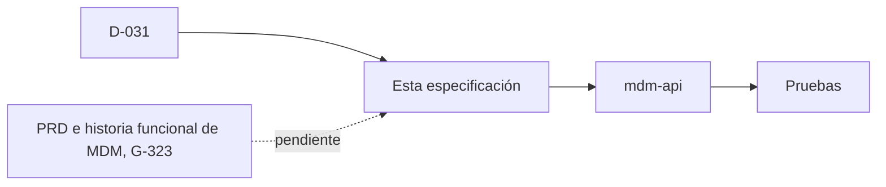

# Especificación técnica — CRUD del maestro de organización y sede en `mdm-api`

  
  
  

> **Fase:** 3 — Construcción
> **Deriva de:** [PRD-MDM-001](../01-concepcion/prd-mdm-001.es.md), elaborado a posteriori como referencia de negocio de MDM
> **Estructura:** la de la plantilla canónica `plantilla-historia-tecnica` (S-01, S-39)
> **Estado:** Borrador **en revisión por [D-043](../../DECISIONS.md#decisiones-locales)**: el modelo base de MDM pasa a ser Party con roles y establecimientos ([DOM-MDM-002](../02-diseno/modelo-dominio-organizacion-erp-mdm-002.es.md)). Lo que este documento describe es el código construido bajo D-031; se rehará sobre Party cuando exista el ADR aceptado ([G-552](../../GAPS.md)). Hub del área: [MDM — Datos Maestros](../02-diseno/hub-mdm.es.md)

---

**Por qué no es todavía una historia técnica.** La plantilla canónica dice que una historia técnica no se redacta sin una historia funcional aprobada, y la cadena PRD → FS → US → TS ([ADR-0178](https://github.com/organizacion-peru/organizacion_arch/blob/main/reference/architecture/adrs/core/0178-el-contrato-de-metadato-de-la-cadena-y-su-ejecutor.es.md)) exige que derive de una. MDM no tiene en este repositorio PRD, historia funcional ni modelo de datos ([G-323](../../GAPS.md)). Este documento sigue las quince secciones de la plantilla para que pasar a historia técnica sea renombrarlo y declarar su origen, pero no reclama esa identidad: hacerlo con un origen inventado sería afirmar una trazabilidad que no existe (SD-05).

## 1. Metadatos

- **Título:** CRUD del maestro de organización (Tenant) y sede (Branch) en `mdm-api`
- **Historia Funcional Origen:** no existe ([G-323](../../GAPS.md))
- **PRD Origen:** [PRD-MDM-001](../01-concepcion/prd-mdm-001.es.md), elaborado a posteriori el 2026-10-24; sigue faltando la historia funcional ([G-323](../../GAPS.md))
- **Decisión que lo autoriza:** [D-031](../../DECISIONS.md#decisiones-locales), que enmienda [D-027](../../DECISIONS.md#decisiones-locales) solo para Tenant y Branch
- **Versión:** 0.2.0
- **Estado:** Borrador
- **Autor:** Arquitectura MDM (aarroyo)
- **Producto:** MDM — Master Data Management, alojado provisionalmente en `organizacion-unilog` ([G-257](../../GAPS.md))
- **Bounded Context:** MDM — maestro de organización y sede
- **Capa Arquitectónica:** Dominio, Aplicación, Infraestructura y Presentación

## 2. Resumen Técnico

Se construye en `src/apps/mdm-api` el CRUD del **maestro** de organización y sede de la suite, replicando el modelo de `organizacion-ums/src/apps/ums.api` sin sus atributos de identidad. Tenant es la raíz del agregado y Branch vive dentro de él, con su bitácora append-only. La API es Minimal API con `MapGroup` sobre `/api/v1`, con concurrencia optimista por `If-Match` y errores como Problem Details con `code` ([contrato de la API](./contrato-api-organizacion-sede-mdm-001.es.md)). La persistencia es SQL Server con EF Core en el esquema `mdm` ([ADR-MDM-001](../../reference/architecture/adrs/MDM-001-nomenclatura-y-conceptos-no-portables-de-mdm.es.md)). Los eventos de dominio se levantan pero **no se publican**: el diseño deja la versión del agregado lista para ser la `Sequence` del `TenantEvent` que UMS ya sabe consumir, y la publicación queda en [G-312](../../GAPS.md). Es el enfoque más simple que cumple D-031: un solo agregado, una sola versión y ninguna dependencia nueva en ejecución.

### 2.1 Alcance

| Se construye | Se queda en UMS | Diferido |
| :--- | :--- | :--- |
| Tenant: `Code` inmutable, normalizado y único incluido el archivado; `Name`; `OrganizationType`; `CompanyReference`; `ParentTenantId` inmutable; `Status` `Active`/`Suspended`/`Archived`; auditoría | `IdpStrategy`, `ShowOnLogin`, `IsManagementOwner`, `DefaultSystemSuiteId`, proveedores de identidad, parámetros del inquilino ([G-317](../../GAPS.md)) | Outbox y `TenantEvent` ([G-312](../../GAPS.md)); carga inicial ([G-313](../../GAPS.md)); autorización por permiso ([G-314](../../GAPS.md)) |
| Branch: `Code` único por organización incluido el cerrado; `Name`; `IsActive` reversible; `IsClosed` terminal con `ClosedAt` y `ClosedBy` | — | Reglas de cierre que dependen de usuarios y perfiles de UMS ([G-316](../../GAPS.md)); geofencing ([G-326](../../GAPS.md)) |
| `BranchLifecycleEntry` append-only; eventos de dominio sin publicar; errores de dominio como `string` | — | Endpoint de bitácora ([G-325](../../GAPS.md)); OpenAPI ([G-258](../../GAPS.md)) |

## 3. Diagrama de Arquitectura

## 4. Diagrama de Componentes

## 5. Componentes Afectados

| Componente | Tipo | Cambio |
| --- | --- | --- |
| `src/NuGet.Config` y `src/Directory.Packages.props` | Nuevo / Modificado | Feed de `organizacion-peru` con `packageSourceMapping` para `Unimar.Shells.Net.Ddd` 1.0.0, token fuera del repositorio (S-43, [G-319](../../GAPS.md)); MediatR 12.4.1 (última Apache 2.0), FluentValidation 12.0.0 y EF Core 10.0.7 bajo Central Package Management |
| `Mdm.Domain/Organization/Tenant/**` | Nuevo | Agregado, `Props` con `WithX`, eventos de dominio, errores de dominio ([G-318](../../GAPS.md)) |
| `Mdm.Application/**` | Nuevo | Comandos, consultas, `ValidationBehavior`, `TenantMutationExecutor` y los puertos `IUnitOfWork` e `ITenantReadStore` |
| `Mdm.Infrastructure/Persistence/**` | Nuevo | `DbContext`, configuración de entidades, repositorio con unidad de trabajo, almacén de lectura y `MdmDatabaseMigrator` |
| `Mdm.Infrastructure.Migrations.SqlServer` | Nuevo | Proyecto aparte con la migración `InitialCreate` ([ADR-0229](https://github.com/organizacion-peru/organizacion_arch/blob/main/reference/architecture/adrs/core/0229-modelo-datos-logico-fisico-fase-diseno.es.md) §3.6) |
| `Mdm.Presentation` | Modificado | Endpoints de organización y sede, `DomainErrorStatusMapper`, `ETags`, autenticación JWT en `Security/` y `Program.cs` |
| `Mdm.*.Test` y `Mdm.Presentation.IntegrationTest` | Nuevo / Modificado | Pruebas unitarias e integración con `Testcontainers.MsSql` y un emisor JWT de prueba |

### 5.1 Decisiones de construcción

- **Firmas con _records_.** Los verbos del agregado reciben `NewTenant`, `TenantGeneralData`, `BranchRegistration` y `BranchChange` en vez de listas largas de parámetros (regla S107 de SonarAnalyzer, [D-005](../../DECISIONS.md#decisiones-locales)).
- **Rehidratación sin reflexión.** `Tenant.Load(TenantSnapshot)` reconstruye el agregado desde primitivos que arma la infraestructura; no emite eventos ni anota bitácora.
- **Versión.** `Tenant.Version` es `long` y **oculta** (`new`) el `int Version` de `Unimar.Shells.Net.Ddd`, porque la columna es `bigint` ([ADR-MDM-001](../../reference/architecture/adrs/MDM-001-nomenclatura-y-conceptos-no-portables-de-mdm.es.md#d4) D4); la heredada no se usa ([G-318](../../GAPS.md)). `PersistedVersion` guarda la versión con que se leyó el agregado: el repositorio la fija como valor original del token, de modo que `UPDATE … WHERE Version = PersistedVersion` da cero filas si otro proceso avanzó la fila entre la lectura y el guardado.
- **`Result.Error` es un código estable.** Todo fallo de dominio y de aplicación es una cadena como `tenant.archived`; la presentación la traduce con una tabla explícita (`DomainErrorStatusMapper`) y jamás interpreta el texto. Un código sin correspondencia responde `500` `server.unexpected_error` y se registra.
- **Política de estado de la organización sobre sus sedes.** Dar de alta o reactivar una sede exige la organización `Active`; modificarla, que no esté archivada; desactivar y cerrar se admiten siempre ([contrato](./contrato-api-organizacion-sede-mdm-001.es.md#4-transiciones-y-su-código) §4).
- **`TenantMutationExecutor`.** Secuencia común de todo comando que modifica el agregado: actor del portador → carga → comparación con la versión esperada (`If-Match`) → verbo de dominio → `UpdateAsync` → `IUnitOfWork`, que traduce `ConcurrencyConflictException` y `DuplicateKeyConflictException` a su código. Devuelve la nueva versión.
- **CQRS ligero.** Las escrituras pasan por el agregado y `ITenantRepository`; las lecturas, por `ITenantReadStore`, que proyecta desde las tablas sin rastreo ni agregados. Repositorio y unidad de trabajo son la misma instancia por alcance.
- **Sin reloj inyectable.** El dominio usa `TimeProvider.System`; el `AuditValueObject` de Shells usa `DateTime.UtcNow` ([G-318](../../GAPS.md)).
- **`ConfigureAwait(false)`** en los manejadores y el repositorio; es una observación de estilo, no un hallazgo.
- **Migraciones explícitas.** Nada en el arranque las aplica; `MdmDatabaseMigrator` lo hace cuando lo invoca quien despliega o una prueba ([ADR-0229](https://github.com/organizacion-peru/organizacion_arch/blob/main/reference/architecture/adrs/core/0229-modelo-datos-logico-fisico-fase-diseno.es.md) §3.6; el mecanismo de despliegue es [G-322](../../GAPS.md)).

## 6. Contratos de API

El contrato completo —catorce endpoints, reglas de `ETag`, `If-Match` y `If-None-Match`, paginación y catálogo de `code`— está en el [contrato de la API](./contrato-api-organizacion-sede-mdm-001.es.md).

### 6.1 Puntos de Conexión Nuevos

| Método | Ruta | Propósito | Autenticación |
| --- | --- | --- | --- |
| `GET` | `/api/v1/tenants` | Lista paginada | JWT RS256 |
| `GET` · `POST` | `/api/v1/tenants/{id}` · `/api/v1/tenants` | Consulta y alta | JWT RS256 |
| `PUT` · `POST …/suspend` · `POST …/activate` · `DELETE` | `/api/v1/tenants/{id}` | Modificar, suspender, reactivar, archivar | JWT RS256 |
| `GET` · `POST` | `/api/v1/tenants/{id}/branches` | Listado y alta de sedes | JWT RS256 |
| `GET` · `PUT` · `POST …/deactivate` · `POST …/reactivate` · `DELETE` | `/api/v1/tenants/{id}/branches/{branchId}` | Consultar, modificar, desactivar, reactivar, cerrar | JWT RS256 |

### 6.2 Diagrama de Secuencia de la API

### 6.3 Contratos OpenAPI (Extracto)

No hay documento OpenAPI generado ([G-258](../../GAPS.md)). Hasta que lo haya, la fuente es el [contrato de la API](./contrato-api-organizacion-sede-mdm-001.es.md).

## 7. Modelo de Datos

### 7.1 Entidades y Objetos de Valor

| Elemento | Tipo | Cardinalidad | Persistencia |
| --- | --- | --- | --- |
| `Tenant` | Aggregate Root | 1 | `mdm.Tenants` |
| `Branch` | Entity | 0..N por Tenant | `mdm.TenantBranches` |
| `BranchLifecycleEntry` | Entity append-only | 1..N por Branch | `mdm.BranchLifecycleEntries` |
| `Code`, `Name`, `CompanyReference` | Value Object | 1 | Columnas |
| `TenantStatus`, `OrganizationType` | Enumeración de dominio | 1 | Columnas `int` (`StatusId`, `OrganizationTypeId`) con restricción `CK_` |

### 7.2 Diagrama de Entidades

Los nombres físicos son `Tenants`, `TenantBranches` y `BranchLifecycleEntries` ([ADR-MDM-001](../../reference/architecture/adrs/MDM-001-nomenclatura-y-conceptos-no-portables-de-mdm.es.md#d1) D1); el diagrama usa mayúsculas con guion bajo porque Mermaid no distingue mayúsculas en las entidades. La unicidad de `(TenantId, Code)` en `TenantBranches` no lleva filtro; la de `CompanyReference` en `Tenants` sí ([D5](../../reference/architecture/adrs/MDM-001-nomenclatura-y-conceptos-no-portables-de-mdm.es.md#d5)). Índices, restricciones `CK_`, claves foráneas `NO ACTION` e intercalación por columna: [D1](../../reference/architecture/adrs/MDM-001-nomenclatura-y-conceptos-no-portables-de-mdm.es.md#d1).

### 7.3 Cambios de Esquema

- **Migración:** `InitialCreate`, en `Mdm.Infrastructure.Migrations.SqlServer`.
- **Rollback:** reversible mientras no haya datos: la migración crea el esquema `mdm` y sus tablas y nada más. Con datos, no se revierte: se corrige con una migración nueva. Para `dotnet ef` contra una base real, la cadena va en la variable `MDM_MIGRATIONS_CONNECTION` (nunca en el repositorio, S-43).
- **Datos a migrar:** ninguno en esta entrega. La carga inicial desde UMS es [G-313](../../GAPS.md); cómo se aplican las migraciones en cada despliegue, [G-322](../../GAPS.md); la versión e instancia de SQL Server, [G-321](../../GAPS.md).

## 8. Seguridad

### 8.1 Medidas de Seguridad

- **Autenticación:** JwtBearer RS256 contra el JWKS de UMS ([ADR-0157](https://github.com/organizacion-peru/organizacion_arch/blob/main/reference/architecture/adrs/core/0157-firma-asimetrica-portador-ums-jwks.es.md), [ADR-0230](https://github.com/organizacion-peru/organizacion_arch/blob/main/reference/architecture/adrs/core/0230-sesion-por-portador-carril-satelite-ums.es.md)), con lista blanca de un solo algoritmo, emisor y audiencia validados y la clave elegida por `kid`. El JWKS se cachea 60 minutos y se recarga como mucho cada 5 si llega un `kid` desconocido (ADR-0157 §4.4); fuera de Development exige HTTPS. Política por defecto «autenticado» (`FallbackPolicy`); `/health` anónimo. La configuración va en `Authentication:*` y no contiene secretos. El emisor, la audiencia y la URL del JWKS del despliegue están por confirmar ([G-315](../../GAPS.md)).
- **Autorización:** ninguna más allá de estar autenticado ([G-314](../../GAPS.md)). Es un riesgo aceptado mientras `mdm-api` no esté desplegado con datos reales.
- **Validación de entrada:** FluentValidation en la aplicación y reglas del agregado en el dominio; las longitudes y los campos obligatorios, en el [contrato](./contrato-api-organizacion-sede-mdm-001.es.md#2-recursos).
- **Datos sensibles:** el maestro no guarda datos personales; el actor de auditoría es el `sub` del portador, que no se escribe en el log (S-34).

### 8.2 Cumplimiento

- **Estándares:** RFC 9457 para los errores; RFC 9110 para `ETag`, `If-Match` y `412`; RFC 6585 para `428`.
- **Auditoría:** columnas de auditoría en el agregado y bitácora append-only de la sede ([ADR-MDM-001](../../reference/architecture/adrs/MDM-001-nomenclatura-y-conceptos-no-portables-de-mdm.es.md#d6) D6). No es todavía la pista de auditoría de [ADR-0016](https://github.com/organizacion-peru/organizacion_arch/blob/main/reference/architecture/adrs/core/0016-pista-auditoria-inmutable-negocio.es.md): `pista_auditoria` sigue declarada `no-emite` en [DECISIONS.md](../../DECISIONS.md#retención-y-protección-de-las-señales-de-observabilidad).

### 8.3 Diagrama de Flujo de Seguridad

## 9. Observabilidad

- **Logs estructurados:** el logging por defecto de ASP.NET Core a stdout, ya declarado `no-gobernada` en [DECISIONS.md](../../DECISIONS.md#retención-y-protección-de-las-señales-de-observabilidad) ([G-004](../../GAPS.md)). Se registra el `code` de cada rechazo, nunca el cuerpo de la petición.
- **Métricas:** no se emiten en esta entrega.
- **Trazas:** no se emiten en esta entrega.
- **Alertas:** ninguna mientras no haya despliegue.

### 9.1 Diagrama de Trazabilidad

## 10. Pruebas

| Tipo | Cobertura mínima | Responsable |
| --- | --- | --- |
| Unitarias de dominio | Invariantes: código único incluido cerrado y archivado, transiciones de estado, cierre terminal, `Version` sube en cada escritura (`Mdm.Domain.Test`, suelo 62) | Construcción MDM |
| Unitarias de aplicación | Validación y manejadores; ≥ 80 % de líneas en Domain y Application, con la puerta de `scripts/verify-local.sh` (`Mdm.Application.Test`, suelo 159; cobertura medida 96,9 %, [G-333](../../GAPS.md)) | Construcción MDM |
| Infraestructura sin motor | Arquitectura y persistencia sin motor (`Mdm.Infrastructure.Test`, suelo 21) | Construcción MDM |
| Integración | Con SQL Server en contenedor: 21 pruebas de `Infrastructure.IntegrationTest` (migración sobre contenedor vacío, repositorio, lectura) y 52 E2E de `Presentation.IntegrationTest` (cada fila del [contrato](./contrato-api-organizacion-sede-mdm-001.es.md#3-endpoints) con su código; `401`, `409`, `412` y `428`) ([ADR-0053](https://github.com/organizacion-peru/organizacion_arch/blob/main/reference/architecture/adrs/core/0053-estrategia-pruebas-integracion-e2e.es.md)). **Estas 73 pruebas no se han ejecutado nunca** porque Docker no arrancó ([G-328](../../GAPS.md)); el resto de `Presentation.IntegrationTest` corre en proceso con dobles de prueba (almacén de lectura falso y emisor JWT de prueba). Exige Docker ([G-320](../../GAPS.md)) | Validación MDM |
| Contrato | Lo cubren las pruebas de integración mientras no haya OpenAPI ([G-258](../../GAPS.md)) | Validación MDM |
| E2E | No aplica: no hay interfaz | — |
| Seguridad | gitleaks y auditoría de dependencias de la puerta local ([D-006](../../DECISIONS.md#decisiones-locales)) | Construcción MDM |
| Performance | No aplica en esta entrega ([G-327](../../GAPS.md)) | — |

### 10.1 Diagrama de Estrategia de Pruebas

## 11. Riesgos Técnicos

| Riesgo | Probabilidad | Impacto | Mitigación |
| --- | --- | --- | --- |
| El ADR de dueño del maestro se rechaza y el CRUD debe volver a UMS | Media | Alto | D-031 condicionada a [G-311](../../GAPS.md); código aislado en `mdm-api`, sin dependencias desde SIL |
| Dos altas de organización (UMS y MDM) divergen antes de sincronizar | Alta | Alto | Sin despliegue con datos reales hasta [G-313](../../GAPS.md) |
| Cualquier portador válido escribe en el maestro | Alta | Alto | Sin despliegue hasta [G-314](../../GAPS.md) |
| La puerta local falla sin token del feed o sin Docker | Media | Medio | [G-319](../../GAPS.md), [G-320](../../GAPS.md) |
| Probar con SQL Server 2022 y desplegar con otra versión | Media | Medio | [G-320](../../GAPS.md), [G-321](../../GAPS.md) |
| El esquema, el rastreo de `UpdateAsync` y la traducción de errores 2601/2627 nunca se probaron contra un motor | Media | Alto | [G-328](../../GAPS.md); la puerta con Docker apagado solo verifica compilación y descubrimiento ([G-329](../../GAPS.md)) |

### 11.1 Diagrama de Matriz de Riesgos

## 12. ADRs Aplicables

| ADR | Tema | Relevancia para esta especificación |
| --- | --- | --- |
| [ADR-0041](https://github.com/organizacion-peru/organizacion_arch/blob/main/reference/architecture/adrs/dotnet/0041-arquitectura-backend-canonica-dotnet.es.md) | Backend .NET canónico | Clean Architecture, Minimal API, EF Core, FluentValidation y `Result` |
| [ADR-0053](https://github.com/organizacion-peru/organizacion_arch/blob/main/reference/architecture/adrs/core/0053-estrategia-pruebas-integracion-e2e.es.md) | Pruebas de integración y E2E | `WebApplicationFactory` con base real en contenedor |
| [ADR-0157](https://github.com/organizacion-peru/organizacion_arch/blob/main/reference/architecture/adrs/core/0157-firma-asimetrica-portador-ums-jwks.es.md) | Portador RS256 con JWKS | Autenticación de `mdm-api` |
| [ADR-0229](https://github.com/organizacion-peru/organizacion_arch/blob/main/reference/architecture/adrs/core/0229-modelo-datos-logico-fisico-fase-diseno.es.md) | Modelo de datos lógico y físico | Conceptos no portables, `Guid` de la aplicación (Anexo A) y proyecto de migraciones aparte (§3.6) |
| [ADR-0054](https://github.com/organizacion-peru/organizacion_arch/blob/main/reference/architecture/adrs/core/0054-estandares-diseno-normalizacion-base-datos.es.md) · [ADR-0031](https://github.com/organizacion-peru/organizacion_arch/blob/main/reference/architecture/adrs/core/0031-esquema-por-contexto-catalogo-eventos-dominio.es.md) | Nomenclatura y esquema por contexto | `PascalCase`, `Id`, esquema `mdm` |
| [ADR-0071](https://github.com/organizacion-peru/organizacion_arch/blob/main/reference/architecture/adrs/core/0071-identidad-tenant-raiz-admin-root-tenant-owner.es.md) | Tenant Raíz en UMS | En tensión con D-031 hasta [G-311](../../GAPS.md) |
| [ADR-0164](https://github.com/organizacion-peru/organizacion_arch/blob/main/reference/architecture/adrs/core/0164-el-borrado-es-logico-y-la-clave-natural-no-se-reutiliza.es.md) · [ADR-0171](https://github.com/organizacion-peru/organizacion_arch/blob/main/reference/architecture/adrs/dotnet/0171-familia-shells-net-base-comun-del-backend-dotnet.es.md) | Borrado lógico; familia Shells | `Borrador`, no vinculan (SD-03): se adoptan como regla local ([G-324](../../GAPS.md), [G-318](../../GAPS.md)) |
| [ADR-MDM-001](../../reference/architecture/adrs/MDM-001-nomenclatura-y-conceptos-no-portables-de-mdm.es.md) | Modelo físico de `mdm-api` | `Borrador`: esquema, nombres, `datetimeoffset(3)`, `Version` como token |

## 13. Lista de Verificación de Hecho

- [ ] Código revisado y aprobado por al menos 1 par.
- [ ] Cobertura de Domain y Application ≥ 80 % (sección 10).
- [ ] Análisis estático sin hallazgos (`TreatWarningsAsErrors`, [D-005](../../DECISIONS.md#decisiones-locales)).
- [ ] Cada fila del [contrato](./contrato-api-organizacion-sede-mdm-001.es.md) responde su código en una prueba de integración.
- [ ] La migración `InitialCreate` aplica en un contenedor vacío.
- [ ] README de `mdm-api` y [MADUREZ.md](../../MADUREZ.md) actualizados con la evidencia.
- [ ] Trazabilidad con historia funcional y PRD: **no verificable** hasta [G-323](../../GAPS.md).

## 14. Referencias y Trazabilidad

### 14.1 Artefactos Relacionados

| Artefacto | Tipo | Enlace |
| --- | --- | --- |
| D-031 | Decisión local | [DECISIONS.md](../../DECISIONS.md#decisiones-locales) |
| Contrato de la API | Contrato | [contrato-api-organizacion-sede-mdm-001.es.md](./contrato-api-organizacion-sede-mdm-001.es.md) |
| ADR-MDM-001 | ADR local | [MDM-001](../../reference/architecture/adrs/MDM-001-nomenclatura-y-conceptos-no-portables-de-mdm.es.md) |
| Propuesta al núcleo | Borrador de ADR | [MDM dueño del maestro de organización y sede](../../reference/architecture/propuestas-upstream/adr-mdm-dueno-maestro-organizacion-sede.es.md) |
| `TenantEvent` y `TenantProjectionConsumer` | Contrato y consumidor en `organizacion-ums` | `src/apps/ums.api/Organización.Ums.Infrastructure/MasterData/` (D-006 de `organizacion-ums`) |

### 14.2 Flujo de Trazabilidad

### 14.3 Artefacto Siguiente

| Este artefacto | Artefacto siguiente | Propósito |
| --- | --- | --- |
| Especificación técnica | Reporte Resumen de Pruebas, cuando haya historia técnica | Documentar los resultados de las pruebas |

## 15. Historial de Cambios

| Versión | Fecha | Autor | Cambios |
| --- | --- | --- | --- |
| 0.2.0 | 2026-10-21 | aarroyo | Alineada con el código construido: decisiones de construcción (§5.1), nombres físicos reales, orden real de las comprobaciones, JWT con JWKS cacheado y estado real de las pruebas ([G-328](../../GAPS.md), [G-329](../../GAPS.md), [G-333](../../GAPS.md)) |
| 0.1.0 | 2026-10-21 | aarroyo | Versión inicial en `Borrador`, con la estructura de la plantilla de historia técnica y sin su identidad, por falta de historia funcional y PRD de MDM ([G-323](../../GAPS.md)) |

---

  <strong>© Organización S.A.</strong> · RUC 20100412447 · Operador Logístico Aduanero desde 1978

