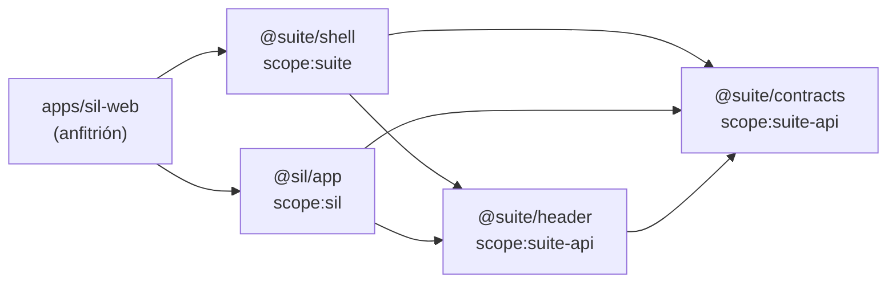

# sil-web — prototipo evolutivo del frontend SIL (Fase 1, solo EXPO)

> **Estado:** prototipo con las nueve pantallas del diseño | **Fase:** 3 — Construcción | **Decisión:** [D-024](../../../DECISIONS.md)

SPA React 19 que implementa la [especificación UX](../../../docs/02-diseno/especificacion-ux-sil-001.es.md) `UX-SIL-001` v0.5.0 con Material Design 3 ([D-021](../../../DECISIONS.md)). **Es la base del frontend definitivo, no un desechable**: los datos de ejemplo viven detrás de una interfaz tipada (`SilGateway`) y se sustituyen por el BFF sin tocar las pantallas.

## Cómo ejecutarlo

Desde `src/` (Node 24):

```bash
npm ci                                  # instala con el lockfile, sin scripts de instalación
npm run dev:sil-web                     # http://127.0.0.1:4200
npx nx run-many -t typecheck lint test build   # puertas de calidad
npx playwright install chromium         # una sola vez
npx nx run sil-web:e2e                  # flujos y axe en compact, medium y expanded; `themes.spec.ts` mide todas las pantallas en ambos temas
#   CAPTURAS_DIR=/ruta npx nx run sil-web:e2e   guarda además una captura por pantalla y tema
bash ../scripts/verify-local.sh node    # el gate que corre el pre-push
```

**El prototipo arranca en la suite** ([anexo A1 de la especificación](../../../docs/02-diseno/especificacion-ux-suite-acceso-sil-001.es.md), mock): `/` es el inicio de la suite (S-02) y, sin sesión, lleva al inicio de sesión (`/acceso`, S-01); desde la tarjeta «SIL» se entra a SIL, que conserva sus rutas (`/solicitudes…`). En S-01 el menú «Usuarios de prueba» (R-03 del rediseño; elige «Usar a {nombre}») rellena el usuario del inquilino elegido y la clave de prueba, que solo vive en el código del mock (`libs/suite-mock/src/test-users.ts`) y no se publica en ningún documento.

| Usuario de prueba | Qué demuestra |
| :--- | :--- |
| `ana.perez` (Ana Pérez) | Customer Service · Callao; paso directo a SIL; SIL, DT y CNS en el lanzador |
| `carlos.vega` (Carlos Vega) | Negocio · Piura (solo lectura en SIL) y CONSULTOR de MDM; la tarjeta de SIL es siempre un enlace: no hay selector de sede (US-SIL-004). Con DT en Callao y Piura y CMS, UMS y YMS en todas las sedes, S-02 le deja elegir la «Sede de trabajo» (D-030) |
| `luis.rojas` (Luis Rojas) | Asistente de Transporte · Callao |
| `rosa.diaz` (Rosa Díaz) | Rol de SIL sin sede en UMS: SIL no se monta y lo dice (US-SIL-004 escenario 4) |
| `rosa.medina` (Rosa Medina) | Analista de datos maestros de MDM · Callao (D-044) |
| `diego.salas` (Diego Salas) | Sin acceso a SIL: no ve su tarjeta y una dirección de SIL muestra «sin acceso»; su DT vale en todas las sedes (D-030) |
| `cuenta.bloqueada` | Cuenta bloqueada de origen; también se bloquea un usuario con 5 intentos fallidos |

Todos son del inquilino ORG (D-029). En ORG TRANSPORTES y UNILOG cada caso tiene su variante, con las mismas concesiones y otra persona ficticia (`test-users.ts`); S-01 lista solo los del inquilino elegido.

Para ver P-06 (con una sesión iniciada y `FULL_SCOPE` en `true`): `/solicitudes/OP-CAL-26-000360/orden` (3 versiones y los 5 estados). La modificación de la **US-SIL-005**, la cancelación de la **US-SIL-006** y la reactivación de la **US-SIL-007** son pantallas y acciones nuevas con su sección más abajo; las rutas `/modificar` con motivo, versión de orden y conflicto 409 de la P-07 anterior ya no se alcanzan en el Sprint 1. Para verlas: inicia sesión con `ana.perez` y abre `/solicitudes/SIL-00001/resumen` (en «Servicio creado»: «Modificar» y «Cancelar expediente») o `/solicitudes/SIL-00007/resumen` (cancelado: «Reactivar»).

**Tema y notificaciones** (anexo A1 v0.2.0, §9 y §10): el menú de cuenta (avatar) de la suite y de SIL trae el grupo «Tema» (Claro, Oscuro, Seguir al sistema, por defecto) y S-01 un botón «Tema»; la preferencia es por usuario y por dispositivo en `localStorage` (`suite.tema.{usuario}` y `suite.tema`) y la aplica antes de pintar `public/tema-inicial.js`, un archivo del mismo origen cargado de forma síncrona (sin script en línea, compatible con una CSP estricta, [G-192](../../../GAPS.md)); `theme-color` lo emite el generador de tokens. La campana con insignia de la cabecera abre una hoja lateral (desde `medium`) o la pantalla completa `/notificaciones` (`compact`); con `ana.perez` hay 3 sin leer, con `luis.rojas` 2, con `carlos.vega` 1 en Callao y 0 en Piura, y `diego.salas` no tiene. Simulaciones: `?sim=notif-vacio|notif-error|notif-error-marcar|notif-nueva|notif-reiniciar` (ver el [README del mock](../../libs/sil-mock/README.md)).

`?sim=lento|vacio|error|nuevas|antiguos` en la dirección fuerza los estados de carga, vacío y error. De la suite: `?sim=ums-caido` (el inicio de sesión responde que UMS no contesta), `?sim=mantenimiento` (la tarjeta de SIL pasa a «En mantenimiento»), `?sim=expira` (la sesión vence a los 20 s y aparece «Tu sesión terminó») y `?motivo=expirada` en `/acceso`. **El simulador de perfil se retiró**: el rol y la sede salen de la sesión de la suite; para probar otro actor se cierra la sesión y se entra con otro usuario de prueba. Las funcionalidades condicionadas viven en la sección «Herramientas del prototipo» del menú de cuenta de SIL (R-11), y solo con `FULL_SCOPE` en `true`: en el Sprint 1 no se muestran ([G-177](../../../GAPS.md)). La sesión es un mock en `sessionStorage` (no hay autenticación real: la identidad y los permisos vendrán de UMS, [G-124](../../../GAPS.md)).

**Pruebas:** las de Vitest y E2E siembran la sesión con un ayudante, sin pasar por S-01. Hay tres arneses, uno por lado de la frontera ([D-026](../../../DECISIONS.md)): `renderSil` (`libs/sil-app/src/testing/sil-harness.tsx`, SIL solo con un `SystemContext` de prueba; opciones `role`, `site`, `featureFlags`), `renderSuite` (`libs/suite-shell/src/testing/suite-harness.tsx`, la suite sola con un sistema de prueba; opciones `role`, `site` o `user`) y `renderApp` (`src/testing/composition-harness.tsx`, el anfitrión completo para lo que cruza la frontera, en `src/integration/`). En E2E, `seedSession` de `e2e/fixtures.ts` (`test.use({ session: { user: 'carlos.vega' } })`).

## Arquitectura (D-025, D-026)

`apps/sil-web` es solo el **anfitrión de composición**: `main.tsx`, `app/App.tsx` (proveedores globales de la suite), `app/AppRoutes.tsx`, `system-registry.ts` y `styles.css`. La suite y SIL viven en librerías separadas y se encuentran en un contrato mínimo de `@suite/contracts`:



- `AppRoutes` recorre `SYSTEM_REGISTRY` (hoy `[silModule]`) y monta cada raíz del sistema (`solicitudes/*`, `servicios-planificados/*`) bajo la guarda de sesión y la guarda genérica `SystemRoute`: sin perfil del sistema, «Sin acceso a SIL» bajo la cabecera de la suite. Lo que no es de la suite ni de un sistema es el 404 de la suite.
- SIL recibe un `SystemContext` (sesión, perfil vigente, cambio de perfil y ajustes de red) en una entrada diferida (`React.lazy(import())`) que el build deja en su **propio chunk** (`sil-entry-*.js`): es lo que se convertirá en el remote de Module Federation ([G-241](../../../GAPS.md)).
- La cabecera común (`@suite/header`) declara las interfaces que el anfitrión implementa: persona y cierre de sesión, notificaciones, tema y salida protegida.
- Las fronteras las impone ESLint: `@nx/enforce-module-boundaries` (SIL nunca importa `scope:suite`, la suite nunca importa `scope:sil`) y, dentro de cada lib, las capas `domain/` → `application/` → `infrastructure/` y `presentation/` con `no-restricted-imports`.

Dónde se crea cada archivo nuevo (pantalla, componente, hook, caso de uso, puerto, adaptador, prueba, token) está en la [guía de la estructura de `src/`](../../../docs/03-construccion/guia-estructura-src-sil-001.es.md); las vistas de arquitectura, en el [Blueprint §6.3](../../../docs/02-diseno/blueprint-sil-001.es.md#63-cliente-web-arquitectura-modular-vigente-y-composición-objetivo).

**Objetivo, no activado.** [ADR-0246](https://github.com/organizacion-peru/organizacion_arch/blob/main/reference/architecture/adrs/core/0246-composicion-de-la-suite-con-microfrontends.es.md) (`Aceptado`) fija como destino un anfitrión de la suite (`apps/suite-web`) y un remote por sistema con Module Federation, en el que esta app pasaría a ser el remote de SIL. No se activa hasta cumplir los diez criterios de su spike —el de rendimiento falló el 2026-10-17 ([G-245](../../../GAPS.md))— y tener un segundo cliente web (D11). El spike vive en la rama `spike/mfe-module-federation` ([informe](../../../docs/04-validacion/informe-spike-mfe-adr-0246.es.md)); en `develop` rige D-026.

## Identidad de marca (anexo A1 v0.3.0, §11)

Cambios M-01 a M-12 implementados (seguimiento en [G-197](../../../GAPS.md), desviaciones en [G-200](../../../GAPS.md) y [G-201](../../../GAPS.md)): color personalizado **fijo** `brand`, `on-brand` y `on-brand-variant` (`#0f3e67`, `#ffffff`, `#d1e4ff`, emitidos por el generador de tokens en ambos temas; **no** cambian la semilla de D-023 ni `primary`, y no se usan en botones, enlaces ni controles: lo vigila una prueba), panel de marca de S-01 con motivo gráfico propio en SVG, banda de `brand` en S-01 (`compact` y `medium`) y S-02, barra en `surface` con isotipo y «Suite» o «SIL», un icono por sistema, pie institucional, favicon con variante oscura, títulos de pestaña únicos, copy sin jerga y cifras tabulares. Ver en `http://127.0.0.1:4200/acceso` (S-01) y tras iniciar sesión (S-02 y SIL), en claro y oscuro desde «Tema».

**El logotipo es un activo PROVISIONAL (G-194).** Son los dos PNG que publica `https://www.organizacion.com.pe/wp-content/themes/organizacion/images/` y cuyo uso en el prototipo autorizó el propietario; se copiaron **sin editar** a `libs/ui-sil/src/brand/`:

| Archivo | Tamaño | Qué es | sha256 |
| :--- | :--- | :--- | :--- |
| `logo_organizacion.png` | 103 × 120 px, RGBA | Logotipo apilado en color (isotipo azul y «ORG» en negro) | `fe5a25908d471dd249f72428f5b5556e69bc74e909c7b8773facb3c3b4bbaef5` |
| `logo_organizacion_footer.png` | 124 × 96 px, RGBA | Isotipo en blanco sobre transparente | `65b60884db5ec0be27777031860f84685f60ee225aa8b9f9e7d772c38113768b` |

Son de baja resolución y no vectoriales: **no se amplían** (los tamaños de `Logo` no superan 1×: isotipo 96 dp, apilado 120 dp) y el panel grande de S-01 usa un motivo propio, no el logo ampliado. Las versiones negativa y monocroma se **derivan con CSS** del mismo PNG (`brightness(0) invert(1)` y `brightness(0)`), y el isotipo en color es el PNG blanco usado como máscara teñida con `brand`; todo es provisional. Las marcas BASC y BPA de la web son de terceros y no se usan. La web usa Open Sans y el prototipo Montserrat (D-023): no se cambia (G-195).

**Dónde se sustituye por el logotipo oficial:** en **un solo archivo**, `libs/ui-sil/src/brand/assets.tsx`. Reemplaza el `drawing` de `isotype` y `stacked` por los trazos del SVG maestro y ajusta su `aspectRatio`; `Logo` (`libs/ui-sil/src/brand/Logo.tsx`: forma, fondo, tamaño con nombre e `informative`), `SuiteLogo` (`libs/suite-header`, elige la versión según el tema) y las pantallas no cambian. Los favicon son `public/marca/favicon.svg` y `favicon-oscuro.svg`.

**Entregables que faltan** (G-194): `organizacion-logo-color.svg`, `organizacion-logo-horizontal-color.svg`, `organizacion-logo-negativo.svg`, `organizacion-logo-mono.svg`, `organizacion-isotipo-color.svg`, `organizacion-isotipo-negativo.svg`, `favicon.ico` (16, 32, 48), `apple-touch-icon.png` (180), `icon-192.png` e `icon-512.png`, el manual de uso y la autorización por escrito.

Pruebas: `libs/ui-tokens/src/contrast.test.ts` (pares de `brand` y brand fijo en ambos esquemas), `libs/ui-sil/src/brand/Logo.test.tsx`, `libs/suite-shell/src/presentation/brand/brand.test.tsx`, `src/integration/brand.test.tsx` (incluye la búsqueda de `brand` fuera de superficies de identidad en `apps/` y `libs/`) y `e2e/brand.spec.ts` (axe, color real de `brand` en claro y oscuro, logo sin ampliar, favicon, títulos y desborde; con `CAPTURAS_DIR` guarda capturas).

## Rediseño de la experiencia y del sistema visual (anexo A1 v0.4.0 §12 y UI-SIL-001)

Implementado en el árbol de trabajo (sin commit; seguimiento en [G-202](../../../GAPS.md), [G-205](../../../GAPS.md) y [G-231](../../../GAPS.md)) a partir de la [especificación UX, anexo A1 §12](../../../docs/02-diseno/especificacion-ux-suite-acceso-sil-001.es.md) (R-01 a R-30) y de la [especificación UI](../../../docs/02-diseno/especificacion-ui-sistema-diseno-sil-001.es.md) (UI-01 a UI-17). Principio rector: **lo nominal calla y la excepción habla**. Se ve con `npm run dev:sil-web` y los usuarios `ana.perez` (Customer Service) y `carlos.vega` (Negocio). Al integrarse con el Sprint 1, las decisiones del propietario prevalecen donde chocan: D-035 (estado de la bandeja con color y sin icono, con los tonos de `Tag`), D-036 (riel expandido de 224 dp desde `expanded`, que sustituye al riel contraído de R-30; sigue permanente, sin botón para ocultarlo, [G-376](../../../GAPS.md)) y la bandeja de la US-SIL-002 (sin vistas rápidas ni vista inicial por rol, R-16):

| Qué | Dónde se ve |
| :--- | :--- |
| Panel de marca sereno, ruta de cinco hitos, un solo botón relleno, «¿Necesitas ayuda para ingresar?» y «Usuarios de prueba» en un menú (R-01 a R-04) | `/acceso` |
| Saludo sin banda de marca, «Tus sistemas» y «Aún no disponibles en este prototipo» (lista sin bordes), estado vacío del lanzador (R-05 a R-09) | `/` |
| Cabecera de la suite con nombre, rol y sede (US-SIL-004, ADR-0245 D4.1), «Herramientas del prototipo» en el menú de cuenta (solo con el alcance completo), tono de la barra al desplazar en `compact` y FAB que se contrae a icono (R-10 a R-12, R-18, UI-04, UI-12) | toda SIL |
| Etiqueta única por tono (`Tag`), tabla de 56 dp con tokens de componente y densidad compacta opcional en el menú «Columnas» (R-20, UI-01, UI-03) | `/solicitudes` |
| Un solo bloque de estado, etapas con iconos, contenedores sin repetición, «Registrar número» en contexto (R-21 a R-25) | `/solicitudes/OP-CAL-26-000409/resumen` y `…/orden` |
| Notificaciones de tres líneas con el identificador sin truncar (R-26) | campana y `/notificaciones` |
| Énfasis tipográfico 500, `success` con croma 36, movimiento y estados con tokens, campo con muesca coherente, estado vacío, insignia y snackbar (UI-02, UI-05, UI-09 a UI-11, UI-14, UI-15) | toda la interfaz |

**No hecho:** UI-08 (Material Symbols: el usuario lo dejó pendiente, [G-234](../../../GAPS.md); se sigue con `Icon.tsx`, al que solo se añadieron tres glifos de estado) y UI-17 (origen único de tokens, [G-230](../../../GAPS.md)). Las excepciones y desviaciones están en [GAPS.md](../../../GAPS.md).

**Verificación del sistema visual (UI-16):** `libs/ui-tokens/src/contrast.test.ts` mide los pares de la §3.3 de la especificación UI y las capas de estado en claro y oscuro; `libs/ui-tokens/src/hygiene.test.ts` falla ante un literal de color, un valor arbitrario entre corchetes, un peso fuera de 400 y 500, `tertiary` en un componente, relleno más borde en una pieza, espaciado fuera de la rejilla o una duración escrita como literal; `e2e/redesign.spec.ts` mide en el navegador lo que los criterios dicen en cifras (alto de fila, desborde, posición de la primera fila, tamaño de objetivo, foco no tapado, tono de la barra, salida animada, hover que no se pega, movimiento reducido) y `e2e/themes.spec.ts` pasa axe por todas las pantallas, en claro y oscuro, a 412, 768 y 1440 px; con `CAPTURAS_DIR=/ruta` guarda una captura por pantalla, tema y tamaño (sin línea base comparada: [G-596](../../../GAPS.md)).

## Alcance (primer corte y segunda ronda: las nueve pantallas del diseño)

| Pantalla | Ruta | Estado |
| :--- | :--- | :--- |
| P-01 Bandeja | `/solicitudes` | Construida con la US-SIL-002 del Sprint 1: tabla de diez columnas con el expediente fijo (`medium`+), lista con «Cargar más» (`compact`); filtros en dos filas (D-037), booking por prefijo con sugerencias (D-038), estado con color sin icono (D-035), «Exportar» (D-041), menú «Columnas» con «Densidad compacta» (R-20), orden por columna y aviso «Hay expedientes nuevos · Mostrar»; todo en la dirección. La lista-detalle con vista previa del rediseño (R-17, `InboxPreview.tsx`) no se integra en la bandeja del Sprint 1 |
| P-02 Registro | `/solicitudes/nueva` | Construida: lista de secciones (`expanded`+), secciones 3 a 8 plegables en `compact`, maestros con menú desplegable y filtrado, selectores de fecha y hora, adjuntos, errores, duplicidad, idempotencia y «Guardar borrador» (condicionado) |
| P-03 Ficha | `/solicitudes/:id/resumen` | Construida: cabecera, progreso, estado, semáforo, avisos, pestañas, «Registrar número», «Ver» y «Reemplazar» adjunto, menú «Más» con «Copiar ID» y «Cancelar servicio» (condicionada; esta última, legado: [G-292](../../../GAPS.md)) |
| P-04 Validación y crédito | `/solicitudes/:id/validacion` | Construida (ver [G-154](../../../GAPS.md) para lo que falta) |
| P-05 Conformidad | `/solicitudes/:id/conformidad` | Construida |
| P-06 Orden y envío | `/solicitudes/:id/orden` | Construida |
| P-07 Modificación (anterior) | sin ruta | **Sustituida por la US-SIL-005** (ver «Modificar el expediente (US-SIL-005, Sprint 1)» más abajo). La pantalla con motivo obligatorio, «Efecto del cambio» y conflicto 409 sigue en `libs/sil-app/src/presentation/features/amendment/`, sin ruta ni uso: código legado huérfano ([G-282](../../../GAPS.md)); su especificación UX sigue sin actualizar ([G-279](../../../GAPS.md)) |
| P-08 Bitácora | `/solicitudes/:id/bitacora` | Construida (solo lectura; Customer Service y Jefatura, según la matriz): filtros por contenedor y tipo, `?desde=`, carga incremental |
| P-09 Servicios planificados | `/servicios-planificados` | Construida, **condicionada**: solo Asistente y Coordinador de Transporte con la funcionalidad activa |
| «Guardar borrador» y «Cancelar servicio» | P-02 y P-03 | Construidos, **condicionados** por su interruptor (`BORRADOR` y aviso de cancelación); «Cancelar servicio» es legado ([G-292](../../../GAPS.md)) |
| «Cancelar expediente» (US-SIL-006) | Detalle del expediente | **Sustituye** al «Cancelar servicio» condicionado en el Sprint 1: ver «Cancelar el expediente (US-SIL-006, Sprint 1)» más abajo |
| «Reactivar» (US-SIL-007) | Detalle del expediente y `/solicitudes/:id/reactivar` | **Real** en el Sprint 1, solo para un expediente «Cancelado»: ver «Reactivar el expediente (US-SIL-007, Sprint 1)» más abajo |

Para ver P-08, P-09 y lo condicionado: inicia sesión con `luis.rojas` (P-09) o `ana.perez`, activa las funcionalidades en «Funcionalidades de prueba» y abre `/solicitudes/OP-CAL-26-000360/bitacora` (3 versiones), `/solicitudes/OP-CAL-26-000405/resumen` («Registrar número»), `/solicitudes/BOR-CAL-26-0001/resumen` (borrador), `/servicios-planificados`. Estados: `?sim=nuevas` (aviso de solicitudes nuevas) y `?sim=antiguos` (maestros desactualizados).

## Modificar el expediente (US-SIL-005, Sprint 1)

La [US-SIL-005](../../../docs/01-concepcion/historia-usuario-sil-005.es.md) **ya se prototipa**. Es una pantalla nueva (`libs/sil-app/src/presentation/features/edit-request/`, `EditRequestPage`) que reutiliza el formulario en cinco grupos del registro (`features/request-form/`, `ServiceRequestFields` con `mode="edit"`); no es la P-07 anterior (`features/amendment/`).

| Tema | Lo que hace el prototipo |
| :--- | :--- |
| Ruta | `/solicitudes/:id/modificar` en `SilRoutes.tsx`, **registrada aunque `FULL_SCOPE` sea `false`** (`sil-scope.ts`) |
| Quién ve «Modificar» | Solo Customer Service (acción `solicitud.modificar`) y con el expediente en «Servicio creado» (`offersEdit`, en `domain/offers-edit.ts`). Es el enlace `EditLink` del encabezado o, con `PROPOSED_DETAIL`, el botón de la zona «Acciones» (`DetailActions`). Negocio no lo ve y por la dirección ve «Sin permiso»; un expediente en otro estado muestra `NotEditable` («Este expediente no se puede modificar», escenario 12). Es comodidad: el servidor vuelve a autorizar y a comprobar el estado (P-SEC-01) |
| Gateway | `getForEdit` (valores vigentes; `null` sin acceso, sin permiso o inexistente; `not-editable` fuera de «Servicio creado») y `modifyServiceRequest` (autoriza, comprueba el estado, revalida con `validateForm`, conserva ID de operación, estado y booking, y recalcula contenedores y lo que falta para planificar), en `sil-contracts/src/request-edit.ts`. Resultados: `modified`, `invalid`, `status-not-allowed`, `not-found` y `forbidden`. Sustituyen a `getForAmendment` y `amendServiceRequest` de la P-07 anterior, que quedan sin uso |
| Formulario | Precargado, con ID de expediente, ID de booking y tipo de operación en solo lectura; el aviso «Expediente SIL-NNNNN modificado» (`modifiedMessage`) y el foco al título del detalle tras guardar. Guardar sin cambios es válido ([G-285](../../../GAPS.md)) |
| Sin motivo ni versión | La HU no exige motivo; no hay versión de orden, bitácora de cambios ni salidas en el Sprint 1 |
| Outbox | `MockStore.outbox` es de solo lectura y **está vacío** a propósito (escenario 13: EV-06, EV-09 y el correo están diferidos); `saveEdit` escribe estado y outbox juntos |
| Escenarios sembrados | Opcionales: `new MockStore(clock, { editScenarios: true })` añade SIL-00031 (3 contenedores, escenario 10) y SIL-00032 (cut-off informado sin fecha de llenado, escenario 11). Por defecto el catálogo sigue en 30 ([G-286](../../../GAPS.md)) |
| Adjuntos | Se muestran en solo lectura con `CurrentDocumentsReadOnly`; la HU no define si se reemplazan al modificar ([G-276](../../../GAPS.md)) |

Todo esto es un supuesto de prototipo sin ADR aceptado ([G-274](../../../GAPS.md)); la validación única cliente-servidor también está pendiente ([G-275](../../../GAPS.md)). Pruebas: `features/edit-request/EditRequestPage.test.tsx`, `features/record/RecordEditWithoutProposal.test.tsx`, `e2e/edit-request.spec.ts` y las de `libs/sil-mock/src/request-edit.test.ts`. Lo que **no** está probado figura en [G-283](../../../GAPS.md) y [G-284](../../../GAPS.md).

## Cancelar el expediente (US-SIL-006, Sprint 1)

La [US-SIL-006](../../../docs/01-concepcion/historia-usuario-sil-006.es.md) **ya se prototipa**. No es el «Cancelar servicio» con motivo de la especificación anterior.

| Tema | Lo que hace el prototipo |
| :--- | :--- |
| Dónde está el botón | «Cancelar expediente» (icono `cancel`, `CancelRequestAction`) **solo en el detalle** del expediente, nunca en la bandeja (escenario 7): en la zona «Acciones» con `PROPOSED_DETAIL` o, sin la propuesta, en el encabezado junto a «Modificar» ([G-291](../../../GAPS.md)). No existe estilo destructivo (rojo) en el sistema de diseño ([G-290](../../../GAPS.md)) |
| Quién lo ve | Solo Customer Service y con el expediente en «Servicio creado» (`offersCancel`); Negocio y los expedientes «Cancelados» u otros estados no lo ven, y no se pinta deshabilitado (escenarios 8 y 9). Es comodidad: el servidor vuelve a autorizar y a comprobar el estado (P-SEC-01) |
| Confirmación | Diálogo `CancelRequestDialog` **sin campo de motivo** (escenario 5); el foco entra en «Volver», que con Escape cierra sin cambios (escenario 6) |
| Resultado | Aviso «Expediente SIL-NNNNN cancelado» (`cancelledMessage`, escenario 2); el expediente queda «Cancelado» con sus datos y la bandeja se vuelve a leer: lo muestra en ese estado, que se encuentra con el filtro por estado o la búsqueda (escenario 3, [G-294](../../../GAPS.md)); el foco pasa al título del detalle |
| Solo lectura | Servidor y UI: el cancelado no ofrece «Modificar» y `/modificar` muestra «Este expediente no se puede modificar» (escenario 4) |
| Rechazo | Si al confirmar el expediente ya no está en «Servicio creado», el diálogo lo dice y el detalle se refresca ([G-289](../../../GAPS.md)); cancelar desde otros estados no está definido ([G-295](../../../GAPS.md)) |
| Gateway y permiso | `cancelRequest` (resultados `cancelled`, `status-not-allowed`, `not-found` y `forbidden`, en `sil-contracts/src/cancellation.ts`) y la acción `expediente.cancelar`, **sin interruptor** de funcionalidad ([G-287](../../../GAPS.md)); qué guarda la cancelación sin motivo: [G-288](../../../GAPS.md) |
| Outbox | Sigue vacío y observable: cancelar no emite eventos ni correos (escenario 10, [G-293](../../../GAPS.md)) |
| Reactivar | Con el expediente «Cancelado» el detalle ofrece «Reactivar» (US-SIL-007): ver la sección siguiente |
| Flujo legado | `cancelService` con motivo, `CancelServiceDialog`, el interruptor `cancelService` y el menú «Más acciones» **quedan fuera del flujo** ([G-292](../../../GAPS.md)); la fila «Cancelar servicio» de la tabla de alcance es de esa especificación anterior |

Los supuestos del mock (SU-MOCK-45 a SU-MOCK-49) están en el [README de sil-mock](../../libs/sil-mock/README.md). Pruebas: `features/record/CancelRequest.test.tsx`, `e2e/cancel-request.spec.ts`, `e2e/accessibility.spec.ts` y `libs/sil-mock/src/cancel-request.test.ts`.

## Reactivar el expediente (US-SIL-007, Sprint 1)

La [US-SIL-007](../../../docs/01-concepcion/historia-usuario-sil-007.es.md) **ya se prototipa**. Reutiliza el formulario del registro (`features/request-form/`, `ServiceRequestFields` con `mode="reactivation"`) en una pantalla propia, `features/reactivate-request/` (`ReactivateRequestPage`). No hay diseño anterior de reactivación en la especificación UX ([G-349](../../../GAPS.md)).

| Tema | Lo que hace el prototipo |
| :--- | :--- |
| Alcance | Retomar un expediente «Cancelado» con su mismo ID de operación, sin motivo ni plazo límite |
| Ruta | `/solicitudes/:id/reactivar` en `SilRoutes.tsx`, **registrada aunque `FULL_SCOPE` sea `false`**, como `/modificar` |
| Quién ve «Reactivar» | Solo Customer Service y solo en el detalle de un expediente «Cancelado» (`offersReactivate`, `ReactivateRequestAction`); Negocio y los demás estados no lo ven. Es comodidad: el servidor vuelve a autorizar y a comprobar el estado (P-SEC-01). Un expediente que no está «Cancelado» muestra `NotReactivable` («Este expediente no se puede reactivar») |
| Confirmación | Diálogo `ReactivateRequestDialog` **sin campo de motivo** antes de abrir el formulario; el foco entra en «Volver» |
| Formulario | Precargado con los datos anteriores. Un check «Aprobado» (`CheckApproved`) **solo junto a los seis campos obligatorios para crear** (`APPROVABLE_FIELDS`: ID de booking, booking adjunto, sede, cliente, línea naviera y la pregunta de servicio de transporte); el ID de booking se muestra en solo lectura y solo se aprueba. Si falta aprobar alguno, el botón sigue accionable y SIL muestra la alerta con lo que falta y enlaza a cada check ([G-297](../../../GAPS.md)); el estado de «aprobado» al cambiar un campo no está definido ([G-302](../../../GAPS.md)) |
| Documentos | Zonas de adjuntos del registro (`AttachmentZone`): el booking nuevo es obligatorio; la carta de temperatura y la instrucción de embarque son opcionales. Los adjuntos anteriores pasan a **no vigentes** sin borrarse (`ServiceRequest.nonCurrentDocuments`; [G-299](../../../GAPS.md), [G-305](../../../GAPS.md)) |
| Validaciones | Las del registro (`validateReactivation` sobre `validateForm`) y la duplicidad contra otro expediente activo (alerta que enlaza al existente, [G-301](../../../GAPS.md)); el texto del rechazo si el expediente ya no está «Cancelado» es del prototipo ([G-300](../../../GAPS.md)) |
| Resultado | El expediente vuelve a «Servicio creado» con el mismo ID, se recalcula «Para planificar» y aparece el aviso «Expediente SIL-NNNNN reactivado» (`reactivatedMessage`) |
| Gateway y permiso | `getForReactivation` (valores precargados y documentos anteriores) y `reactivateRequest` (resultados `reactivated`, `invalid`, `duplicate`, `status-not-allowed`, `not-found` y `forbidden`), en `sil-contracts/src/reactivation.ts`; acción `expediente.reactivar`, **sin interruptor** de funcionalidad y separada de lo legado ([G-296](../../../GAPS.md)) |
| Outbox | Sin cambios: reactivar no emite eventos ni correos; la prueba solo comprueba que el outbox global no cambia ([G-304](../../../GAPS.md), [G-293](../../../GAPS.md)) |

Divergencia con la HU, el escenario 3 y el riesgo de reglas distintas entre modificar y reactivar: [G-297](../../../GAPS.md), [G-298](../../../GAPS.md) y [G-303](../../../GAPS.md). Los supuestos del mock (SU-MOCK-50 a SU-MOCK-54) están en el [README de sil-mock](../../libs/sil-mock/README.md). Pruebas: `features/reactivate-request/ReactivateRequestPage.test.tsx`, `e2e/reactivate-request.spec.ts`, `e2e/accessibility.spec.ts` y `libs/sil-mock/src/reactivate-request.test.ts`.

## Estructura

| Carpeta | Contenido |
| :--- | :--- |
| `apps/sil-web/src` | Anfitrión: proveedores globales, rutas, registro de sistemas, estilos, arnés de composición y pruebas de integración |
| `libs/suite-shell` (`@suite/shell`) | La suite (mock): S-01, S-02, S-03 desde el lanzador, notificaciones a pantalla completa, tema, marca, guardas, 404; ver su [README](../../libs/suite-shell/README.md) |
| `libs/suite-header` (`@suite/header`) | Cabecera común de la suite y de SIL (ADR-0245): marca, campana, cuenta, ayuda, S-03; ver su [README](../../libs/suite-header/README.md) |
| `libs/sil-app` (`@sil/app`) | SIL montable: shell adaptativo, las nueve pantallas, las de modificar (`edit-request`) y reactivar (`reactivate-request`), el formulario compartido (`request-form`), sesión y datos de SIL; ver su [README](../../libs/sil-app/README.md) |
| `libs/sil-contracts` (`@sil/contracts`) | Dominio y contratos TS: estados, semáforo, entrega, perfiles, consulta de la bandeja, validación del registro, modificación (`request-edit`), cancelación (`cancellation`) y reactivación (`reactivation`), `SilGateway` |
| `libs/suite-contracts` (`@suite/contracts`) | Contratos de la suite (mock): `SuiteSession`, `SuiteProfile`, catálogo del lanzador, `SuiteGateway`, `safeReturnPath`, ajustes de red y la frontera `SystemModule`/`SystemContext`; separada de SIL para que el portal real la sustituya |
| `libs/sil-mock` (`@sil/mock`) | Datos de ejemplo y el gateway en memoria de SIL; ver su [README](../../libs/sil-mock/README.md) |
| `libs/suite-mock` (`@suite/mock`) | Usuarios de prueba, catálogo, sesión y notificaciones en memoria de la suite; ver su [README](../../libs/suite-mock/README.md) |
| `libs/ui-tokens` (`@sil/ui-tokens`) | Tokens M3 (color generado desde la semilla `#0f3e67`, tipografía, forma, elevación, movimiento) como tema de Tailwind v4 |
| `libs/ui-sil` (`@sil/ui`) | Componentes reutilizables sin dominio: interruptor, progreso lineal, hoja lateral y pantalla completa (en el diálogo), aviso en línea, error de lectura, botones, campos, pestañas, filtros, diálogos, snackbar; `@sil/ui/testing` con los ayudantes de ancho de ventana |

## Decisiones de diseño técnico

- **Dominio como uniones discriminadas** (`ContainerDelivery`, `RegistrationState`, `RegistrationOutcome`): no hay estado intermedio sin representar.
- **Estado de servidor** en React Query; **estado de cliente** local donde se usa. El formulario de registro usa Actions de React 19 (`<form action>` + `useActionState`).
- **Frontera validada**: parámetros de ruta y de URL, `sessionStorage` y `FormData` se estrechan antes de tiparse. La URL guarda vista, búsqueda, filtros y página.
- **Falla cerrado**: error de lectura o de escritura = mensaje genérico con código de correlación; nunca el detalle técnico.
- **Tokens, sin valores crudos**: Tailwind v4 CSS-first con la paleta, las formas y las sombras por defecto retiradas; no se usan valores arbitrarios entre corchetes.
- **Color `success` y `warning`**: `warning` con el valor **provisional** de ADR-0228 §2.6 (`Borrador`, [G-123](../../../GAPS.md)); `success` con **croma 36**, una **desviación local provisional** de ese ADR aprobada para el rediseño (UI-02, [G-231](../../../GAPS.md)): el generador la calcula con `TonalPalette.fromHueAndChroma(142, 36)` y está marcada como provisional en `colors.generated.css` y en `build-tokens.mjs`.

## Desviaciones y pendientes

Todas están en [GAPS.md](../../../GAPS.md). Esta ronda cierra el primer corte por fidelidad al diseño ([G-148](../../../GAPS.md), [G-155](../../../GAPS.md), [G-171](../../../GAPS.md), [G-172](../../../GAPS.md); pendientes de cerrar con el commit). Lo que quedó fuera por falta de una decisión: [G-180](../../../GAPS.md) a [G-183](../../../GAPS.md) y [G-154](../../../GAPS.md) (frescura de SAP y CMS en P-04).

Supuestos de adaptación por tamaño: no hay wireframe `compact` ni `medium` de P-04, P-05, P-08 ni P-09; se aplican las reglas M3 de la especificación (una columna; hoja lateral modal desde `medium` y diálogo de pantalla completa en `compact`; «Exceptuar…» en el menú «Más» en `compact`; chips de P-08 que se ajustan en varias líneas en vez de desplazarse, para no recortar sus menús). En `compact` la cabecera de panel se funde con el top app bar; P-02 y los formularios de modificar y reactivar (US-SIL-005 y US-SIL-007) son un diálogo de pantalla completa que cubre la barra. La herramienta de funcionalidades de prueba solo aparece en `compact` en la bandeja.
